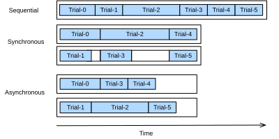

```{.python .input}
%load_ext d2lbook.tab
tab.interact_select(["pytorch"])
#required_libs("syne-tune[gpsearchers]==0.3.2")
```

# 异步随机搜索
:label:`sec_rs_async`

正如我们在前面的 :numref:`sec_api_hpo` 中所见，由于超参数
配置的评估代价高昂，我们可能不得不等待
数小时甚至数天，随机搜索才会返回一个良好的超参数
配置。在实践中，我们常常可以使用一组资源池，例如
同一台机器上的多个 GPU，或多台各配有一块 GPU 的机器。这
引出了一个问题：*我们如何高效地分布随机搜索？*

一般而言，我们区分同步和异步并行
超参数优化（见 :numref:`distributed_scheduling`）。在
同步设定中，我们要等待所有并发运行的试验结束，
然后才开始下一批。考虑包含如下超参数的
配置空间：深度神经网络的滤波器数量或层数。
包含更多层或滤波器的超参数配置
自然需要更多时间才能完成，而同一批中的其他所有试验
都必须在同步点（:numref:`distributed_scheduling` 中的灰色区域）等待，
我们才能继续优化过程。

在异步设定中，一旦资源变得可用，我们就立即调度一个新试验。
这将最优地利用我们的资源，因为我们可以避免任何
同步开销。对于随机搜索，每个新的超参数配置
都是独立于所有其他配置选择的，特别是不利用
任何先前评估的观测。这意味着我们可以轻而易举地
异步并行化随机搜索。对于基于先前观测做出决策的更精巧方法
（见 :numref:`sec_sh_async`），这就不那么直接了。
虽然与顺序设定相比我们需要访问更多资源，异步
随机搜索呈现出线性加速：如果 $K$ 个试验可以并行运行，
那么达到某一性能的速度会快 $K$ 倍。



:label:`distributed_scheduling`

在本笔记本中，我们将考察异步随机搜索，其中试验在
同一台机器上的多个 Python 进程中执行。分布式任务调度
与执行很难从头实现。我们将使用 *Syne Tune*
:cite:`salinas-automl22`，它为我们提供了一个异步
HPO 的简单接口。Syne Tune 被设计为可与不同的执行后端一起运行，
有兴趣的读者可以去研究它简单的 API，以了解更多关于
分布式 HPO 的内容。

```{.python .input}
from d2l import torch as d2l
import logging
logging.basicConfig(level=logging.INFO)
from syne_tune.config_space import loguniform, randint
from syne_tune.backend.python_backend import PythonBackend
from syne_tune.optimizer.baselines import RandomSearch
from syne_tune import Tuner, StoppingCriterion
from syne_tune.experiments import load_experiment
```

## 目标函数

首先，我们必须定义一个新的目标函数，使它现在通过 `report` 回调
把性能返回给 Syne Tune。

```{.python .input  n=34}
def hpo_objective_lenet_synetune(learning_rate, batch_size, max_epochs):
    from d2l import torch as d2l    
    from syne_tune import Reporter

    model = d2l.LeNet(lr=learning_rate, num_classes=10)
    trainer = d2l.HPOTrainer(max_epochs=1, num_gpus=1)
    data = d2l.FashionMNIST(batch_size=batch_size)
    model.apply_init([next(iter(data.get_dataloader(True)))[0]], d2l.init_cnn)
    report = Reporter() 
    for epoch in range(1, max_epochs + 1):
        if epoch == 1:
            # Initialize the state of Trainer
            trainer.fit(model=model, data=data) 
        else:
            trainer.fit_epoch()
        validation_error = d2l.numpy(trainer.validation_error().cpu())
        report(epoch=epoch, validation_error=float(validation_error))
```

请注意，Syne Tune 的 `PythonBackend` 要求在函数定义内部导入
依赖包。

## 异步调度器

首先，我们定义并发评估试验的工作进程数。我们
还需要通过设定总实际时间的上限，来指定我们希望
运行随机搜索多长时间。

```{.python .input  n=37}
n_workers = 2  # Needs to be <= the number of available GPUs

max_wallclock_time = 12 * 60  # 12 minutes
```

接下来，我们说明要优化哪个指标，以及要最小化还是
最大化该指标。具体而言，`metric` 需要对应于传给 `report` 回调的
参数名。

```{.python .input  n=38}
mode = "min"
metric = "validation_error"
```

我们使用前面例子中的配置空间。在 Syne Tune 中，这个
字典也可以用来向训练脚本传递常量属性。
我们利用这一特性来传递 `max_epochs`。此外，我们在
`initial_config` 中指定第一个要评估的配置。

```{.python .input  n=39}
config_space = {
    "learning_rate": loguniform(1e-2, 1),
    "batch_size": randint(32, 256),
    "max_epochs": 10,
}
initial_config = {
    "learning_rate": 0.1,
    "batch_size": 128,
}
```

接下来，我们需要指定作业执行的执行后端。这里我们只考虑
在本地机器上分布执行，即并行作业作为
子进程运行。然而，对于大规模 HPO，我们也可以将其放在集群
或云环境中运行，在那里每个试验占用一个完整的实例。

```{.python .input  n=40}
trial_backend = PythonBackend(
    tune_function=hpo_objective_lenet_synetune,
    config_space=config_space,
)
```

现在我们可以创建用于异步随机搜索的调度器，其行为
与 :numref:`sec_api_hpo` 中的 `BasicScheduler` 类似。

```{.python .input  n=41}
scheduler = RandomSearch(
    config_space,
    metric=metric,
    mode=mode,
    points_to_evaluate=[initial_config],
)
```

Syne Tune 还提供一个 `Tuner`，它把主实验循环和
记录工作集中起来，并协调调度器与执行后端之间的
交互。

```{.python .input  n=42}
stop_criterion = StoppingCriterion(max_wallclock_time=max_wallclock_time)

tuner = Tuner(
    trial_backend=trial_backend,
    scheduler=scheduler, 
    stop_criterion=stop_criterion,
    n_workers=n_workers,
    print_update_interval=int(max_wallclock_time * 0.6),
)
```

让我们运行分布式 HPO 实验。根据我们的停止准则，
它将运行约 12 分钟。

```{.python .input  n=43}
tuner.run()
```

所有已评估超参数配置的日志都会被保存下来以供进一步
分析。在调优任务期间的任何时刻，我们都可以轻松获取目前
已获得的结果，并绘制当前最优配置的轨迹。

```{.python .input  n=46}
d2l.set_figsize()
tuning_experiment = load_experiment(tuner.name)
tuning_experiment.plot()
```

## 可视化异步优化过程

下面我们可视化每个试验的学习曲线（图中每种颜色代表一个试验）在
异步优化过程中如何演变。在任何时刻，并发运行的试验数量
都等于我们拥有的工作进程数。一旦某个试验完成，我们就立即
启动下一个试验，而不等待其他试验完成。采用异步调度，
工作进程的空闲时间被降到最低。

```{.python .input  n=45}
d2l.set_figsize([6, 2.5])
results = tuning_experiment.results

for trial_id in results.trial_id.unique():
    df = results[results["trial_id"] == trial_id]
    d2l.plt.plot(
        df["st_tuner_time"],
        df["validation_error"],
        marker="o"
    )
    
d2l.plt.xlabel("wall-clock time")
d2l.plt.ylabel("objective function")
```

## 小结

通过把试验分布到并行资源上，我们可以大幅减少随机搜索的等待
时间。一般而言，我们区分同步调度和异步调度。
同步调度意味着一旦前一批完成，我们就采样新一批超参数配置。
如果我们有掉队进程（straggler）——比其他试验花费更多时间才能完成的试验——
那么我们的工作进程需要在同步点等待。异步
调度则在资源变得可用时立即评估新的超参数配置，
因此确保所有工作进程在任何时刻都保持忙碌。
虽然随机搜索很容易异步分布，而且不需要对实际算法做任何改动，
但其他方法则需要一些额外的修改。

## 练习

1. 考虑 :numref:`sec_dropout` 中实现、并在 :numref:`sec_api_hpo` 练习 1 中使用的 `DropoutMLP` 模型。
    1. 实现一个目标函数 `hpo_objective_dropoutmlp_synetune`，供 Syne Tune 使用。确保你的函数在每一轮之后都报告验证误差。
    2. 使用 :numref:`sec_api_hpo` 中练习 1 的设置，比较随机搜索与贝叶斯优化。如果你使用 SageMaker，可以随意使用 Syne Tune 的基准测试工具来并行运行实验。提示：贝叶斯优化以 `syne_tune.optimizer.baselines.BayesianOptimization` 提供。
    3. 本练习需要在至少 4 个 CPU 核心的实例上运行。对于上面使用的其中一种方法（随机搜索、贝叶斯优化），用 `n_workers=1`、`n_workers=2`、`n_workers=4` 运行实验，并比较结果（当前最优配置轨迹）。至少对于随机搜索，你应当观察到相对于工作进程数的线性扩展。提示：为了得到稳健的结果，你可能需要对每次运行做多次重复并取平均。
2. *高级*。本练习的目标是在 Syne Tune 中实现一个新的调度器。
    1. 创建一个同时包含 [d2lbook](https://github.com/d2l-ai/d2l-en/blob/master/INFO.md#installation-for-developers) 和 [syne-tune](https://syne-tune.readthedocs.io/en/latest/getting_started.html) 源码的虚拟环境。
    2. 把 :numref:`sec_api_hpo` 练习 2 中的 `LocalSearcher` 实现为 Syne Tune 中的一个新搜索器。提示：阅读[这篇教程](https://syne-tune.readthedocs.io/en/latest/tutorials/developer/README.html)。或者，你可以遵循这个[示例](https://syne-tune.readthedocs.io/en/latest/examples.html#launch-hpo-experiment-with-home-made-scheduler)。
    3. 在 `DropoutMLP` 基准上比较你的新 `LocalSearcher` 与 `RandomSearch`。


:begin_tab:`pytorch`
[讨论](https://discuss.d2l.ai/t/12093)
:end_tab:
