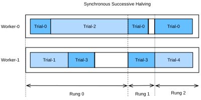
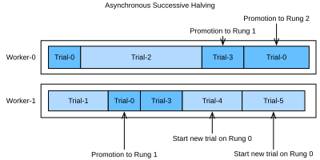

```{.python .input}
%load_ext d2lbook.tab
tab.interact_select(["pytorch"])
#required_libs("syne-tune[gpsearchers]==0.3.2")
```

# 异步逐次减半

:label:`sec_sh_async`

正如我们在 :numref:`sec_rs_async` 中所见，我们可以通过把
超参数配置的评估分布到多个实例或单个实例上的多个 CPU/GPU 上，来加速 HPO。
然而，与随机搜索相比，在分布式设定中异步地运行
逐次减半（SH）并不那么简单。在我们能够
决定接下来运行哪个配置之前，必须先收集当前
梯级水平上的所有观测。这要求在每一个梯级水平上
同步工作进程。例如，对于最低的梯级水平
$r_{\mathrm{min}}$，我们必须先评估所有 $N = \eta^K$ 个配置，然后才能
把其中 $\frac{1}{\eta}$ 的配置提升到下一个梯级水平。

在任何分布式系统中，同步通常意味着工作进程的空闲时间。
首先，我们常常观察到不同超参数
配置的训练时间差异很大。例如，假设每层的滤波器数量是一个
超参数，那么滤波器较少的网络比滤波器较多的网络
训练完成得更快，这意味着掉队进程会造成工作进程的空闲时间。
此外，一个梯级水平中的槽位数并不总是工作进程数的
整数倍，在这种情况下，某些工作进程甚至可能整个批次都空闲。

图 :numref:`synchronous_sh` 展示了使用两个工作进程、$\eta=2$
的同步 SH 在四个不同试验上的调度。我们首先
运行 Trial-0 和 Trial-1 各一个轮次，并在它们完成后
立即继续运行接下来的两个试验。我们必须先等到 Trial-2 完成——
它比其他试验花费的时间长得多——然后才能提升最好的两个
试验（即 Trial-0 和 Trial-3）到下一个梯级水平。这造成了 Worker-1 的空闲时间。
然后，我们继续到梯级 1。这里 Trial-3 也比 Trial-0 耗时更长，
这又导致 Worker-0 额外的空闲时间。一旦到达梯级 2，只剩
最好的试验 Trial-0，它只占用一个工作进程。为了避免
Worker-1 在那段时间空闲，大多数 SH 实现会提前开始
下一轮，并在第一个梯级上开始评估新试验（例如 Trial-4）。


:label:`synchronous_sh`

异步逐次减半（ASHA）:cite:`li-arxiv18` 使 SH 适应异步
并行场景。ASHA 的主要思想是，一旦我们在当前梯级水平上
收集到至少 $\eta$ 个观测，就把配置提升到下一个梯级
水平。这一决策规则可能导致次优的提升：某些配置可能被提升到
下一个梯级水平，但事后看来，它们与同一梯级水平上的大多数其他配置相比
并不占优。另一方面，这样做我们就不需要任何同步点。
在实践中，这种次优的初始提升对
性能的影响不大，这不仅是因为超参数配置的排序在不同梯级水平之间
往往相当一致，还因为梯级会随时间增长，并且
越来越能反映该水平上指标值的分布。如果某个
工作进程空闲，但没有配置可以提升，我们就以 $r = r_{\mathrm{min}}$
（即第一个梯级水平）开始一个新配置。

:numref:`asha` 展示了相同配置在 ASHA 下的调度。一旦 Trial-1
完成，我们收集两个试验（即 Trial-0 和 Trial-1）的结果，并
立即将其中较好的一个（Trial-0）提升到下一个梯级水平。在 Trial-0
于梯级 1 上完成后，那里的试验太少，不足以支持进一步
提升。因此，我们继续在梯级 0 上评估 Trial-3。一旦 Trial-3 完成，
Trial-2 仍在等待。此时我们在梯级 0 上评估了 3 个试验，在梯级 1 上
已经评估了 1 个试验。由于 Trial-3 在梯级 0 上的表现比 Trial-0 差，
且 $\eta=2$，我们还不能提升任何新试验，于是 Worker-1 从头开始
运行 Trial-4。然而，一旦 Trial-2 完成并且得分比 Trial-3 差，
后者就被提升到梯级 1。之后，我们
在梯级 1 上收集到 2 次评估，这意味着我们现在可以把 Trial-0 提升到
梯级 2。同时，Worker-1 继续在梯级 0 上评估新试验
（即 Trial-5）。



:label:`asha`

```{.python .input}
from d2l import torch as d2l
import logging
logging.basicConfig(level=logging.INFO)
import matplotlib.pyplot as plt
from syne_tune.config_space import loguniform, randint
from syne_tune.backend.python_backend import PythonBackend
from syne_tune.optimizer.baselines import ASHA
from syne_tune import Tuner, StoppingCriterion
from syne_tune.experiments import load_experiment
```

## 目标函数

我们将使用 *Syne Tune*，目标函数与
:numref:`sec_rs_async` 中相同。

```{.python .input  n=54}
def hpo_objective_lenet_synetune(learning_rate, batch_size, max_epochs):
    from d2l import torch as d2l
    from syne_tune import Reporter

    model = d2l.LeNet(lr=learning_rate, num_classes=10)
    trainer = d2l.HPOTrainer(max_epochs=1, num_gpus=1)
    data = d2l.FashionMNIST(batch_size=batch_size)
    model.apply_init([next(iter(data.get_dataloader(True)))[0]], d2l.init_cnn)
    report = Reporter()
    for epoch in range(1, max_epochs + 1):
        if epoch == 1:
            # Initialize the state of Trainer
            trainer.fit(model=model, data=data)
        else:
            trainer.fit_epoch()
        validation_error = d2l.numpy(trainer.validation_error().cpu())
        report(epoch=epoch, validation_error=float(validation_error))
```

我们还将使用与之前相同的配置空间：

```{.python .input  n=55}
min_number_of_epochs = 2
max_number_of_epochs = 10
eta = 2

config_space = {
    "learning_rate": loguniform(1e-2, 1),
    "batch_size": randint(32, 256),
    "max_epochs": max_number_of_epochs,
}
initial_config = {
    "learning_rate": 0.1,
    "batch_size": 128,
}
```

## 异步调度器

首先，我们定义并发评估试验的工作进程数。我们
还需要通过设定总实际时间的上限，来指定我们希望
运行随机搜索多长时间。

```{.python .input  n=56}
n_workers = 2  # Needs to be <= the number of available GPUs
max_wallclock_time = 12 * 60  # 12 minutes
```

运行 ASHA 的代码是我们此前为异步随机搜索所做工作的一个简单变体。

```{.python .input  n=56}
mode = "min"
metric = "validation_error"
resource_attr = "epoch"

scheduler = ASHA(
    config_space,
    metric=metric,
    mode=mode,
    points_to_evaluate=[initial_config],
    max_resource_attr="max_epochs",
    resource_attr=resource_attr,
    grace_period=min_number_of_epochs,
    reduction_factor=eta,
)
```

这里，`metric` 和 `resource_attr` 指定与 `report`
回调一起使用的键名，而 `max_resource_attr` 表示目标函数的
哪个输入对应于 $r_{\mathrm{max}}$。此外，`grace_period` 给出 $r_{\mathrm{min}}$，
`reduction_factor` 是 $\eta$。我们可以像之前一样运行 Syne Tune（这将
耗时约 12 分钟）：

```{.python .input  n=57}
trial_backend = PythonBackend(
    tune_function=hpo_objective_lenet_synetune,
    config_space=config_space,
)

stop_criterion = StoppingCriterion(max_wallclock_time=max_wallclock_time)
tuner = Tuner(
    trial_backend=trial_backend,
    scheduler=scheduler,
    stop_criterion=stop_criterion,
    n_workers=n_workers,
    print_update_interval=int(max_wallclock_time * 0.6),
)
tuner.run()
```

请注意，我们运行的 ASHA 变体中，表现不佳的试验会被
提前停止。这与我们在 :numref:`sec_mf_hpo_sh` 中的实现不同，
那里每个训练任务都以固定的 `max_epochs` 启动。
在后一种情况下，一个表现良好、达到完整 10 轮的试验，
需要先训练 1 轮、然后 2 轮、然后 4 轮、然后 8 轮，每次都
从头开始。这种暂停—恢复调度可以通过在每轮训练之后
对训练状态做检查点来高效实现，但我们在这里避免
额外的复杂性。实验完成后，我们可以检索并绘制结果。

```{.python .input  n=59}
d2l.set_figsize()
e = load_experiment(tuner.name)
e.plot()
```

## 可视化优化过程

我们再次可视化每个试验的学习曲线（图中每种颜色代表一个试验）。请将其与
:numref:`sec_rs_async` 中的异步随机搜索相比较。正如我们在
:numref:`sec_mf_hpo` 中对逐次减半所见，大多数试验在 1 或 2 轮
（$r_{\mathrm{min}}$ 或 $\eta * r_{\mathrm{min}}$）时被停止。然而，试验并不都在
同一点停止，因为它们每轮所需的时间
不同。如果我们运行标准逐次减半而不是 ASHA，那么
在把配置提升到下一个梯级水平之前，我们需要同步
工作进程。

```{.python .input  n=60}
d2l.set_figsize([6, 2.5])
results = e.results
for trial_id in results.trial_id.unique():
    df = results[results["trial_id"] == trial_id]
    d2l.plt.plot(
        df["st_tuner_time"],
        df["validation_error"],
        marker="o"
    )
d2l.plt.xlabel("wall-clock time")
d2l.plt.ylabel("objective function")
```

## 小结

与随机搜索相比，逐次减半在异步分布式设定下运行起来
并不那么轻松。为了避免同步点，我们尽可能快地把
配置提升到下一个梯级水平，即使这意味着提升一些错误的配置。
在实践中，这通常不会造成太大损害，而且异步调度相对于同步调度的
收益通常远高于次优决策所带来的损失。


:begin_tab:`pytorch`
[讨论](https://discuss.d2l.ai/t/12101)
:end_tab:
