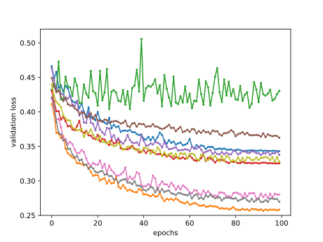
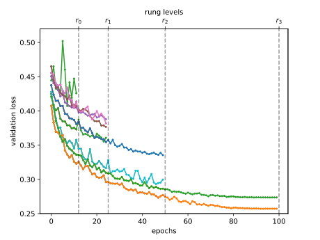

```{.python .input}
%load_ext d2lbook.tab
tab.interact_select(["pytorch"])
```

# 多保真度超参数优化
:label:`sec_mf_hpo`

训练神经网络即使是在中等规模的数据集上也可能代价高昂。
取决于配置空间（:numref:`sec_intro_config_spaces`），
超参数优化需要数十到数百次函数评估，
才能找到性能良好的超参数配置。正如我们在
:numref:`sec_rs_async` 中所见，我们可以通过利用并行资源来显著加快 HPO 的整体实际
时间，但这并不会减少所需的总
计算量。

在本节中，我们将展示如何加速超参数配置的
评估。诸如随机搜索之类的方法为每个超参数
评估分配相同数量的资源（例如轮数、训练数据点）。
:numref:`img_samples_lc` 描绘了一组用不同超参数配置训练的
神经网络的学习曲线。经过几个轮次，我们
已经能够在视觉上区分性能良好的配置和次优
配置。然而，学习曲线是有噪声的，我们可能仍然需要
完整的 100 轮才能找出表现最好的那个配置。


:label:`img_samples_lc`

多保真度超参数优化为有希望的配置分配更多资源，
并提前停止对性能不佳配置的评估。
这加快了优化过程，因为在相同的总资源量下，
我们可以尝试更多的配置。

更形式化地说，我们扩展 :numref:`sec_definition_hpo` 中的定义，
使得目标函数 $f(\mathbf{x}, r)$ 得到一个额外输入
$r \in [r_{\mathrm{min}}, r_{max}]$，它指定我们愿意为
配置 $\mathbf{x}$ 的评估花费多少资源。我们假设
误差 $f(\mathbf{x}, r)$ 随 $r$ 增大而减小，而计算
成本 $c(\mathbf{x}, r)$ 随之增大。通常，$r$ 表示
训练神经网络的轮数，但它也可以是训练
子集大小或交叉验证折数。

```{.python .input}
%%tab pytorch
from d2l import torch as d2l
import numpy as np
from scipy import stats
from collections import defaultdict
d2l.set_figsize()
```

## 逐次减半
:label:`sec_mf_hpo_sh`

使随机搜索适应多保真度设定的最简单方法之一是
*逐次减半*（successive halving）:cite:`jamieson-aistats16,karnin-icml13`。基本
思想是：从 $N$ 个配置开始（例如从配置空间中随机采样得到），
只对每个配置训练 $r_{\mathrm{min}}$ 轮。然后
我们丢弃一部分表现最差的试验，并让剩余的
试验训练更长时间。迭代这个过程，运行的试验越来越少、但时间越来越长，
直到至少有一个试验达到 $r_{max}$ 轮。

更形式化地说，考虑最小预算 $r_{\mathrm{min}}$（例如 1 轮）、最大
预算 $r_{max}$（例如前面例子中的 `max_epochs`），以及一个减半
常数 $\eta\in\{2, 3, \dots\}$。为简单起见，假设
$r_{max} = r_{\mathrm{min}} \eta^K$，其中 $K \in \mathbb{I}$。初始
配置的数量则为 $N = \eta^K$。让我们定义梯级
集合 $\mathcal{R} = \{ r_{\mathrm{min}}, r_{\mathrm{min}}\eta, r_{\mathrm{min}}\eta^2, \dots, r_{max} \}$。

一轮逐次减半的过程如下。我们首先运行 $N$
个试验直到第一个梯级 $r_{\mathrm{min}}$。对验证误差排序后，我们保留
前 $1 / \eta$ 的比例（即 $\eta^{K-1}$ 个配置），
丢弃其余所有配置。存活的试验为下一个梯级
（$r_{\mathrm{min}}\eta$ 轮）而训练，该过程重复进行。在每个梯级，
$1 / \eta$ 比例的试验存活下来，它们的训练以
$\eta$ 倍大的预算继续。以这种特定的 $N$ 选择，
只有一个试验会被训练到完整预算 $r_{max}$。一旦这样一轮
逐次减半完成，我们就用一组新的初始
配置开始下一轮，如此迭代，直到总预算用完。



我们继承 :numref:`sec_api_hpo` 中的 `HPOScheduler` 基类，以
实现逐次减半，并允许一个通用的 `HPOSearcher` 对象
采样配置（在我们下面的例子中，它将是一个 `RandomSearcher`）。
此外，用户必须传入最小资源 $r_{\mathrm{min}}$、最大
资源 $r_{max}$ 和 $\eta$ 作为输入。在调度器内部，我们维护一个
仍需要在当前梯级 $r_i$ 上评估的配置
队列。每当我们跳到下一个梯级时，就更新该队列。

```{.python .input  n=2}
class SuccessiveHalvingScheduler(d2l.HPOScheduler):  #@save
    def __init__(self, searcher, eta, r_min, r_max, prefact=1):
        self.save_hyperparameters()
        # Compute K, which is later used to determine the number of configurations
        self.K = int(np.log(r_max / r_min) / np.log(eta))
        # Define the rungs
        self.rung_levels = [r_min * eta ** k for k in range(self.K + 1)]
        if r_max not in self.rung_levels:
            # The final rung should be r_max
            self.rung_levels.append(r_max)
            self.K += 1
        # Bookkeeping
        self.observed_error_at_rungs = defaultdict(list)
        self.all_observed_error_at_rungs = defaultdict(list)
        # Our processing queue
        self.queue = []
```

开始时我们的队列为空，我们用
$n = \textrm{prefact} \cdot \eta^{K}$ 个配置填充它，这些配置首先在
最小梯级 $r_{\mathrm{min}}$ 上评估。这里，$\textrm{prefact}$ 允许我们在不同的上下文中复用
代码。就本节而言，我们固定
$\textrm{prefact} = 1$。每当资源变得可用、`HPOTuner`
对象查询 `suggest` 函数时，我们就从队列中返回一个元素。一旦
我们完成一轮逐次减半（这意味着我们在最高资源水平 $r_{max}$ 上评估了所有
存活的配置），并且我们的队列
为空，我们就用一组新的随机采样配置
重新开始整个过程。

```{.python .input  n=12}
%%tab pytorch
@d2l.add_to_class(SuccessiveHalvingScheduler)  #@save
def suggest(self):
    if len(self.queue) == 0:
        # Start a new round of successive halving
        # Number of configurations for the first rung:
        n0 = int(self.prefact * self.eta ** self.K)
        for _ in range(n0):
            config = self.searcher.sample_configuration()
            config["max_epochs"] = self.r_min  # Set r = r_min
            self.queue.append(config)
    # Return an element from the queue
    return self.queue.pop()
```

当我们收集到一个新数据点时，首先更新搜索器模块。
之后检查当前梯级上的所有数据点是否都已收集完毕。
如果是，我们对所有配置排序，并将前 $\frac{1}{\eta}$
的配置推入队列。

```{.python .input  n=4}
%%tab pytorch
@d2l.add_to_class(SuccessiveHalvingScheduler)  #@save
def update(self, config: dict, error: float, info=None):
    ri = int(config["max_epochs"])  # Rung r_i
    # Update our searcher, e.g if we use Bayesian optimization later
    self.searcher.update(config, error, additional_info=info)
    self.all_observed_error_at_rungs[ri].append((config, error))
    if ri < self.r_max:
        # Bookkeeping
        self.observed_error_at_rungs[ri].append((config, error))
        # Determine how many configurations should be evaluated on this rung
        ki = self.K - self.rung_levels.index(ri)
        ni = int(self.prefact * self.eta ** ki)
        # If we observed all configuration on this rung r_i, we estimate the
        # top 1 / eta configuration, add them to queue and promote them for
        # the next rung r_{i+1}
        if len(self.observed_error_at_rungs[ri]) >= ni:
            kiplus1 = ki - 1
            niplus1 = int(self.prefact * self.eta ** kiplus1)
            best_performing_configurations = self.get_top_n_configurations(
                rung_level=ri, n=niplus1
            )
            riplus1 = self.rung_levels[self.K - kiplus1]  # r_{i+1}
            # Queue may not be empty: insert new entries at the beginning
            self.queue = [
                dict(config, max_epochs=riplus1)
                for config in best_performing_configurations
            ] + self.queue
            self.observed_error_at_rungs[ri] = []  # Reset
```

配置根据它们在当前梯级上观测到的性能进行排序。

```{.python .input  n=4}
%%tab pytorch

@d2l.add_to_class(SuccessiveHalvingScheduler)  #@save
def get_top_n_configurations(self, rung_level, n):
    rung = self.observed_error_at_rungs[rung_level]
    if not rung:
        return []
    sorted_rung = sorted(rung, key=lambda x: x[1])
    return [x[0] for x in sorted_rung[:n]]
```

让我们看看逐次减半在我们的神经网络示例上表现如何。我们
将使用 $r_{\mathrm{min}} = 2$、$\eta = 2$、$r_{max} = 10$，因此梯级水平为
$2, 4, 8, 10$。

```{.python .input  n=5}
min_number_of_epochs = 2
max_number_of_epochs = 10
eta = 2
num_gpus=1

config_space = {
    "learning_rate": stats.loguniform(1e-2, 1),
    "batch_size": stats.randint(32, 256),
}
initial_config = {
    "learning_rate": 0.1,
    "batch_size": 128,
}
```

我们只需把调度器替换为新的 `SuccessiveHalvingScheduler`。

```{.python .input  n=14}
searcher = d2l.RandomSearcher(config_space, initial_config=initial_config)
scheduler = SuccessiveHalvingScheduler(
    searcher=searcher,
    eta=eta,
    r_min=min_number_of_epochs,
    r_max=max_number_of_epochs,
)
tuner = d2l.HPOTuner(
    scheduler=scheduler,
    objective=d2l.hpo_objective_lenet,
)
tuner.run(number_of_trials=30)
```

我们可以可视化所评估的所有配置的学习曲线。
大多数配置被提前停止，只有表现更好的
配置存活到 $r_{max}$。将此与普通随机搜索比较，
后者会为每个配置分配 $r_{max}$。

```{.python .input  n=19}
for rung_index, rung in scheduler.all_observed_error_at_rungs.items():
    errors = [xi[1] for xi in rung]
    d2l.plt.scatter([rung_index] * len(errors), errors)
d2l.plt.xlim(min_number_of_epochs - 0.5, max_number_of_epochs + 0.5)
d2l.plt.xticks(
    np.arange(min_number_of_epochs, max_number_of_epochs + 1),
    np.arange(min_number_of_epochs, max_number_of_epochs + 1)
)
d2l.plt.ylabel("validation error")
d2l.plt.xlabel("epochs")
```

最后，请注意我们在 `SuccessiveHalvingScheduler` 实现中
的一些复杂性。假设有一个工作进程空闲可以运行任务，而
`suggest` 被调用时当前梯级几乎已被完全填满，但
另一个工作进程仍在忙于一次评估。由于我们缺少该工作进程的指标值，
我们无法确定要开启下一个梯级的前 $1 / \eta$ 比例是哪些。
另一方面，我们希望给空闲的工作进程分配任务，
使它不会一直闲置。我们的解决方案是开始新的一轮逐次
减半，并把该工作进程分配到那里的第一个试验。然而，一旦某个梯级
在 `update` 中完成，我们确保将新配置插入队列的
开头，使它们优先于下一轮的配置。

## 小结

本节介绍了多保真度超参数优化的概念。在该设定中，我们假设可以获得目标函数
的廉价可评估近似，例如用训练一定轮数后的验证误差
作为完整轮数后验证误差的代理。多保真度超参数优化
能够减少 HPO 的总计算量，而不仅仅是减少实际耗时。

我们实现并评估了逐次减半——一种简单而高效的多保真度 HPO 算法。


:begin_tab:`pytorch`
[讨论](https://discuss.d2l.ai/t/12094)
:end_tab:
