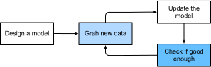
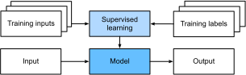
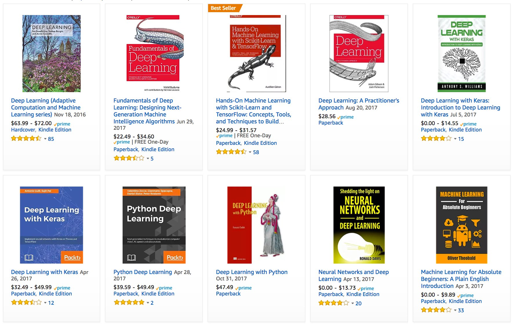
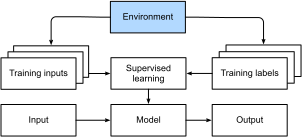
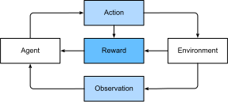

# 引言
:label:`chap_introduction`

直到最近，你在平常一天里可能与之交互的几乎每一个计算机程序，都是作为一套刚性的规则编写出来的，这些规则精确地规定了程序应当如何行事。假设我们想编写一个应用来管理电子商务平台。围在白板前思考几个小时之后，我们可能会定下可行解决方案的大致轮廓，例如：（i）用户通过运行在网页浏览器或移动应用里的界面与应用交互；（ii）应用与商用级数据库引擎交互，以跟踪每个用户的状态，并维护历史交易记录；（iii）在应用的核心处，应用的*业务逻辑*（你或许会称之为应用的*大脑*）明确列出一组规则，把每一种可能想到的情形映射到程序应当采取的相应动作。

要构建应用的大脑，我们可能会枚举程序应当处理的所有常见事件。例如，每当顾客点击把商品加入购物车时，程序就应当在购物车数据库表中添加一条记录，把该用户的ID与所请求商品的ID关联起来。此后，我们可能会尝试逐一走遍所有可能的边角情形，检验规则是否恰当，并做必要的修改。如果用户用空购物车发起购买，会发生什么？尽管很少有开发者能一次就完全写对（可能需要反复测试运行才能解决这些毛病），但大多数情况下，我们确实能写出这类程序，并在真正见到客户*之前*就放心地发布。人类能够手工设计出驱动产品和系统正常运转的自动化系统，而且往往是在新情境下做到这一点，这是一种非凡的认知成就。而当你能够设计出$100\%$情况下都有效的解决方案时，通常就不必再为机器学习操心了。

对于不断壮大的机器学习科学家群体来说幸运的是，我们想要自动化的许多任务，并不那么容易被人力巧思所折服。想象一下，你和所认识的最聪明的一群人围在白板前，但这一次，你要解决的是下列问题之一：

* 编写一个程序，根据地理信息、卫星图像和过去一段时间的天气记录来预测明天的天气。
* 编写一个程序，接收以自由形式文本表述的一个事实型问题，并正确作答。
* 编写一个程序，给定一张图像，识别出图中描绘的每一个人，并分别在每个人周围画出轮廓。
* 编写一个程序，向用户展示他们可能喜欢、但在自然浏览过程中不太可能遇到的产品。

面对这些问题，即使是精英程序员，从头编写解决方案也会很吃力。原因可能各不相同。有时，我们要找的程序所遵循的模式会随时间变化，因此根本不存在固定不变的正确答案！在这种情况下，任何成功的解决方案都必须能优雅地适应不断变化的世界。另一些时候，各种关系（比如像素与抽象类别之间的关系）可能过于复杂，需要成千上万次乃至上百万次计算，而且遵循我们未知的原理。以图像识别为例，完成任务所需的确切步骤超出了我们有意识的理解范围，尽管我们下意识的认知过程能毫不费力地完成这项任务。

*机器学习*是研究能够从经验中学习的算法的学科。随着机器学习算法积累更多经验——通常以观测数据或与环境交互的形式出现——它的性能会得到提升。与之形成对照的是我们那个确定性的电子商务平台：无论积累多少经验，它都会遵循同样的业务逻辑，直到开发者自身学到了新东西并决定是时候更新软件为止。在本书中，我们将教你机器学习的基础知识，并特别聚焦于*深度学习*——这是一组强大的技术，正推动着计算机视觉、自然语言处理、医疗保健和基因组学等各个领域的创新。

## 一个激励人心的例子

在开始写作之前，本书作者也像大多数上班族一样，得先摄入一点咖啡因。我们钻进车里，开始开车。Alex用iPhone喊了一声“嘿，Siri”，唤醒了手机的语音识别系统。接着，Mu命令道“导航到Blue Bottle咖啡店”。手机很快显示出了对他这条命令的转写结果。它还识别出我们是在请求指路，于是启动了地图应用（app）来满足我们的请求。地图应用启动后，确定出了若干条路线。在每条路线旁边，手机都显示了预测的通行时间。虽然这个故事是为了教学方便而虚构的，但它说明，在短短几秒钟之内，我们与智能手机的日常交互就可能用到好几个机器学习模型。

想象一下，仅仅编写一个程序来响应*唤醒词*（wake word），比如“Alexa”“OK Google”和“嘿，Siri”。试着独自待在一个房间里，除了一台计算机和一个代码编辑器之外什么都没有，动手把它编写出来，如 :numref:`fig_wake_word` 所示。你会怎样从第一性原理出发编写这样一个程序？想一想……这个问题很难。麦克风每秒钟大约会采集44000个样本。每个样本都是对声波振幅的一次测量。什么样的规则才能可靠地把一小段原始音频映射为关于该片段是否包含唤醒词的确定预测$\{\textrm{yes}, \textrm{no}\}$？如果你卡住了，不必担心。我们也不知道该如何从零编写这样的程序。这正是我们要使用机器学习的原因。


:label:`fig_wake_word`

诀窍就在这里。很多时候，即使我们不知道如何明确地告诉计算机怎样把输入映射到输出，我们自己却仍然能够完成这一认知壮举。换句话说，即使你不知道如何给计算机编程，让它识别出“Alexa”这个词，你本人却是能够识别出它的。有了这种能力，我们就可以收集一个庞大的*数据集*（dataset），其中包含音频片段的样例以及关联的标签，指明哪些片段包含唤醒词。在当前主流的机器学习方法中，我们并不试图*明确地*设计一个用来识别唤醒词的系统。相反，我们定义一个灵活的程序，它的行为由许多*参数*（parameter）决定。然后我们用数据集来确定尽可能好的参数值，即在某个选定的性能度量下能够改善程序性能的那些参数值。

你可以把参数想象成我们可以转动的旋钮，用来操纵程序的行为。一旦参数固定下来，我们就称这个程序为一个*模型*（model）。仅仅通过操纵参数就能产生的所有不同程序（输入到输出的映射）的集合，称为模型的*族*（family）。而那个利用我们的数据集来选择参数的“元程序”，则称为*学习算法*（learning algorithm）。

在我们着手运行学习算法之前，必须先精确地定义问题：确定输入与输出的确切性质，并选择合适的模型族。在这个例子中，模型接收一小段音频作为*输入*，并在$\{\textrm{yes}, \textrm{no}\}$之中作出选择作为*输出*。如果一切按计划进行，那么对于该片段是否包含唤醒词，模型的猜测通常会是正确的。

如果我们选择了正确的模型族，那么应当存在一种旋钮设置，使得模型每次听到“Alexa”这个词时都会给出“yes”。由于唤醒词的具体选择是任意的，我们很可能需要一个足够丰富的模型族：通过另一种旋钮设置，它可以在只听到“Apricot”这个词时才给出“yes”。我们期望同一个模型族既适用于识别“Alexa”，也适用于识别“Apricot”，因为直觉上它们似乎是相似的任务。然而，如果想处理根本不同的输入或输出，我们可能就需要一个完全不同的模型族，比如想把图像映射为说明文字，或者把英文句子映射为中文句子。

你或许已经猜到，如果我们只是随机地设置所有的旋钮，模型不太可能识别出“Alexa”“Apricot”或任何其他英语单词。在机器学习中，*学习*指的是这样一个过程：我们发现旋钮的正确设置，从而迫使模型表现出我们想要的行为。换句话说，我们用数据来*训练*模型。如 :numref:`fig_ml_loop` 所示，训练过程通常如下所示：

1. 从一个随机初始化的模型开始，它还做不了任何有用的事。
1. 抓取一些数据（例如音频片段及对应的$\{\textrm{yes}, \textrm{no}\}$标签）。
1. 调整旋钮，使模型在这些样例上的表现更好。
1. 重复第2步和第3步，直到模型变得很棒。


:label:`fig_ml_loop`

总结一下：与其编写一个唤醒词识别器，我们不如编写一个能够*学习*识别唤醒词的程序，前提是提供给它一个大型的有标签数据集。你可以把通过提供数据集来确定程序行为这一做法，看作*用数据编程*（programming with data）。也就是说，我们可以通过向机器学习系统提供大量猫和狗的样例，来“编写”一个猫检测器。这样一来，检测器最终会学会：如果输入是猫，就给出一个很大的正数；如果是狗，就给出一个很大的负数；如果拿不准，就给出接近零的数。这还只是略窥机器学习能力的一角。我们稍后会详细讲解的深度学习，只是解决机器学习问题的众多流行方法之一。

## 关键组件

在我们那个唤醒词的例子中，我们描述了一个由音频片段和二元标签组成的数据集，并且粗略地给出了一个思路：如何训练模型来逼近从片段到类别的映射。这类问题——给定一个由已知标签的样例组成的数据集，我们试图根据已知的输入来预测某个指定的未知标签——称为*监督学习*（supervised learning）。它只是众多机器学习问题中的一种。在探讨其他类型之前，我们希望进一步阐明几个核心组件，无论我们处理哪种机器学习问题，它们都会一直伴随我们：

1. 可供我们从中学习的*数据*。
1. 关于如何变换数据的*模型*。
1. 量化模型表现好（或差）程度的*目标函数*。
1. 调整模型参数以优化目标函数的*算法*。

### 数据

不言而喻，没有数据就无法从事数据科学。我们本可以花上几百页去琢磨数据*究竟*是什么，但眼下，我们将聚焦于所关注数据集的关键性质。一般来说，我们关注的是一个由样例构成的集合。为了有效地利用数据，我们通常需要给出一种合适的数值表示。每个*样例*（example，又称*数据点* data point、*数据实例* data instance、*样本* sample）通常由一组称为*特征*（feature，有时称为*协变量* covariate 或*输入* input）的属性构成，模型必须根据这些属性作出预测。在监督学习问题中，我们的目标是预测某个特殊属性的值，这个属性称为*标签*（label，或称*目标值* target），它不属于模型的输入。

如果处理的是图像数据，那么每个样例可能由一张单独的图片（特征）以及一个表示该图片所属类别的数字（标签）构成。这张图片会被数值化地表示为三个数值网格，分别表示每个像素位置上红、绿、蓝光的亮度。例如，一张$200\times 200$像素的彩色图片将由$200\times200\times3=120000$个数值组成。

另一种情形是处理电子健康记录数据，并解决预测给定病人在未来30天内存活可能性这一任务。这里，我们的特征可能由一组随时可获取的属性和经常记录的测量值构成，包括年龄、生命体征、合并症、当前用药以及近期手术。可用于训练的标签将是一个二元值，表示历史数据中的每位病人是否在30天窗口内存活。

在这类情形中，当每个样例都由相同数目的数值特征刻画时，我们说输入是定长向量，并把向量（恒定的）长度称为数据的*维数*（dimensionality）。可以想象，定长输入会带来便利，让我们少操心一个麻烦。不过，并非所有数据都能轻易表示成*定长*向量。我们或许可以期望显微镜图像来自标准设备，但不能指望从互联网上挖来的图像都具有相同的分辨率或形状。对于图像，我们或许可以考虑裁剪成标准尺寸，但这种策略只能解决部分问题。我们有可能丢失被裁掉部分中的信息。此外，文本数据对定长表示的抗拒更为顽固。想想Amazon、IMDb和TripAdvisor等电商网站上留下的顾客评论。有些很短：“太糟了！”。另一些则长篇大论好几页。深度学习相对于传统方法的一大优势在于，现代模型能够比较从容地处理*变长*数据。

一般说来，我们拥有的数据越多，任务就变得越容易。数据更多时，我们能够训练更强大的模型，并更少地依赖先入为主的假设。从（相对）小数据到大数据这一格局的转变，是现代深度学习取得成功的一大促进因素。为了强调这一点：深度学习中许多最令人兴奋的模型，没有大型数据集就无法工作。另外一些模型或许能在小数据情形下工作，但并不比传统方法更好。

最后，拥有大量数据并加以巧妙处理还不够。我们需要的是*正确的*数据。如果数据充满错误，或者所选择的特征无法预测所关注的目标量，学习就会失败。这一情形用那句老话概括得恰到好处：*垃圾进，垃圾出*（garbage in, garbage out）。此外，预测性能差并不是唯一可能的后果。在机器学习的敏感应用中，例如预测性警务、简历筛选以及用于放贷的风险模型，我们必须格外警惕垃圾数据带来的后果。一种常见的失败模式涉及这样一些数据集：其中某些群体在训练数据中代表性不足。想象一下，把一个从未见过黑色皮肤的皮肤癌识别系统投入使用会怎样。当数据不仅对某些群体代表不足，而且还反映了社会偏见时，同样会出问题。例如，如果用过去的招聘决策来训练一个将用于筛选简历的预测模型，那么机器学习模型就可能不经意间习得并自动化历史上的不公正做法。请注意，这一切都可能在数据科学家并未主动密谋、甚至毫不知情的情况下发生。

### 模型

大多数机器学习都涉及在某种意义上变换数据。我们可能想构建一个系统，摄入照片并预测其“微笑程度”。或者，我们可能想摄入一组传感器读数，并预测这些读数有多正常、多异常。所谓*模型*（model），我们指的是摄入一种类型的数据、并输出可能是另一种类型的预测的计算机制。特别地，我们感兴趣的是能够从数据中估计的*统计模型*（statistical model）。虽然简单的模型完全能够处理相应简单的问题，但本书关注的问题会挑战经典方法的极限。深度学习与经典方法的区别主要在于它所聚焦的那一组强大模型。这些模型由许多相继的数据变换构成，自上而下地串联在一起，因此得名*深度学习*（deep learning）。在讨论深度模型的过程中，我们也会讨论一些更传统的方法。

### 目标函数

前面我们把机器学习介绍为从经验中学习。这里的*学习*，指的是随着时间推移在某个任务上有所改进。但谁来界定什么算“改进”呢？你可能会想，我们可以提出更新模型，而另一些人可能对我们提出的更新算不算改进意见不一。

为了建立起关于学习机器的形式化数学体系，我们需要有形式化的度量来衡量模型有多好（或多差）。在机器学习以及更一般的优化中，我们把这些度量称为*目标函数*（objective function）。按照惯例，我们通常定义目标函数时让较小值更好。这仅仅是一种惯例。你可以取任意一个较大值更好的函数，通过翻转符号把它变成一个新函数，二者在性质上完全相同，只是新函数以较小值为好。因为我们选择较小值为好，所以这些函数有时被称为*损失函数*（loss function）。

当试图预测数值时，最常见的损失函数是*平方误差*（squared error），即预测值与真实目标值之差的平方。对于分类问题，最常见的目标是最小化错误率，即预测结果与真实标签不一致的样例所占比例。有些目标（例如平方误差）容易优化，而另一些目标（例如错误率）由于不可微或其他复杂性而难以直接优化。在这些情况下，常用的做法是转而优化一个*替代目标*（surrogate objective）。

在优化过程中，我们把损失看作模型参数的函数，并把训练数据集视为常量。我们通过在由为训练而收集的若干样例组成的集合上最小化所产生的损失，来学习模型参数的最佳取值。然而，在训练数据上表现良好，并不保证我们在未见过的数据上也能表现良好。因此，我们通常希望把可用数据分成两个划分：用于学习模型参数的*训练数据集*（training dataset，或*训练集* training set）；以及留作评估之用的*测试数据集*（test dataset，或*测试集* test set）。归根结底，我们通常会报告模型在这两个划分上的表现。你可以把训练表现类比为学生为备战某场期末大考而在模拟考试中取得的分数。即使模拟考试成绩喜人，也不能保证期末大考一定成功。在学习过程中，学生可能开始背诵练习题，表面上掌握了主题，但在期末大考中面对此前没见过的问题时却败下阵来。当一个模型在训练集上表现良好，却无法泛化到未见过的数据时，我们说它对训练数据*过拟合*（overfitting）。

### 优化算法

一旦我们有了某种数据来源与表示、一个模型以及一个定义良好的目标函数，我们就需要一种算法，能够搜索出使损失函数最小化的最佳参数。深度学习流行的优化算法基于一种称为*梯度下降*（gradient descent）的方法。简而言之，在每一步，该方法会对每个参数检查：如果仅仅对该参数施加一小点扰动，训练集损失会如何变化。然后，它朝着使损失降低的方向更新该参数。

## 各种机器学习问题

我们开头那个激励人心的例子中的唤醒词问题，只是机器学习能够解决的众多问题之一。为了进一步激发读者的兴趣，并为大家提供一些贯穿全书的共同语言，我们现在对机器学习问题的全貌作一个概述。

### 监督学习

监督学习描述的是这样一类任务：我们给定一个同时包含特征和标签的数据集，要求产生一个模型，在给定输入特征时能够预测标签。每个特征—标签对称为一个样例。有时，当语境清楚时，我们可能用术语*样例*来指一组输入，即使对应的标签未知。监督之所以起作用，是因为为了选择参数，我们（监督者）向模型提供由带标签样例组成的数据集。用概率的语言来说，我们通常感兴趣的是估计给定输入特征时标签的条件概率。虽然监督学习只是若干范式之一，但工业界机器学习的大部分成功应用都属于监督学习。部分原因是许多重要任务都可以清晰地描述为：给定一组可用的特定数据，估计某个未知量的概率：

* 给定一张计算机断层扫描图像，预测是癌症还是不是癌症。
* 给定一个英文句子，预测正确的法文翻译。
* 根据本月的财务报告数据，预测下个月的股票价格。

虽然所有监督学习问题都能被“给定输入特征预测标签”这一简单描述所涵盖，但监督学习本身可以采取多种形式，并需要大量的建模决策，这取决于（除其他考虑之外）输入和输出的类型、大小和数量。例如，处理任意长度序列与处理定长向量表示所用的模型就不同。本书将深入探讨其中许多问题。

非正式地说，学习过程大致如下。首先，收集一个规模很大的、特征已知的样例集合，并从中选取一个随机子集，获取每个样例的真实标签。有时这些标签可能是已经收集好的现成数据（例如，病人是否在随后的一年内死亡？），另一些时候我们可能需要雇用人工标注员来标注数据（例如，把图像分配到类别）。这些输入连同对应的标签一起构成训练集。我们把训练数据集输入一个监督学习算法——它是一个以数据集为输入、并输出另一个函数（即学到的模型）的函数。最后，我们可以把此前从未见过的输入喂给学到的模型，用它的输出作为相应标签的预测。整个过程如 :numref:`fig_supervised_learning` 所示。


:label:`fig_supervised_learning`

#### 回归

也许最容易让你理解的监督学习任务是*回归*（regression）。例如，考虑从房屋销售数据库中收集来的一组数据。我们可以构造一张表，其中每一行对应一栋不同的房屋，每一列对应某个相关属性，比如房屋的平方英尺数、卧室数、浴室数，以及步行到市中心的分钟数。在这个数据集中，每个样例将是一栋具体的房屋，而对应的特征向量将是表中的一行。如果你住在纽约或旧金山，而且你不是Amazon、Google、Microsoft或Facebook的CEO，那么你家的（平方英尺数、卧室数、浴室数、步行距离）特征向量可能看起来像：$[600, 1, 1, 60]$。然而，如果你住在匹兹堡，它可能更像是$[3000, 4, 3, 10]$。这样的定长特征向量对于大多数经典机器学习算法是必不可少的。

实际上，决定一个问题是不是回归的，是目标值的形式。假设你正在市场上物色新房。你可能想根据上述一些特征来估计一栋房屋的公平市场价值。这里的数据可能由历史房屋挂牌信息构成，而标签可能是观察到的销售价格。当标签取任意数值（即使是在某个区间内）时，我们称这是一个*回归*问题。目标是产生一个模型，其预测能紧密地逼近实际的标签值。

许多实际问题都很容易描述为回归问题。预测用户会给一部电影打多少分，可以看作一个回归问题；如果你在2009年设计出一种能完成此壮举的优秀算法，你也许就赢得了[百万美元 Netflix 大奖](https://en.wikipedia.org/wiki/Netflix_Prize)。预测病人在医院住院的时长也是一个回归问题。一条好的经验法则是：任何*多少*（how much）或*多少个*（how many）的问题，都可能是回归问题。例如：

* 这台手术需要多少小时？
* 这个城镇未来六小时会有多少降雨？

即使你以前从未接触过机器学习，你很可能也非正式地处理过一个回归问题。例如，设想你请人修好了下水道，而承包商花了3个小时清除你污水管里的污垢。然后他们给你寄来一张350美元的账单。现在再设想你的朋友雇了同一位承包商2个小时，收到了一张250美元的账单。如果这时有人问你，他们即将到来的清污账单预计是多少，你可能会作出一些合理的假设，比如工作时间越长花费越多。你可能还会假设存在某种基础费用，然后承包商按小时收费。如果这些假设成立，那么给定这两个数据样例，你就已经能确定承包商的定价结构：每小时100美元，外加50美元的上门费。如果你能理解到这一步，那么你就已经懂了*线性*回归（linear regression）背后的高层思想。

在这个例子中，我们能够给出与承包商价格精确吻合的参数。有时这做不到，例如，如果部分变化来自你这两个特征之外的其他因素。在这些情况下，我们会尝试学习模型，使我们的预测与观测值之间的距离最小。在本书的大多数章节中，我们将聚焦于最小化平方误差损失函数。我们后面会看到，这种损失对应于如下假设：我们的数据被高斯噪声污染了。

#### 分类

虽然回归模型非常适合回答*多少*的问题，但许多问题并不能轻松地套进这个模板。例如，考虑一家银行想为其移动应用开发一项支票扫描功能。理想情况下，顾客只需给支票拍张照片，应用就会自动从图像中识别出文字。假设我们有某种能力，能够分割出对应每个手写字符的图像块，那么剩下的主要任务就是确定每个图像块中描绘的是某个已知字符集中的哪一个字符。这类*哪一个*（which one）的问题称为*分类*（classification），它需要一套与回归不同的工具，尽管许多技术可以沿用。

在*分类*中，我们希望模型查看特征（例如图像中的像素值），然后预测样例属于某个离散选项集合中的哪个*类别*（category，有时称为*类* class）。对于手写数字，我们可能有十个类，对应数字0到9。分类最简单的形式是只有两个类，我们把这样的问题称为*二元分类*（binary classification）。例如，我们的数据集可以由动物的图像组成，而标签可能是类别$\textrm{\{cat, dog\}}$。在回归中我们要找一个回归器来输出一个数值，而在分类中我们要找一个分类器，其输出是预测出的类别归属。

由于某些原因——随着本书越来越深入技术细节，我们将会详细讨论——优化一个只能输出*确定的*类别归属（例如要么是“猫”要么是“狗”）的模型可能会很困难。在这些情况下，用概率的语言来表达模型通常要容易得多。给定一个样例的特征，我们的模型为每个可能的类别分配一个概率。回到类别为$\textrm{\{cat, dog\}}$的动物分类例子，分类器可能看到一张图像后，输出该图像是猫的概率为0.9。我们可以这样解释这个数字：分类器有90\%的把握认为该图像描绘的是一只猫。预测类别的概率大小传达了一种不确定性。这并不是唯一可用的不确定性度量，我们将在涉及更高级主题的章节中讨论其他度量。

当可能的类别多于两个时，我们称该问题为*多类分类*（multiclass classification）。常见的例子包括手写字符识别$\textrm{\{0, 1, 2, ... 9, a, b, c, ...\}}$。我们通过最小化平方误差损失函数来处理回归问题，而分类问题常用的损失函数称为*交叉熵*（cross-entropy），它的名字将在后面的章节引入信息论时揭开面纱。

请注意，最可能的类别不一定就是你要用来作决策的那个类别。假设你在后院里发现了一朵漂亮的蘑菇，如图 :numref:`fig_death_cap` 所示。


:width:`200px`
:label:`fig_death_cap`

现在，假设你构建了一个分类器，并训练它根据照片预测蘑菇是否有毒。假定我们的毒性检测分类器输出：:numref:`fig_death_cap` 所展示的是毒鹅膏的概率为0.2。换句话说，分类器有80\%的把握认为我们的蘑菇不是毒鹅膏。尽管如此，你要是把它吃下去，那就是犯傻。这是因为一顿美餐带来的确定收益，不值得冒20\%为之丧命的风险。换句话说，不确定风险的影响远远超过了收益。因此，为了决定要不要吃这朵蘑菇，我们需要计算每种动作相关的预期损害，这既取决于可能的结果，也取决于每种结果关联的收益或危害。在这种情况下，吃掉蘑菇招致的损害可能是$0.2 \times \infty + 0.8 \times 0 = \infty$，而丢弃它的损失是$0.2 \times 0 + 0.8 \times 1 = 0.8$。我们的谨慎是有道理的：正如任何真菌学家都会告诉我们的，:numref:`fig_death_cap` 中的蘑菇实际上正是一朵毒鹅膏。

分类可以比二元分类或多类分类复杂得多。例如，有一些分类变体专门处理层次化结构的类别。在这类情况下，并非所有错误都是等价的——如果我们必须犯错，我们可能更愿意误分到相近的类别，而不是相差很远的类别。通常，这被称为*层次分类*（hierarchical classification）。为了获得启发，你可以想想[林奈](https://en.wikipedia.org/wiki/Carl_Linnaeus)，他按层次组织动物群。

在动物分类的情形中，把一只贵宾犬误认成雪纳瑞也许还不算太糟，但如果我们的模型把贵宾犬和恐龙搞混，那就要付出巨大的代价。哪种层次结构相关，可能取决于你打算怎样使用模型。例如，响尾蛇和束带蛇在系统发生树上可能很接近，但把响尾蛇误认成束带蛇可能带来致命的后果。

#### 标注

有些分类问题恰好适合二元分类或多类分类的设置。例如，我们可以训练一个普通的二元分类器来区分猫和狗。以计算机视觉的现状而言，我们可以借助现成的工具轻松做到这一点。然而，无论我们的模型变得多么准确，当分类器遇到*不来梅的城市乐手*（Town Musicians of Bremen）——一个流行的德国童话，里面有四只动物（:numref:`fig_stackedanimals`）——的图像时，我们可能会发现自己陷入麻烦。


:width:`300px`
:label:`fig_stackedanimals`

如你所见，这张照片中有一头驴、一只猫、一条狗和一只公鸡，背景里还有一些树。如果我们预计会遇到这样的图像，那么多类分类可能就不是正确的问题表述。相反，我们可能想让模型有这样一种选择：说这张图像描绘了一只猫、一条狗、一头驴*和*一只公鸡。

学习预测并非互斥的类别的这一问题，称为*多标签分类*（multi-label classification）。自动标注问题通常最适合用多标签分类来描述。想一想人们可能会给技术博客上的文章打上的标签，例如“机器学习”“技术”“小玩意”“编程语言”“Linux”“云计算”“AWS”。一篇典型的文章可能被打上5–10个标签。通常，标签会表现出某种相关结构。关于“云计算”的文章很可能提到“AWS”，而关于“机器学习”的文章很可能提到“GPU”。

有时这类标注问题会涉及极其庞大的标签集。美国国家医学图书馆雇用了许多专业标注员，他们为每篇将收录进PubMed的论文关联一组从医学主题词表（MeSH）本体中抽取的标签，该本体大约包含28,000个标签。正确地标注论文很重要，因为它使研究人员能够对文献进行穷尽式综述。这是一个耗时的过程，通常从论文入库到完成标注之间有一年的滞后。机器学习可以提供临时标签，直到每篇论文都经过适当的人工审查。事实上，BioASQ组织已经连续多年为该任务[举办竞赛](http://bioasq.org/)。

#### 搜索

在信息检索领域，我们常常要对一组物品进行排序。以网页搜索为例。其目标与其说是确定某个特定页面是否与查询相关，不如说是在一组相关结果当中，哪一个应当最醒目地展示给某个特定用户。一种做法可能是先为集合中的每个元素分配一个分数，然后取出评分最高的元素。[PageRank](https://en.wikipedia.org/wiki/PageRank)是Google搜索引擎最初的秘密武器，也是这种评分系统的早期例子。奇怪的是，PageRank提供的评分并不依赖于实际的查询。相反，他们依靠一个简单的相关性过滤器来确定相关候选的集合，然后用PageRank来优先排列更权威的页面。如今，搜索引擎使用机器学习和行为模型来获得依赖于查询的相关性分数。已经有专门的学术会议致力于这一课题。

#### 推荐系统
:label:`subsec_recommender_systems`

推荐系统是与搜索和排序相关的另一类问题设置。这些问题的相似之处在于，目标都是展示一组与用户相关的物品。主要区别在于，在推荐系统的语境下，强调对特定用户的*个性化*（personalization）。例如，对于电影推荐，科幻迷看到的结果页面与彼得·塞勒斯喜剧行家看到的结果页面可能会有显著差异。类似的问题也会出现在其他推荐场景中，例如零售商品、音乐和新闻推荐。

在某些情况下，顾客提供显式反馈，表明他们对某个特定产品的喜爱程度（例如Amazon、IMDb或Goodreads上的产品评分和评论）。另一些情况下，他们提供隐式反馈，例如跳过播放列表中的曲目，这可能表示不满，也可能只是表明这首歌在当时的语境下不合适。在最简单的表述中，这些系统被训练来估计某个分数，例如预期的星级评分，或者给定用户购买特定物品的概率。

有了这样的模型，对于任何给定用户，我们都可以检索出分数最大的那组对象，然后推荐给该用户。生产系统要先进得多，在计算这类分数时会考虑到详细的用户活动和物品特征。:numref:`fig_deeplearning_amazon` 展示了Amazon推荐的深度学习书籍，这些推荐基于为捕捉Aston偏好而调校的个性化算法。


:label:`fig_deeplearning_amazon`

尽管推荐系统具有巨大的经济价值，但简单地建立在预测模型之上的推荐系统存在一些严重的概念缺陷。首先，我们只观测到*删失反馈*（censored feedback）：用户会优先评价那些他们有强烈感受的电影。例如，在一个五分制评分尺度上，你可能会注意到，物品会收到很多一星和五星评分，但三星评分却少得引人注目。此外，当前的购买习惯往往是当前在用的推荐算法造成的结果，而学习算法并不总能考虑到这一细节。因此，反馈回路有可能形成：推荐系统优先推送某个物品，该物品由于购买量更大而被认为更好，进而又更频繁地被推荐。这类问题中的许多——如何应对删失、激励和反馈回路——都是重要的开放研究问题。

#### 序列学习

到目前为止，我们考察的问题都是输入数目固定、输出数目固定的问题。例如，我们考虑过在给定一组固定特征（平方英尺数、卧室数、浴室数以及到市中心的通行时间）的情况下预测房价。我们还讨论过从（固定维数的）图像映射到它属于固定数目类别中每一类的预测概率，以及仅根据用户ID和产品ID预测与购买相关的星级评分。在这些情况下，模型一旦训练完成，每个测试样例被喂入模型之后就会被立即遗忘。我们假设相继的观测是独立的，因此没有必要保留这一上下文。

但是，我们应当如何处理视频片段呢？在这种情况下，每个片段可能由数目不同的帧组成。而如果我们考虑前后相邻的帧，那么对每一帧中正在发生什么的判断可能会可靠得多。语言也是如此。例如，一个流行的深度学习问题是机器翻译：即摄入某种源语言的句子，并预测它们在另一种语言中的译文这一任务。

这类问题在医学中也会出现。我们可能希望用一个模型来监测重症监护室的病人，并在他们未来24小时内的死亡风险超过某个阈值时发出警报。这里，我们不会每个小时都把所知道的病人历史全部丢掉，因为我们可能不想只根据最新的测量值来作预测。

诸如此类的问题属于机器学习最令人兴奋的应用之列，它们是*序列学习*（sequence learning）的实例。这些问题要求模型要么摄入输入序列，要么产生输出序列（或者两者兼有）。具体来说，*序列到序列学习*（sequence-to-sequence learning）考虑的是输入和输出都由变长序列构成的问题。例子包括机器翻译和语音到文本的转写。虽然不可能把所有类型的序列变换都考虑在内，但以下特殊情况值得提及。

**标注与解析**。这涉及用属性标注一个文本序列。这里，输入和输出是*对齐的*，即它们数目相同，并按照对应的顺序出现。例如，在*词性标注*（part-of-speech tagging，PoS tagging）中，我们为句子中的每个单词标注相应的词性，即“名词”或“直接宾语”。或者，我们可能想知道哪些连续词组成的组指代命名实体，比如*人物*、*地点*或*组织*。在下面这个卡通般简单的例子中，我们可能只想指出句子中是否有任何单词属于某个命名实体（标记为“Ent”）。

```text
Tom has dinner in Washington with Sally
Ent  -    -    -     Ent      -    Ent
```

**自动语音识别**。在语音识别中，输入序列是说话人的一段音频录音（:numref:`fig_speech`），输出是说话人所说内容的转写文本。挑战在于，音频帧的数量比文本多得多（声音通常以8kHz或16kHz采样），即音频和文本之间没有一一对应的关系，因为数千个样本可能只对应一个说出的单词。这些是序列到序列学习问题，其中输出比输入短得多。虽然人类在识别语音方面表现出色，即使音频质量很低也能识别，但让计算机完成同样的壮举却是一个艰巨的挑战。


:width:`700px`
:label:`fig_speech`

**文本到语音**。这是自动语音识别的逆过程。这里输入是文本，输出是音频文件。在这种情况下，输出比输入长得多。

**机器翻译**。与语音识别中输入和输出按相同顺序出现的情形不同，在机器翻译中，未对齐的数据构成了新的挑战。这里输入序列和输出序列的长度可以不同，而且各自序列中相对应的区域可能以不同的顺序出现。考虑下面这个说明性例子，它展示了德语把动词放在句末的奇特倾向：

```text
German:           Haben Sie sich schon dieses grossartige Lehrwerk angeschaut?
English:          Have you already looked at this excellent textbook?
Wrong alignment:  Have you yourself already this excellent textbook looked at?
```

其他学习任务中也会冒出许多相关问题。例如，确定用户阅读一个网页的顺序，是一个二维布局分析问题。对话问题会表现出各种额外的复杂性：要确定接下来该说什么，需要考虑现实世界的知识，以及跨越长时间距离的对话先前状态。这类主题是活跃的研究领域。

### 无监督学习与自监督学习

前面的例子都聚焦于监督学习，我们把一个同时包含特征和对应标签值的大型数据集喂给模型。你可以把监督学习器想象成拥有一份极其专门的工作，以及一位极其专制的老板。老板站在学习器身后，在每种情形下都确切地告诉它该做什么，直到它学会从情境到动作的映射。为这样一位老板工作听起来相当无趣。另一方面，取悦这样一位老板却很容易。你只要尽快认出模式，模仿老板的动作就行了。

考虑相反的情形，为一位根本不知道自己想让你做什么的老板工作，可能会令人沮丧。然而，如果你打算成为一名数据科学家，你最好习惯这种情况。老板可能只是丢给你一大堆数据，然后对你说：*用它做点数据科学吧！*这听起来含糊，因为它本来就含糊。我们把这一类问题称为*无监督学习*（unsupervised learning），而我们可以提出的问题的类型和数量只受我们创造力的限制。我们将在后面的章节中讨论无监督学习技术。为了先吊起你的胃口，我们描述你可能会问的以下几个问题。

* 我们能否找到少量的原型，来准确地概括这些数据？给定一组照片，我们能否把它们分成风景照、狗的照片、婴儿照片、猫的照片和山峰照片？同样地，给定一组用户的浏览活动，我们能否把他们分成行为相似的用户？这个问题通常称为*聚类*（clustering）。
* 我们能否找到少量参数，来准确地刻画数据的相关性质？球的轨迹可以用球的速度、直径和质量很好地描述。裁缝们已经总结出少量参数，能够相当准确地描述人体形状，以便量身制衣。这些问题被称为*子空间估计*（subspace estimation）。如果依赖关系是线性的，则称为*主成分分析*（principal component analysis）。
* 是否存在一种（任意结构）对象在欧几里得空间中的表示，使得符号属性能够得到很好的匹配？这种表示可用于描述实体及其关系，例如“Rome”$-$“Italy”$+$“France”$=$“Paris”。
* 对于我们观测到的许多数据，是否存在对其根本原因的描述？例如，如果我们拥有关房价、污染、犯罪、位置、教育和薪资的人口统计数据，我们能否仅凭经验数据就发现它们之间是如何关联的？关注*因果性*（causality）和*概率图模型*（probabilistic graphical models）的领域研究的就是这类问题。
* 无监督学习近期另一个重要而令人兴奋的发展，是*深度生成模型*（deep generative model）的出现。这些模型显式地或*隐式地*估计数据的密度。训练完成后，我们可以用生成模型根据样例的似然程度为其打分，或者从学到的分布中采样合成样例。生成建模领域早期的深度学习突破来自*变分自编码器*（variational autoencoder）的发明 :cite:`Kingma.Welling.2014,rezende2014stochastic`，随后又随着*生成对抗网络*（generative adversarial network）的发展而延续 :cite:`Goodfellow.Pouget-Abadie.Mirza.ea.2014`。更近期的进展包括规范化流 :cite:`dinh2014nice,dinh2017density` 和扩散模型 :cite:`sohl2015deep,song2019generative,ho2020denoising,song2021score`。

无监督学习的进一步发展是*自监督学习*（self-supervised learning）的兴起，这类技术利用无标签数据的某些方面来提供监督。对于文本，我们可以训练模型在大型语料库中利用周围单词（上下文）来预测随机掩码的单词，从而“填空”，无需任何标注工作 :cite:`Devlin.Chang.Lee.ea.2018`！对于图像，我们可以训练模型判断同一张图像的两个裁剪区域之间的相对位置 :cite:`Doersch.Gupta.Efros.2015`，根据图像的其余部分预测被遮挡的部分，或者预测两个样例是否是同一底层图像经过扰动的版本。自监督模型往往能学到一些表示，随后通过在某些感兴趣的下游任务上微调所得模型来加以利用。

### 与环境交互

到目前为止，我们还没有讨论数据究竟从何而来，也没有讨论当机器学习模型产生输出时究竟会发生什么。这是因为监督学习和无监督学习都没有以非常精细的方式处理这些问题。在这两种情况下，我们都在事先抓取一大堆数据，然后就让模式识别机器运转起来，不再与环境发生任何交互。因为所有的学习都发生在算法与环境断开连接之后，所以这有时被称为*离线学习*（offline learning）。例如，监督学习假设存在 :numref:`fig_data_collection` 所描绘的简单交互模式。


:label:`fig_data_collection`

离线学习的这种简单性有其魅力。好处在于，我们可以孤立地关心模式识别，不必担心与动态环境交互所产生的复杂性。但这种问题表述是有局限的。如果你是读着阿西莫夫的机器人小说长大的，那么你脑海中的人工智能体大概不仅能作出预测，还能在世界上采取行动。我们想考虑的是智能*体*（agent），而不仅仅是预测模型。这意味着我们需要考虑选择*动作*，而不仅仅是作出预测。与单纯的预测不同，动作实际会作用于环境。如果我们想训练一个智能体，就必须考虑它的动作可能如何影响它未来的观测，因此离线学习并不合适。

考虑与环境交互，会引出一整套新的建模问题。下面仅举几个例子。

* 环境会记住我们之前做过什么吗？
* 环境是想帮助我们吗？例如，一个用户正在把文本读给语音识别器听。
* 环境是想击败我们吗？例如，垃圾邮件发送者会调整他们的邮件以躲避垃圾邮件过滤器。
* 环境的动态会变化吗？例如，未来的数据是否总是与过去相似，还是模式会随时间变化——无论是自然变化，还是因我们的自动化工具而变化？

这些问题引出了*分布偏移*（distribution shift）问题，即训练数据与测试数据不同。一个例子我们许多人可能都遇到过：课程作业由助教出题，而考试题却由讲师出。接下来，我们简要介绍强化学习——一个在智能体与环境交互的情形下提出学习问题的丰富框架。

### 强化学习

如果你有兴趣用机器学习来开发一个与环境交互并采取动作的智能体，那么你很可能最终会聚焦于*强化学习*（reinforcement learning）。这可能包括机器人、对话系统方面的应用，甚至包括为电子游戏开发人工智能（AI）。把深度学习应用于强化学习问题的*深度强化学习*（deep reinforcement learning）已经迅速流行起来。仅凭视觉输入就在Atari游戏中击败人类的突破性深度Q网络 :cite:`mnih2015human`，以及在棋盘游戏围棋中击败世界冠军的AlphaGo程序 :cite:`Silver.Huang.Maddison.ea.2016`，就是两个著名的例子。

强化学习对如下问题给出一种非常一般的表述：智能体在一系列时间步中与环境交互。在每个时间步，智能体从环境中接收某种*观测*，并且必须选择一个*动作*，该动作随后通过某种机制（有时称为*执行器* actuator）传回环境；每轮循环之后，智能体会从环境收到一个奖励。这一过程如 :numref:`fig_rl-environment` 所示。智能体随后接收下一个观测，并选择下一个动作，如此往复。强化学习智能体的行为由*策略*（policy）支配。简而言之，*策略*不过是一个从环境观测到动作的映射函数。强化学习的目标是产生好的策略。


:label:`fig_rl-environment`

强化学习框架的一般性怎么强调都不为过。例如，监督学习可以重新表述为强化学习。假设我们有一个分类问题。我们可以创建一个强化学习智能体，为每个类别对应一个动作。然后，我们可以创建一个环境，它给出的奖励恰好等于原监督学习问题中的损失函数。

此外，强化学习还能处理许多监督学习无法处理的问题。例如，在监督学习中，我们总是期望训练输入伴随着正确的标签。但在强化学习中，我们并不假设环境会针对每个观测告诉我们最优动作。一般来说，我们只是得到某个奖励。而且，环境甚至可能不会告诉我们哪些动作带来了这个奖励。

考虑国际象棋。唯一真正的奖励信号出现在对局结束时：我们要么赢了，得到比如说$1$的奖励；要么输了，得到比如说$-1$的奖励。因此，强化学习器必须处理*信用分配*（credit assignment）问题：确定哪些动作应当为某个结果记功或担责。对一位在10月11日获得晋升的员工来说，道理也是一样。那次晋升很可能反映了过去一年里一系列精心选择的动作。想要在未来获得晋升，就需要弄清楚一路走来哪些动作导致了先前的晋升。

强化学习器还可能要处理部分可观测性问题。也就是说，当前的观测可能不会告诉你关于当前状态的一切。假设你的清洁机器人发现自己被困在你家中许多一模一样的壁橱之一里。要营救这个机器人，就需要推断它的精确位置，这可能需要考虑它进入壁橱之前的更早观测。

最后，在任何给定时刻，强化学习器可能知道一个好策略，但可能还存在许多它从未尝试过的更好策略。强化学习器必须不断选择：是把（当前）已知最好的策略作为策略加以*利用*（exploit），还是在策略空间中*探索*（explore），可能放弃一些短期奖励以换取知识。

一般的强化学习问题具有非常一般的设定。动作会影响后续观测。奖励只有在与所选动作相对应时才会被观测到。环境可能是完全可观测的，也可能是部分可观测的。一次性考虑所有这些复杂性，可能要求过高。此外，并非每个实际问题都表现出所有这些复杂性。因此，研究者研究了许多强化学习问题的特殊情况。

当环境完全可观测时，我们把该强化学习问题称为*马尔可夫决策过程*（Markov decision process）。当状态不依赖于先前的动作时，我们称之为*上下文赌博机问题*（contextual bandit problem）。当没有状态，只有一组初始奖励未知的可用动作时，我们面对的就是经典的*多臂赌博机问题*（multi-armed bandit problem）。

## 起源

我们刚刚回顾了机器学习能够处理的一小部分问题。对于各种不同的机器学习问题，深度学习提供了强大的求解工具。尽管许多深度学习方法是近期的发明，但从数据中学习的核心思想却已经被研究了几个世纪。事实上，人类分析和预测未来结果的愿望由来已久，正是这种愿望构成了大部分自然科学和数学的根基。两个例子是得名于[雅各布·伯努利（Jacob Bernoulli，1655–1705）](https://en.wikipedia.org/wiki/Jacob_Bernoulli)的伯努利分布，以及由[卡尔·弗里德里希·高斯（Carl Friedrich Gauss，1777–1855）](https://en.wikipedia.org/wiki/Carl_Friedrich_Gauss)发现的高斯分布。例如，高斯发明了最小均方算法，直至今日，从保险计算到医学诊断的众多问题仍在使用它。这些工具增强了自然科学中的实验方法——例如，描述电阻中电流与电压关系的欧姆定律，就可以用线性模型完美地描述。

即使在中世纪，数学家们对估计也有着敏锐的直觉。例如，[雅各布·克贝尔（Jacob Köbel，1460–1533）](https://www.maa.org/press/periodicals/convergence/mathematical-treasures-jacob-kobels-geometry)的几何书就展示了这样一种做法：对16位成年男子的脚长取平均，来估计人群中典型的脚长（:numref:`fig_koebel`）。


:width:`500px`
:label:`fig_koebel`

当一群人从教堂里走出来时，16位成年男子被要求排成一排，测量他们的脚长。然后把这些测量值之和除以16，就得到对如今所谓“一英尺”的估计。这个“算法”后来得到了改进，以应对畸形的脚：脚最短和脚最长的两名男子被请走，只对剩下的人取平均。这是最早一批截尾均值估计的例子之一。

随着数据的获取与收集，统计学真正起飞了。其先驱之一[罗纳德·费希尔（Ronald Fisher，1890–1962）](https://en.wikipedia.org/wiki/Ronald_Fisher)对统计学的理论及其在遗传学中的应用作出了重大贡献。他的许多算法（如线性判别分析）和概念（如费希尔信息矩阵）在现代统计学的基础中仍然占据显著地位。连他的数据资源也产生了持久的影响。费希尔在1936年发布的Iris数据集至今有时仍被用来演示机器学习算法。费希尔还是一位优生学的拥护者，这提醒我们：数据科学在伦理上可疑的用法，与其在工业和自然科学中富有成效的用法一样，都有着同样悠久而持续的历史。

机器学习的其他影响来自[克劳德·香农（Claude Shannon，1916–2001）](https://en.wikipedia.org/wiki/Claude_Shannon)的信息论，以及[艾伦·图灵（Alan Turing，1912–1954）](https://en.wikipedia.org/wiki/Alan_Turing)提出的计算理论。图灵在其著名论文*Computing Machinery and Intelligence* :cite:`Turing.1950` 中提出了“机器能思考吗？”这一问题。在描述如今被称为图灵测试的东西时，他提出：如果人类评估者仅凭文本交互，很难区分机器的回复与人类的回复，那么就可以认为这台机器是*智能的*。

进一步的影响来自神经科学和心理学。毕竟，人类显然表现出智能行为。许多学者都问过：能否解释、乃至逆向工程出这种能力？最早的受生物学启发的算法之一由[唐纳德·赫布（Donald Hebb，1904–1985）](https://en.wikipedia.org/wiki/Donald_O._Hebb)提出。在其开创性著作*The Organization of Behavior* :cite:`Hebb.1949` 中，他假设神经元通过正强化进行学习。这后来被称为赫布学习规则。这些思想启发了后来的工作，比如Rosenblatt的感知机学习算法，并为如今支撑深度学习的许多随机梯度下降算法奠定了基础：强化期望的行为、削弱不期望的行为，从而得到神经网络中参数的良好设置。

生物学灵感正是*神经网络*得名的由来。一个多世纪以来（可追溯到Alexander Bain 1873年和James Sherrington 1890年的模型），研究者们一直试图组装出类似于相互作用的神经元网络的计算回路。随着时间推移，对生物学的解读越来越少地照字面进行，但这个名字保留了下来。其核心是几条关键原则，在当今大多数网络中都能找到：

* 线性和非线性处理单元的交替，通常称为*层*（layer）。
* 使用链式法则（也称为*反向传播* backpropagation）来一次性调整整个网络中的参数。

在最初的快速进展之后，从大约1995年到2005年，神经网络研究陷入了停滞。这主要有两个原因。第一，训练网络在计算上非常昂贵。上世纪末时随机存取存储器已经相当充足，但计算能力却很稀缺。第二，数据集相对较小。事实上，费希尔1936年的Iris数据集仍然是检验算法效力的常用工具。含60000个手写数字的MNIST数据集当时被认为是巨大的。

鉴于数据和计算的稀缺，核方法、决策树和图模型等强大的统计工具在许多应用中从实证上看更为优越。此外，与神经网络不同，它们不需要训练数周，并且能在强理论保证下给出可预测的结果。

## 迈向深度学习之路

随着万维网的出现、在线服务数亿用户的企业兴起、低成本高质量传感器的普及、
廉价的数据存储（Kryder 定律）以及便宜的计算（摩尔定律），
海量数据的可用性使这一切发生了很大变化。
特别是，原本为电脑游戏而设计的 GPU 的进步，
彻底改变了深度学习的计算格局。
突然之间，那些曾被认为在计算上不可行的算法和模型变得触手可及。
:numref:`tab_intro_decade` 对此做了最好的说明。

:数据集与计算机内存、算力的对比
:label:`tab_intro_decade`

|十年|数据集|内存|每秒浮点运算次数|
|:--|:-|:-|:-|
|1970|100（Iris 数据集）|1 KB|100 KF（Intel 8080）|
|1980|1 K（波士顿房价）|100 KB|1 MF（Intel 80186）|
|1990|10 K（光学字符识别）|10 MB|10 MF（Intel 80486）|
|2000|10 M（网页）|100 MB|1 GF（Intel Core）|
|2010|10 G（广告）|1 GB|1 TF（NVIDIA C2050）|
|2020|1 T（社交网络）|100 GB|1 PF（NVIDIA DGX-2）|

需要注意的是，随机存取存储器的发展并没有跟上数据增长的速度。
与此同时，算力的增长却超过了数据集的增长。
这意味着统计模型需要变得更加节省内存，
同时由于可用的计算预算增加了，
它们可以自由地把更多计算机周期花在优化参数上。
因此，机器学习与统计学的最佳平衡点
从（广义）线性模型和核方法转移到了深度神经网络。
这也是深度学习中的许多中坚技术，
例如多层感知机 :cite:`McCulloch.Pitts.1943`、
卷积神经网络 :cite:`LeCun.Bottou.Bengio.ea.1998`、
长短期记忆网络 :cite:`Hochreiter.Schmidhuber.1997`
以及 Q 学习 :cite:`Watkins.Dayan.1992`，
在相对沉寂了相当长一段时间之后，
过去十年里本质上被"重新发现"的原因之一。

近来统计模型、应用和算法方面的进展，
有时被比作寒武纪大爆发：
物种进化的一个突飞猛进时期。
的确，当前的最先进水平并不仅仅是
把可用资源投入几十年前的算法所产生的结果。
请注意，下面列举的思路
只是过去十年间帮助研究者取得巨大进展的诸多因素中的冰山一角。


* 抑制过拟合的新方法，例如 *暂退法*（dropout）
  :cite:`Srivastava.Hinton.Krizhevsky.ea.2014`，
  帮助缓解了过拟合问题。
  其做法是在训练期间向整个神经网络中注入噪声 :cite:`Bishop.1995`。
* *注意力机制*（attention mechanism）解决了困扰统计学一个多世纪的第二个问题：
  如何在不增加可学习参数数量的情况下
  增加系统的记忆容量和复杂度。
  研究者找到了一种优雅的解决方案，
  即使用一种只能被称为
  *可学习指针结构* :cite:`Bahdanau.Cho.Bengio.2014` 的东西。
  例如，对于机器翻译，模型不必再用固定维度的表示
  记住整个文本序列，
  而只需存储一个指向翻译过程中间状态的指针。
  由于模型在开始生成新序列之前
  不再需要记住整个序列，
  因此对于长序列，准确率可以显著提高。
* *Transformer* 架构 :cite:`Vaswani.Shazeer.Parmar.ea.2017` 完全建立在注意力机制之上，
  表现出了更优的*扩展*行为：随着数据集规模、模型规模和训练计算量的增加，它的表现会更好 :cite:`kaplan2020scaling`。
  该架构在广泛领域中都取得了令人瞩目的成功，
  例如自然语言处理 :cite:`Devlin.Chang.Lee.ea.2018,brown2020language`、计算机视觉 :cite:`Dosovitskiy.Beyer.Kolesnikov.ea.2021,liu2021swin`、语音识别 :cite:`gulati2020conformer`、强化学习 :cite:`chen2021decision` 以及图神经网络 :cite:`dwivedi2020generalization`。
  例如，一个在文本、图像、关节力矩和按键操作等如此多样的模态上预训练的单一 Transformer，
  就能玩 Atari 游戏、为图像生成说明文字、进行对话，
  还能控制机器人 :cite:`reed2022generalist`。
* 对文本序列的概率进行建模的*语言模型*可以根据其他文本预测文本。
  扩大数据、模型和计算规模，释放了语言模型越来越多的能力，
  使其能够基于输入文本生成类人文本，从而完成期望的任务 :cite:`brown2020language,rae2021scaling,hoffmann2022training,chowdhery2022palm,openai2023gpt4,anil2023palm,touvron2023llama,touvron2023llama2`。
  例如，通过与人类意图对齐语言模型 :cite:`ouyang2022training`，
  OpenAI 的 [ChatGPT](https://chat.openai.com/) 允许用户以对话方式与之交互来解决问题，
  例如调试代码和创意写作。
* 多阶段设计，例如通过记忆网络
  :cite:`Sukhbaatar.Weston.Fergus.ea.2015`
  和神经程序员-解释器 :cite:`Reed.De-Freitas.2015`，
  使统计建模者能够描述迭代式的推理方法。
  这些工具允许深度神经网络的内部状态被反复修改，
  从而执行一连串推理中的后续步骤，
  就像处理器可以为一次计算而修改内存一样。
* *深度生成建模*（deep generative modeling）的一个关键发展
  是*生成对抗网络*（generative adversarial network）
  :cite:`Goodfellow.Pouget-Abadie.Mirza.ea.2014` 的发明。
  传统上，用于密度估计和生成模型的统计方法
  侧重于寻找恰当的概率分布，
  以及（通常是近似的）从这些分布中采样的算法。
  因此，这些算法在很大程度上受制于统计模型固有的灵活性不足。
  生成对抗网络的关键创新在于，
  用一个带有可微参数的任意算法来代替采样器。
  然后调整这些参数，使得判别器
  （实际上是一个双样本检验）
  无法区分假数据和真数据。
  由于能够使用任意算法来生成数据，
  密度估计由此向各种各样的技术敞开了大门。
  飞奔的斑马 :cite:`Zhu.Park.Isola.ea.2017`
  和以假乱真的名人面孔 :cite:`Karras.Aila.Laine.ea.2017`
  的例子，都是这一进展的明证。
  即使是业余涂鸦者，也能仅凭描述场景布局的草图
  生成照片级的图像 :cite:`Park.Liu.Wang.ea.2019`。
* 此外，*扩散模型*（diffusion model）:cite:`sohl2015deep,ho2020denoising` 通过逐步向数据样本添加随机噪声的扩散过程，
  学习如何反转该扩散过程、从随机噪声中逐步构造数据样本。
  在较新的深度生成模型中，它们已开始取代生成对抗网络，
  诸如 DALL-E 2 :cite:`ramesh2022hierarchical` 和 Imagen :cite:`saharia2022photorealistic`
  等模型已被用于基于文本描述的创意艺术与图像生成。
* 在许多情况下，单块 GPU 不足以处理训练可用的大量数据。
  过去十年间，构建并行和分布式训练算法的能力有了显著提高。
  设计可扩展算法的一个关键挑战在于，
  深度学习的优化主力——随机梯度下降——
  依赖于相对较小的数据小批量。
  与此同时，小批量又限制了 GPU 的效率。
  因此，用 1024 块 GPU 训练、每批比如 32 张图像，
  合计就相当于约 32000 张图像的小批量。
  最初由 :citet:`Li.2017`、随后由 :citet:`You.Gitman.Ginsburg.2017`
  和 :citet:`Jia.Song.He.ea.2018` 开展的工作将规模推高到 64000 个观测，
  使 ResNet-50 模型在 ImageNet 数据集上的训练时间缩短到不足 7 分钟。
  相比之下，最初的训练时间以天计。
* 并行计算能力的提升也促进了*强化学习*的进展。
  这使计算机在围棋、Atari 游戏、星际争霸等任务，
  以及在可使用环境模拟器的物理仿真（例如使用 MuJoCo）中，
  取得了超越人类的性能。
  例如，参见 :citet:`Silver.Huang.Maddison.ea.2016` 对 AlphaGo 中此类成就的描述。
  简而言之，当有大量（状态、动作、奖励）元组可用时，
  强化学习效果最好。
  仿真提供了这样一条途径。
* 深度学习框架在传播思想方面发挥了关键作用。
  第一代用于神经网络建模的开源框架
  由 [Caffe](https://github.com/BVLC/caffe)、
  [Torch](https://github.com/torch) 和
  [Theano](https://github.com/Theano/Theano) 组成。
  许多开创性论文都是用这些工具写成的。
  它们现在已被
  [TensorFlow](https://github.com/tensorflow/tensorflow)（常通过其高级 API [Keras](https://github.com/keras-team/keras) 使用）、[CNTK](https://github.com/Microsoft/CNTK)、[Caffe 2](https://github.com/caffe2/caffe2) 和 [Apache MXNet](https://github.com/apache/incubator-mxnet) 所取代。
  第三代框架由所谓的深度学习*命令式*工具组成，
  这一趋势可以说始于 [Chainer](https://github.com/chainer/chainer)，
  它使用类似 Python NumPy 的语法来描述模型。
  这一思想随后被 [PyTorch](https://github.com/pytorch/pytorch)、
  MXNet 的 [Gluon API](https://github.com/apache/incubator-mxnet)
  以及 [JAX](https://github.com/google/jax) 所采纳。


系统研究者构建更好的工具、
统计建模者构建更好的神经网络，这种分工极大地简化了事情。
例如，训练一个线性逻辑回归模型
曾经是一件不简单的课后作业，
2014 年时足以布置给卡内基梅隆大学新入学机器学习博士生。
如今，这项任务用不到 10 行代码就能完成，
任何程序员都能轻松胜任。

## 成功案例

人工智能有着悠久的历史，它在许多原本难以完成的任务上取得了成果。
例如，使用光学字符识别的邮件分拣系统
自 20 世纪 90 年代起就已投入使用。
毕竟，著名的 MNIST 手写数字数据集
正是来源于此。
读取银行储蓄支票以及对申请人进行信用评分也是如此。
金融交易会自动接受欺诈检查。
这构成了许多电子商务支付系统的骨干，
例如 PayPal、Stripe、支付宝、微信支付、Apple Pay、Visa 和 MasterCard。
几十年来，国际象棋计算机程序一直具备与人类棋手一较高下的实力。
机器学习为互联网上的搜索、推荐、个性化和排序提供支撑。
换句话说，机器学习无处不在，尽管它常常隐藏在幕后。

直到最近，人工智能才成为人们关注的焦点，
这主要是因为一些曾经被认为难以解决、
且与消费者直接相关的问题得到了解决。
许多这样的进展都归功于深度学习。

* 智能助手，例如苹果的 Siri、
  亚马逊的 Alexa 和谷歌助理，
  能够以相当高的准确度响应口头请求。
  这既包括打开电灯开关之类的琐事，
  也包括更复杂的任务，例如预约理发师
  以及提供电话客服对话。
  这很可能是人工智能正在影响我们生活的最明显迹象。
* 数字助手的一个关键要素
  是准确识别语音的能力。
  这类系统的准确率已经逐步提高，
  在某些应用中达到了与人类相当的水平 :cite:`Xiong.Wu.Alleva.ea.2018`。
* 物体识别同样取得了长足进步。
  在 2010 年，识别图像中的物体
  还是一项相当有挑战性的任务。
  在 ImageNet 基准上，来自 NEC 实验室
  和伊利诺伊大学厄巴纳-香槟分校的研究者
  取得了 28% 的前五错误率 :cite:`Lin.Lv.Zhu.ea.2010`。
  到 2017 年，这一错误率已降至 2.25% :cite:`Hu.Shen.Sun.2018`。
  同样，在识别鸟鸣和诊断皮肤癌方面也取得了令人惊叹的成果。
* 博弈能力曾经是衡量人类能力的标尺。
  从 TD-Gammon 开始——这是一个使用时序差分强化学习玩西洋双陆棋的程序——
  算法和计算方面的进步
  催生了适用于广泛应用的算法。
  与西洋双陆棋相比，国际象棋具有
  复杂得多的状态空间和动作集合。
  深蓝（DeepBlue）利用大规模并行计算、
  专用硬件以及对博弈树的高效搜索
  击败了加里·卡斯帕罗夫 :cite:`Campbell.Hoane-Jr.Hsu.2002`。
  围棋则更加困难，因为其状态空间极其庞大。
  2015 年，AlphaGo 将深度学习与蒙特卡洛树采样相结合，
  达到了人类同等水平 :cite:`Silver.Huang.Maddison.ea.2016`。
  扑克牌的挑战在于状态空间很大，
  而且只能被部分观测
  （我们不知道对手手里的牌）。
  Libratus 利用高效的结构化策略，
  在扑克上超越了人类表现 :cite:`Brown.Sandholm.2017`。
* 人工智能进步的另一个标志
  是自动驾驶车辆的出现。
  虽然完全自动驾驶尚未实现，
  但这一方向已经取得了极好的进展，
  特斯拉、英伟达
  和 Waymo 等公司已经推出了
  支持部分自动驾驶的产品。
  完全自动驾驶之所以如此困难，
  是因为正确的驾驶需要同时具备感知、推理
  以及把规则融入系统的能力。
  目前，深度学习主要被用于
  这些问题的视觉方面。
  其余部分则大量依赖工程师的调校。


这只是机器学习重要应用的冰山一角。
例如，机器人学、物流、计算生物学、
粒子物理学和天文学
近来一些最令人瞩目的进展，
至少部分要归功于机器学习，它因此正成为
工程师和科学家手中无处不在的工具。

非技术类文章经常提出
关于人工智能末日即将到来
以及*奇点*（singularity）是否可信的问题。
人们担心的是，机器学习系统会不知何故产生意识并做出决策，
脱离其程序员的控制，
从而直接影响人类的生活。
在某种程度上，人工智能已经以直接的方式
影响着人类的生计：
信用度被自动评估，
自动驾驶仪在多数情况下操控车辆，
是否准予保释的决策以统计数据作为输入。
更轻松一点的例子是，我们可以让 Alexa 打开咖啡机。

幸运的是，我们离那种能有意识地操纵其人类创造者的
有意识人工智能系统还很遥远。
首先，人工智能系统的设计、训练和部署
都是以特定的、目标导向的方式进行的。
虽然它们的行为可能给人一种
通用智能的错觉，但其底层设计
实际上是规则、启发式方法和统计模型的组合。
其次，目前根本没有能够自我改进、
对自身进行推理，并能在
尝试解决通用任务的过程中修改、
扩展和改进自身架构的*通用人工智能*
（artificial general intelligence）工具。

一个更为紧迫的关切是人工智能在我们的日常生活中正被如何使用。
许多目前由人类完成的日常任务很可能可以而且将会被自动化。
农业机器人可能会降低有机农场主的成本，
但它们也会使收割作业自动化。
这一阶段的工业革命
可能对社会的大部分群体产生深远影响，
因为在许多国家，各类卑微的工作
提供了大量就业机会。
此外，统计模型如果不加审慎地应用，
可能导致种族、性别或年龄偏见；
如果被自动化用于做出重大决策，
便会引发关于程序公平性的合理担忧。
确保这些算法被审慎使用十分重要。
就我们目前所知，这比"心怀恶意的超级智能毁灭人类"
的可能性要紧迫得多。

## 深度学习的本质

到目前为止，我们都是从广义上讨论机器学习。
深度学习是机器学习的一个子集，
关注基于多层神经网络的模型。
它之所以*深*，正是因为其模型
学习许多*层*变换。
虽然这听起来可能很狭隘，
但深度学习已经催生了
令人眼花缭乱的模型、技术、
问题表述和应用。
人们发展出许多直觉
来解释深度的好处。
可以说，所有机器学习
都有许多层计算，
第一层由特征处理步骤组成。
深度学习的独特之处在于，
许多表示层中的每一层所学到的操作
都是从数据中联合学习得到的。

我们迄今讨论的问题，
例如从原始音频信号中学习、
从图像的原始像素值中学习，
或者在任意长度的句子与其外语对应句之间建立映射，
都是深度学习擅长
而传统方法难以胜任的问题。
事实证明，这些多层模型
能够以以往工具无法做到的方式
处理低层感知数据。
可以说，深度学习方法最重要的共性
是*端到端训练*（end-to-end training）。
也就是说，系统不是由各个分别调校的组件
拼装而成，而是先构建整体，
再联合调校其性能。
例如，在计算机视觉中，科学家过去
把*特征工程*（feature engineering）过程
与构建机器学习模型的过程分开。
Canny 边缘检测器 :cite:`Canny.1987`
和 Lowe 的 SIFT 特征提取器 :cite:`Lowe.2004`
作为将图像映射为特征向量的算法，
在十多年间占据统治地位。
在过去，将机器学习应用于此类问题的关键部分，
是想出人工设计的方法，
把数据变换成浅层模型可以接受的形式。
遗憾的是，与算法在数百万种选择上自动完成的一致评估相比，
人类依靠聪明才智所能做到的终究有限。
当深度学习接棒之后，
这些特征提取器被自动调校的滤波器所取代，
从而获得了更高的准确率。

因此，深度学习的一个关键优势在于，
它不仅取代了传统学习流程末端的浅层模型，
还取代了劳动密集的特征工程过程。
此外，通过取代大量领域特定的预处理，
深度学习消除了一度分隔计算机视觉、语音识别、
自然语言处理、医学信息学及其他应用领域的许多界线，
从而为处理各种问题提供了一套统一的工具。

除了端到端训练之外，我们正在经历
从参数化统计描述向完全非参数化模型的转变。
当数据稀缺时，人们需要依靠关于现实的简化假设
才能得到有用的模型。
当数据丰富时，这些假设可以被
更好地拟合数据的非参数化模型所取代。
在某种程度上，这与物理学在上世纪中叶
因计算机的普及而经历的发展进程相呼应。
人们不再手工求解电子行为的参数化近似，
而是可以借助数值方法求解相关的偏微分方程。
这带来了准确得多的模型，
尽管往往牺牲了可解释性。

与以往工作相比的另一个不同之处在于，接受次优解、
处理非凸非线性优化问题，
以及愿意在证明之前先进行尝试。
这种在统计问题上新获得的经验主义，
再加上人才的大量涌入，
推动了实用算法的快速发展，
尽管在许多情况下代价是要修改
和重新发明已经存在了几十年的工具。

最后，深度学习社区以跨越学术与产业边界
共享工具为荣，
将许多优秀的库、统计模型
和训练好的网络作为开源软件发布。
正是本着这种精神，构成本书的笔记本
可以自由分发和使用。
我们一直在努力降低门槛，
让任何希望学习深度学习的人都能入门，
希望读者能从中受益。


## 小结

机器学习研究计算机系统如何
利用经验（通常是数据）
来提升特定任务上的表现。
它融合了统计学、数据挖掘和优化的思想。
它常常被用作实现人工智能解决方案的手段。
作为机器学习的一类，表示学习
关注如何自动找到
表示数据的恰当方式。
深度学习被视为通过学习许多层变换
而实现的多级表示学习，
它不仅取代了传统机器学习流程末端的
浅层模型，还取代了劳动密集的特征工程过程。
深度学习近来的许多进展，
是由廉价传感器和互联网规模应用带来的
数据极大丰富，
以及计算（主要通过 GPU）的显著进步所推动的。
此外，高效的深度学习框架的普及，
使整个系统优化的设计与实现变得容易得多，
而这是获得高性能的关键因素。

## 练习

1. 你当前正在编写的哪些代码部分可以"学习"，
   即通过学习自动确定代码中
   所做的设计选择来改进它们？
   你的代码中是否包含启发式的设计选择？
   要学习到期望的行为，可能需要哪些数据？
1. 你遇到的问题中，哪些有许多解决方案的示例，
   却没有特定的自动化方法？
   这些可能是使用深度学习的首选候选问题。
1. 描述算法、数据和计算三者之间的关系。数据和当前可用计算资源的特征如何影响各种算法的适用性？
1. 举出一些目前端到端训练还不是默认做法、但可能会有用的场景。

[讨论](https://discuss.d2l.ai/t/22)
