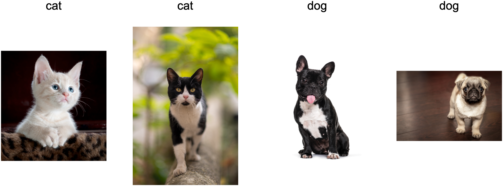
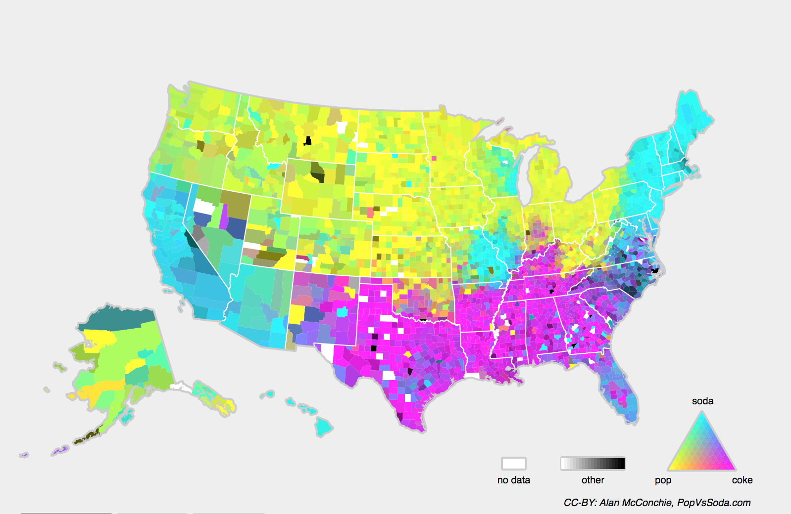

# 环境与分布偏移
:label:`sec_environment-and-distribution-shift`

在前面的几节中，我们完成了若干机器学习的动手应用，
把模型拟合到了各种数据集上。
然而，我们从未停下来思考过：数据最初究竟来自哪里，
以及我们最终打算用模型的输出来做什么。
太多时候，手头有了数据的机器学习开发者会匆忙开发模型，
而不停下来考虑这些根本性问题。

许多失败的机器学习部署都可以追溯到这种疏忽。
有时，以测试集准确率衡量，模型似乎表现极佳，
但一旦数据分布突然发生偏移，模型在部署中就会灾难性地失败。
更隐蔽的是，有时正是模型的部署本身，
成了扰动数据分布的催化剂。
例如，假设我们训练了一个模型来预测谁会偿还贷款而不是违约，
结果发现申请人的鞋子选择与违约风险相关联
（牛津鞋表示会还款，运动鞋表示会违约）。
于是我们可能倾向于给任何穿牛津鞋的申请人发放贷款，
而拒绝所有穿运动鞋的申请人。

在这种情况下，我们轻率地从模式识别跳跃到决策制定，
又没有批判性地考虑环境，可能会带来灾难性的后果。
首先，一旦我们开始根据鞋子做出决策，
顾客就会察觉并改变自己的行为。
要不了多久，所有申请人都会穿上牛津鞋，
而他们的信用状况却不会有任何相应的改善。
花一分钟消化一下这一点，因为类似的问题在机器学习的许多应用中层出不穷：
把我们基于模型做出的决策引入环境，可能会破坏模型本身。

我们虽然无法在一节中完整地处理这些主题，
但在此力求揭示一些常见的顾虑，
并激发所需的批判性思维，以便及早发现这类情况、减轻损害，
并负责任地使用机器学习。
有些解决方案很简单（去要“正确的”数据），
有些在技术上很困难（实现一个强化学习系统），
还有一些则要求我们完全走出统计预测的领域，
去应对与算法伦理应用有关的棘手哲学问题。

## 分布偏移的类型

首先，我们仍停留在被动预测（passive prediction）的设定中，
考察数据分布可能发生偏移的各种方式，
以及可以采取哪些措施来挽救模型性能。
在一个经典的设定中，我们假设训练数据是从某个分布 $p_S(\mathbf{x},y)$ 中采样得到的，
但测试数据将由从另一个不同的分布 $p_T(\mathbf{x},y)$ 中抽取的无标签样例构成。
此时，我们必须面对一个令人清醒的现实：
如果对 $p_S$ 与 $p_T$ 之间的关系没有任何假设，
那么学习一个稳健的分类器是不可能的。

考虑一个二元分类问题，我们想区分狗和猫。
如果分布可以以任意方式偏移，
那么这个设定就允许一种病态情形：
输入的分布保持不变，即 $p_S(\mathbf{x}) = p_T(\mathbf{x})$，
但标签全部翻转：$p_S(y \mid \mathbf{x}) = 1 - p_T(y \mid \mathbf{x})$。
换句话说，如果上帝突然决定，未来所有的“猫”都变成狗，
而我们以前称为“狗”的现在都变成猫——同时输入分布 $p(\mathbf{x})$ 没有任何变化——
那么我们就不可能把这种情形与分布根本没有改变的情形区分开来。

幸运的是，在关于数据未来可能如何变化的某些受限假设下，
有原则的算法可以检测出偏移，有时甚至能即时适应，
从而改善原始分类器的准确率。

### 协变量偏移

在分布偏移的各类别中，协变量偏移（covariate shift）也许是研究得最广泛的。
这里我们假设：输入的分布可能随时间变化，但标注函数，
即条件分布 $P(y \mid \mathbf{x})$，不会改变。
统计学家称之为*协变量偏移*，
因为这个问题源于协变量（特征）分布的偏移。
虽然我们有时不借助因果关系也能推理分布偏移，
但要注意，在我们相信 $\mathbf{x}$ 导致 $y$ 的设定中，
协变量偏移是应当采用的自然假设。

考虑区分猫和狗这一挑战。
我们的训练数据可能由 :numref:`fig_cat-dog-train` 中的那类图像组成。

:label:`fig_cat-dog-train`

在测试时，我们要对 :numref:`fig_cat-dog-test` 中的图像进行分类。

:label:`fig_cat-dog-test`

训练集由照片组成，而测试集只包含卡通画。
如果训练数据的特征与测试集存在显著差异，
而我们对如何适应新领域又没有一套连贯的方案，那就会带来麻烦。

### 标签偏移

*标签偏移*（label shift）描述的是相反的问题。
这里我们假设标签的边缘分布 $P(y)$ 可能改变，
但类条件分布 $P(\mathbf{x} \mid y)$ 在各个领域之间保持不变。
当我们相信 $y$ 导致 $\mathbf{x}$ 时，标签偏移是一个合理的假设。
例如，我们可能希望根据症状（或其他表现）来预测诊断结果，
即便各种诊断的相对流行程度随时间在变化。
这里标签偏移是恰当的假设，因为疾病导致症状。
在某些退化情形中，标签偏移和协变量偏移的假设可以同时成立。
例如，当标签是确定性的时候，即便 $y$ 导致 $\mathbf{x}$，
协变量偏移假设也会得到满足。
有趣的是，在这些情形下，采用从标签偏移假设推导出的方法往往更有利。
这是因为这些方法通常涉及操纵那些看起来像标签的对象（往往是低维的），
而不是看起来像输入的对象——在深度学习中，输入往往是高维的。

### 概念偏移

我们可能还会遇到与之相关的*概念偏移*（concept shift）问题，
它发生在标签的定义本身可能改变的时候。
这听起来很奇怪——*猫*就是*猫*，不是吗？
然而，其他类别的用法是会随时间变化的。
精神疾病的诊断标准、什么算时髦以及职位头衔，
都会经历相当程度的概念偏移。
事实证明，如果我们在美国各地走动，
按地理位置改变我们数据的来源，
就会发现，关于*软饮料*名称的分布存在相当程度的概念偏移，
如 :numref:`fig_popvssoda` 所示。

:width:`400px`
:label:`fig_popvssoda`

如果我们要构建一个机器翻译系统，
那么分布 $P(y \mid \mathbf{x})$ 可能因我们所在的地点而不同。
这个问题可能很难察觉。
我们也许希望利用这样一个知识：这种偏移只是在时间或地理意义上逐渐发生的。

## 分布偏移的示例

在深入形式化定义和算法之前，我们可以先讨论一些具体情形，
其中的协变量偏移或概念偏移也许并不明显。

### 医学诊断

设想你想设计一个检测癌症的算法。
你从健康人和病人那里收集数据，然后训练算法。
算法运行良好，给出了很高的准确率，
于是你断定自己已经准备好在医学诊断领域大展宏图了。
*别急。*

产生训练数据的分布与你在实际中会遇到的分布可能相差很大。
这种事就发生在多年前我们作者中的几位合作过的一家不幸的初创公司身上。
他们当时正在开发一种血液检测方法，用于检测一种主要影响老年男性的疾病，
并希望利用从患者身上采集的血液样本来研究它。
然而，从健康男性身上获取血液样本，
要比从已在医疗系统中的患病患者那里获取困难得多。
为了补偿这一点，这家初创公司向大学校园里的学生征集献血，
作为健康对照组来开发他们的检测方法。
然后他们问我们能否帮助他们构建一个检测该疾病的分类器。

正如我们向他们解释的那样，
以近乎完美的准确率区分健康人群和患病群体确实很容易。
然而，这是因为受试者在年龄、激素水平、
体力活动、饮食、饮酒量以及许多与疾病无关的其他因素上都有差异。
真正的患者身上不太可能出现这种情况。
由于他们的采样程序，我们可以预期会遇到极端的协变量偏移。
此外，这种情况不太可能通过常规方法纠正。
简而言之，他们白白浪费了一大笔钱。

### 自动驾驶汽车

假设有一家公司想利用机器学习来开发自动驾驶汽车。
其中一个关键部件是路旁检测器。
由于获取真实标注数据的成本很高，
他们有了一个（聪明又可疑的）想法：
用游戏渲染引擎生成的合成数据作为额外的训练数据。
在从渲染引擎中抽取的“测试数据”上，这个办法效果非常好。
唉，但在真实的汽车里，这却是一场灾难。
原来，路旁是用非常简单的纹理渲染的。
更重要的是，*所有*路旁都是用*同一种*纹理渲染的，
而路旁检测器很快就学会了这个“特征”。

类似的事情也发生在美国陆军身上，当时他们首次尝试在森林中检测坦克。
他们先拍摄了森林中没有坦克的航拍照片，
然后把坦克开进森林，又拍了一组照片。
分类器似乎工作得*完美*。
不幸的是，它只是学会了如何区分有阴影的树和无阴影的树——
第一组照片是在清晨拍摄的，第二组则是在正午拍摄的。

### 非平稳分布

当分布变化缓慢（也称为*非平稳分布*，nonstationary distribution），
而模型没有得到充分更新时，会出现一种隐蔽得多的情况。
下面是一些典型情形。

* 我们训练了一个计算广告模型，之后却没有频繁地更新它（例如，我们忘了纳入一款名为 iPad 的不起眼新设备刚刚发布这一事实）。
* 我们构建了一个垃圾邮件过滤器。它在检测迄今为止所见过的所有垃圾邮件方面表现良好。但随后垃圾邮件发送者学聪明了，炮制出与我们以前见过的任何东西都不同的新邮件。
* 我们构建了一个产品推荐系统。它整个冬天都运行良好，但在圣诞节过去很久之后，它还在继续推荐圣诞帽。

### 更多轶事

* 我们构建了一个人脸检测器。它在所有基准上都表现良好。不幸的是，它在测试数据上失败了——那些出问题的是人脸占满整张图像的特写照片（训练集中没有这类数据）。
* 我们为美国市场构建了一个网络搜索引擎，并想把它部署到英国。
* 我们通过汇编一个大型数据集来训练图像分类器，其中一大批类别（比如 1000 个类别）在数据集中均匀出现，每个类别由 1000 张图像表示。然后我们把系统部署到真实世界中，那里照片的实际标签分布明显是不均匀的。

## 分布偏移的纠正

正如我们已经讨论过的，在很多情况下，
训练分布和测试分布 $P(\mathbf{x}, y)$ 是不同的。
在一些情况下，我们运气好，即便存在协变量偏移、标签偏移或概念偏移，模型也能正常工作。
在另一些情况下，通过采用有原则的策略来应对偏移，我们可以做得更好。
本节剩下的部分在技术上会深入得多。
缺乏耐心的读者可以继续阅读下一节，
因为这些材料并不是后续概念的先修内容。

### 经验风险与风险
:label:`subsec_empirical-risk-and-risk`

让我们先反思一下模型训练过程中究竟发生了什么：
我们遍历训练数据的特征及相应标签
$\{(\mathbf{x}_1, y_1), \ldots, (\mathbf{x}_n, y_n)\}$，
并在每个小批量之后更新模型 $f$ 的参数。
为简单起见，我们不考虑正则化，
因此我们基本上是在最小化训练集上的损失：

$$\mathop{\mathrm{minimize}}_f \frac{1}{n} \sum_{i=1}^n l(f(\mathbf{x}_i), y_i),$$
:eqlabel:`eq_empirical-risk-min`

其中 $l$ 是损失函数，
衡量在给定相应标签 $y_i$ 的情况下，预测 $f(\mathbf{x}_i)$“有多糟”。
统计学家把 :eqref:`eq_empirical-risk-min` 中的项称为*经验风险*（empirical risk）。
*经验风险*是训练数据上的平均损失，
用来近似*风险*（risk），
后者是在从真实分布 $p(\mathbf{x},y)$ 中抽出的全部数据总体上损失的期望：

$$E_{p(\mathbf{x}, y)} [l(f(\mathbf{x}), y)] = \int\int l(f(\mathbf{x}), y) p(\mathbf{x}, y) \;d\mathbf{x}dy.$$
:eqlabel:`eq_true-risk`

然而在实践中，我们通常无法获得全部数据。
因此，*经验风险最小化*（empirical risk minimization），
即在 :eqref:`eq_empirical-risk-min` 中最小化经验风险，
是机器学习的一种实用策略，其希望是近似地最小化风险。

### 协变量偏移的纠正
:label:`subsec_covariate-shift-correction`

假设我们想要估计某种依赖关系 $P(y \mid \mathbf{x})$，
并且我们拥有带标签的数据 $(\mathbf{x}_i, y_i)$。
不幸的是，观测值 $\mathbf{x}_i$ 是从某个*源分布*（source distribution）$q(\mathbf{x})$ 中抽取的，
而不是从*目标分布*（target distribution）$p(\mathbf{x})$ 中抽取的。
幸运的是，依赖关系假设意味着条件分布不会改变：$p(y \mid \mathbf{x}) = q(y \mid \mathbf{x})$。
如果源分布 $q(\mathbf{x})$ 是“错误的”，
我们可以通过在风险中使用下面这个简单的恒等式来加以纠正：

$$
\begin{aligned}
\int\int l(f(\mathbf{x}), y) p(y \mid \mathbf{x})p(\mathbf{x}) \;d\mathbf{x}dy =
\int\int l(f(\mathbf{x}), y) q(y \mid \mathbf{x})q(\mathbf{x})\frac{p(\mathbf{x})}{q(\mathbf{x})} \;d\mathbf{x}dy.
\end{aligned}
$$

换句话说，我们需要按照“该数据样例本应从正确分布中抽出的概率”
与“它从错误分布中抽出的概率”之比，对每个数据样例重新加权：

$$\beta_i \stackrel{\textrm{def}}{=} \frac{p(\mathbf{x}_i)}{q(\mathbf{x}_i)}.$$

为每个数据样例 $(\mathbf{x}_i, y_i)$ 代入权重 $\beta_i$，
我们就可以使用*加权经验风险最小化*（weighted empirical risk minimization）来训练模型：

$$\mathop{\mathrm{minimize}}_f \frac{1}{n} \sum_{i=1}^n \beta_i l(f(\mathbf{x}_i), y_i).$$
:eqlabel:`eq_weighted-empirical-risk-min`

唉，我们并不知道这个比值，
所以在能做任何有用的事情之前，我们需要先估计它。
可用的方法很多，
其中包括一些精巧的算子理论方法，
它们试图用最小范数原理或最大熵原理直接重新校准期望算子。
请注意，对于任何这类方法，我们都需要从两个分布中抽取的样本——
“真实”分布 $p$（例如通过访问测试数据获得），
以及用于生成训练集的分布 $q$（后者很容易获得）。
但要注意，我们只需要特征 $\mathbf{x} \sim p(\mathbf{x})$；
我们不需要访问标签 $y \sim p(y)$。

在这种情况下，存在一种非常有效的方法，
它能给出几乎与原始方法一样好的结果：即逻辑回归（logistic regression），
它是 softmax 回归（见 :numref:`sec_softmax`）在二元分类下的特例。
这就是计算估计概率比所需要的全部内容。
我们学习一个分类器，用来区分从 $p(\mathbf{x})$ 中抽取的数据和从 $q(\mathbf{x})$ 中抽取的数据。
如果无法区分这两个分布，
那就意味着相关的这些实例同等地可能来自这两个分布中的任何一个。
另一方面，任何能够被良好区分的实例，
都应当相应地大幅提高权重或降低权重。

为简单起见，假设我们分别从两个分布 $p(\mathbf{x})$ 和 $q(\mathbf{x})$ 中拥有相同数量的实例。
现在用 $z$ 表示标签：从 $p$ 中抽取的数据标记为 $1$，从 $q$ 中抽取的数据标记为 $-1$。
那么混合数据集中的概率由下式给出

$$P(z=1 \mid \mathbf{x}) = \frac{p(\mathbf{x})}{p(\mathbf{x})+q(\mathbf{x})} \textrm{ and hence } \frac{P(z=1 \mid \mathbf{x})}{P(z=-1 \mid \mathbf{x})} = \frac{p(\mathbf{x})}{q(\mathbf{x})}.$$

因此，如果我们采用逻辑回归方法，其中 $P(z=1 \mid \mathbf{x})=\frac{1}{1+\exp(-h(\mathbf{x}))}$（$h$ 是一个参数化函数），那么可以推出

$$
\beta_i = \frac{1/(1 + \exp(-h(\mathbf{x}_i)))}{\exp(-h(\mathbf{x}_i))/(1 + \exp(-h(\mathbf{x}_i)))} = \exp(h(\mathbf{x}_i)).
$$

于是，我们需要解决两个问题：
第一个是区分从两个分布中抽取的数据，
然后是 :eqref:`eq_weighted-empirical-risk-min` 中的加权经验风险最小化问题，
其中我们用 $\beta_i$ 对各项加权。

现在我们准备好描述一个纠偏算法了。
假设我们有一个训练集 $\{(\mathbf{x}_1, y_1), \ldots, (\mathbf{x}_n, y_n)\}$ 和一个无标签测试集 $\{\mathbf{u}_1, \ldots, \mathbf{u}_m\}$。
对于协变量偏移，我们假设所有 $1 \leq i \leq n$ 的 $\mathbf{x}_i$ 都从某个源分布中抽取，
而所有 $1 \leq i \leq m$ 的 $\mathbf{u}_i$ 都从目标分布中抽取。
下面是纠正协变量偏移的一个典型算法：

1. 创建一个二元分类训练集：$\{(\mathbf{x}_1, -1), \ldots, (\mathbf{x}_n, -1), (\mathbf{u}_1, 1), \ldots, (\mathbf{u}_m, 1)\}$。
1. 用逻辑回归训练一个二元分类器，得到函数 $h$。
1. 用 $\beta_i = \exp(h(\mathbf{x}_i))$，或者更好的 $\beta_i = \min(\exp(h(\mathbf{x}_i)), c)$（$c$ 为某个常数）来给训练数据加权。
1. 在 :eqref:`eq_weighted-empirical-risk-min` 中使用权重 $\beta_i$ 在 $\{(\mathbf{x}_1, y_1), \ldots, (\mathbf{x}_n, y_n)\}$ 上训练。

请注意，上述算法依赖于一个关键假设。
要让这个方案奏效，我们需要目标（例如测试时）分布中的每个数据样例
在训练时都有非零的出现概率。
如果我们发现某个点满足 $p(\mathbf{x}) > 0$ 但 $q(\mathbf{x}) = 0$，
那么相应的重要性权重应当是无穷大。

### 标签偏移的纠正

假设我们处理的是一个有 $k$ 个类别的分类任务。
沿用 :numref:`subsec_covariate-shift-correction` 中的记号，
$q$ 和 $p$ 分别是源分布（例如训练时）和目标分布（例如测试时）。
假设标签的分布随时间偏移：$q(y) \neq p(y)$，
但类条件分布保持不变：$q(\mathbf{x} \mid y)=p(\mathbf{x} \mid y)$。
如果源分布 $q(y)$ 是“错误的”，
我们可以按照 :eqref:`eq_true-risk` 中定义的风险的如下恒等式来纠正：

$$
\begin{aligned}
\int\int l(f(\mathbf{x}), y) p(\mathbf{x} \mid y)p(y) \;d\mathbf{x}dy =
\int\int l(f(\mathbf{x}), y) q(\mathbf{x} \mid y)q(y)\frac{p(y)}{q(y)} \;d\mathbf{x}dy.
\end{aligned}
$$

这里，我们的重要性权重将对应于标签似然比：

$$\beta_i \stackrel{\textrm{def}}{=} \frac{p(y_i)}{q(y_i)}.$$

标签偏移的一个好处是：如果我们在源分布上有一个相当好的模型，
那么我们就能得到这些权重的一致估计，而完全不必处理周围维度。
在深度学习中，输入往往是像图像这样的高维对象，
而标签往往是像类别这样更简单的对象。

为了估计目标标签分布，
我们首先取来那个相当好的现成分类器（通常是在训练数据上训练的），
并用验证集（同样来自训练分布）计算它的“混淆”矩阵。
*混淆矩阵*（confusion matrix）$\mathbf{C}$ 就是一个 $k \times k$ 的矩阵，
其中每一列对应一个标签类别（真实类别），每一行对应我们模型的预测类别。
每个单元格的值 $c_{ij}$ 是验证集上全部预测中，
真实标签为 $j$ 而我们的模型预测为 $i$ 的预测所占的比例。

现在，我们无法直接在目标数据上计算混淆矩阵，
因为除非我们投入构建一个复杂的实时标注流水线，
否则我们是看不到在实际中遇到的样例的标签的。
不过，我们能够做的是：把测试时模型的所有预测平均起来，
得到平均模型输出 $\mu(\hat{\mathbf{y}}) \in \mathbb{R}^k$，
其中第 $i^\textrm{th}$ 个元素 $\mu(\hat{y}_i)$
是测试集上全部预测中我们的模型预测为 $i$ 的预测所占的比例。

事实证明，在某些温和条件下——
如果我们的分类器一开始就相当准确，
如果目标数据只包含我们以前见过的类别，
并且如果标签偏移假设一开始就成立（这是这里最强的假设）——
我们可以通过求解一个简单的线性方程组来估计测试集的标签分布

$$\mathbf{C} p(\mathbf{y}) = \mu(\hat{\mathbf{y}}),$$

因为作为估计，$\sum_{j=1}^k c_{ij} p(y_j) = \mu(\hat{y}_i)$ 对所有 $1 \leq i \leq k$ 都成立，
其中 $p(y_j)$ 是 $k$ 维标签分布向量 $p(\mathbf{y})$ 的第 $j^\textrm{th}$ 个元素。
如果我们的分类器一开始就足够准确，
那么混淆矩阵 $\mathbf{C}$ 将是可逆的，
我们便得到解 $p(\mathbf{y}) = \mathbf{C}^{-1} \mu(\hat{\mathbf{y}})$。

由于我们观测到了源数据上的标签，
估计分布 $q(y)$ 很容易。
然后，对于任何标签为 $y_i$ 的训练样例 $i$，
我们可以取所估计的 $p(y_i)/q(y_i)$ 之比来计算权重 $\beta_i$，
并把它代入 :eqref:`eq_weighted-empirical-risk-min` 中的加权经验风险最小化。

### 概念偏移的纠正

概念偏移要按有原则的方式修正困难得多。
例如，在问题突然从区分猫和狗变成区分白色动物和黑色动物的情形下，
假定我们能比单纯收集新标签并从头训练做得好得多，是不合理的。
幸运的是在实践中，这种极端的偏移很少见。
通常发生的情况是，任务在缓慢地持续变化。
为了让事情更具体，这里有一些例子：

* 在计算广告中，新产品不断推出，旧产品变得不那么流行。这意味着广告及其流行度的分布会逐渐变化，任何点击率预测器都需要随之逐渐变化。
* 交通摄像头的镜头会因环境磨损而逐渐退化，从而逐步影响图像质量。
* 新闻内容会逐渐变化（即大多数新闻保持不变，但会出现新的报道）。

在这种情况下，我们可以采用训练网络时所用的同一套方法，让网络适应数据的变化。
换句话说，我们使用现有的网络权重，用新数据简单地执行几步更新，
而不是从头训练。

## 学习问题的分类法

有了处理分布变化的知识，我们现在可以考虑机器学习问题表述的一些其他方面。

### 批量学习

在*批量学习*（batch learning）中，我们可以访问训练特征和标签 $\{(\mathbf{x}_1, y_1), \ldots, (\mathbf{x}_n, y_n)\}$，并用它们训练一个模型 $f(\mathbf{x})$。之后，我们部署这个模型来为新数据 $(\mathbf{x}, y)$ 打分，这些新数据来自同一分布。这是我们在本书中讨论的任何问题默认的假设。例如，我们可能根据大量猫和狗的照片训练一个猫检测器。一旦训练完成，我们就把它作为智能猫门计算机视觉系统的一部分交付出去，该系统只让猫进屋。然后它被安装到客户家中，之后再也不更新（除非出现极端情况）。

### 在线学习

现在设想数据 $(\mathbf{x}_i, y_i)$ 一次只到达一个样本。更具体地说，假设我们先观测到 $\mathbf{x}_i$，然后需要给出一个估计 $f(\mathbf{x}_i)$。只有在我们给出估计之后，才会观测到 $y_i$，并因此根据我们的决策获得奖励或遭受损失。
许多实际问题都属于这一类。例如，我们需要预测明天的股价，这让我们能基于该估计进行交易，并在当天结束时得知这个估计是否让我们赚了钱。换句话说，在*在线学习*（online learning）中，我们有下面这样的循环，根据新的观测不断改进模型：

$$\begin{aligned}&\textrm{model } f_t \longrightarrow \textrm{data }  \mathbf{x}_t \longrightarrow \textrm{estimate } f_t(\mathbf{x}_t) \longrightarrow\\ \textrm{obs}&\textrm{ervation } y_t \longrightarrow \textrm{loss } l(y_t, f_t(\mathbf{x}_t)) \longrightarrow \textrm{model } f_{t+1}\end{aligned}$$

### 赌博机

*赌博机*（bandits）是上述问题的一种特殊情况。在大多数学习问题中，我们有一个连续参数化的函数 $f$，我们想学习它的参数（例如深度网络）；而在*赌博机*问题中，我们只有有限数量的臂可以拉动，即只有有限数量的动作可以采取。毫不奇怪，对于这个更简单的问题，可以获得关于最优性的更强的理论保证。我们把它列在这里，主要是因为这个问题常常（令人困惑地）被当作一种独特的学习设定来对待。

### 控制

在许多情况下，环境会记住我们做过什么。不一定是以对抗的方式，它只是会记住，而响应将取决于之前发生过什么。例如，一个咖啡加热器控制器会根据它之前是否在加热壶身而观测到不同的温度。PID（比例-积分-微分）控制器算法是那里的一种流行选择。
同样，用户在新闻网站上的行为会取决于我们之前给他们展示了什么（例如，大多数新闻他们只会读一次）。许多这类算法会构建一个其所处环境的模型，以便使它们的决策显得不那么随机。
最近，
控制理论（例如 PID 的各种变体）也被用来自动调整超参数，
以获得更好的解耦和重建质量，
并提升生成文本的多样性和生成图像的重建质量 :cite:`Shao.Yao.Sun.ea.2020`。

### 强化学习

在有记忆的环境的更一般情形下，我们可能遇到环境试图与我们合作的情况（合作博弈，特别是非零和博弈），或者环境试图获胜的情况。国际象棋、围棋、西洋双陆棋或 StarCraft 都是*强化学习*（reinforcement learning）中的一些例子。同样，我们可能想为自动驾驶汽车构建一个良好的控制器。其他车辆很可能会以不平凡的方式对自动驾驶汽车的驾驶风格做出反应，例如试图避开它、试图制造事故，或试图与它合作。

### 考虑环境

上述不同情形之间的一个关键区别在于：在一个平稳环境中自始至终可能奏效的策略，在一个能够适应的环境中未必始终奏效。例如，交易员发现的一个套利机会一旦被利用，很可能就会消失。环境变化的速度和方式在很大程度上决定了我们可以采用哪类算法。例如，如果我们知道事物只可能缓慢变化，我们就可以强迫任何估计也只缓慢变化。如果我们知道环境可能瞬间变化，但只是非常不频繁地变化，我们就可以为此留出余地。这类知识对于有志于成为数据科学家的人处理概念偏移至关重要，即当所解决的问题可能随时间变化时。

## 机器学习中的公平性、问责制与透明度

最后，重要的是要记住，
当你部署机器学习系统时，
你不仅仅是在优化一个预测模型——
你通常是在提供一个将被用来（部分或完全）自动化决策的工具。
这些技术系统可能影响那些受决策结果影响的个体的生活。
从考虑预测到做出决策的跳跃，
不仅带来新的技术问题，
还带来一系列必须仔细考虑的伦理问题。
如果我们要部署一个医学诊断系统，
就需要知道它对哪些人群可能有效、对哪些人群可能无效。
忽视某个子群体福利方面可预见的风险，
可能导致我们对他们施以较差的医疗照护。
此外，一旦我们考虑决策系统，
就必须后退一步，重新思考我们如何评估自己的技术。
这次范围变化带来的后果之一，
就是我们将会发现*准确率*很少是合适的度量。
例如，在把预测转化为行动时，
我们往往希望考虑以各种方式犯错的潜在成本敏感性。
如果对一张图像的一种误分类方式
可能被视为种族上的冒犯，
而误分类到另一个类别则无伤大雅，
那么我们就可能希望相应地调整阈值，
在设计决策协议时把社会价值观考虑进去。
我们还要小心预测系统如何导致反馈循环。
例如，考虑预测性警务系统，
它把巡逻警员分配到预测犯罪率高的地区。
很容易看出一个令人担忧的模式是如何出现的：

 1. 犯罪更多的社区得到更多的巡逻。
 1. 因此，在这些社区中发现更多犯罪，这些犯罪进入可用于未来迭代的训练数据。
 1. 模型接触到更多正例后，预测这些社区的犯罪更多。
 1. 在下一次迭代中，更新后的模型更着重瞄准同一社区，导致发现更多犯罪，如此循环。

通常，模型预测与训练数据相互耦合的各种机制，
在建模过程中都没有被考虑在内。
这可能导致研究者所称的*失控反馈循环*（runaway feedback loops）。
此外，我们还要小心
我们一开始是否在解决正确的问题。
预测算法现在在调节信息传播方面发挥着超大的作用。
一个人遇到的新闻，是否应当由他们*点赞*过的 Facebook 页面集合来决定？
这些只是你在机器学习职业生涯中可能遇到的众多紧迫伦理困境中的几个。

## 小结

在许多情况下，训练集和测试集并非来自同一分布。这称为分布偏移。
风险是在从真实分布中抽取的全部数据总体上损失的期望。然而，这整个总体通常是无法获得的。经验风险是训练数据上的平均损失，用来近似风险。在实践中，我们执行经验风险最小化。

在相应的假设下，协变量偏移和标签偏移可以在测试时被检测并纠正。未能考虑这种偏差，在测试时可能会成为问题。
在某些情况下，环境可能记住自动化动作，并以令人惊讶的方式做出响应。我们在构建模型时必须考虑这种可能性，并持续监控在线系统，对模型与环境以意想不到的方式纠缠在一起的可能性保持开放态度。

## 练习

1. 当我们改变搜索引擎的行为时，可能会发生什么？用户可能会怎么做？广告商呢？
1. 实现一个协变量偏移检测器。提示：构建一个分类器。
1. 实现一个协变量偏移纠正器。
1. 除了分布偏移之外，还有什么会影响经验风险对风险的近似程度？

[讨论](https://discuss.d2l.ai/t/105)
