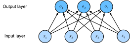

# softmax 回归
:label:`sec_softmax`

在 :numref:`sec_linear_regression` 中，我们介绍了线性回归，
在 :numref:`sec_linear_scratch` 中从零实现了它，
随后又在 :numref:`sec_linear_concise` 中改用深度学习框架的高级 API
来完成繁重的工作。

当我们想要回答*多少？*或*几个？*这类问题时，
回归就是我们诉诸的锤子。
如果你想预测一栋房子将以多少美元（价格）售出，
或想预测一支棒球队可能赢多少场比赛，
或想预测一位病人在出院前还要住院多少天，
那么你很可能需要一个回归模型。
然而，即使在回归模型内部，也存在重要的区别。
例如，房价永远不会为负，
而且其变化往往可能是相对于基准价格的*相对*变化。
因此，对价格的对数进行回归可能更为有效。
同样，病人住院的天数是一个*离散非负*随机变量。
因此，最小均方误差可能也不是理想的方法。
这类时间-事件建模还伴随着许多其他复杂问题，
它们由一门称为*生存建模*（survival modeling）的专业子领域来处理。

这里的目的不是要让你不堪重负，
而只是想让你知道，估计远不止最小化平方误差这么简单。
更广泛地说，监督学习也远不止回归。
在本节中，我们关注*分类*（classification）问题，
在这类问题中，我们搁置*多少？*这类问题，
转而关注*属于哪一类？*这类问题。

* 这封电子邮件应该放进垃圾邮件文件夹还是收件箱？
* 这位客户更可能订阅还是不订阅某项订阅服务？
* 这张图像描绘的是驴、狗、猫还是公鸡？
* Aston 最可能接下来看哪部电影？
* 你接下来要读本书的哪一节？

通俗地说，机器学习从业者会重载*分类*一词，
用它来描述两个微妙不同的问题：
(i) 只关心把样例硬性地分配给各个类别（类）的问题；
(ii) 希望进行软分配，
即评估每个类别适用概率的问题。
这种区别往往会变得模糊，部分原因是：
即使我们只关心硬分配，
我们也常常使用进行软分配的模型。

更有甚者，在某些情况下可能有不止一个标签为真。
例如，一篇新闻文章可能同时涉及
娱乐、商业和太空飞行这些主题，
但不涉及医学或体育主题。
因此，把它单独归入上述类别之一，
用处不大。
这个问题通常称为[多标签分类](https://en.wikipedia.org/wiki/Multi-label_classification)。
综述参见 :citet:`Tsoumakas.Katakis.2007`，
图像标注中的有效算法参见 :citet:`Huang.Xu.Yu.2015`。

## 分类
:label:`subsec_classification-problem`

为了先熟悉一下，我们从一个简单的图像分类问题开始。
这里，每个输入由一幅 $2\times2$ 的灰度图像构成。
我们可以用单个标量表示每个像素值，
从而得到四个特征 $x_1, x_2, x_3, x_4$。
此外，我们假设每幅图像属于
“猫”“鸡”和“狗”三个类别之一。

接下来，我们必须选择如何表示标签。
我们有两个显而易见的选择。
也许最自然的冲动是选择 $y \in \{1, 2, 3\}$，
其中整数分别表示
$\{\textrm{dog}, \textrm{cat}, \textrm{chicken}\}$。
这是在计算机上*存储*此类信息的一种好方法。
如果这些类别之间存在某种自然的顺序，
比如我们要预测的是
$\{\textrm{baby}, \textrm{toddler}, \textrm{adolescent}, \textrm{young adult}, \textrm{adult}, \textrm{geriatric}\}$，
那么把它转化为一个[序数回归](https://en.wikipedia.org/wiki/Ordinal_regression)问题
并保持这种标签格式甚至还说得通。
关于不同类型排序损失函数的综述，
参见 :citet:`Moon.Smola.Chang.ea.2010`；
关于处理多峰响应的贝叶斯方法，
参见 :citet:`Beutel.Murray.Faloutsos.ea.2014`。

一般来说，分类问题的各个类之间并没有自然的顺序。
幸运的是，统计学家很久以前就发明了一种
表示分类数据的简单方法：*独热编码*（one-hot encoding）。
独热编码是一个向量，
其分量个数等于类别的个数。
与特定实例所属类别对应的分量被设为 1，
所有其他分量都被设为 0。
在我们的例子中，标签 $y$ 将是一个三维向量，
$(1, 0, 0)$ 对应“猫”，$(0, 1, 0)$ 对应“鸡”，
$(0, 0, 1)$ 对应“狗”：

$$y \in \{(1, 0, 0), (0, 1, 0), (0, 0, 1)\}.$$

### 线性模型

为了估计与所有可能类别
相关联的条件概率，
我们需要一个具有多个输出的模型，每个类别对应一个输出。
为了用线性模型解决分类问题，
我们需要与输出个数一样多的仿射函数。
严格来说，我们只需要少一个，
因为最后一个类别必须等于 $1$ 减去其他类别之和，
但出于对称性的考虑，
我们使用一种稍有冗余的参数化方式。
每个输出对应它自己的仿射函数。
在我们的例子中，由于有 4 个特征和 3 个可能的输出类别，
我们需要 12 个标量来表示权重（带下标的 $w$），
以及 3 个标量来表示偏置（带下标的 $b$）。这给出：

$$
\begin{aligned}
o_1 &= x_1 w_{11} + x_2 w_{12} + x_3 w_{13} + x_4 w_{14} + b_1,\\
o_2 &= x_1 w_{21} + x_2 w_{22} + x_3 w_{23} + x_4 w_{24} + b_2,\\
o_3 &= x_1 w_{31} + x_2 w_{32} + x_3 w_{33} + x_4 w_{34} + b_3.
\end{aligned}
$$

对应的神经网络图如 :numref:`fig_softmaxreg` 所示。
就像线性回归中一样，
我们使用单层神经网络。
由于每个输出 $o_1, o_2$ 和 $o_3$ 的计算
都依赖于每一个输入 $x_1$、$x_2$、$x_3$ 和 $x_4$，
输出层也可以描述为*全连接层*。

:label:`fig_softmaxreg`

为了使用更简洁的记号，我们采用向量和矩阵：
$\mathbf{o} = \mathbf{W} \mathbf{x} + \mathbf{b}$
更适合数学和代码。
请注意，我们把所有权重汇集到一个 $3 \times 4$ 矩阵中，
并把所有偏置
$\mathbf{b} \in \mathbb{R}^3$ 汇集到一个向量中。

### softmax 运算
:label:`subsec_softmax_operation`

假设有一个合适的损失函数，
我们可以直接尝试最小化
$\mathbf{o}$ 与标签 $\mathbf{y}$ 之间的差异。
虽然把分类当作向量值回归问题来处理
效果出奇地好，
但它在以下几个方面仍然不能令人满意：

* 无法保证输出 $o_i$ 之和为 $1$，即无法像我们期望的概率那样表现。
* 即使输出之和为 $1$，也无法保证输出 $o_i$ 非负，或者不超过 $1$。

这两个方面都使得估计问题难以求解，
而且解对离群值非常敏感。
例如，如果我们假设
卧室数量与某人买房的概率之间
存在正线性依赖关系，
那么在购买豪宅时概率可能会超过 $1$！
因此，我们需要一种把输出“压缩”的机制。

我们可以通过许多方式来实现这一目标。
例如，我们可以假设输出
$\mathbf{o}$ 是 $\mathbf{y}$ 的损坏版本，
其中损坏是通过加入从正态分布中抽取的噪声 $\boldsymbol{\epsilon}$ 发生的。
换句话说，$\mathbf{y} = \mathbf{o} + \boldsymbol{\epsilon}$，
其中 $\epsilon_i \sim \mathcal{N}(0, \sigma^2)$。
这就是所谓的 [probit 模型](https://en.wikipedia.org/wiki/Probit_model)，
由 :citet:`Fechner.1860` 首次提出。
虽然它颇具吸引力，但与 softmax 相比，
它的效果并不那么好，
也不会带来特别漂亮的优化问题。

实现这一目标（并确保非负性）的另一种方法
是使用指数函数 $P(y = i) \propto \exp o_i$。
这确实满足这样的要求：
条件类别概率随 $o_i$ 增大而增大，
它是单调的，
并且所有概率都非负。
然后我们可以把每个值除以它们的和，
从而把这些值变换为加起来等于 $1$。
这一过程称为*规范化*（normalization）。
把这两个部分结合起来，
就得到了 *softmax* 函数：

$$\hat{\mathbf{y}} = \mathrm{softmax}(\mathbf{o}) \quad \textrm{where}\quad \hat{y}_i = \frac{\exp(o_i)}{\sum_j \exp(o_j)}.$$
:eqlabel:`eq_softmax_y_and_o`

请注意，$\mathbf{o}$ 中最大的坐标
对应 $\hat{\mathbf{y}}$ 中最可能的类别。
此外，由于 softmax 运算
保持其各参数之间的顺序，
我们不需要计算 softmax
就能确定哪个类别被赋予了最高概率。因此，

$$
\operatorname*{argmax}_j \hat y_j = \operatorname*{argmax}_j o_j.
$$

softmax 的思想可以追溯到 :citet:`Gibbs.1902`，
他从物理学中借鉴了相关思想。
再往前追溯，现代统计物理学的奠基人 Boltzmann
就用这个技巧来建模气体分子能态上的分布。
特别是，他发现热力学系综
（例如气体中的分子）中某个能量状态的普遍程度
与 $\exp(-E/kT)$ 成正比。
这里，$E$ 是某个状态的能量，
$T$ 是温度，$k$ 是 Boltzmann 常数。
当统计学家谈论提高或降低
一个统计系统的“温度”时，
他们指的是改变 $T$，
以便偏向能量更低或更高的状态。
遵循 Gibbs 的思想，能量等价于误差。
基于能量的模型 :cite:`Ranzato.Boureau.Chopra.ea.2007`
在描述深度学习问题时采用了这一观点。

### 向量化
:label:`subsec_softmax_vectorization`

为了提高计算效率，
我们在数据的小批量上对计算进行向量化。
假设给定一个由 $n$ 个样例组成的小批量
$\mathbf{X} \in \mathbb{R}^{n \times d}$，
其维数（输入个数）为 $d$。
此外，假设输出有 $q$ 个类别。
那么权重满足 $\mathbf{W} \in \mathbb{R}^{d \times q}$，
偏置满足 $\mathbf{b} \in \mathbb{R}^{1\times q}$。

$$ \begin{aligned} \mathbf{O} &= \mathbf{X} \mathbf{W} + \mathbf{b}, \\ \hat{\mathbf{Y}} & = \mathrm{softmax}(\mathbf{O}). \end{aligned} $$
:eqlabel:`eq_minibatch_softmax_reg`

这会把主要运算加速为
一个矩阵-矩阵乘积 $\mathbf{X} \mathbf{W}$。
此外，由于 $\mathbf{X}$ 中的每一行表示一个数据样例，
softmax 运算本身可以*按行*计算：
对 $\mathbf{O}$ 的每一行，先对所有元素取指数，
然后按和进行规范化。
不过请注意，必须小心
避免对大数取指数和取对数，
因为这可能导致数值上溢或下溢。
深度学习框架会自动处理这一点。

## 损失函数
:label:`subsec_softmax-regression-loss-func`

既然我们已经有了从特征 $\mathbf{x}$
到概率 $\mathbf{\hat{y}}$ 的映射，
就需要一种方法来优化这个映射的准确率。
我们将依赖最大似然估计，
这正是我们在 :numref:`subsec_normal_distribution_and_squared_loss` 中
为均方误差损失提供概率论依据时所使用的方法。

### 对数似然

softmax 函数给出一个向量 $\hat{\mathbf{y}}$，
我们可以把它解释为在给定任意输入 $\mathbf{x}$ 时
每个类别的（估计）条件概率，
例如 $\hat{y}_1$ = $P(y=\textrm{cat} \mid \mathbf{x})$。
在下文中，我们假设对于特征为 $\mathbf{X}$ 的数据集，
标签 $\mathbf{Y}$ 用独热编码的标签向量表示。
我们可以通过检查在给定特征的情况下
实际类别在模型看来有多大的可能性，
来把估计值与现实进行比较：

$$
P(\mathbf{Y} \mid \mathbf{X}) = \prod_{i=1}^n P(\mathbf{y}^{(i)} \mid \mathbf{x}^{(i)}).
$$

我们之所以可以使用这种因式分解，
是因为我们假设每个标签都是独立地
从其各自的分布 $P(\mathbf{y}\mid\mathbf{x}^{(i)})$ 中抽取的。
由于最大化各项的乘积很不方便，
我们取负对数，从而得到等价的
最小化负对数似然的问题：

$$
-\log P(\mathbf{Y} \mid \mathbf{X}) = \sum_{i=1}^n -\log P(\mathbf{y}^{(i)} \mid \mathbf{x}^{(i)})
= \sum_{i=1}^n l(\mathbf{y}^{(i)}, \hat{\mathbf{y}}^{(i)}),
$$

其中，对于 $q$ 个类别上的任意一对标签 $\mathbf{y}$
和模型预测 $\hat{\mathbf{y}}$，
损失函数 $l$ 为

$$ l(\mathbf{y}, \hat{\mathbf{y}}) = - \sum_{j=1}^q y_j \log \hat{y}_j. $$
:eqlabel:`eq_l_cross_entropy`

由于稍后将解释的原因，
:eqref:`eq_l_cross_entropy` 中的损失函数
通常称为*交叉熵损失*（cross-entropy loss）。
由于 $\mathbf{y}$ 是长度为 $q$ 的独热向量，
对其所有坐标 $j$ 的求和中除一项外其余各项都消失。
请注意，只要 $\hat{\mathbf{y}}$ 是概率向量，
损失 $l(\mathbf{y}, \hat{\mathbf{y}})$
就有下界 $0$：
没有任何一项大于 $1$，
因此它们的负对数不可能低于 $0$；
只有在我们*确信*地预测出实际标签时，
才有 $l(\mathbf{y}, \hat{\mathbf{y}}) = 0$。
对于任何有限的权重取值，这永远不可能发生，
因为要让 softmax 输出趋向 $1$，
就需要让相应的输入 $o_i$ 趋向无穷大
（或者让所有其他输出 $o_j$（$j \neq i$）趋向负无穷大）。
即使我们的模型能够分配输出概率 $0$，
在赋予如此高的置信度时所犯的任何错误
都会带来无穷大的损失（$-\log 0 = \infty$）。

### softmax 与交叉熵损失
:label:`subsec_softmax_and_derivatives`

由于 softmax 函数
及相应的交叉熵损失如此常见，
值得更好地理解它们是如何计算的。
把 :eqref:`eq_softmax_y_and_o` 代入
:eqref:`eq_l_cross_entropy` 中损失的定义，
并利用 softmax 的定义，我们得到

$$
\begin{aligned}
l(\mathbf{y}, \hat{\mathbf{y}}) &=  - \sum_{j=1}^q y_j \log \frac{\exp(o_j)}{\sum_{k=1}^q \exp(o_k)} \\
&= \sum_{j=1}^q y_j \log \sum_{k=1}^q \exp(o_k) - \sum_{j=1}^q y_j o_j \\
&= \log \sum_{k=1}^q \exp(o_k) - \sum_{j=1}^q y_j o_j.
\end{aligned}
$$

为了更好地理解究竟发生了什么，
考虑关于任意 logit $o_j$ 的导数。我们得到

$$
\partial_{o_j} l(\mathbf{y}, \hat{\mathbf{y}}) = \frac{\exp(o_j)}{\sum_{k=1}^q \exp(o_k)} - y_j = \mathrm{softmax}(\mathbf{o})_j - y_j.
$$

换句话说，这个导数就是
我们的模型（通过 softmax 运算表达）所分配的概率
与实际发生的情况（通过独热标签向量中的元素表达）
之间的差。
在这个意义上，它与我们在回归中所看到的非常相似：
那里的梯度是观测值 $y$ 与估计值 $\hat{y}$ 之间的差。
这并非巧合。
在任何指数族模型中，
对数似然的梯度都恰好由这一项给出。
这一事实使得在实践中计算梯度变得容易。

现在考虑我们观察到的不是一个单一结果，
而是结果的整个分布的情形。
我们可以对标签 $\mathbf{y}$ 使用与之前相同的表示。
唯一的区别在于，
我们不再使用只含二值元素（比如 $(0, 0, 1)$）的向量，
而使用一个一般的概率向量，比如 $(0.1, 0.2, 0.7)$。
我们之前用来在 :eqref:`eq_l_cross_entropy`
中定义损失 $l$ 的数学仍然适用，
只是解释稍微更一般一些。
它是标签分布下损失的期望值。
这种损失称为*交叉熵损失*，
也是分类问题中最常用的损失之一。
我们可以通过介绍一点信息论的基础知识
来揭开这个名字的奥秘。
简而言之，它度量的是
把我们看到的内容 $\mathbf{y}$ 相对于
我们预测应该发生的内容 $\hat{\mathbf{y}}$ 进行编码所需的比特数。
下面我们给出一个非常基本的解释。
关于信息论的更多细节，参见
:citet:`Cover.Thomas.1999` 或 :citet:`mackay2003information`。

## 信息论基础
:label:`subsec_info_theory_basics`

许多深度学习论文使用来自信息论的直觉和术语。
为了理解它们，我们需要一些共同的语言。
本节就是一份生存指南。
*信息论*（information theory）研究
信息（也称为数据）的编码、解码、传输和操作问题。

### 熵

信息论的核心思想是量化
数据中包含的信息量。
这为我们压缩数据的能力设定了一个极限。
对于分布 $P$，其*熵*（entropy）$H[P]$ 定义为：

$$H[P] = \sum_j - P(j) \log P(j).$$
:eqlabel:`eq_softmax_reg_entropy`

信息论的基本定理之一指出，
为了对从分布 $P$ 中随机抽取的数据进行编码，
我们至少需要 $H[P]$ 个“纳特”（nat）来编码 :cite:`Shannon.1948`。
如果你想知道什么是“纳特”，
它相当于比特，只不过使用的是以 $e$ 为底的编码，
而不是以 2 为底的编码。
因此，一个纳特等于 $\frac{1}{\log(2)} \approx 1.44$ 比特。

### 惊奇

你可能会想，压缩与预测有什么关系。
想象一下，我们有一个想要压缩的数据流。
如果我们总能轻松预测下一个词元，
那么这个数据就很容易压缩。
举一个极端的例子：
数据流中的每个词元总是取相同的值。
那是一个极其无聊的数据流！
它不仅无聊，而且很容易预测。
由于词元总是相同的，
我们不必传输任何信息
就能传达该数据流的内容。
容易预测，也就容易压缩。

然而，如果我们无法完美预测每一个事件，
那么有时我们就会感到惊奇。
当一个事件被赋予较低的概率时，
我们的惊奇感会更强。
Claude Shannon 选定
$\log \frac{1}{P(j)} = -\log P(j)$
来量化某人在给事件 $j$ 赋予（主观）概率 $P(j)$
后观察到该事件时的*惊奇*程度。
而在 :eqref:`eq_softmax_reg_entropy` 中定义的熵，
则是在所赋予的概率
真正匹配数据生成过程时的*期望惊奇*。

### 重新审视交叉熵

因此，如果熵是知道真实概率的人
所体验到的惊奇程度，
那么你可能会想：交叉熵又是什么呢？
*从* $P$ *到* $Q$ 的交叉熵，记作 $H(P, Q)$，
是一个具有主观概率 $Q$ 的观察者
在看到实际按概率 $P$ 生成的数据时
所经历的期望惊奇。
它由 $H(P, Q) \stackrel{\textrm{def}}{=} \sum_j - P(j) \log Q(j)$ 给出。
当 $P=Q$ 时，交叉熵达到可能的最小值。
在这种情况下，从 $P$ 到 $Q$ 的交叉熵为 $H(P, P)= H(P)$。

简而言之，我们可以从两个角度来看待
交叉熵分类目标：
(i) 最大化观测数据的似然；
(ii) 最小化我们传达标签
所需的惊奇（从而最小化所需的比特数）。

## 小结与讨论

在本节中，我们遇到了第一个非平凡的损失函数，
它使我们能够在*离散*输出空间上进行优化。
其设计的关键在于我们采用了概率论方法，
把离散类别视为从概率分布中抽取的实例。
作为一个附带结果，我们遇到了 softmax，
这是一个方便的激活函数，
它把普通神经网络层的输出变换为
合法的离散概率分布。
我们看到，交叉熵损失与 softmax 结合后的导数
与平方误差的导数表现非常相似；
都是取期望行为与其预测之间的差。
而且，尽管我们只是触及了它的表面，
我们还是遇到了与统计物理和信息论
之间令人兴奋的联系。

虽然这足以让你继续前进，
也希望足以吊起你的胃口，
但我们在这里几乎没有深入。
除其他事项外，我们跳过了计算方面的考虑。
具体来说，对于任何具有 $d$ 个输入和 $q$ 个输出的全连接层，
其参数化和计算成本为 $\mathcal{O}(dq)$，
这在实践中可能高得令人望而却步。
幸运的是，把 $d$ 个输入变换为 $q$ 个输出的这一成本
可以通过近似和压缩来降低。
例如，Deep Fried Convnets :cite:`Yang.Moczulski.Denil.ea.2015`
结合使用置换、傅里叶变换和缩放，
把成本从二次降为对数线性。
类似的技术也适用于更高级的结构矩阵近似 :cite:`sindhwani2015structured`。
最后，基于压缩因子 $n$，
我们可以使用类似四元数的分解
把成本降低到 $\mathcal{O}(\frac{dq}{n})$——
前提仍是我们愿意用少量精度换取计算和存储成本的降低 :cite:`Zhang.Tay.Zhang.ea.2021`。
这是一个活跃的研究领域。
其挑战性在于，
我们未必追求最紧凑的表示
或最少的浮点运算次数，
而是追求在现代 GPU 上能够最高效执行的解。

## 练习

1. 我们可以更深入地探讨指数族与 softmax 之间的联系。
    1. 计算 softmax 的交叉熵损失 $l(\mathbf{y},\hat{\mathbf{y}})$ 的二阶导数。
    1. 计算由 $\mathrm{softmax}(\mathbf{o})$ 给出的分布的方差，并证明它与上面计算的二阶导数一致。
1. 假设我们有三个等概率出现的类别，即概率向量为 $(\frac{1}{3}, \frac{1}{3}, \frac{1}{3})$。
    1. 如果我们尝试为它设计一种二进制编码，会有什么问题？
    1. 你能设计一种更好的编码吗？提示：如果我们尝试编码两个独立的观察会怎样？如果我们联合编码 $n$ 个观察又会怎样？
1. 在编码通过物理导线传输的信号时，工程师并不总是使用二进制编码。例如，[PAM-3](https://en.wikipedia.org/wiki/Ternary_signal) 使用三个信号电平 $\{-1, 0, 1\}$，而不是两个电平 $\{0, 1\}$。传输 $\{0, \ldots, 7\}$ 范围内的一个整数需要多少个三进制单位？从电子学的角度看，为什么这可能是个更好的主意？
1. [Bradley–Terry 模型](https://en.wikipedia.org/wiki/Bradley%E2%80%93Terry_model)使用
逻辑模型来刻画偏好。为了刻画用户在苹果和橙子之间的选择，
我们假定分数 $o_{\textrm{apple}}$ 和 $o_{\textrm{orange}}$。我们的要求是：
分数越大，选择相应物品的可能性就越高；
并且分数最大的物品最可能被选中 :cite:`Bradley.Terry.1952`。
    1. 证明 softmax 满足这一要求。
    1. 如果你想允许一个既不选苹果也不选橙子的默认选项，会发生什么？提示：现在用户有三个选择。
1. softmax 的名字来自如下映射：$\textrm{RealSoftMax}(a, b) = \log (\exp(a) + \exp(b))$。
    1. 证明 $\textrm{RealSoftMax}(a, b) > \mathrm{max}(a, b)$。
    1. 你能把这两个函数之间的差做到多小？提示：不失一般性，
    可以设 $b = 0$ 且 $a \geq b$。
    1. 证明在 $\lambda > 0$ 的情况下，该结论对 $\lambda^{-1} \textrm{RealSoftMax}(\lambda a, \lambda b)$ 也成立。
    1. 证明当 $\lambda \to \infty$ 时，有 $\lambda^{-1} \textrm{RealSoftMax}(\lambda a, \lambda b) \to \mathrm{max}(a, b)$。
    1. 构造一个类似的 softmin 函数。
    1. 把它推广到多于两个数的情况。
1. 函数 $g(\mathbf{x}) \stackrel{\textrm{def}}{=} \log \sum_i \exp x_i$ 有时也称为[对数配分函数](https://en.wikipedia.org/wiki/Partition_function_(mathematics))。
    1. 证明该函数是凸的。提示：为此，利用一阶导数等于 softmax 函数给出的概率这一事实，并证明二阶导数是方差。
    1. 证明 $g$ 具有平移不变性，即 $g(\mathbf{x} + b) = g(\mathbf{x})$。
    1. 如果某些坐标 $x_i$ 非常大，会发生什么？如果它们都很小，又会发生什么？
    1. 证明如果取 $b = \mathrm{max}_i x_i$，我们就会得到一个数值稳定的实现。
1. 假设我们有某个概率分布 $P$。再假设我们选取另一个分布 $Q$，满足 $Q(i) \propto P(i)^\alpha$（$\alpha > 0$）。
    1. $\alpha$ 取何值时相当于把温度加倍？取何值时相当于把温度减半？
    1. 如果让温度趋近 $0$，会发生什么？
    1. 如果让温度趋近 $\infty$，会发生什么？

[讨论](https://discuss.d2l.ai/t/46)
