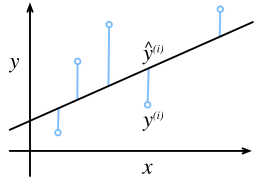
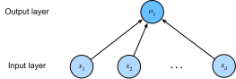
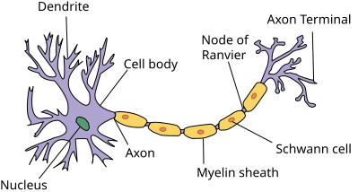

```{.python .input}
%load_ext d2lbook.tab
tab.interact_select(['mxnet', 'pytorch', 'tensorflow', 'jax'])
```

# 线性回归
:label:`sec_linear_regression`

*回归*（regression）问题出现在我们想要预测某个数值的时候。
常见的例子包括预测价格（房屋、股票等）、
预测停留时长（医院中的病人）、
预测需求（零售销量）等等。
并非每个预测问题都是经典的回归问题。
后面我们还会介绍分类问题，
其目标是在一组类别中预测所属的类别。

作为一个贯穿全节的例子，假设我们希望
根据房屋的面积（单位：平方英尺）和房龄（单位：年）
来估计房屋的价格（单位：美元）。
为了开发一个预测房价的模型，
我们需要获取数据，
其中包括每套房屋的售价、面积和房龄。
用机器学习的术语来说，
该数据集称为*训练数据集*（training dataset）或*训练集*（training set），
其中每一行（包含与一次交易对应的数据）
称为一个*样例*（example），
或称为*数据点*（data point）、*实例*（instance）、*样本*（sample）。
我们试图预测的对象（价格）
称为*标签*（label）或*目标值*（target）。
预测所依据的变量（房龄和面积）
称为*特征*（feature）或*协变量*（covariate）。

```{.python .input}
%%tab mxnet
%matplotlib inline
from d2l import mxnet as d2l
import math
from mxnet import np
import time
```

```{.python .input}
%%tab pytorch
%matplotlib inline
from d2l import torch as d2l
import math
import torch
import numpy as np
import time
```

```{.python .input}
%%tab tensorflow
%matplotlib inline
from d2l import tensorflow as d2l
import math
import tensorflow as tf
import numpy as np
import time
```

```{.python .input}
%%tab jax
%matplotlib inline
from d2l import jax as d2l
from jax import numpy as jnp
import math
import time
```

## 基础

*线性回归*（linear regression）是解决
回归问题的标准工具中
最简单、也最流行的一种。
它的历史可以追溯到19世纪初 :cite:`Legendre.1805,Gauss.1809`，
源自几个简单的假设。
首先，我们假设特征$\mathbf{x}$与目标值$y$之间
的关系近似线性，
也就是说，条件均值$E[Y \mid X=\mathbf{x}]$
可以表示为特征$\mathbf{x}$的加权和。
这种设定允许目标值
由于观测噪声而偏离其期望值。
其次，我们可以施加这样的假设：
任何此类噪声都表现良好，服从高斯分布。
通常，我们用$n$表示
数据集中样例的数量。
我们用上标来枚举样本和目标值，
用下标来索引坐标。
更具体地说，
$\mathbf{x}^{(i)}$表示第$i^{\textrm{th}}$个样本，
$x_j^{(i)}$表示它的第$j^{\textrm{th}}$个坐标。

### 模型
:label:`subsec_linear_model`

每个解决方案的核心都是一个模型，
它描述了如何把特征
变换为目标值的估计。
线性假设意味着，
目标值（价格）的期望值
可以表示为特征（面积和房龄）的加权和：

$$\textrm{price} = w_{\textrm{area}} \cdot \textrm{area} + w_{\textrm{age}} \cdot \textrm{age} + b.$$
:eqlabel:`eq_price-area`

这里$w_{\textrm{area}}$和$w_{\textrm{age}}$
称为*权重*（weight），$b$称为*偏置*（bias）
（或*偏移量*（offset）、*截距*（intercept））。
权重决定了每个特征对我们预测的影响。
偏置决定了所有特征都为零时估计值的大小。
尽管我们永远不会见到面积恰好为零的新建房屋，
但我们仍然需要偏置，因为它使我们能够
表示特征的所有线性函数
（而不是仅限于经过原点的直线）。
严格地说，:eqref:`eq_price-area` 是输入特征的*仿射变换*（affine transformation），它由通过加权和实现的特征*线性变换*（linear transformation）与通过加上偏置实现的*平移*（translation）组合而成。
给定一个数据集，我们的目标是选择
权重$\mathbf{w}$和偏置$b$，
使得平均而言，我们模型的预测
尽可能贴近数据中观测到的真实价格。


在通常只关注
少量特征数据集的学科中，
人们习惯像 :eqref:`eq_price-area` 那样
显式地写出模型的长形式。
而在机器学习中，我们通常处理
高维数据集，
此时采用紧凑的线性代数记号更为方便。
当输入由$d$个特征组成时，
我们可以为每个特征分配一个索引（在$1$到$d$之间），
并把我们的预测$\hat{y}$
（一般来说，“帽子”符号表示估计值）表示为

$$\hat{y} = w_1  x_1 + \cdots + w_d  x_d + b.$$

把所有特征收集到一个向量$\mathbf{x} \in \mathbb{R}^d$中，
把所有权重收集到一个向量$\mathbf{w} \in \mathbb{R}^d$中，
我们就可以通过$\mathbf{w}$与$\mathbf{x}$之间的点积
来紧凑地表示模型：

$$\hat{y} = \mathbf{w}^\top \mathbf{x} + b.$$
:eqlabel:`eq_linreg-y`

在 :eqref:`eq_linreg-y` 中，向量$\mathbf{x}$
对应于单个样例的特征。
我们常常会发现，
通过*设计矩阵*（design matrix）$\mathbf{X} \in \mathbb{R}^{n \times d}$
来指代整个包含$n$个样例的数据集的特征会很方便。
这里，$\mathbf{X}$的每一行对应一个样例，
每一列对应一个特征。
对于一组特征$\mathbf{X}$，
预测值$\hat{\mathbf{y}} \in \mathbb{R}^n$
可以通过矩阵-向量乘积来表示：

$${\hat{\mathbf{y}}} = \mathbf{X} \mathbf{w} + b,$$
:eqlabel:`eq_linreg-y-vec`

其中求和过程中应用了广播机制（ :numref:`subsec_broadcasting` ）。
给定训练数据集的特征$\mathbf{X}$
和相应的（已知）标签$\mathbf{y}$，
线性回归的目标是找到
权重向量$\mathbf{w}$和偏置项$b$，
使得对于从与$\mathbf{X}$相同分布中采样得到的
新数据样例的特征，
新样例的标签能够（在期望意义下）
以最小的误差被预测。

即使我们认为，给定$\mathbf{x}$预测$y$的
最佳模型是线性的，
我们也不会指望在真实世界的数据集中
找到$n$个样例，使得
$y^{(i)}$对所有$1 \leq i \leq n$都恰好等于$\mathbf{w}^\top \mathbf{x}^{(i)}+b$。
例如，无论我们使用什么仪器来观测
特征$\mathbf{X}$和标签$\mathbf{y}$，都可能存在少量测量误差。
因此，即使我们确信
潜在的关系是线性的，
我们也会引入一个噪声项来解释这类误差。

在着手寻找最佳*参数*（parameter）
（或*模型参数*（model parameter））$\mathbf{w}$和$b$之前，
我们还需要两样东西：
（i）一种衡量给定模型质量的方法；
（ii）一种更新模型以提高其质量的过程。

### 损失函数
:label:`subsec_linear-regression-loss-function`

自然地，要让模型拟合数据，
就需要我们对某种*拟合程度*（fitness）的度量
（等价地说，是*不拟合程度*（unfitness）的度量）达成一致。
*损失函数*（loss function）衡量
目标值的*真实*值与*预测*值之间的距离。
损失通常是一个非负数，
其值越小越好，
完美预测的损失为0。
对于回归问题，最常见的损失函数是平方误差。
当第$i$个样例的预测值为$\hat{y}^{(i)}$、
对应的真实标签为$y^{(i)}$时，
*平方误差*（squared error）由下式给出：

$$l^{(i)}(\mathbf{w}, b) = \frac{1}{2} \left(\hat{y}^{(i)} - y^{(i)}\right)^2.$$
:eqlabel:`eq_mse`

常数$\frac{1}{2}$并不会带来实质差别，
但在记号上很方便，
因为它在我们对损失求导时恰好被消去。
由于训练数据集是给定的，
因而不受我们控制，
所以经验误差只是模型参数的函数。
在 :numref:`fig_fit_linreg` 中，我们可视化了
一个一维输入问题中线性回归模型的拟合效果。


:label:`fig_fit_linreg`

注意，估计值$\hat{y}^{(i)}$与目标值$y^{(i)}$之间
较大的差异会由于其二次形式
而对损失产生更大的贡献
（这种二次性是一把双刃剑：它一方面鼓励模型避免大的误差，
另一方面也可能导致模型对异常数据过于敏感）。
要衡量模型在整个包含$n$个样例的数据集上的质量，
我们只需对训练集上的损失求平均（等价地说，求和）：

$$L(\mathbf{w}, b) =\frac{1}{n}\sum_{i=1}^n l^{(i)}(\mathbf{w}, b) =\frac{1}{n} \sum_{i=1}^n \frac{1}{2}\left(\mathbf{w}^\top \mathbf{x}^{(i)} + b - y^{(i)}\right)^2.$$

在训练模型时，我们寻找参数（$\mathbf{w}^*, b^*$），
使所有训练样例上的总损失最小：

$$\mathbf{w}^*, b^* = \operatorname*{argmin}_{\mathbf{w}, b}\  L(\mathbf{w}, b).$$

### 解析解

与我们将要介绍的大多数模型不同，
线性回归呈现给我们的
优化问题简单得令人惊讶。
特别地，我们可以
用如下简单公式解析地求出最优参数
（这里的评估依据是训练数据）。
首先，我们可以通过在设计矩阵后追加一列全1，
把偏置$b$并入参数$\mathbf{w}$。
于是我们的预测问题就是最小化$\|\mathbf{y} - \mathbf{X}\mathbf{w}\|^2$。
只要设计矩阵$\mathbf{X}$满秩
（没有特征与其他特征线性相关），
那么损失曲面上就只有一个临界点，
它对应于损失在整个定义域上的最小值。
对损失关于$\mathbf{w}$求导
并令其等于零，得到：

$$\begin{aligned}
    \partial_{\mathbf{w}} \|\mathbf{y} - \mathbf{X}\mathbf{w}\|^2 =
    2 \mathbf{X}^\top (\mathbf{X} \mathbf{w} - \mathbf{y}) = 0
    \textrm{ and hence }
    \mathbf{X}^\top \mathbf{y} = \mathbf{X}^\top \mathbf{X} \mathbf{w}.
\end{aligned}$$

求解$\mathbf{w}$就得到了
该优化问题的最优解。
注意，这个解

$$\mathbf{w}^* = (\mathbf X^\top \mathbf X)^{-1}\mathbf X^\top \mathbf{y}$$

只有在矩阵$\mathbf X^\top \mathbf X$可逆时，
也就是设计矩阵的各列
线性独立时，才是唯一的 :cite:`Golub.Van-Loan.1996`。


虽然像线性回归这样的简单问题
可能容许解析解，
但你不应习惯于这种好运。
尽管解析解能够带来漂亮的数学分析，
但对解析解的要求过于苛刻，
以至于会排除深度学习中几乎所有激动人心的方面。

### 小批量随机梯度下降

幸运的是，即使在无法解析求解模型的情况下，
我们通常仍然能在实践中有效地训练模型。
此外，对于许多任务而言，
那些难以优化的模型
结果要好得多，
以至于弄清如何训练它们
最终是完全值得的。

优化几乎每一个深度学习模型的关键技术，
也是我们在全书中会反复用到的技术，
就是通过沿着
逐步降低损失函数的方向更新参数，
来迭代地减小误差。
这种算法称为*梯度下降*（gradient descent）。

梯度下降最朴素的应用方式，
是计算损失函数的导数，
而该损失是对数据集中
每个样例计算出的损失的平均。
在实践中，这可能极其缓慢：
我们必须遍历整个数据集才能进行一次更新，
即使更新步可能非常强大 :cite:`Liu.Nocedal.1989`。
更糟的是，如果训练数据中存在大量冗余，
完整更新的收益也是有限的。

另一个极端是每次只考虑一个样例，
并基于一次观测采取更新步。
由此得到的算法*随机梯度下降*
（stochastic gradient descent，SGD）
可以是一种有效的策略 :cite:`Bottou.2010`，
即使对于大型数据集也是如此。
不幸的是，SGD在计算和统计两方面都有缺点。
一个问题来自这样的事实：
处理器在做乘加运算时，
比把数据从主内存移动到处理器缓存时快得多。
执行一次矩阵-向量乘法，
比执行相应数量的向量-向量运算
至多可高效一个数量级。
这意味着，与处理一整个批次相比，
一次处理一个样本可能耗时多得多。
第二个问题是，有些层，
例如批量规范化（将在 :numref:`sec_batch_norm` 中描述），
只有在我们一次能访问多个观测时
才能很好地工作。

这两个问题的解决办法是采取一种折中的策略：
既不一次取整个批次，也不一次只取单个样本，
而是一次取一个*小批量*（minibatch）观测 :cite:`Li.Zhang.Chen.ea.2014`。
所述小批量的具体大小
取决于许多因素，
例如内存大小、加速器数量、
层的选择以及数据集总大小。
尽管如此，32到256之间的一个数，
最好是$2$的某个较大次幂的倍数，
是一个不错的起点。
这就引出了*小批量随机梯度下降*（minibatch stochastic gradient descent）。

在其最基本的形式中，在第$t$次迭代时，
我们首先随机抽取一个由固定数量$|\mathcal{B}|$个训练样例
组成的小批量$\mathcal{B}_t$。
然后我们计算小批量上的平均损失
关于模型参数的导数（梯度）。
最后，我们把梯度乘以一个预先确定的小正数$\eta$，
称为*学习率*（learning rate），
并从当前参数值中减去所得项。
我们可以把更新表示为：

$$(\mathbf{w},b) \leftarrow (\mathbf{w},b) - \frac{\eta}{|\mathcal{B}|} \sum_{i \in \mathcal{B}_t} \partial_{(\mathbf{w},b)} l^{(i)}(\mathbf{w},b).$$

总之，小批量SGD的过程如下：
（i）初始化模型参数的值，通常随机初始化；
（ii）迭代地从数据中抽取随机小批量，
沿着负梯度的方向更新参数。
对于二次损失和仿射变换，
这具有闭式展开：

$$\begin{aligned} \mathbf{w} & \leftarrow \mathbf{w} - \frac{\eta}{|\mathcal{B}|} \sum_{i \in \mathcal{B}_t} \partial_{\mathbf{w}} l^{(i)}(\mathbf{w}, b) && = \mathbf{w} - \frac{\eta}{|\mathcal{B}|} \sum_{i \in \mathcal{B}_t} \mathbf{x}^{(i)} \left(\mathbf{w}^\top \mathbf{x}^{(i)} + b - y^{(i)}\right)\\ b &\leftarrow b -  \frac{\eta}{|\mathcal{B}|} \sum_{i \in \mathcal{B}_t} \partial_b l^{(i)}(\mathbf{w}, b) &&  = b - \frac{\eta}{|\mathcal{B}|} \sum_{i \in \mathcal{B}_t} \left(\mathbf{w}^\top \mathbf{x}^{(i)} + b - y^{(i)}\right). \end{aligned}$$
:eqlabel:`eq_linreg_batch_update`

由于我们选取的是一个小批量$\mathcal{B}$，
需要用其大小$|\mathcal{B}|$进行规范化。
通常，小批量大小和学习率是由用户定义的。
这类在训练循环中不更新的可调参数
称为*超参数*（hyperparameter）。
它们可以通过多种技术自动调优，
例如贝叶斯优化 :cite:`Frazier.2018`。
最终，解的质量通常在一个单独的
*验证数据集*（validation dataset）（或*验证集*（validation set））上评估。

在预先确定的若干次迭代之后
（或直到满足其他某种停止准则），
我们记录估计出的模型参数，
记为$\hat{\mathbf{w}}, \hat{b}$。
注意，即使我们的函数确实是线性且无噪声的，
这些参数也不会是损失的精确最小化者，
甚至不是确定性的。
尽管算法会缓慢地收敛到最小化者，
但它通常不会在有限步数内精确地找到它们。
此外，用于更新参数的小批量$\mathcal{B}$
是随机选取的。
这破坏了确定性。

线性回归恰好是一个
具有全局最小值的学习问题
（只要$\mathbf{X}$满秩，
等价地说，只要$\mathbf{X}^\top \mathbf{X}$可逆）。
然而，深度网络的损失曲面包含许多鞍点和最小值。
幸运的是，我们通常并不关心
找到一组精确的参数，
而只关心找到任何一组
能带来准确预测（从而低损失）的参数。
在实践中，深度学习从业者
很少难以找到使损失*在训练集上*最小的参数
:cite:`Izmailov.Podoprikhin.Garipov.ea.2018,Frankle.Carbin.2018`。
更艰巨的任务是找到
能在以前未见过的数据上带来准确预测的参数，
这一挑战称为*泛化*（generalization）。
我们在全书中会反复回到这些主题。

### 预测

给定模型$\hat{\mathbf{w}}^\top \mathbf{x} + \hat{b}$，
我们现在就可以对新样例做*预测*了，
例如，根据一套以前未见过的房屋的
面积$x_1$和房龄$x_2$来预测其售价。
深度学习从业者习惯于把预测阶段称为*推理*（inference），
但这有点用词不当——*推理*泛指
基于证据得出的任何结论，
既包括参数的值，
也包括对未见实例的可能标签。
要说的话，在统计学文献中，
*推理*更多指参数推断，
这种术语的重载在深度学习从业者
与统计学家交流时会造成不必要的混淆。
在下文中，我们将尽可能坚持使用*预测*。

## 向量化加速

在训练模型时，我们通常希望
同时处理整个小批量的样例。
高效地做到这一点，要求(**我们**)(~~应当~~)
(**把计算向量化，并利用
快速的线性代数库，
而不是在Python中编写开销很大的for循环。**)

为了看明白为什么这如此重要，
让我们(**考虑两种向量相加的方法。**)
首先，我们实例化两个
包含全1的10,000维向量。
在第一种方法中，我们用Python的for循环遍历这些向量。
在第二种方法中，我们只依赖一次对`+`的调用。

```{.python .input}
%%tab all
n = 10000
a = d2l.ones(n)
b = d2l.ones(n)
```

现在我们可以对这些工作负载进行基准测试。
首先，[**我们使用for循环，
一次一个坐标地把它们相加。**]

```{.python .input}
%%tab mxnet, pytorch
c = d2l.zeros(n)
t = time.time()
for i in range(n):
    c[i] = a[i] + b[i]
f'{time.time() - t:.5f} sec'
```

```{.python .input}
%%tab tensorflow
c = tf.Variable(d2l.zeros(n))
t = time.time()
for i in range(n):
    c[i].assign(a[i] + b[i])
f'{time.time() - t:.5f} sec'
```

```{.python .input}
%%tab jax
# JAX arrays are immutable, meaning that once created their contents
# cannot be changed. For updating individual elements, JAX provides
# an indexed update syntax that returns an updated copy
c = d2l.zeros(n)
t = time.time()
for i in range(n):
    c = c.at[i].set(a[i] + b[i])
f'{time.time() - t:.5f} sec'
```

(**或者，我们依靠重载的`+`运算符来计算按元素的和。**)

```{.python .input}
%%tab all
t = time.time()
d = a + b
f'{time.time() - t:.5f} sec'
```

第二种方法比第一种方法快得多。
向量化代码往往能带来数量级的加速。
此外，我们把更多的数学运算交给库来完成，
这样我们自己就不必写那么多计算，
从而减少了出错的可能，并提高了代码的可移植性。


## 正态分布与平方损失
:label:`subsec_normal_distribution_and_squared_loss`

到目前为止，我们对平方损失目标
给出了一个相当实用的动机：
当潜在的模式确实是线性时，
最优参数给出条件期望$E[Y\mid X]$，
而且该损失对离群点施加很大的惩罚。
我们还可以通过对噪声分布
作出概率假设，
为平方损失目标提供更正式的动机。

线性回归发明于19世纪之交。
长期以来，人们一直在争论
究竟是高斯（Gauss）还是勒让德（Legendre）
最先想到这个想法，
但发现正态分布
（也称为*高斯分布*（Gaussian））的正是高斯。
事实证明，正态分布
与带平方损失的线性回归之间
的联系，比共同的渊源更为深刻。

首先，回想一下，均值为$\mu$、
方差为$\sigma^2$（标准差为$\sigma$）
的正态分布表示为

$$p(x) = \frac{1}{\sqrt{2 \pi \sigma^2}} \exp\left(-\frac{1}{2 \sigma^2} (x - \mu)^2\right).$$

下面，[**我们定义一个计算正态分布的函数**]。

```{.python .input}
%%tab all
def normal(x, mu, sigma):
    p = 1 / math.sqrt(2 * math.pi * sigma**2)
    if tab.selected('jax'):
        return p * jnp.exp(-0.5 * (x - mu)**2 / sigma**2)
    if tab.selected('pytorch', 'mxnet', 'tensorflow'):
        return p * np.exp(-0.5 * (x - mu)**2 / sigma**2)
```

现在我们可以(**可视化这些正态分布**)。

```{.python .input}
%%tab mxnet
# Use NumPy again for visualization
x = np.arange(-7, 7, 0.01)

# Mean and standard deviation pairs
params = [(0, 1), (0, 2), (3, 1)]
d2l.plot(x.asnumpy(), [normal(x, mu, sigma).asnumpy() for mu, sigma in params], xlabel='x',
         ylabel='p(x)', figsize=(4.5, 2.5),
         legend=[f'mean {mu}, std {sigma}' for mu, sigma in params])
```

```{.python .input}

%%tab pytorch, tensorflow, jax
if tab.selected('jax'):
    # Use JAX NumPy for visualization
    x = jnp.arange(-7, 7, 0.01)
if tab.selected('pytorch', 'mxnet', 'tensorflow'):
    # Use NumPy again for visualization
    x = np.arange(-7, 7, 0.01)

# Mean and standard deviation pairs
params = [(0, 1), (0, 2), (3, 1)]
d2l.plot(x, [normal(x, mu, sigma) for mu, sigma in params], xlabel='x',
         ylabel='p(x)', figsize=(4.5, 2.5),
         legend=[f'mean {mu}, std {sigma}' for mu, sigma in params])
```

注意，改变均值对应于
沿$x$轴的平移，
而增大方差会使分布变得更宽，
从而降低其峰值。

为带平方损失的线性回归提供动机的一种方式，
是假设观测来自带噪声的测量，
其中噪声$\epsilon$服从正态分布
$\mathcal{N}(0, \sigma^2)$：

$$y = \mathbf{w}^\top \mathbf{x} + b + \epsilon \textrm{ where } \epsilon \sim \mathcal{N}(0, \sigma^2).$$

因此，我们现在可以写出在给定$\mathbf{x}$的情况下
看到某个特定$y$的*似然*（likelihood）：

$$P(y \mid \mathbf{x}) = \frac{1}{\sqrt{2 \pi \sigma^2}} \exp\left(-\frac{1}{2 \sigma^2} (y - \mathbf{w}^\top \mathbf{x} - b)^2\right).$$

这样，似然就可以因子分解。
根据*最大似然原理*，
参数$\mathbf{w}$和$b$的最佳取值，
是使整个数据集的*似然*最大的那些取值：

$$P(\mathbf y \mid \mathbf X) = \prod_{i=1}^{n} p(y^{(i)} \mid \mathbf{x}^{(i)}).$$

该等式成立是因为所有对$(\mathbf{x}^{(i)}, y^{(i)})$
都是彼此独立地抽取的。
按照最大似然原理选出的估计量
称为*最大似然估计量*（maximum likelihood estimator）。
最大化许多指数函数的乘积
可能看起来很困难，
但只要改为最大化似然的对数，
我们就能在不改变目标的情况下大大简化问题。
由于历史原因，优化问题更常
被表述为最小化而不是最大化。
因此，在不做任何改变的情况下，
我们可以*最小化* *负对数似然*（negative log-likelihood），
它可以表示如下：

$$-\log P(\mathbf y \mid \mathbf X) = \sum_{i=1}^n \frac{1}{2} \log(2 \pi \sigma^2) + \frac{1}{2 \sigma^2} \left(y^{(i)} - \mathbf{w}^\top \mathbf{x}^{(i)} - b\right)^2.$$

如果我们假设$\sigma$是固定的，
就可以忽略第一项，
因为它不依赖于$\mathbf{w}$或$b$。
第二项与前面介绍的
平方误差损失完全相同，
只差一个相乘的常数$\frac{1}{\sigma^2}$。
幸运的是，解也不依赖于$\sigma$。
由此可知，最小化均方误差
等价于在加性高斯噪声假设下
对线性模型进行最大似然估计。

## 线性回归作为神经网络

虽然线性模型不够丰富，
无法表示我们将在本书中介绍的
许多复杂网络，
但（人工）神经网络足够丰富，
能够把线性模型涵盖为这样的网络：
其中每个特征都由一个输入神经元表示，
而这些神经元都直接连接到输出。

:numref:`fig_single_neuron` 把线性回归
描绘成一个神经网络。
该图强调了连接模式，
例如每个输入如何连接到输出，
但没有给出权重或偏置所取的具体值。


:label:`fig_single_neuron`

输入是$x_1, \ldots, x_d$。
我们把$d$称为输入层的*输入数*
或*特征维数*。
网络的输出是$o_1$。
由于我们只是想预测
一个数值，
所以只有一个输出神经元。
注意，输入值都是*给定的*。
只有一个神经元是*计算*出来的。
总之，我们可以把线性回归
看作一个单层全连接神经网络。
在后面的章节中，我们将遇到
层数多得多的网络。

### 生物学

由于线性回归的提出早于计算神经科学，
用神经网络来描述线性回归
可能显得有些不合时宜。
尽管如此，当控制论专家和神经生理学家
Warren McCulloch 和 Walter Pitts
开始开发人工神经元模型时，
线性回归仍是一个自然的起点。
请看 :numref:`fig_Neuron` 中
这个卡通化的生物神经元图，
它由*树突*（dendrites，输入端）、
*细胞核*（nucleus，CPU）、*轴突*（axon，输出线）
和*轴突末梢*（axon terminals，输出端）组成，
并通过*突触*（synapses）与其他神经元建立连接。


:label:`fig_Neuron`

来自其他神经元（或环境传感器）的信息$x_i$
在树突中被接收。
特别地，该信息会按*突触权重*$w_i$进行加权，
从而决定输入的影响，
例如通过乘积$x_i w_i$产生激活或抑制。
来自多个来源的加权输入
在细胞核中被聚合为一个加权和$y = \sum_i x_i w_i + b$，
并可能经过某个函数$\sigma(y)$的非线性后处理。
随后，这些信息通过轴突
传送到轴突末梢，
在那里到达其目的地
（例如肌肉这样的执行器），
或者通过其树突被送入另一个神经元。

当然，这样一个高层次的想法——
只要具备正确的连接方式和学习算法，
许多这样的单元就可以组合起来，
产生比任何单个神经元
所能表达的远为有趣和复杂的行为——
源于我们对真实生物神经系统的研究。
与此同时，如今深度学习的大多数研究
从更广泛的来源中汲取灵感。
我们引用 :citet:`Russell.Norvig.2016` ，
他们指出：尽管飞机可能是
受到鸟类的*启发*，
但几个世纪以来，鸟类学
并不是航空学创新的主要推动力。
同样，如今深度学习中的灵感，
有同等或更大程度
来自数学、语言学、心理学、
统计学、计算机科学以及许多其他领域。

## 小结

在本节中，我们介绍了
传统的线性回归，
其中线性函数的参数
被选择为使训练集上的平方损失最小。
我们还通过一些实际考量，
以及把线性回归解释为
在线性假设和高斯噪声假设下的
最大似然估计，
为这一目标选择提供了动机。
在讨论了计算方面的考量
以及与统计学的联系之后，
我们展示了如何把这类线性模型
表示成简单的神经网络，其中输入
直接连接到输出。
虽然我们很快就会完全超越线性模型，
但它们足以引出我们所有模型
都需要的大多数组成部分：
参数化形式、可微的目标函数、
通过小批量随机梯度下降进行的优化，
以及最终在以前未见过的数据上的评估。


## 练习

1. 假设我们有一些数据$x_1, \ldots, x_n \in \mathbb{R}$。我们的目标是找到一个常数$b$，使$\sum_i (x_i - b)^2$最小。
    1. 求$b$最优值的解析解。
    1. 这个问题及其解与正态分布有什么关系？
    1. 如果我们把损失从$\sum_i (x_i - b)^2$改为$\sum_i |x_i-b|$，会怎样？你能求出$b$的最优解吗？
1. 证明：可由$\mathbf{x}^\top \mathbf{w} + b$表示的仿射函数，等价于$(\mathbf{x}, 1)$上的线性函数。
1. 假设你想求$\mathbf{x}$的二次函数，即$f(\mathbf{x}) = b + \sum_i w_i x_i + \sum_{j \leq i} w_{ij} x_{i} x_{j}$。你会如何在深度网络中表述它？
1. 回想一下，线性回归问题可解的条件之一是设计矩阵$\mathbf{X}^\top \mathbf{X}$满秩。
    1. 如果不是这样，会发生什么？
    1. 你会如何修复它？如果你给$\mathbf{X}$的所有元素加上少量逐坐标独立的高斯噪声，会发生什么？
    1. 在这种情况下，设计矩阵$\mathbf{X}^\top \mathbf{X}$的期望值是多少？
    1. 当$\mathbf{X}^\top \mathbf{X}$不满秩时，随机梯度下降会发生什么？
1. 假设支配加性噪声$\epsilon$的噪声模型是指数分布。也就是说，$p(\epsilon) = \frac{1}{2} \exp(-|\epsilon|)$。
    1. 写出该模型下数据的负对数似然$-\log P(\mathbf y \mid \mathbf X)$。
    1. 你能求出闭式解吗？
    1. 请提出一种用小批量随机梯度下降求解该问题的算法。可能出什么问题（提示：当我们持续更新参数时，在驻点附近会发生什么）？你能修复它吗？
1. 假设我们想通过组合两个线性层来设计一个两层的神经网络。也就是说，第一层的输出成为第二层的输入。为什么这种朴素的组合方式行不通？
1. 如果你想用回归来对房屋或股票进行现实的价格估计，会遇到什么问题？
    1. 证明加性高斯噪声假设并不合适。提示：价格可以为负吗？波动呢？
    1. 为什么对价格的对数做回归会好得多，即$y = \log \textrm{price}$？
    1. 在处理仙股（即价格非常低的股票）时，你需要担心什么？提示：你能以所有可能的价格交易吗？为什么这对低价股是更严重的问题？更多信息请参阅著名的期权定价Black--Scholes模型 :cite:`Black.Scholes.1973`。
1. 假设我们想用回归来估计一家杂货店售出的苹果的*数量*。
    1. 高斯加性噪声模型有什么问题？提示：你卖的是苹果，不是石油。
    1. [泊松分布](https://en.wikipedia.org/wiki/Poisson_distribution)刻画了计数的分布。它由$p(k \mid \lambda) = \lambda^k e^{-\lambda}/k!$给出。这里$\lambda$是速率函数，$k$是你观测到的事件数。证明$\lambda$是计数$k$的期望值。
    1. 设计与泊松分布相关的损失函数。
    1. 设计一个用于估计$\log \lambda$的损失函数。

:begin_tab:`mxnet`
[讨论](https://discuss.d2l.ai/t/40)
:end_tab:

:begin_tab:`pytorch`
[讨论](https://discuss.d2l.ai/t/258)
:end_tab:

:begin_tab:`tensorflow`
[讨论](https://discuss.d2l.ai/t/259)
:end_tab:
