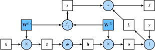

# 前向传播、反向传播与计算图
:label:`sec_backprop`

到目前为止，我们都是用小批量随机梯度下降来训练模型。
然而，在实现该算法时，
我们只关心了模型*前向传播*（forward propagation）
所涉及的计算。
到了计算梯度的时候，
我们只是调用了深度学习框架提供的反向传播函数。

梯度的自动计算
极大地简化了
深度学习算法的实现。
在自动微分出现之前，
即便对复杂模型做很小的改动，也需要
手工重新计算复杂的导数。
令人惊讶的是，学术论文常常不得不花上
许多页篇幅来推导更新规则。
虽然我们必须继续依赖自动微分，
以便把精力集中在有趣的部分上，
但如果你想超越对深度学习的浅层理解，
就应当了解这些梯度
在底层是如何计算出来的。

在本节中，我们深入探讨
*反向传播*（backward propagation，
更常见的叫法是 *backpropagation*）的细节。
为了既讲清这些技术、又讲清它们的实现，
我们借助一些基础数学和计算图。
首先，我们把论述集中在一个
带权重衰减（$\ell_2$ 正则化，将在后续章节中介绍）的
单隐藏层 MLP 上。

## 前向传播

*前向传播*（forward propagation，或*前向传递*，forward pass）指的是
按从输入层到输出层的顺序，
计算并存储神经网络中间变量（包括输出）的过程。
现在我们逐步剖析
一个带单隐藏层的神经网络的机理。
这也许看似枯燥，但用放克音乐大师 James Brown 那句不朽的话来说，
你必须“先付出代价，才能成为老板”。

为简单起见，假设
输入样例为 $\mathbf{x}\in \mathbb{R}^d$，
并且我们的隐藏层不包含偏置项。
这里的中间变量是：

$$\mathbf{z}= \mathbf{W}^{(1)} \mathbf{x},$$

其中 $\mathbf{W}^{(1)} \in \mathbb{R}^{h \times d}$
是隐藏层的权重参数。
把中间变量
$\mathbf{z}\in \mathbb{R}^h$ 通过
激活函数 $\phi$ 之后，
我们得到长度为 $h$ 的隐藏激活向量：

$$\mathbf{h}= \phi (\mathbf{z}).$$

隐藏层输出 $\mathbf{h}$
也是一个中间变量。
假设输出层的参数
只包含权重
$\mathbf{W}^{(2)} \in \mathbb{R}^{q \times h}$，
我们可以得到一个输出层变量，
它是一个长度为 $q$ 的向量：

$$\mathbf{o}= \mathbf{W}^{(2)} \mathbf{h}.$$

假设损失函数为 $l$，
样例标签为 $y$，
那么我们就可以计算
单个数据样例的损失项，

$$L = l(\mathbf{o}, y).$$

正如我们将会看到稍后要介绍的 $\ell_2$ 正则化的定义，
给定超参数 $\lambda$，
正则项为

$$s = \frac{\lambda}{2} \left(\|\mathbf{W}^{(1)}\|_\textrm{F}^2 + \|\mathbf{W}^{(2)}\|_\textrm{F}^2\right),$$
:eqlabel:`eq_forward-s`

其中矩阵的弗罗贝尼乌斯范数
就是把矩阵展平为向量之后
所施加的 $\ell_2$ 范数。
最后，模型在给定数据样例上的
正则化损失为：

$$J = L + s.$$

在接下来的讨论中，我们把 $J$ 称为*目标函数*（objective function）。

## 前向传播的计算图

画出*计算图*（computational graph）可以帮助我们把计算中
运算符与变量之间的依赖关系可视化。
:numref:`fig_forward` 给出了与上面所描述的简单网络
相对应的图，
其中方块表示变量，圆圈表示运算符。
左下角表示输入，
右上角是输出。
注意箭头的方向
（它们表示数据流）
主要是向右和向上的。

:label:`fig_forward`

## 反向传播

*反向传播*（backpropagation）指的是计算
神经网络参数梯度的方法。
简而言之，该方法按照微积分中的*链式法则*（chain rule），
从输出层到输入层，按相反的顺序遍历网络。
在计算关于某些参数的梯度时，
该算法会存储所需的任何中间变量
（偏导数）。
假设我们有函数
$\mathsf{Y}=f(\mathsf{X})$
和 $\mathsf{Z}=g(\mathsf{Y})$，
其中输入和输出
$\mathsf{X}, \mathsf{Y}, \mathsf{Z}$
是任意形状的张量。
利用链式法则，
我们可以通过下式计算
$\mathsf{Z}$ 关于 $\mathsf{X}$ 的导数

$$\frac{\partial \mathsf{Z}}{\partial \mathsf{X}} = \textrm{prod}\left(\frac{\partial \mathsf{Z}}{\partial \mathsf{Y}}, \frac{\partial \mathsf{Y}}{\partial \mathsf{X}}\right).$$

这里我们使用 $\textrm{prod}$ 运算符，
在完成必要的操作（例如转置和交换输入位置）
之后，把它参数相乘。
对于向量，这很直接：
它不过就是矩阵--矩阵乘法。
对于更高维的张量，
我们使用相应的对应物。
运算符 $\textrm{prod}$ 隐藏了所有这些记号上的负担。

回想一下，
计算图在 :numref:`fig_forward` 中的
那个带单隐藏层的简单网络，
其参数是 $\mathbf{W}^{(1)}$ 和 $\mathbf{W}^{(2)}$。
反向传播的目标是
计算梯度 $\partial J/\partial \mathbf{W}^{(1)}$
和 $\partial J/\partial \mathbf{W}^{(2)}$。
为此，我们应用链式法则，
依次计算
每个中间变量和参数的梯度。
计算顺序与
前向传播中的计算顺序相反，
因为我们需要从计算图的结果出发，
一路推回到参数。
第一步是计算
目标函数 $J=L+s$ 关于
损失项 $L$
和正则项 $s$ 的梯度：

$$\frac{\partial J}{\partial L} = 1 \; \textrm{and} \; \frac{\partial J}{\partial s} = 1.$$

接下来，我们根据链式法则计算目标函数
关于输出层变量 $\mathbf{o}$ 的梯度：

$$
\frac{\partial J}{\partial \mathbf{o}}
= \textrm{prod}\left(\frac{\partial J}{\partial L}, \frac{\partial L}{\partial \mathbf{o}}\right)
= \frac{\partial L}{\partial \mathbf{o}}
\in \mathbb{R}^q.
$$

接下来，我们计算
正则项关于
两个参数的梯度：

$$\frac{\partial s}{\partial \mathbf{W}^{(1)}} = \lambda \mathbf{W}^{(1)}
\; \textrm{and} \;
\frac{\partial s}{\partial \mathbf{W}^{(2)}} = \lambda \mathbf{W}^{(2)}.$$

现在我们可以计算
最接近输出层的
模型参数的梯度
$\partial J/\partial \mathbf{W}^{(2)} \in \mathbb{R}^{q \times h}$。
利用链式法则可得：

$$\frac{\partial J}{\partial \mathbf{W}^{(2)}}= \textrm{prod}\left(\frac{\partial J}{\partial \mathbf{o}}, \frac{\partial \mathbf{o}}{\partial \mathbf{W}^{(2)}}\right) + \textrm{prod}\left(\frac{\partial J}{\partial s}, \frac{\partial s}{\partial \mathbf{W}^{(2)}}\right)= \frac{\partial J}{\partial \mathbf{o}} \mathbf{h}^\top + \lambda \mathbf{W}^{(2)}.$$
:eqlabel:`eq_backprop-J-h`

为了得到关于 $\mathbf{W}^{(1)}$
的梯度，我们需要沿着输出层到隐藏层
继续反向传播。
关于隐藏层输出的梯度
$\partial J/\partial \mathbf{h} \in \mathbb{R}^h$ 由下式给出

$$
\frac{\partial J}{\partial \mathbf{h}}
= \textrm{prod}\left(\frac{\partial J}{\partial \mathbf{o}}, \frac{\partial \mathbf{o}}{\partial \mathbf{h}}\right)
= {\mathbf{W}^{(2)}}^\top \frac{\partial J}{\partial \mathbf{o}}.
$$

由于激活函数 $\phi$ 是按元素作用的，
计算中间变量 $\mathbf{z}$
的梯度 $\partial J/\partial \mathbf{z} \in \mathbb{R}^h$
需要用到按元素乘法运算符，
我们把它记作 $\odot$：

$$
\frac{\partial J}{\partial \mathbf{z}}
= \textrm{prod}\left(\frac{\partial J}{\partial \mathbf{h}}, \frac{\partial \mathbf{h}}{\partial \mathbf{z}}\right)
= \frac{\partial J}{\partial \mathbf{h}} \odot \phi'\left(\mathbf{z}\right).
$$

最后，我们可以求得
最接近输入层的
模型参数的梯度
$\partial J/\partial \mathbf{W}^{(1)} \in \mathbb{R}^{h \times d}$。
根据链式法则，我们得到

$$
\frac{\partial J}{\partial \mathbf{W}^{(1)}}
= \textrm{prod}\left(\frac{\partial J}{\partial \mathbf{z}}, \frac{\partial \mathbf{z}}{\partial \mathbf{W}^{(1)}}\right) + \textrm{prod}\left(\frac{\partial J}{\partial s}, \frac{\partial s}{\partial \mathbf{W}^{(1)}}\right)
= \frac{\partial J}{\partial \mathbf{z}} \mathbf{x}^\top + \lambda \mathbf{W}^{(1)}.
$$

## 训练神经网络

在训练神经网络时，
前向传播和反向传播相互依赖。
具体来说，对于前向传播，
我们沿着依赖关系的方向遍历计算图，
并计算其路径上的所有变量。
这些变量随后被用于反向传播，
其中图上的计算顺序是相反的。

以前面提到的简单网络为例来说明。
一方面，
在前向传播中计算正则项 :eqref:`eq_forward-s`
依赖于模型参数 $\mathbf{W}^{(1)}$ 和 $\mathbf{W}^{(2)}$ 的当前值。
它们是由优化算法根据最近一次迭代中的反向传播给出的。
另一方面，
反向传播中参数 :eqref:`eq_backprop-J-h`
的梯度计算
依赖于隐藏层输出 $\mathbf{h}$ 的当前值，
而它是由前向传播给出的。

因此，在训练神经网络时，一旦初始化了模型参数，
我们就交替进行前向传播和反向传播，
利用反向传播给出的梯度更新模型参数。
注意，反向传播会复用前向传播中存储的中间值，以避免重复计算。
这样做的一个后果是，我们需要保留
这些中间值，直到反向传播完成。
这也是训练比单纯的预测
需要显著更多内存的原因之一。
此外，这类中间值的大小大致
与网络层数和批量大小成正比。
因此，
使用更大的批量大小训练更深的网络
更容易导致*内存溢出*（out-of-memory）错误。

## 小结

前向传播按顺序计算并存储神经网络所定义的计算图中的中间变量。它从输入层进行到输出层。
反向传播按相反的顺序，依次计算并存储神经网络中中间变量和参数的梯度。
在训练深度学习模型时，前向传播和反向传播相互依赖，
而且训练所需的内存显著多于预测。

## 练习

1. 假设某个标量函数 $f$ 的输入 $\mathbf{X}$ 是 $n \times m$ 的矩阵。$f$ 关于 $\mathbf{X}$ 的梯度的维数是多少？
1. 为本章所描述模型的隐藏层添加一个偏置（不需要在正则项中包含偏置）。
    1. 画出相应的计算图。
    1. 推导前向传播和反向传播的方程。
1. 计算本章所描述模型在训练和预测时的内存占用。
1. 假设你想要计算二阶导数。计算图会发生什么变化？你预计计算需要多长时间？
1. 假设计算图对你的 GPU 来说太大了。
    1. 你能把它划分到不止一个 GPU 上吗？
    1. 与在更小的批量上训练相比，这样做有什么优缺点？

[讨论](https://discuss.d2l.ai/t/102)
