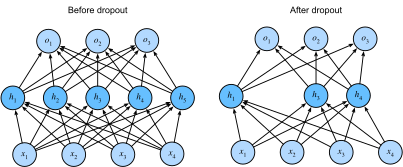

```{.python .input}
%load_ext d2lbook.tab
tab.interact_select(['mxnet', 'pytorch', 'tensorflow', 'jax'])
```

# 暂退法
:label:`sec_dropout`


让我们简要思考一下，我们希望一个好的预测模型具备什么性质。
我们希望它能在未见数据上表现良好。
经典泛化理论表明，
要缩小训练性能与测试性能之间的差距，
我们应当以简单模型为目标。
简单性可以表现为维数较少。
在 :numref:`sec_generalization_basics` 中讨论线性模型的
单项式基函数时，我们探讨过这一点。
此外，正如在 :numref:`sec_weight_decay` 中讨论权重衰减
（$\ell_2$正则化）时所见，
参数的（逆）范数也代表了一种有用的简单性度量。
另一种有用的简单性概念是平滑性，
即函数不应对输入的小变化敏感。
例如，当我们对图像进行分类时，
我们会期望向像素中添加一些随机噪声基本上是无关紧要的。

:citet:`Bishop.1995` 将这一想法形式化：
他证明了使用输入噪声进行训练
等价于 Tikhonov 正则化。
这项工作在数学上清楚地建立了以下两个要求之间的联系：
函数应当平滑（因而简单），
以及函数应当对输入扰动具有稳健性。

随后，:citet:`Srivastava.Hinton.Krizhevsky.ea.2014`
提出了一个巧妙的想法，把 Bishop 的想法也应用到网络的内部层上。
他们的想法称为*暂退法*（dropout），
它在前向传播过程中计算每个内部层时注入噪声，
如今已成为训练神经网络的一种标准技术。
这种方法之所以称为*暂退法*，是因为我们在训练中确实会
*丢弃*一些神经元。
在整个训练过程中，每次迭代时，
标准暂退法都会在计算下一层之前，
把每层中一部分节点的输出置零。

需要说明的是，与 Bishop 的这一联系是我们自己添加的叙述。
关于暂退法的原始论文
通过一个出人意料的类比——有性生殖——来提供直觉。
作者认为，神经网络过拟合的特征是：
每一层都依赖于前一层中特定的激活模式，
他们把这种状态称为*共适应*（co-adaptation）。
他们声称，暂退法就像有人主张有性生殖会打破共适应的基因一样，
能够打破共适应。
虽然这一理论论证当然有待商榷，
但暂退法这项技术本身已被证明经久不衰，
而且大多数深度学习库都实现了各种形式的暂退法。


关键挑战在于如何注入这种噪声。
一种想法是以*无偏*的方式注入噪声，
使得在固定其他层的情况下，每一层的期望值
等于没有噪声时会取到的值。
在 Bishop 的工作中，他向线性模型的输入加入了高斯噪声。
在每次训练迭代中，他
从均值为零的分布 $\epsilon \sim \mathcal{N}(0,\sigma^2)$ 中采样噪声，
并将其加到输入 $\mathbf{x}$ 上，
得到一个受扰动的点 $\mathbf{x}' = \mathbf{x} + \epsilon$。
在期望意义下，$E[\mathbf{x}'] = \mathbf{x}$。

在标准暂退法正则化中，
我们把每层中一部分节点置零，
然后通过按保留下来的（未丢弃的）节点比例进行规范化，
对每一层*去偏*。
换句话说，
设*暂退概率*为 $p$，
每个中间激活值 $h$ 都被如下随机变量 $h'$ 替代：

$$
\begin{aligned}
h' =
\begin{cases}
    0 & \textrm{ with probability } p \\
    \frac{h}{1-p} & \textrm{ otherwise}
\end{cases}
\end{aligned}
$$

按照设计，期望保持不变，即 $E[h'] = h$。

```{.python .input}
%%tab mxnet
from d2l import mxnet as d2l
from mxnet import autograd, gluon, init, np, npx
from mxnet.gluon import nn
npx.set_np()
```

```{.python .input}
%%tab pytorch
from d2l import torch as d2l
import torch
from torch import nn
```

```{.python .input}
%%tab tensorflow
from d2l import tensorflow as d2l
import tensorflow as tf
```

```{.python .input}
%%tab jax
from d2l import jax as d2l
from flax import linen as nn
from functools import partial
import jax
from jax import numpy as jnp
import optax
```

## 实践中的暂退法

回想 :numref:`fig_mlp` 中带有隐藏层和五个隐藏单元的MLP。
当我们对隐藏层应用暂退法、
以概率 $p$ 把每个隐藏单元置零时，
可以把结果看作一个只包含原始神经元子集的网络。
在 :numref:`fig_dropout2` 中，$h_2$ 和 $h_5$ 被移除。
因此，输出的计算不再依赖于 $h_2$ 或 $h_5$，
在执行反向传播时，它们各自的梯度也会消失。
这样，输出层的计算就无法过度依赖
$h_1, \ldots, h_5$ 中的任何一个元素。


:label:`fig_dropout2`

通常，我们在测试时禁用暂退法。
给定训练好的模型和一个新样例，
我们不丢弃任何节点，
因此也不需要规范化。
不过也有一些例外：
一些研究人员在测试时使用暂退法，
把它作为一种启发式方法，用来估计神经网络预测的*不确定性*：
如果在许多不同的暂退输出中预测结果一致，
那么我们也许可以说网络更有信心。

## 从零开始实现

要为单个层实现暂退函数，
我们必须从伯努利（二元）随机变量中抽取与该层维度一样多的样本，
其中随机变量以概率 $1-p$ 取值 $1$（保留），
以概率 $p$ 取值 $0$（丢弃）。
实现这一点的一种简单做法是：
先从均匀分布 $U[0, 1]$ 中抽取样本。
然后，对于样本大于 $p$ 的节点予以保留，其余节点丢弃。

在下面的代码中，我们(**实现一个 `dropout_layer` 函数，
它以概率 `dropout` 丢弃张量输入 `X` 中的元素**)，
并按上文所述对其余元素重新缩放：
把保留下来的元素除以 `1.0-dropout`。

```{.python .input}
%%tab mxnet
def dropout_layer(X, dropout):
    assert 0 <= dropout <= 1
    if dropout == 1: return np.zeros_like(X)
    mask = np.random.uniform(0, 1, X.shape) > dropout
    return mask.astype(np.float32) * X / (1.0 - dropout)
```

```{.python .input}
%%tab pytorch
def dropout_layer(X, dropout):
    assert 0 <= dropout <= 1
    if dropout == 1: return torch.zeros_like(X)
    mask = (torch.rand(X.shape) > dropout).float()
    return mask * X / (1.0 - dropout)
```

```{.python .input}
%%tab tensorflow
def dropout_layer(X, dropout):
    assert 0 <= dropout <= 1
    if dropout == 1: return tf.zeros_like(X)
    mask = tf.random.uniform(
        shape=tf.shape(X), minval=0, maxval=1) < 1 - dropout
    return tf.cast(mask, dtype=tf.float32) * X / (1.0 - dropout)
```

```{.python .input}
%%tab jax
def dropout_layer(X, dropout, key=d2l.get_key()):
    assert 0 <= dropout <= 1
    if dropout == 1: return jnp.zeros_like(X)
    mask = jax.random.uniform(key, X.shape) > dropout
    return jnp.asarray(mask, dtype=jnp.float32) * X / (1.0 - dropout)
```

我们可以[**在几个样例上测试 `dropout_layer` 函数**]。
在下面几行代码中，
我们把输入 `X` 分别以概率 0、0.5 和 1 通过暂退操作。

```{.python .input}
%%tab all
if tab.selected('mxnet'):
    X = np.arange(16).reshape(2, 8)
if tab.selected('pytorch'):
    X = torch.arange(16, dtype = torch.float32).reshape((2, 8))
if tab.selected('tensorflow'):
    X = tf.reshape(tf.range(16, dtype=tf.float32), (2, 8))
if tab.selected('jax'):
    X = jnp.arange(16, dtype=jnp.float32).reshape(2, 8)
print('dropout_p = 0:', dropout_layer(X, 0))
print('dropout_p = 0.5:', dropout_layer(X, 0.5))
print('dropout_p = 1:', dropout_layer(X, 1))
```

### 定义模型

下面的模型对每个隐藏层的输出（在激活函数之后）应用暂退法。
我们可以为每一层分别设置暂退概率。
一种常见的选择是：
越靠近输入层，设置的暂退概率越低。
我们确保暂退法只在训练期间生效。

```{.python .input}
%%tab mxnet
class DropoutMLPScratch(d2l.Classifier):
    def __init__(self, num_outputs, num_hiddens_1, num_hiddens_2,
                 dropout_1, dropout_2, lr):
        super().__init__()
        self.save_hyperparameters()
        self.lin1 = nn.Dense(num_hiddens_1, activation='relu')
        self.lin2 = nn.Dense(num_hiddens_2, activation='relu')
        self.lin3 = nn.Dense(num_outputs)
        self.initialize()

    def forward(self, X):
        H1 = self.lin1(X)
        if autograd.is_training():
            H1 = dropout_layer(H1, self.dropout_1)
        H2 = self.lin2(H1)
        if autograd.is_training():
            H2 = dropout_layer(H2, self.dropout_2)
        return self.lin3(H2)
```

```{.python .input}
%%tab pytorch
class DropoutMLPScratch(d2l.Classifier):
    def __init__(self, num_outputs, num_hiddens_1, num_hiddens_2,
                 dropout_1, dropout_2, lr):
        super().__init__()
        self.save_hyperparameters()
        self.lin1 = nn.LazyLinear(num_hiddens_1)
        self.lin2 = nn.LazyLinear(num_hiddens_2)
        self.lin3 = nn.LazyLinear(num_outputs)
        self.relu = nn.ReLU()

    def forward(self, X):
        H1 = self.relu(self.lin1(X.reshape((X.shape[0], -1))))
        if self.training:  
            H1 = dropout_layer(H1, self.dropout_1)
        H2 = self.relu(self.lin2(H1))
        if self.training:
            H2 = dropout_layer(H2, self.dropout_2)
        return self.lin3(H2)
```

```{.python .input}
%%tab tensorflow
class DropoutMLPScratch(d2l.Classifier):
    def __init__(self, num_outputs, num_hiddens_1, num_hiddens_2,
                 dropout_1, dropout_2, lr):
        super().__init__()
        self.save_hyperparameters()
        self.lin1 = tf.keras.layers.Dense(num_hiddens_1, activation='relu')
        self.lin2 = tf.keras.layers.Dense(num_hiddens_2, activation='relu')
        self.lin3 = tf.keras.layers.Dense(num_outputs)

    def forward(self, X):
        H1 = self.lin1(tf.reshape(X, (X.shape[0], -1)))
        if self.training:
            H1 = dropout_layer(H1, self.dropout_1)
        H2 = self.lin2(H1)
        if self.training:
            H2 = dropout_layer(H2, self.dropout_2)
        return self.lin3(H2)
```

```{.python .input}
%%tab jax
class DropoutMLPScratch(d2l.Classifier):
    num_hiddens_1: int
    num_hiddens_2: int
    num_outputs: int
    dropout_1: float
    dropout_2: float
    lr: float
    training: bool = True

    def setup(self):
        self.lin1 = nn.Dense(self.num_hiddens_1)
        self.lin2 = nn.Dense(self.num_hiddens_2)
        self.lin3 = nn.Dense(self.num_outputs)
        self.relu = nn.relu

    def forward(self, X):
        H1 = self.relu(self.lin1(X.reshape(X.shape[0], -1)))
        if self.training:
            H1 = dropout_layer(H1, self.dropout_1)
        H2 = self.relu(self.lin2(H1))
        if self.training:
            H2 = dropout_layer(H2, self.dropout_2)
        return self.lin3(H2)
```

### [**训练**]

下面的内容与之前介绍过的MLP训练类似。

```{.python .input}
%%tab all
hparams = {'num_outputs':10, 'num_hiddens_1':256, 'num_hiddens_2':256,
           'dropout_1':0.5, 'dropout_2':0.5, 'lr':0.1}
model = DropoutMLPScratch(**hparams)
data = d2l.FashionMNIST(batch_size=256)
trainer = d2l.Trainer(max_epochs=10)
trainer.fit(model, data)
```

## [**简洁实现**]

借助高级API，我们只需在每个全连接层之后添加一个 `Dropout` 层，
把暂退概率作为其构造函数的唯一参数传入即可。
在训练期间，`Dropout` 层会根据指定的暂退概率
随机丢弃前一层的输出
（等价地说，即后续层的输入）。
在非训练模式（测试）下，
`Dropout` 层只是让数据直接通过。

```{.python .input}
%%tab mxnet
class DropoutMLP(d2l.Classifier):
    def __init__(self, num_outputs, num_hiddens_1, num_hiddens_2,
                 dropout_1, dropout_2, lr):
        super().__init__()
        self.save_hyperparameters()
        self.net = nn.Sequential()
        self.net.add(nn.Dense(num_hiddens_1, activation="relu"),
                     nn.Dropout(dropout_1),
                     nn.Dense(num_hiddens_2, activation="relu"),
                     nn.Dropout(dropout_2),
                     nn.Dense(num_outputs))
        self.net.initialize()
```

```{.python .input}
%%tab pytorch
class DropoutMLP(d2l.Classifier):
    def __init__(self, num_outputs, num_hiddens_1, num_hiddens_2,
                 dropout_1, dropout_2, lr):
        super().__init__()
        self.save_hyperparameters()
        self.net = nn.Sequential(
            nn.Flatten(), nn.LazyLinear(num_hiddens_1), nn.ReLU(), 
            nn.Dropout(dropout_1), nn.LazyLinear(num_hiddens_2), nn.ReLU(), 
            nn.Dropout(dropout_2), nn.LazyLinear(num_outputs))
```

```{.python .input}
%%tab tensorflow
class DropoutMLP(d2l.Classifier):
    def __init__(self, num_outputs, num_hiddens_1, num_hiddens_2,
                 dropout_1, dropout_2, lr):
        super().__init__()
        self.save_hyperparameters()
        self.net = tf.keras.models.Sequential([
            tf.keras.layers.Flatten(),
            tf.keras.layers.Dense(num_hiddens_1, activation=tf.nn.relu),
            tf.keras.layers.Dropout(dropout_1),
            tf.keras.layers.Dense(num_hiddens_2, activation=tf.nn.relu),
            tf.keras.layers.Dropout(dropout_2),
            tf.keras.layers.Dense(num_outputs)])
```

```{.python .input}
%%tab jax
class DropoutMLP(d2l.Classifier):
    num_hiddens_1: int
    num_hiddens_2: int
    num_outputs: int
    dropout_1: float
    dropout_2: float
    lr: float
    training: bool = True

    @nn.compact
    def __call__(self, X):
        x = nn.relu(nn.Dense(self.num_hiddens_1)(X.reshape((X.shape[0], -1))))
        x = nn.Dropout(self.dropout_1, deterministic=not self.training)(x)
        x = nn.relu(nn.Dense(self.num_hiddens_2)(x))
        x = nn.Dropout(self.dropout_2, deterministic=not self.training)(x)
        return nn.Dense(self.num_outputs)(x)
```

:begin_tab:`jax`
注意，我们需要重新定义损失函数，
因为带有暂退层的网络在调用 `Module.apply()` 时需要一个 PRNGKey，
而且这个随机数种子应当显式命名为 `dropout`。
Flax 中的 `dropout` 层会使用该键在内部生成随机暂退掩码。
在训练循环中，每一轮都必须使用一个唯一的 `dropout_rng` 键，
否则生成的暂退掩码将不是随机的，而且各轮运行之间不会有差异。
这个 `dropout_rng` 可以作为属性存储在
`TrainState` 对象中（该对象位于 :numref:`oo-design-training` 定义的
`d2l.Trainer` 类里），并在每一轮被替换为一个新的 `dropout_rng`。
我们已经在 :numref:`sec_linear_scratch` 定义的
`fit_epoch` 方法中处理了这一点。
:end_tab:

```{.python .input}
%%tab jax
@d2l.add_to_class(d2l.Classifier)  #@save
@partial(jax.jit, static_argnums=(0, 5))
def loss(self, params, X, Y, state, averaged=True):
    Y_hat = state.apply_fn({'params': params}, *X,
                           mutable=False,  # To be used later (e.g., batch norm)
                           rngs={'dropout': state.dropout_rng})
    Y_hat = d2l.reshape(Y_hat, (-1, Y_hat.shape[-1]))
    Y = d2l.reshape(Y, (-1,))
    fn = optax.softmax_cross_entropy_with_integer_labels
    # The returned empty dictionary is a placeholder for auxiliary data,
    # which will be used later (e.g., for batch norm)
    return (fn(Y_hat, Y).mean(), {}) if averaged else (fn(Y_hat, Y), {})
```

接下来，我们[**训练模型**]。

```{.python .input}
%%tab all
model = DropoutMLP(**hparams)
trainer.fit(model, data)
```

## 小结

除了控制维数和权重向量的大小之外，暂退法还是避免过拟合的另一种工具。这些工具通常会结合使用。
注意，暂退法只在训练期间使用：
它把激活值 $h$ 替换为期望值为 $h$ 的随机变量。


## 练习

1. 如果改变第一层和第二层的暂退概率会发生什么？特别地，如果把两层的暂退概率对调会发生什么？设计一个实验来回答这些问题，定量描述你的结果，并总结定性的结论。
1. 增加训练轮数，比较使用暂退法得到的结果与不使用暂退法得到的结果。
1. 在应用暂退法和不应用暂退法时，每个隐藏层中激活值的方差分别是多少？绘制曲线，展示对于两个模型，该量如何随时间演变。
1. 为什么测试时通常不使用暂退法？
1. 以本节中的模型为例，比较使用暂退法和权重衰减的效果。同时使用暂退法和权重衰减时会发生什么？结果是可以叠加的吗？是否存在收益递减（或更糟）？它们会相互抵消吗？
1. 如果我们对权重矩阵的各个权重而不是对激活值应用暂退法，会发生什么？
1. 再发明一种与标准暂退法不同的、在每一层注入随机噪声的技术。你能否开发出一种在 Fashion-MNIST 数据集上（在固定架构下）优于暂退法的方法？

:begin_tab:`mxnet`
[讨论](https://discuss.d2l.ai/t/100)
:end_tab:

:begin_tab:`pytorch`
[讨论](https://discuss.d2l.ai/t/101)
:end_tab:

:begin_tab:`tensorflow`
[讨论](https://discuss.d2l.ai/t/261)
:end_tab:

:begin_tab:`jax`
[讨论](https://discuss.d2l.ai/t/17987)
:end_tab:
