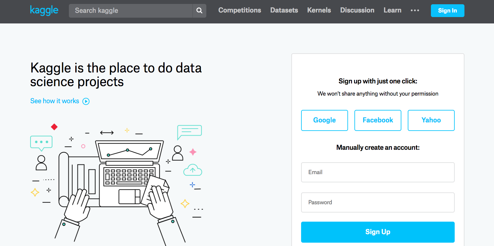
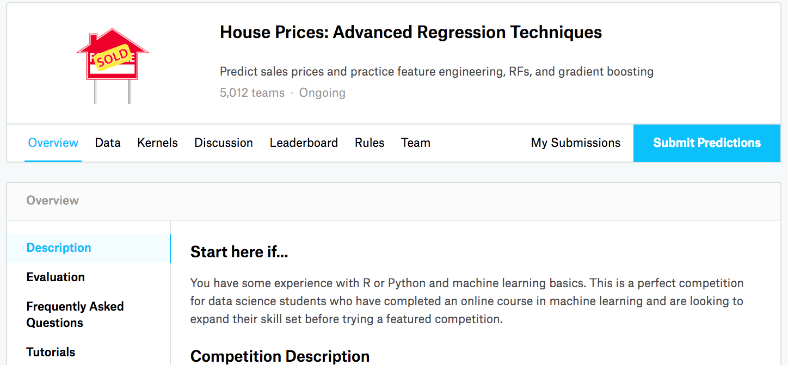
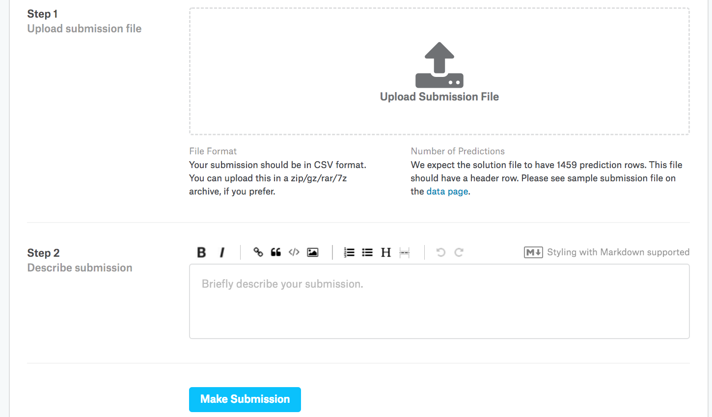

```{.python .input  n=1}
%load_ext d2lbook.tab
tab.interact_select(['mxnet', 'pytorch', 'tensorflow', 'jax'])
```

# 在Kaggle上预测房价
:label:`sec_kaggle_house`

既然我们已经介绍了一些基本工具，
用于构建和训练深层网络，
并用权重衰减和暂退法等技术对它们进行正则化，
我们就准备好通过参加一场Kaggle竞赛，
把所有这些知识付诸实践了。
房价预测竞赛是一个很好的起点。
这些数据相当通用，并没有表现出
可能需要专门模型的那种奇特结构（音频或视频数据可能会）。
该数据集由 :citet:`De-Cock.2011` 收集，
涵盖2006--2010年间艾奥瓦州埃姆斯（Ames）的房价。
它比 Harrison 和 Rubinfeld（1978）著名的[波士顿房价数据集](https://archive.ics.uci.edu/ml/machine-learning-databases/housing/housing.names)大得多，
拥有更多的样例和更多的特征。


在本节中，我们将带你了解
数据预处理、模型设计和超参数选择的细节。
我们希望通过这种动手实践的方式，
你能获得一些直觉，用来指导你作为数据科学家的职业生涯。

```{.python .input}
%%tab mxnet
%matplotlib inline
from d2l import mxnet as d2l
from mxnet import gluon, autograd, init, np, npx
from mxnet.gluon import nn
import pandas as pd

npx.set_np()
```

```{.python .input}
%%tab pytorch
%matplotlib inline
from d2l import torch as d2l
import torch
from torch import nn
import pandas as pd
```

```{.python .input}
%%tab tensorflow
%matplotlib inline
from d2l import tensorflow as d2l
import tensorflow as tf
import pandas as pd
```

```{.python .input}
%%tab jax
%matplotlib inline
from d2l import jax as d2l
import jax
from jax import numpy as jnp
import numpy as np
import pandas as pd
```

## 下载数据

在整本书中，我们将在各种下载的数据集上训练和测试模型。
这里，我们(**实现两个工具函数**)，
分别用于下载和解压 zip 或 tar 文件。
同样，我们跳过这类工具函数的实现细节。

```{.python .input  n=2}
%%tab all
def download(url, folder, sha1_hash=None):
    """Download a file to folder and return the local filepath."""

def extract(filename, folder):
    """Extract a zip/tar file into folder."""
```

## Kaggle

[Kaggle](https://www.kaggle.com) 是一个举办机器学习竞赛的热门平台。
每场竞赛都围绕一个数据集展开，
其中许多竞赛由利益相关方赞助，
为获胜方案提供奖金。
该平台帮助用户通过论坛和共享代码进行互动，
既促进合作，也促进竞争。
虽然追逐排行榜常常会失控，
研究者会短视地关注预处理步骤，
而不是提出根本性的问题，
但这样一个平台也具有巨大的价值：
它的客观性便于对相互竞争的方法进行直接的定量比较，
也便于共享代码，
让每个人都能了解哪些做法有效、哪些无效。
如果你想参加Kaggle竞赛，
首先需要注册一个账号
（见 :numref:`fig_kaggle`）。


:width:`400px`
:label:`fig_kaggle`

在房价预测竞赛页面上，如 :numref:`fig_house_pricing` 所示，
你可以找到数据集（在“Data”标签页下）、
提交预测，并查看自己的排名。
URL 如下：

> https://www.kaggle.com/c/house-prices-advanced-regression-techniques


:width:`400px`
:label:`fig_house_pricing`

## 访问和读取数据集

请注意，竞赛数据分为训练集和测试集。
每条记录包括房屋的房产价值，
以及街道类型、建造年份、屋顶类型、地下室状况等属性。
这些特征由多种数据类型组成。
例如，建造年份用整数表示，
屋顶类型用离散的类别赋值表示，
其他特征则用浮点数表示。
而现实情况在这里就变得复杂起来：
对于某些样例，某些数据完全缺失，
缺失值被简单地标记为“na”。
每套房屋的价格只包含在训练集中
（毕竟这是一场比赛）。
我们会希望划分训练集来创建验证集，
但只有在把预测结果上传到Kaggle之后，
我们才能使用官方测试集来评估模型。
:numref:`fig_house_pricing` 中竞赛页面的“Data”标签页
提供了下载数据的链接。

作为开始，我们将[**使用 `pandas` 读入并处理数据**]，
我们已在 :numref:`sec_pandas` 中介绍过这个库。
为方便起见，我们可以下载并缓存Kaggle房价数据集。
如果缓存目录中已经存在与该数据集对应的文件，
并且其SHA-1与 `sha1_hash` 匹配，
我们的代码就会使用缓存文件，
避免用重复下载堵塞你的网络。

```{.python .input  n=30}
%%tab all
class KaggleHouse(d2l.DataModule):
    def __init__(self, batch_size, train=None, val=None):
        super().__init__()
        self.save_hyperparameters()
        if self.train is None:
            self.raw_train = pd.read_csv(d2l.download(
                d2l.DATA_URL + 'kaggle_house_pred_train.csv', self.root,
                sha1_hash='585e9cc93e70b39160e7921475f9bcd7d31219ce'))
            self.raw_val = pd.read_csv(d2l.download(
                d2l.DATA_URL + 'kaggle_house_pred_test.csv', self.root,
                sha1_hash='fa19780a7b011d9b009e8bff8e99922a8ee2eb90'))
```

训练数据集包含1460个样例、
80个特征和一个标签，
而验证数据包含1459个样例和80个特征。

```{.python .input  n=31}
%%tab all
data = KaggleHouse(batch_size=64)
print(data.raw_train.shape)
print(data.raw_val.shape)
```

## 数据预处理

让我们从前四个样例中[**查看前四个特征、最后两个特征
以及标签（SalePrice）**]。

```{.python .input  n=10}
%%tab all
print(data.raw_train.iloc[:4, [0, 1, 2, 3, -3, -2, -1]])
```

可以看到，每个样例的第一个特征都是标识符。
它帮助模型识别每个训练样例。
虽然这很方便，但它不携带任何用于预测的信息。
因此，在把数据送入模型之前，
我们会把它从数据集中删除。
此外，鉴于数据类型多种多样，
我们需要先对数据进行预处理，才能开始建模。


我们从数值特征开始。
首先，我们采用一种启发式做法，
[**把所有缺失值替换为对应特征的均值。**]
然后，为了把所有特征放在同一尺度上，
我们对数据(***标准化*，将特征重新缩放到零均值和单位方差**)：

$$x \leftarrow \frac{x - \mu}{\sigma},$$

其中 $\mu$ 和 $\sigma$ 分别表示均值和标准差。
为了验证这确实把我们的特征（变量）
变换为零均值和单位方差，
注意到 $E[\frac{x-\mu}{\sigma}] = \frac{\mu - \mu}{\sigma} = 0$，
以及 $E[(x-\mu)^2] = (\sigma^2 + \mu^2) - 2\mu^2+\mu^2 = \sigma^2$。
直观地说，我们标准化数据有两个原因。
第一，事实证明这对优化很方便。
第二，由于我们事先（*a priori*）并不知道哪些特征会是相关的，
我们不希望赋予某个特征的系数的惩罚比任何其他特征更多。

[**接下来我们处理离散值。**]
这类特征包括“MSZoning”等。
(**我们用独热编码替换它们**)，
方式与我们之前把多类标签转换为向量时相同
（见 :numref:`subsec_classification-problem`）。
例如，“MSZoning”的取值为“RL”和“RM”。
去掉“MSZoning”这一特征后，
会创建两个新的指示特征
“MSZoning_RL”和“MSZoning_RM”，取值为0或1。
按照独热编码，
如果“MSZoning”的原始值为“RL”，
那么“MSZoning_RL”为1，“MSZoning_RM”为0。
`pandas` 包会自动为我们完成这一操作。

```{.python .input  n=32}
%%tab all
@d2l.add_to_class(KaggleHouse)
def preprocess(self):
    # Remove the ID and label columns
    label = 'SalePrice'
    features = pd.concat(
        (self.raw_train.drop(columns=['Id', label]),
         self.raw_val.drop(columns=['Id'])))
    # Standardize numerical columns
    numeric_features = features.dtypes[features.dtypes!='object'].index
    features[numeric_features] = features[numeric_features].apply(
        lambda x: (x - x.mean()) / (x.std()))
    # Replace NAN numerical features by 0
    features[numeric_features] = features[numeric_features].fillna(0)
    # Replace discrete features by one-hot encoding
    features = pd.get_dummies(features, dummy_na=True)
    # Save preprocessed features
    self.train = features[:self.raw_train.shape[0]].copy()
    self.train[label] = self.raw_train[label]
    self.val = features[self.raw_train.shape[0]:].copy()
```

可以看到，这种转换把特征数量
从79个增加到331个（不包括ID列和标签列）。

```{.python .input  n=33}
%%tab all
data.preprocess()
data.train.shape
```

## 误差度量

作为开始，我们将训练一个使用平方损失的线性模型。
不出所料，我们的线性模型不会带来能赢得竞赛的提交结果，
但它确实提供了一个健全性检查，
用来判断数据中是否包含有意义的信息。
如果我们在这里不能做到比随机猜测更好，
那么很可能是我们的数据处理有bug。
而如果一切顺利，线性模型将充当一个基准，
让我们对简单模型与最佳报告模型的接近程度有一些直觉，
从而了解更花哨的模型应该能带来多少收益。

对于房价，就像对股价一样，
我们更关心相对量而不是绝对量。
因此，[**我们往往更关心
相对误差 $\frac{y - \hat{y}}{y}$**]，
而不是绝对误差 $y - \hat{y}$。
例如，如果我们在估计俄亥俄州乡村一套房屋的价格时
偏差达到 \$100,000，
而那里典型房屋的价值是 \$125,000，
那么我们大概做得很糟糕。
另一方面，如果我们在加利福尼亚州的洛斯阿尔托斯山
也偏差这么大的金额，
这可能代表一个极其准确的预测
（那里的房屋中位价超过 \$400 万）。

(**解决这个问题的一种方法，
是在价格估计值的对数上度量差异。**)
事实上，这也是竞赛用来评估提交质量的官方误差度量。
毕竟，$|\log y - \log \hat{y}| \leq \delta$ 中的 $\delta$ 取值很小，
就意味着 $e^{-\delta} \leq \frac{\hat{y}}{y} \leq e^\delta$。
由此得到预测价格对数与标签价格对数之间的
如下均方根误差：

$$\sqrt{\frac{1}{n}\sum_{i=1}^n\left(\log y_i -\log \hat{y}_i\right)^2}.$$

```{.python .input  n=60}
%%tab all
@d2l.add_to_class(KaggleHouse)
def get_dataloader(self, train):
    label = 'SalePrice'
    data = self.train if train else self.val
    if label not in data: return
    get_tensor = lambda x: d2l.tensor(x.values.astype(float),
                                      dtype=d2l.float32)
    # Logarithm of prices 
    tensors = (get_tensor(data.drop(columns=[label])),  # X
               d2l.reshape(d2l.log(get_tensor(data[label])), (-1, 1)))  # Y
    return self.get_tensorloader(tensors, train)
```

## $K$折交叉验证

你可能还记得，我们在
:numref:`subsec_generalization-model-selection` 中介绍了[**交叉验证**]，
并讨论了如何处理模型选择。
我们将很好地利用它来选择模型设计并调整超参数。
我们首先需要一个函数，它返回
$K$ 折交叉验证过程中数据的第 $i^\textrm{th}$ 折。
它的做法是把第 $i^\textrm{th}$ 段切片出来作为验证数据，
其余部分作为训练数据返回。
请注意，这不是处理数据的最有效方式；
如果我们的数据集大得多，
我们肯定会采用更聪明的做法。
但这种额外的复杂性可能会不必要地使代码难以理解，
因此鉴于问题很简单，
我们可以放心地在这里省略它。

```{.python .input}
%%tab all
def k_fold_data(data, k):
    rets = []
    fold_size = data.train.shape[0] // k
    for j in range(k):
        idx = range(j * fold_size, (j+1) * fold_size)
        rets.append(KaggleHouse(data.batch_size, data.train.drop(index=idx),  
                                data.train.loc[idx]))    
    return rets
```

在 $K$ 折交叉验证中训练 $K$ 次时，
[**返回的是平均验证误差**]。

```{.python .input}
%%tab all
def k_fold(trainer, data, k, lr):
    val_loss, models = [], []
    for i, data_fold in enumerate(k_fold_data(data, k)):
        model = d2l.LinearRegression(lr)
        model.board.yscale='log'
        if i != 0: model.board.display = False
        trainer.fit(model, data_fold)
        val_loss.append(float(model.board.data['val_loss'][-1].y))
        models.append(model)
    print(f'average validation log mse = {sum(val_loss)/len(val_loss)}')
    return models
```

## [**模型选择**]

在这个例子中，我们选取一组未经调优的超参数，
并让读者自行改进模型。
找到一组好的选择可能需要时间，
这取决于要优化的变量有多少。
当数据集足够大、超参数属于常规类型时，
$K$ 折交叉验证往往对多重检验具有相当的稳健性。
然而，如果我们尝试的选项数量大得不合理，
我们可能会发现验证性能不再能代表真实误差。

```{.python .input}
%%tab all
trainer = d2l.Trainer(max_epochs=10)
models = k_fold(trainer, data, k=5, lr=0.01)
```

请注意，有时一组超参数的训练误差数值可以非常低，
而 $K$ 折交叉验证上的误差数值却高得多。
这表明我们过拟合了。
在整个训练过程中，你会希望同时监控这两个数值。
过拟合较轻可能表明我们的数据足以支撑更强大的模型。
严重的过拟合则可能表明，
我们可以通过引入正则化技术来获益。

##  [**在Kaggle上提交预测**]

既然我们已经知道怎样算是一组好的超参数选择，
我们就可以用所有 $K$ 个模型
计算测试集上的平均预测。
把预测结果保存为csv文件，
可以简化向Kaggle上传结果的操作。
下面的代码会生成一个名为 `submission.csv` 的文件。

```{.python .input}
%%tab all
if tab.selected('pytorch', 'mxnet', 'tensorflow'):
    preds = [model(d2l.tensor(data.val.values.astype(float), dtype=d2l.float32))
             for model in models]
if tab.selected('jax'):
    preds = [model.apply({'params': trainer.state.params},
             d2l.tensor(data.val.values.astype(float), dtype=d2l.float32))
             for model in models]
# Taking exponentiation of predictions in the logarithm scale
ensemble_preds = d2l.reduce_mean(d2l.exp(d2l.concat(preds, 1)), 1)
submission = pd.DataFrame({'Id':data.raw_val.Id,
                           'SalePrice':d2l.numpy(ensemble_preds)})
submission.to_csv('submission.csv', index=False)
```

接下来，如 :numref:`fig_kaggle_submit2` 所示，
我们可以在Kaggle上提交预测，
并查看它们与测试集上实际房价（标签）的对比情况。
步骤非常简单：

* 登录Kaggle网站，访问房价预测竞赛页面。
* 点击“Submit Predictions”或“Late Submission”按钮。
* 点击页面底部虚线框中的“Upload Submission File”按钮，选择要上传的预测文件。
* 点击页面底部的“Make Submission”按钮，查看结果。


:width:`400px`
:label:`fig_kaggle_submit2`

## 小结与讨论

真实数据往往混合了不同的数据类型，需要进行预处理。
把实值数据重新缩放到零均值和单位方差是一个很好的默认做法。用均值替换缺失值也是如此。
此外，把类别特征转换为指示特征，可以让我们像处理独热向量一样处理它们。
当我们往往更关心相对误差而不是绝对误差时，
可以在预测值的对数上度量差异。
要选择模型并调整超参数，
我们可以使用 $K$ 折交叉验证。


## 练习

1. 把本节中的预测结果提交到Kaggle。它们表现如何？
1. 用均值替换缺失值总是好主意吗？提示：你能否构造一种情形，使得这些值不是随机缺失的？
1. 通过 $K$ 折交叉验证调整超参数，提高得分。
1. 通过改进模型（例如层、权重衰减和暂退法）提高得分。
1. 如果我们不像本节这样对连续数值特征进行标准化，会发生什么？

:begin_tab:`mxnet`
[讨论](https://discuss.d2l.ai/t/106)
:end_tab:

:begin_tab:`pytorch`
[讨论](https://discuss.d2l.ai/t/107)
:end_tab:

:begin_tab:`tensorflow`
[讨论](https://discuss.d2l.ai/t/237)
:end_tab:

:begin_tab:`jax`
[讨论](https://discuss.d2l.ai/t/17988)
:end_tab:
