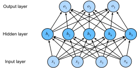

```{.python .input}
%load_ext d2lbook.tab
tab.interact_select(['mxnet', 'pytorch', 'tensorflow', 'jax'])
```

# 多层感知机
:label:`sec_mlp`

在 :numref:`sec_softmax` 中，我们介绍了
softmax 回归，既从零实现了该算法
（:numref:`sec_softmax_scratch`），也使用了高层 API
（:numref:`sec_softmax_concise`）。这使我们能够
训练出从低分辨率图像中识别
10 类服装的分类器。
在此过程中，我们学会了如何整理数据、
把输出强制转换为一个合法的概率分布、
应用合适的损失函数，
并针对模型参数最小化该损失函数。
现在，我们已经在简单线性模型的背景下
掌握了这些机理，
就可以开始探索深度神经网络了——
这正是本书主要关注的那类相对丰富的模型。

```{.python .input}
%%tab mxnet
%matplotlib inline
from d2l import mxnet as d2l
from mxnet import autograd, np, npx
npx.set_np()
```

```{.python .input}
%%tab pytorch
%matplotlib inline
from d2l import torch as d2l
import torch
```

```{.python .input}
%%tab tensorflow
%matplotlib inline
from d2l import tensorflow as d2l
import tensorflow as tf
```

```{.python .input}
%%tab jax
%matplotlib inline
from d2l import jax as d2l
import jax
from jax import numpy as jnp
from jax import grad, vmap
```

## 隐藏层

我们在 :numref:`subsec_linear_model` 中把仿射变换
描述为带偏置的线性变换。
首先，回想一下与我们的 softmax 回归示例
相对应的模型架构，
如 :numref:`fig_softmaxreg` 所示。
该模型通过单个仿射变换
把输入直接映射到输出，
随后再接一个 softmax 运算。
如果我们的标签确实通过一个简单的仿射变换
与输入数据相关联，
那么这种方法就足够了。
然而，（仿射变换中的）线性性是一个*很强*的假设。

### 线性模型的局限

例如，线性性蕴含了更*弱*的
*单调性*假设，即：
特征的任何增加都必须
要么总是导致模型输出的增加
（如果相应的权重为正），
要么总是导致模型输出的减少
（如果相应的权重为负）。
有时这是有道理的。
例如，如果我们想预测
一个人是否会偿还贷款，
我们也许可以合理假设：在其他条件相同的前提下，
收入更高的申请人
总是比收入更低的申请人更有可能还款。
尽管这种关系是单调的，但它很可能
并不与还款概率线性相关。
收入从 \$0 增加到 \$50,000，
很可能比从 100 万美元增加到 105 万美元
对应着更大的还款可能性提升。
处理这个问题的一种方式，是对结果进行后处理，
使线性性变得更合理，
比如使用 logistic 映射（因而使用结果概率的对数）。

注意，我们很容易举出违反单调性的例子。
例如，假设我们想根据体温来预测健康状况。
对于体温高于 37°C（98.6°F）的正常个体，
体温越高意味着风险越大。
然而，如果体温降到 37°C 以下，体温越低反而意味着风险越大！
同样，我们也许可以用一些巧妙的预处理
来解决这个问题，例如把与 37°C 的距离作为一个特征。


但是，对猫和狗的图片进行分类又当如何呢？
增大位置 (13, 17) 处像素的强度，
是否应当总是增大（或总是减小）
图像描绘的是狗的可能性呢？
依赖线性模型相当于隐含地假设：
区分猫和狗所唯一需要做的，
就是评估各个像素的亮度。
在一个把图像反转过来仍不改变类别的世界里，
这种方法注定要失败。

然而，尽管与前面的例子相比，
这里的线性性显得荒谬，
但用简单的预处理来修正这个问题并不那么显然。
这是因为任何像素的重要性
都以复杂的方式取决于其上下文
（周围像素的取值）。
也许存在一种数据的表示，
它能考虑到特征之间相关的相互作用，
在此基础上线性模型就能适用，
但我们根本不知道如何手工计算出这种表示。
借助深度神经网络，我们可以利用观测数据
通过隐藏层联合学习一种表示，
以及作用于该表示的线性预测器。

这个非线性问题至少已经被研究了一个
世纪 :cite:`Fisher.1928`。例如，最基本形式的决策树
使用一系列二元决策来
判定类别归属 :cite:`quinlan2014c4`。同样，
核方法几十年来一直被用于对非线性依赖关系建模
:cite:`Aronszajn.1950`。这些思想后来进入
非参数样条模型 :cite:`Wahba.1990` 和核方法
:cite:`Scholkopf.Smola.2002`。这也是大脑
能够相当自然地解决的问题。毕竟，
神经元向其他神经元馈送信号，而后者
又反过来向再一些神经元馈送信号 :cite:`Cajal.Azoulay.1894`。
因此，我们得到了一系列相对简单的变换。

### 引入隐藏层

我们可以通过引入一个或多个隐藏层
来克服线性模型的局限。
最简单的做法是把
许多全连接层依次堆叠起来。
每一层都馈入其上一层，
直到我们生成输出。
我们可以把前 $L-1$ 层
看作我们的表示，把最后一层
看作我们的线性预测器。
这种架构通常称为
*多层感知机*（multilayer perceptron），
常缩写为 *MLP*（:numref:`fig_mlp`）。


:label:`fig_mlp`

这个 MLP 有四个输入、三个输出，
其隐藏层包含五个隐藏单元。
由于输入层不涉及任何计算，
用这个网络产生输出
需要实现隐藏层和输出层
两部分的计算；
因此，这个 MLP 的层数是两层。
注意这两层都是全连接的。
每个输入都影响隐藏层中的每个神经元，
而隐藏层中的每个神经元又反过来影响
输出层中的每个神经元。唉，我们还没有
完全讲完。

### 从线性到非线性

和之前一样，我们用矩阵 $\mathbf{X} \in \mathbb{R}^{n \times d}$
表示一个由 $n$ 个样例组成的小批量，其中每个样例有 $d$ 个输入（特征）。
对于一个隐藏层含 $h$ 个隐藏单元的单隐藏层 MLP，
我们用 $\mathbf{H} \in \mathbb{R}^{n \times h}$
表示隐藏层的输出，即
*隐藏表示*（hidden representation）。
由于隐藏层和输出层都是全连接的，
我们有隐藏层权重 $\mathbf{W}^{(1)} \in \mathbb{R}^{d \times h}$ 和偏置 $\mathbf{b}^{(1)} \in \mathbb{R}^{1 \times h}$，
以及输出层权重 $\mathbf{W}^{(2)} \in \mathbb{R}^{h \times q}$ 和偏置 $\mathbf{b}^{(2)} \in \mathbb{R}^{1 \times q}$。
这使我们能够如下计算单隐藏层 MLP 的
输出 $\mathbf{O} \in \mathbb{R}^{n \times q}$：

$$
\begin{aligned}
    \mathbf{H} & = \mathbf{X} \mathbf{W}^{(1)} + \mathbf{b}^{(1)}, \\
    \mathbf{O} & = \mathbf{H}\mathbf{W}^{(2)} + \mathbf{b}^{(2)}.
\end{aligned}
$$

注意，加入隐藏层之后，
我们的模型现在需要我们跟踪并更新
额外的参数集。
那么，我们换来了什么呢？
你可能会惊讶地发现，
在上述定义的模型中，*我们费了这么大劲却一无所获*！
原因很简单。
上面的隐藏单元是输入的
仿射函数，
而输出（softmax 之前）只是
隐藏单元的仿射函数。
仿射函数的仿射函数
仍然是仿射函数。
此外，我们的线性模型本来就已经
能够表示任何仿射函数。

为了正式地看到这一点，我们只需把上面定义中的隐藏层折叠掉，
得到一个等价的单层模型，其参数为
$\mathbf{W} = \mathbf{W}^{(1)}\mathbf{W}^{(2)}$ 和 $\mathbf{b} = \mathbf{b}^{(1)} \mathbf{W}^{(2)} + \mathbf{b}^{(2)}$：

$$
\mathbf{O} = (\mathbf{X} \mathbf{W}^{(1)} + \mathbf{b}^{(1)})\mathbf{W}^{(2)} + \mathbf{b}^{(2)} = \mathbf{X} \mathbf{W}^{(1)}\mathbf{W}^{(2)} + \mathbf{b}^{(1)} \mathbf{W}^{(2)} + \mathbf{b}^{(2)} = \mathbf{X} \mathbf{W} + \mathbf{b}.
$$

为了发挥多层架构的潜力，
我们还需要一个关键要素：
一个非线性*激活函数*（activation function）$\sigma$，
在仿射变换之后作用于每个隐藏单元。例如，
一个流行的选择是 ReLU（rectified linear unit，修正线性单元）激活函数 :cite:`Nair.Hinton.2010`
$\sigma(x) = \mathrm{max}(0, x)$，它按元素作用于其参数。
激活函数 $\sigma(\cdot)$
的输出称为*激活*（activation）。
一般来说，有了激活函数之后，
我们就不再可能把 MLP 折叠成一个线性模型：

$$
\begin{aligned}
    \mathbf{H} & = \sigma(\mathbf{X} \mathbf{W}^{(1)} + \mathbf{b}^{(1)}), \\
    \mathbf{O} & = \mathbf{H}\mathbf{W}^{(2)} + \mathbf{b}^{(2)}.\\
\end{aligned}
$$

由于 $\mathbf{X}$ 中的每一行对应小批量中的一个样例，
（这里稍微滥用一下记号）我们定义非线性 $\sigma$
以逐行的方式作用于其输入，
即一次一个样例。
注意，当我们在 :numref:`subsec_softmax_vectorization` 中
表示逐行运算时，softmax 也使用了同样的记号。
我们常用的激活函数往往不仅作用于逐行，而且
按元素作用。这意味着，在计算完该层的线性部分之后，
我们可以分别计算每个激活值，
而不必查看其他隐藏单元的取值。

为了构建更一般的 MLP，我们可以继续堆叠
这样的隐藏层，
例如 $\mathbf{H}^{(1)} = \sigma_1(\mathbf{X} \mathbf{W}^{(1)} + \mathbf{b}^{(1)})$、
$\mathbf{H}^{(2)} = \sigma_2(\mathbf{H}^{(1)} \mathbf{W}^{(2)} + \mathbf{b}^{(2)})$，
一层叠一层，从而得到表达能力越来越强的模型。

### 通用近似器

我们知道，人脑能够进行非常复杂的统计分析。因此，
值得一问：深度网络究竟可以*有多强大*。这个问题
已经被多次回答，例如，:citet:`Cybenko.1989` 在
MLP 的背景下给出了回答，而 :citet:`micchelli1984interpolation` 则在再生核
希尔伯特空间的背景下给出了一种可以看作单隐藏层径向基函数（RBF）网络的回答。
这些结果（以及相关结果）表明，即便是单隐藏层网络，
只要节点足够多（可能是多得离谱的多），
并且权重集合合适，
我们就能对任何函数建模。
不过，真正学习到这个函数才是困难的部分。
你也许可以把你的神经网络
想象得有点像 C 编程语言。
与任何其他现代语言一样，
这门语言能够表达任何可计算的程序。
但真正给出一个符合你规格说明的程序
才是困难的部分。

此外，单隐藏层网络*能够*学习任何函数，
并不意味着你应当试图
用一个这样的网络来解决你所有的问题。事实上，在这种情况下核方法
要有效得多，因为它们即使在无限维空间中也能够
*精确地*解决该问题 :cite:`Kimeldorf.Wahba.1971,Scholkopf.Herbrich.Smola.2001`。
事实上，使用更深（而不是更宽）的网络，我们可以
更为紧凑地近似许多函数 :cite:`Simonyan.Zisserman.2014`。
我们将在后续章节中讨论更严格的论证。

## 激活函数
:label:`subsec_activation-functions`

激活函数通过计算加权和并在此基础上加上偏置，
来决定一个神经元是否应当被激活。
它们是用于把输入信号变换为输出的可微运算符，
且其中大多数会引入非线性。
由于激活函数是深度学习的基础，
(**下面我们简要考察一些常见的激活函数**)。

### ReLU 函数

最流行的选择是*修正线性单元*（*ReLU*）:cite:`Nair.Hinton.2010`，
这既因为实现简单，
也因为它在各种预测任务上表现良好。
[**ReLU 提供了一种非常简单的非线性变换**]。
给定一个元素 $x$，该函数定义为
该元素与 $0$ 二者中的最大值：

$$\operatorname{ReLU}(x) = \max(x, 0).$$

非正式地说，ReLU 函数只保留正的元素，
而把所有负的元素对应的激活值都设为 0 从而丢弃它们。
为了获得一些直观认识，我们可以画出这个函数。
如你所见，该激活函数是分段线性的。

```{.python .input}
%%tab mxnet
x = np.arange(-8.0, 8.0, 0.1)
x.attach_grad()
with autograd.record():
    y = npx.relu(x)
d2l.plot(x, y, 'x', 'relu(x)', figsize=(5, 2.5))
```

```{.python .input}
%%tab pytorch
x = torch.arange(-8.0, 8.0, 0.1, requires_grad=True)
y = torch.relu(x)
d2l.plot(x.detach(), y.detach(), 'x', 'relu(x)', figsize=(5, 2.5))
```

```{.python .input}
%%tab tensorflow
x = tf.Variable(tf.range(-8.0, 8.0, 0.1), dtype=tf.float32)
y = tf.nn.relu(x)
d2l.plot(x.numpy(), y.numpy(), 'x', 'relu(x)', figsize=(5, 2.5))
```

```{.python .input}
%%tab jax
x = jnp.arange(-8.0, 8.0, 0.1)
y = jax.nn.relu(x)
d2l.plot(x, y, 'x', 'relu(x)', figsize=(5, 2.5))
```

当输入为负时，
ReLU 函数的导数为 0，
而当输入为正时，
ReLU 函数的导数为 1。
注意，当输入取值恰好等于 0 时，
ReLU 函数不可微。
在这些情况下，我们默认取左导数，
即认为输入为 0 时导数为 0。
我们可以这样做，是因为
输入实际上可能永远不会恰好为零（数学家
会说它在零测集上是不可微的）。
有句老话说，如果微妙的边界条件很重要，
我们很可能是在做（*真正的*）数学，而不是工程。
这条传统智慧也许适用于此，或者至少，适用于这个事实：
我们做的并不是约束优化 :cite:`Mangasarian.1965,Rockafellar.1970`。
下面我们画出 ReLU 函数的导数。

```{.python .input}
%%tab mxnet
y.backward()
d2l.plot(x, x.grad, 'x', 'grad of relu', figsize=(5, 2.5))
```

```{.python .input}
%%tab pytorch
y.backward(torch.ones_like(x), retain_graph=True)
d2l.plot(x.detach(), x.grad, 'x', 'grad of relu', figsize=(5, 2.5))
```

```{.python .input}
%%tab tensorflow
with tf.GradientTape() as t:
    y = tf.nn.relu(x)
d2l.plot(x.numpy(), t.gradient(y, x).numpy(), 'x', 'grad of relu',
         figsize=(5, 2.5))
```

```{.python .input}
%%tab jax
grad_relu = vmap(grad(jax.nn.relu))
d2l.plot(x, grad_relu(x), 'x', 'grad of relu', figsize=(5, 2.5))
```

使用 ReLU 的原因是它的导数表现特别好：
它们要么消失，要么就让参数原样通过。
这使得优化表现得更好，
并且缓解了曾困扰早期神经网络版本的、
有充分文献记载的梯度消失问题（后文还会详细讨论）。

注意，ReLU 函数有许多变体，
包括*参数化 ReLU*（*pReLU*）函数 :cite:`He.Zhang.Ren.ea.2015`。
这一变体为 ReLU 增加了一个线性项，
因此即使参数为负，也仍有一些信息可以通过：

$$\operatorname{pReLU}(x) = \max(0, x) + \alpha \min(0, x).$$

### Sigmoid 函数

[**sigmoid 函数把那些**]取值位于定义域 $\mathbb{R}$ 中的输入
(**变换为取值落在区间 (0, 1) 上的输出。**)
因此，sigmoid 函数
常被称为*挤压函数*（squashing function）：
它把 (-inf, inf) 范围内的任何输入
挤压到 (0, 1) 范围内的某个值：

$$\operatorname{sigmoid}(x) = \frac{1}{1 + \exp(-x)}.$$

在最早的神经网络中，科学家们
感兴趣的是对*激活*或*不激活*的生物神经元建模。
因此，这一领域的先驱们——
可以一直追溯到人工神经元的发明者
McCulloch 和 Pitts——
专注于阈值单元 :cite:`McCulloch.Pitts.1943`。
阈值激活在其输入低于某个阈值时
取值为 0，
而在输入超过该阈值时取值为 1。

当注意力转向基于梯度的学习时，
sigmoid 函数是一个自然的选择，
因为它是阈值单元的一个平滑、可微的
近似。
当我们在二元分类问题中想把输出解释为概率时，
sigmoid 仍然被广泛用作输出单元上的
激活函数：你可以把 sigmoid 看作 softmax 的一个特例。
然而，在隐藏层的大多数用途中，sigmoid 已在很大程度上
被更简单、也更容易训练的 ReLU 所取代。
这在很大程度上是因为 sigmoid 给优化带来了挑战
:cite:`LeCun.Bottou.Orr.ea.1998`，因为当参数为大的正数*或*负数时，它的梯度会消失。
这可能导致难以逃离的平台区。
尽管如此，sigmoid 仍然很重要。在后续关于循环神经网络的章节中（例如 :numref:`sec_lstm`），
我们将描述利用 sigmoid 单元来控制信息跨时间流动的架构。

下面我们画出 sigmoid 函数。
注意，当输入接近 0 时，
sigmoid 函数近似于
一个线性变换。

```{.python .input}
%%tab mxnet
with autograd.record():
    y = npx.sigmoid(x)
d2l.plot(x, y, 'x', 'sigmoid(x)', figsize=(5, 2.5))
```

```{.python .input}
%%tab pytorch
y = torch.sigmoid(x)
d2l.plot(x.detach(), y.detach(), 'x', 'sigmoid(x)', figsize=(5, 2.5))
```

```{.python .input}
%%tab tensorflow
y = tf.nn.sigmoid(x)
d2l.plot(x.numpy(), y.numpy(), 'x', 'sigmoid(x)', figsize=(5, 2.5))
```

```{.python .input}
%%tab jax
y = jax.nn.sigmoid(x)
d2l.plot(x, y, 'x', 'sigmoid(x)', figsize=(5, 2.5))
```

sigmoid 函数的导数由下式给出：

$$\frac{d}{dx} \operatorname{sigmoid}(x) = \frac{\exp(-x)}{(1 + \exp(-x))^2} = \operatorname{sigmoid}(x)\left(1-\operatorname{sigmoid}(x)\right).$$


sigmoid 函数的导数如下图所示。
注意，当输入为 0 时，
sigmoid 函数的导数
达到最大值 0.25。
当输入向任一方向偏离 0 时，
导数都趋近于 0。

```{.python .input}
%%tab mxnet
y.backward()
d2l.plot(x, x.grad, 'x', 'grad of sigmoid', figsize=(5, 2.5))
```

```{.python .input}
%%tab pytorch
# Clear out previous gradients
x.grad.data.zero_()
y.backward(torch.ones_like(x),retain_graph=True)
d2l.plot(x.detach(), x.grad, 'x', 'grad of sigmoid', figsize=(5, 2.5))
```

```{.python .input}
%%tab tensorflow
with tf.GradientTape() as t:
    y = tf.nn.sigmoid(x)
d2l.plot(x.numpy(), t.gradient(y, x).numpy(), 'x', 'grad of sigmoid',
         figsize=(5, 2.5))
```

```{.python .input}
%%tab jax
grad_sigmoid = vmap(grad(jax.nn.sigmoid))
d2l.plot(x, grad_sigmoid(x), 'x', 'grad of sigmoid', figsize=(5, 2.5))
```

### Tanh 函数
:label:`subsec_tanh`

与 sigmoid 函数一样，[**tanh（双曲正切）
函数也会挤压它的输入**]，
把它们变换为取值在(**$-1$ 与 $1$ 之间**)的元素：

$$\operatorname{tanh}(x) = \frac{1 - \exp(-2x)}{1 + \exp(-2x)}.$$

下面我们画出 tanh 函数。注意，当输入接近 0 时，tanh 函数近似于一个线性变换。尽管该函数的形状与 sigmoid 函数相似，但 tanh 函数关于坐标原点具有点对称性 :cite:`Kalman.Kwasny.1992`。

```{.python .input}
%%tab mxnet
with autograd.record():
    y = np.tanh(x)
d2l.plot(x, y, 'x', 'tanh(x)', figsize=(5, 2.5))
```

```{.python .input}
%%tab pytorch
y = torch.tanh(x)
d2l.plot(x.detach(), y.detach(), 'x', 'tanh(x)', figsize=(5, 2.5))
```

```{.python .input}
%%tab tensorflow
y = tf.nn.tanh(x)
d2l.plot(x.numpy(), y.numpy(), 'x', 'tanh(x)', figsize=(5, 2.5))
```

```{.python .input}
%%tab jax
y = jax.nn.tanh(x)
d2l.plot(x, y, 'x', 'tanh(x)', figsize=(5, 2.5))
```

tanh 函数的导数为：

$$\frac{d}{dx} \operatorname{tanh}(x) = 1 - \operatorname{tanh}^2(x).$$

其图像如下所示。
当输入接近 0 时，
tanh 函数的导数趋近于最大值 1。
而正如我们在 sigmoid 函数那里所见到的，
当输入向任一方向远离 0 时，
tanh 函数的导数都趋近于 0。

```{.python .input}
%%tab mxnet
y.backward()
d2l.plot(x, x.grad, 'x', 'grad of tanh', figsize=(5, 2.5))
```

```{.python .input}
%%tab pytorch
# Clear out previous gradients
x.grad.data.zero_()
y.backward(torch.ones_like(x),retain_graph=True)
d2l.plot(x.detach(), x.grad, 'x', 'grad of tanh', figsize=(5, 2.5))
```

```{.python .input}
%%tab tensorflow
with tf.GradientTape() as t:
    y = tf.nn.tanh(x)
d2l.plot(x.numpy(), t.gradient(y, x).numpy(), 'x', 'grad of tanh',
         figsize=(5, 2.5))
```

```{.python .input}
%%tab jax
grad_tanh = vmap(grad(jax.nn.tanh))
d2l.plot(x, grad_tanh(x), 'x', 'grad of tanh', figsize=(5, 2.5))
```

## 小结与讨论

我们现在已经知道如何引入非线性
来构建表达能力强的多层神经网络架构。
顺便说一句，你的知识已经
让你掌握了与大约 1990 年的实践者
类似的一套工具。
在某些方面，你比当时工作的任何人
都有优势，
因为你可以利用强大的
开源深度学习框架，
只用几行代码就能快速构建模型。
以前，训练这些网络
需要研究者用 C、Fortran 甚至 Lisp（就 LeNet 而言）显式地
编写层和导数的代码。

第二个好处是，ReLU 比 sigmoid 或 tanh 函数
显著地更适合优化。有人可能会说，
这是过去十年间帮助深度学习复兴的关键创新之一。
不过要注意，关于激活函数的研究并没有停止。
例如，
:citet:`Hendrycks.Gimpel.2016` 提出的
GELU（Gaussian error linear unit，高斯误差线性单元）
激活函数 $x \Phi(x)$（其中 $\Phi(x)$
是标准高斯累积分布函数）
以及
:citet:`Ramachandran.Zoph.Le.2017` 中提出的 Swish 激活
函数 $\sigma(x) = x \operatorname{sigmoid}(\beta x)$，
在很多情况下都能带来更好的准确率。

## 练习

1. 证明：向一个*线性*深度网络（即不含
   非线性 $\sigma$ 的网络）添加层，永远不会增强该网络的表达能力。
   举一个它实际上反而会削弱表达能力的例子。
1. 计算 pReLU 激活函数的导数。
1. 计算 Swish 激活函数 $x \operatorname{sigmoid}(\beta x)$ 的导数。
1. 证明：只使用 ReLU（或 pReLU）的 MLP 构造出的是
   连续的分段线性函数。
1. Sigmoid 与 tanh 非常相似。
    1. 证明 $\operatorname{tanh}(x) + 1 = 2 \operatorname{sigmoid}(2x)$。
    1. 证明由这两种非线性所参数化的函数类是相同的。提示：仿射层也带有偏置项。
1. 假设我们有一个一次作用于一个小批量的非线性，例如批量规范化 :cite:`Ioffe.Szegedy.2015`。你预计这会带来哪些问题？
1. 举一个 sigmoid 激活函数梯度消失的例子。

:begin_tab:`mxnet`
[讨论](https://discuss.d2l.ai/t/90)
:end_tab:

:begin_tab:`pytorch`
[讨论](https://discuss.d2l.ai/t/91)
:end_tab:

:begin_tab:`tensorflow`
[讨论](https://discuss.d2l.ai/t/226)
:end_tab:

:begin_tab:`jax`
[讨论](https://discuss.d2l.ai/t/17984)
:end_tab:
