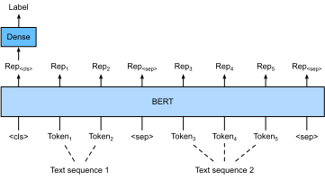
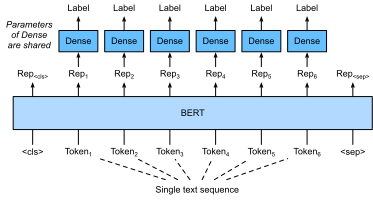
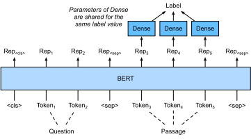

# 针对序列级和词元级应用微调 BERT
:label:`sec_finetuning-bert`

在本章前面的几节中，
我们为自然语言处理应用设计了不同的模型，
例如基于 RNN、CNN、注意力和 MLP 的模型。
当存在空间或时间限制时，这些模型是有用的，
然而，
为每个自然语言处理任务专门设计一个模型
实际上是不可行的。
在 :numref:`sec_bert` 中，
我们介绍了一个预训练模型 BERT，
它只需对架构做最小的改动
就能适用于广泛的自然语言处理任务。
一方面，
在其提出之时，
BERT 提高了各种自然语言处理任务的最优水平。
另一方面，
正如 :numref:`sec_bert-pretraining` 中指出的，
原始 BERT 模型的两个版本
分别有 1.1 亿和 3.4 亿个参数。
因此，当有足够的计算资源时，
我们可以考虑
为下游自然语言处理应用微调 BERT。

在下文中，
我们将自然语言处理应用的一个子集概括为
序列级和词元级。
在序列级，
我们介绍如何将文本输入的 BERT 表示
转换为
单文本分类
和文本对分类或回归中的输出标签。
在词元级，我们将简要介绍新的应用
（如文本标注和问答），
并说明 BERT 如何表示它们的输入并转换为输出标签。
在微调期间，
BERT 在不同应用中所需的“最小架构改动”
就是额外的全连接层。
在下游应用的监督学习中，
额外层的参数是从头开始学习的，而
预训练 BERT 模型中的所有参数都经过微调。

## 单文本分类

*单文本分类*以单个文本序列作为输入，并输出其分类结果。
除了本章中已经研究过的情感分析之外，
语言可接受性语料库（CoLA）
也是一个单文本分类数据集，
用于判断给定句子在语法上是否可接受 :cite:`Warstadt.Singh.Bowman.2019`。
例如，“I should study.”是可接受的，而“I should studying.”不是。

:label:`fig_bert-one-seq`

:numref:`sec_bert` 描述了 BERT 的输入表示。
BERT 输入序列能够明确地表示单个文本和文本对，
其中特殊分类词元
“&lt;cls&gt;”用于序列分类，
特殊分类词元
“&lt;sep&gt;”标记单个文本的结束或分隔一对文本。
如 :numref:`fig_bert-one-seq` 所示，
在单文本分类应用中，
特殊分类词元
“&lt;cls&gt;”的 BERT 表示
编码了整个输入文本序列的信息。
作为输入单文本的表示，
它将被送入一个由全连接（稠密）层组成的小型 MLP，
以输出所有离散标签值的分布。

## 文本对分类或回归

我们在本章中还考察了自然语言推断。
它属于*文本对分类*，
即一类对文本对进行分类的应用。

以一对文本作为输入但输出连续值，
*语义文本相似性*（semantic textual similarity）是一个流行的*文本对回归*任务。
该任务度量句子之间的语义相似度。
例如，在语义文本相似性基准数据集中，
一对句子的相似度得分
是一个序数量表，范围从 0（无语义重叠）到 5（语义等价）:cite:`Cer.Diab.Agirre.ea.2017`。
目标是预测这些分数。
语义文本相似性基准数据集的样本包括（句子 1，句子 2，相似度得分）：

* "A plane is taking off."（“一架飞机正在起飞。”），"An air plane is taking off."（“一架飞机正在起飞。”），5.000；
* "A woman is eating something."（“一个女人在吃东西。”），"A woman is eating meat."（“一个女人在吃肉。”），3.000；
* "A woman is dancing."（“一个女人在跳舞。”），"A man is talking."（“一个男人在说话。”），0.000。

:label:`fig_bert-two-seqs`

与 :numref:`fig_bert-one-seq` 中的单文本分类相比，
:numref:`fig_bert-two-seqs` 中对文本对分类的 BERT 微调
在输入表示上有所不同。
对于语义文本相似性等文本对回归任务，
可以应用细微的改动，例如输出连续的标签值
并使用均方损失：这些改动在回归中很常见。

## 文本标注

现在让我们考虑词元级任务，例如*文本标注*，
其中每个词元都被分配一个标签。
在文本标注任务中，
*词性标注*根据词在句子中的作用，
为每个词分配一个词性标记（例如，形容词和限定词）。
例如，
根据 Penn Treebank II 标记集，
句子 "John Smith 's car is new"
应标注为
"NNP (noun, proper singular) NNP POS (possessive ending) NN (noun, singular or mass) VB (verb, base form) JJ (adjective)"。

:label:`fig_bert-tagging`

文本标注应用的 BERT 微调
如 :numref:`fig_bert-tagging` 所示。
与 :numref:`fig_bert-one-seq` 相比，
唯一的区别在于
在文本标注中，输入文本*每个词元*的 BERT 表示
都被送入同一个额外的全连接层，以输出该词元的标签，
例如词性标记。

## 问答

作为另一个词元级应用，
*问答*体现了阅读理解的能力。
例如，
斯坦福问答数据集（SQuAD v1.1）
由阅读段落和问题组成，
其中每个问题的答案
只是问题所针对段落中的一段文本（文本片段）:cite:`Rajpurkar.Zhang.Lopyrev.ea.2016`。
举例来说，
考虑一段话
"Some experts report that a mask's efficacy is inconclusive. However, mask makers insist that their products, such as N95 respirator masks, can guard against the virus."（“一些专家报告说口罩的功效尚无定论。然而，口罩制造商坚持认为他们的产品，如 N95 呼吸器口罩，可以预防病毒。”）
以及一个问题 "Who say that N95 respirator masks can guard against the virus?"（“谁说 N95 呼吸器口罩可以预防病毒？”）。
答案应该是段落中的文本片段 "mask makers"（“口罩制造商”）。
因此，SQuAD v1.1 的目标是给定问题和段落，预测段落的文本片段的开始和结束位置。

:label:`fig_bert-qa`

为了针对问答微调 BERT，
问题和段落分别作为
BERT 输入中的
第一个和第二个文本序列打包。
为了预测文本片段开始的位置，
同一个额外的全连接层将把
段落中位置为 $i$ 的任意词元的 BERT 表示
转换为标量分数 $s_i$。
段落中所有词元的这类分数
进一步通过 softmax 运算
转换为概率分布，
从而为段落中的每个词元位置 $i$ 分配
成为文本片段开始的概率 $p_i$。
预测文本片段的结束位置
与上述过程相同，只是
其额外全连接层中的参数
与预测开始位置的参数相互独立。
预测结束时，
位置为 $i$ 的任意段落词元
都通过同一个全连接层
转换为标量分数 $e_i$。
:numref:`fig_bert-qa`
描述了问答的 BERT 微调。

对于问答，
监督学习的训练目标非常直接，
即最大化真实开始和结束位置的对数似然。
在预测文本片段时，
我们可以计算从位置 $i$ 到位置 $j$（$i \leq j$）的合法文本片段的分数 $s_i + e_j$，
并输出分数最高的文本片段。

## 小结

* 对于序列级和词元级自然语言处理应用，BERT 只需要最小的架构改动（额外的全连接层），这些应用包括单文本分类（例如情感分析和语言可接受性测试）、文本对分类或回归（例如自然语言推断和语义文本相似性）、文本标注（例如词性标注）和问答。
* 在下游应用的监督学习中，额外层的参数是从头开始学习的，而预训练 BERT 模型中的所有参数都经过微调。

## 练习

1. 让我们为新闻文章设计一个搜索引擎算法。当系统收到一个查询（例如“冠状病毒爆发期间的石油行业”）时，它应返回与查询最相关的一组新闻文章排序列表。假设我们有一个庞大的新闻文章池和大量查询。为了简化问题，假设每个查询都标注了最相关的文章。如何在算法设计中应用负采样（见 :numref:`subsec_negative-sampling`）和 BERT？
1. 我们如何在训练语言模型时利用 BERT？
1. 我们能否在机器翻译中利用 BERT？

[讨论](https://discuss.d2l.ai/t/396)
