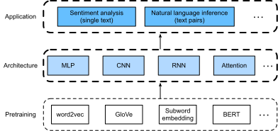

# 自然语言处理：应用
:label:`chap_nlp_app`

我们已经了解了如何在文本序列中表示词元，并在 :numref:`chap_nlp_pretrain` 中训练它们的表示。
这种预训练的文本表示可以输入到各种模型中，用于不同的下游自然语言处理任务。

事实上，
前几章已经讨论了一些*没有预训练*的自然语言处理应用，
只是为了解释深度学习架构。
例如，在 :numref:`chap_rnn` 中，
我们依靠 RNN 设计语言模型来生成小说式的文本。
在 :numref:`chap_modern_rnn` 和 :numref:`chap_attention-and-transformers` 中，
我们还设计了基于 RNN 和注意力机制的机器翻译模型。

然而，本书并不打算全面覆盖所有这类应用。
相反，
我们的重点是*如何将语言的（深度）表示学习应用于解决自然语言处理问题*。
给定预训练的文本表示，
本章将探讨两个
流行且有代表性的
下游自然语言处理任务：
情感分析和自然语言推断，
它们分别分析单个文本和文本对之间的关系。


:label:`fig_nlp-map-app`

如 :numref:`fig_nlp-map-app` 所示，
本章重点介绍使用不同类型的深度学习架构（如 MLP、CNN、RNN 和注意力）设计自然语言处理模型的基本思想。
尽管可以将任何预训练的文本表示与任何架构组合，用于 :numref:`fig_nlp-map-app` 中的任一应用，
但我们只选择几个有代表性的组合。
具体来说，我们将探讨用于情感分析的流行 RNN 和 CNN 架构。
对于自然语言推断，我们选择注意力和 MLP 来演示如何分析文本对。
最后，我们介绍如何微调预训练的 BERT 模型，
以应对广泛的自然语言处理应用，
例如在序列层面（单文本分类和文本对分类）
和词元层面（文本标注和问答）。
作为一个具体的实证案例，
我们将微调 BERT 用于自然语言推断。

正如我们在 :numref:`sec_bert` 中介绍的，
BERT 只需对架构做最小的改动，
就能适应广泛的下游自然语言处理应用。
然而，这一好处是以针对下游应用微调大量 BERT 参数为代价的。
当空间或时间有限时，
那些基于 MLP、CNN、RNN 和注意力精心设计的模型更为可行。
接下来，我们从情感分析应用开始，
分别说明基于 RNN 和 CNN 的模型设计。

```toc
:maxdepth: 2

sentiment-analysis-and-dataset
sentiment-analysis-rnn
sentiment-analysis-cnn
natural-language-inference-and-dataset
natural-language-inference-attention
finetuning-bert
natural-language-inference-bert
```
