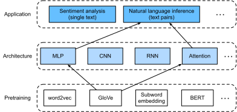
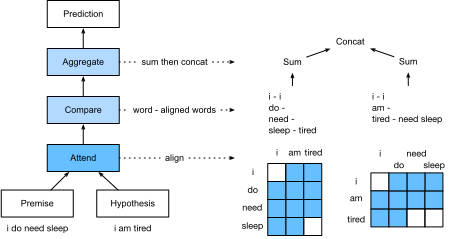

# 自然语言推断：使用注意力
:label:`sec_natural-language-inference-attention`

我们在 :numref:`sec_natural-language-inference-and-dataset` 中介绍了自然语言推断任务和 SNLI 数据集。鉴于许多模型都基于复杂而深层的架构，:citet:`Parikh.Tackstrom.Das.ea.2016` 提出用注意力机制解决自然语言推断问题，并称之为“可分解注意力模型”。
这使得模型既没有循环层也没有卷积层，在 SNLI 数据集上以少得多的参数取得了当时的最佳结果。
本节中，我们将描述并实现这种基于注意力的自然语言推断方法（使用 MLP），如 :numref:`fig_nlp-map-nli-attention` 所示。


:label:`fig_nlp-map-nli-attention`


## 模型

与保留前提和假设中词元的顺序相比，更简单的做法是只需把一个文本序列中的词元与另一个序列中的每个词元对齐，反之亦然，然后比较并聚合这些信息，以预测前提和假设之间的逻辑关系。
与机器翻译中源句和目标句之间词元的对齐类似，前提和假设之间词元的对齐可以通过注意力机制巧妙地完成。


:label:`fig_nli_attention`

:numref:`fig_nli_attention` 描述了使用注意力机制的自然语言推断方法。
从高层次来看，它由三个联合训练的步骤组成：对齐、比较和聚合。
我们将在下面逐步说明这些步骤。

```{.python .input}
#@tab mxnet
from d2l import mxnet as d2l
from mxnet import gluon, init, np, npx
from mxnet.gluon import nn

npx.set_np()
```

```{.python .input}
#@tab pytorch
from d2l import torch as d2l
import torch
from torch import nn
from torch.nn import functional as F
```

### 对齐（Attending）

第一步是将一个文本序列中的词元与另一个序列中的每个词元对齐。
假设前提是“我确实需要睡眠”，假设是“我累了”。
由于语义上的相似性，
我们可能希望将假设中的“我”与前提中的“我”对齐，
并将假设中的“累”与前提中的“睡眠”对齐。
同样，我们可能希望将前提中的“我”与假设中的“我”对齐，
并将前提中的“需要”和“睡眠”与假设中的“累”对齐。
请注意，这种对齐是利用加权平均完成的*软*对齐，
其中理想情况下较大的权重与要对齐的词元相关联。
为了便于演示，:numref:`fig_nli_attention` 以*硬*对齐的方式展示了这种对齐。

现在，我们更详细地描述使用注意力机制的软对齐。
分别用 $\mathbf{A} = (\mathbf{a}_1, \ldots, \mathbf{a}_m)$
和 $\mathbf{B} = (\mathbf{b}_1, \ldots, \mathbf{b}_n)$ 表示前提和假设，
它们的词元数分别为 $m$ 和 $n$，
其中 $\mathbf{a}_i, \mathbf{b}_j \in \mathbb{R}^{d}$（$i = 1, \ldots, m, j = 1, \ldots, n$）是 $d$ 维词向量。
为了进行软对齐，我们将注意力权重 $e_{ij} \in \mathbb{R}$ 计算为

$$e_{ij} = f(\mathbf{a}_i)^\top f(\mathbf{b}_j),$$
:eqlabel:`eq_nli_e`

其中函数 $f$ 是下面`mlp`函数中定义的一个 MLP。
$f$ 的输出维度由`mlp`的`num_hiddens`参数指定。

```{.python .input}
#@tab mxnet
def mlp(num_hiddens, flatten):
    net = nn.Sequential()
    net.add(nn.Dropout(0.2))
    net.add(nn.Dense(num_hiddens, activation='relu', flatten=flatten))
    net.add(nn.Dropout(0.2))
    net.add(nn.Dense(num_hiddens, activation='relu', flatten=flatten))
    return net
```

```{.python .input}
#@tab pytorch
def mlp(num_inputs, num_hiddens, flatten):
    net = []
    net.append(nn.Dropout(0.2))
    net.append(nn.Linear(num_inputs, num_hiddens))
    net.append(nn.ReLU())
    if flatten:
        net.append(nn.Flatten(start_dim=1))
    net.append(nn.Dropout(0.2))
    net.append(nn.Linear(num_hiddens, num_hiddens))
    net.append(nn.ReLU())
    if flatten:
        net.append(nn.Flatten(start_dim=1))
    return nn.Sequential(*net)
```

需要强调的是，在 :eqref:`eq_nli_e` 中，
$f$ 分别以 $\mathbf{a}_i$ 和 $\mathbf{b}_j$ 作为输入，而不是将它们成对地一起作为输入。
这种*分解*技巧使得 $f$ 只需应用 $m + n$ 次（线性复杂度），而不是 $mn$ 次
（二次复杂度）。


对 :eqref:`eq_nli_e` 中的注意力权重进行规范化，
我们计算假设中所有词元向量的加权平均，
得到与前提中索引为 $i$ 的词元软对齐的假设表示：

$$
\boldsymbol{\beta}_i = \sum_{j=1}^{n}\frac{\exp(e_{ij})}{ \sum_{k=1}^{n} \exp(e_{ik})} \mathbf{b}_j.
$$

同样，我们计算假设中索引为 $j$ 的每个词元与前提词元的软对齐：

$$
\boldsymbol{\alpha}_j = \sum_{i=1}^{m}\frac{\exp(e_{ij})}{ \sum_{k=1}^{m} \exp(e_{kj})} \mathbf{a}_i.
$$

下面我们定义`Attend`类，用于计算假设（`beta`）与输入前提`A`的软对齐，以及前提（`alpha`）与输入假设`B`的软对齐。

```{.python .input}
#@tab mxnet
class Attend(nn.Block):
    def __init__(self, num_hiddens, **kwargs):
        super(Attend, self).__init__(**kwargs)
        self.f = mlp(num_hiddens=num_hiddens, flatten=False)

    def forward(self, A, B):
        # Shape of `A`/`B`: (b`atch_size`, no. of tokens in sequence A/B,
        # `embed_size`)
        # Shape of `f_A`/`f_B`: (`batch_size`, no. of tokens in sequence A/B,
        # `num_hiddens`)
        f_A = self.f(A)
        f_B = self.f(B)
        # Shape of `e`: (`batch_size`, no. of tokens in sequence A,
        # no. of tokens in sequence B)
        e = npx.batch_dot(f_A, f_B, transpose_b=True)
        # Shape of `beta`: (`batch_size`, no. of tokens in sequence A,
        # `embed_size`), where sequence B is softly aligned with each token
        # (axis 1 of `beta`) in sequence A
        beta = npx.batch_dot(npx.softmax(e), B)
        # Shape of `alpha`: (`batch_size`, no. of tokens in sequence B,
        # `embed_size`), where sequence A is softly aligned with each token
        # (axis 1 of `alpha`) in sequence B
        alpha = npx.batch_dot(npx.softmax(e.transpose(0, 2, 1)), A)
        return beta, alpha
```

```{.python .input}
#@tab pytorch
class Attend(nn.Module):
    def __init__(self, num_inputs, num_hiddens, **kwargs):
        super(Attend, self).__init__(**kwargs)
        self.f = mlp(num_inputs, num_hiddens, flatten=False)

    def forward(self, A, B):
        # Shape of `A`/`B`: (`batch_size`, no. of tokens in sequence A/B,
        # `embed_size`)
        # Shape of `f_A`/`f_B`: (`batch_size`, no. of tokens in sequence A/B,
        # `num_hiddens`)
        f_A = self.f(A)
        f_B = self.f(B)
        # Shape of `e`: (`batch_size`, no. of tokens in sequence A,
        # no. of tokens in sequence B)
        e = torch.bmm(f_A, f_B.permute(0, 2, 1))
        # Shape of `beta`: (`batch_size`, no. of tokens in sequence A,
        # `embed_size`), where sequence B is softly aligned with each token
        # (axis 1 of `beta`) in sequence A
        beta = torch.bmm(F.softmax(e, dim=-1), B)
        # Shape of `alpha`: (`batch_size`, no. of tokens in sequence B,
        # `embed_size`), where sequence A is softly aligned with each token
        # (axis 1 of `alpha`) in sequence B
        alpha = torch.bmm(F.softmax(e.permute(0, 2, 1), dim=-1), A)
        return beta, alpha
```

### 比较（Comparing）

下一步，我们将一个序列中的一个词元与另一个序列中与其软对齐的表示进行比较。
请注意，在软对齐中，来自一个序列的所有词元（尽管注意力权重可能不同）都将与另一个序列中的某个词元进行比较。
为了便于演示，:numref:`fig_nli_attention` 以*硬*对齐的方式将词元与对齐的词元配对。
例如，假设对齐步骤确定前提中的“需要”和“睡眠”都与假设中的“累”对齐，那么“累——需要 睡眠”这一对将被比较。

在比较步骤中，我们将一个序列中的词元与另一个序列中对齐的词元的连结（运算符 $[\cdot, \cdot]$）输入函数 $g$（一个 MLP）：

$$\mathbf{v}_{A,i} = g([\mathbf{a}_i, \boldsymbol{\beta}_i]), i = 1, \ldots, m\\ \mathbf{v}_{B,j} = g([\mathbf{b}_j, \boldsymbol{\alpha}_j]), j = 1, \ldots, n.$$

:eqlabel:`eq_nli_v_ab`


在 :eqref:`eq_nli_v_ab` 中，$\mathbf{v}_{A,i}$ 是前提中词元 $i$ 与所有与词元 $i$ 软对齐的假设词元之间的比较；
而 $\mathbf{v}_{B,j}$ 是假设中词元 $j$ 与所有与词元 $j$ 软对齐的前提词元之间的比较。
下面的`Compare`类定义了这样的比较步骤。

```{.python .input}
#@tab mxnet
class Compare(nn.Block):
    def __init__(self, num_hiddens, **kwargs):
        super(Compare, self).__init__(**kwargs)
        self.g = mlp(num_hiddens=num_hiddens, flatten=False)

    def forward(self, A, B, beta, alpha):
        V_A = self.g(np.concatenate([A, beta], axis=2))
        V_B = self.g(np.concatenate([B, alpha], axis=2))
        return V_A, V_B
```

```{.python .input}
#@tab pytorch
class Compare(nn.Module):
    def __init__(self, num_inputs, num_hiddens, **kwargs):
        super(Compare, self).__init__(**kwargs)
        self.g = mlp(num_inputs, num_hiddens, flatten=False)

    def forward(self, A, B, beta, alpha):
        V_A = self.g(torch.cat([A, beta], dim=2))
        V_B = self.g(torch.cat([B, alpha], dim=2))
        return V_A, V_B
```

### 聚合（Aggregating）

手头有两组比较向量 $\mathbf{v}_{A,i}$（$i = 1, \ldots, m$）和 $\mathbf{v}_{B,j}$（$j = 1, \ldots, n$），
在最后一步中，我们将聚合这些信息以推断逻辑关系。
我们首先对两组向量分别求和：

$$
\mathbf{v}_A = \sum_{i=1}^{m} \mathbf{v}_{A,i}, \quad \mathbf{v}_B = \sum_{j=1}^{n}\mathbf{v}_{B,j}.
$$

接下来，我们将两个汇总结果的连结输入函数 $h$（一个 MLP），以获得逻辑关系的分类结果：

$$
\hat{\mathbf{y}} = h([\mathbf{v}_A, \mathbf{v}_B]).
$$

下面的`Aggregate`类定义了聚合步骤。

```{.python .input}
#@tab mxnet
class Aggregate(nn.Block):
    def __init__(self, num_hiddens, num_outputs, **kwargs):
        super(Aggregate, self).__init__(**kwargs)
        self.h = mlp(num_hiddens=num_hiddens, flatten=True)
        self.h.add(nn.Dense(num_outputs))

    def forward(self, V_A, V_B):
        # Sum up both sets of comparison vectors
        V_A = V_A.sum(axis=1)
        V_B = V_B.sum(axis=1)
        # Feed the concatenation of both summarization results into an MLP
        Y_hat = self.h(np.concatenate([V_A, V_B], axis=1))
        return Y_hat
```

```{.python .input}
#@tab pytorch
class Aggregate(nn.Module):
    def __init__(self, num_inputs, num_hiddens, num_outputs, **kwargs):
        super(Aggregate, self).__init__(**kwargs)
        self.h = mlp(num_inputs, num_hiddens, flatten=True)
        self.linear = nn.Linear(num_hiddens, num_outputs)

    def forward(self, V_A, V_B):
        # Sum up both sets of comparison vectors
        V_A = V_A.sum(dim=1)
        V_B = V_B.sum(dim=1)
        # Feed the concatenation of both summarization results into an MLP
        Y_hat = self.linear(self.h(torch.cat([V_A, V_B], dim=1)))
        return Y_hat
```

### 整合代码

将对齐、比较和聚合这三个步骤放在一起，
我们定义了可分解注意力模型，以联合训练这三个步骤。

```{.python .input}
#@tab mxnet
class DecomposableAttention(nn.Block):
    def __init__(self, vocab, embed_size, num_hiddens, **kwargs):
        super(DecomposableAttention, self).__init__(**kwargs)
        self.embedding = nn.Embedding(len(vocab), embed_size)
        self.attend = Attend(num_hiddens)
        self.compare = Compare(num_hiddens)
        # There are 3 possible outputs: entailment, contradiction, and neutral
        self.aggregate = Aggregate(num_hiddens, 3)

    def forward(self, X):
        premises, hypotheses = X
        A = self.embedding(premises)
        B = self.embedding(hypotheses)
        beta, alpha = self.attend(A, B)
        V_A, V_B = self.compare(A, B, beta, alpha)
        Y_hat = self.aggregate(V_A, V_B)
        return Y_hat
```

```{.python .input}
#@tab pytorch
class DecomposableAttention(nn.Module):
    def __init__(self, vocab, embed_size, num_hiddens, num_inputs_attend=100,
                 num_inputs_compare=200, num_inputs_agg=400, **kwargs):
        super(DecomposableAttention, self).__init__(**kwargs)
        self.embedding = nn.Embedding(len(vocab), embed_size)
        self.attend = Attend(num_inputs_attend, num_hiddens)
        self.compare = Compare(num_inputs_compare, num_hiddens)
        # There are 3 possible outputs: entailment, contradiction, and neutral
        self.aggregate = Aggregate(num_inputs_agg, num_hiddens, num_outputs=3)

    def forward(self, X):
        premises, hypotheses = X
        A = self.embedding(premises)
        B = self.embedding(hypotheses)
        beta, alpha = self.attend(A, B)
        V_A, V_B = self.compare(A, B, beta, alpha)
        Y_hat = self.aggregate(V_A, V_B)
        return Y_hat
```

## 训练和评估模型

现在，我们将在 SNLI 数据集上训练和评估定义好的可分解注意力模型。
我们首先读取数据集。


### 读取数据集

我们使用 :numref:`sec_natural-language-inference-and-dataset` 中定义的函数下载并读取 SNLI 数据集。批量大小和序列长度分别设为 $256$ 和 $50$。

```{.python .input}
#@tab all
batch_size, num_steps = 256, 50
train_iter, test_iter, vocab = d2l.load_data_snli(batch_size, num_steps)
```

### 创建模型

我们使用预训练的 100 维 GloVe 嵌入表示输入词元。
因此，我们将 :eqref:`eq_nli_e` 中向量 $\mathbf{a}_i$ 和 $\mathbf{b}_j$ 的维度预先定义为 100。
:eqref:`eq_nli_e` 中函数 $f$ 和 :eqref:`eq_nli_v_ab` 中函数 $g$ 的输出维度设为 200。
然后我们创建模型实例、初始化其参数，
并加载 GloVe 嵌入来初始化输入词元的向量。

```{.python .input}
#@tab mxnet
embed_size, num_hiddens, devices = 100, 200, d2l.try_all_gpus()
net = DecomposableAttention(vocab, embed_size, num_hiddens)
net.initialize(init.Xavier(), ctx=devices)
glove_embedding = d2l.TokenEmbedding('glove.6b.100d')
embeds = glove_embedding[vocab.idx_to_token]
net.embedding.weight.set_data(embeds)
```

```{.python .input}
#@tab pytorch
embed_size, num_hiddens, devices = 100, 200, d2l.try_all_gpus()
net = DecomposableAttention(vocab, embed_size, num_hiddens)
glove_embedding = d2l.TokenEmbedding('glove.6b.100d')
embeds = glove_embedding[vocab.idx_to_token]
net.embedding.weight.data.copy_(embeds);
```

### 训练和评估模型

与 :numref:`sec_multi_gpu` 中接受单个输入（如文本序列或图像）的`split_batch`函数不同，
我们定义一个`split_batch_multi_inputs`函数，以接受小批量中的多个输入，如前提和假设。

```{.python .input}
#@tab mxnet
#@save
def split_batch_multi_inputs(X, y, devices):
    """Split multi-input `X` and `y` into multiple devices."""
    X = list(zip(*[gluon.utils.split_and_load(
        feature, devices, even_split=False) for feature in X]))
    return (X, gluon.utils.split_and_load(y, devices, even_split=False))
```

现在我们可以训练并评估模型在 SNLI 数据集上的表现。

```{.python .input}
#@tab mxnet
lr, num_epochs = 0.001, 4
trainer = gluon.Trainer(net.collect_params(), 'adam', {'learning_rate': lr})
loss = gluon.loss.SoftmaxCrossEntropyLoss()
d2l.train_ch13(net, train_iter, test_iter, loss, trainer, num_epochs, devices,
               split_batch_multi_inputs)
```

```{.python .input}
#@tab pytorch
lr, num_epochs = 0.001, 4
trainer = torch.optim.Adam(net.parameters(), lr=lr)
loss = nn.CrossEntropyLoss(reduction="none")
d2l.train_ch13(net, train_iter, test_iter, loss, trainer, num_epochs, devices)
```

### 使用模型

最后，定义预测函数，输出一对前提和假设之间的逻辑关系。

```{.python .input}
#@tab mxnet
#@save
def predict_snli(net, vocab, premise, hypothesis):
    """Predict the logical relationship between the premise and hypothesis."""
    premise = np.array(vocab[premise], ctx=d2l.try_gpu())
    hypothesis = np.array(vocab[hypothesis], ctx=d2l.try_gpu())
    label = np.argmax(net([premise.reshape((1, -1)),
                           hypothesis.reshape((1, -1))]), axis=1)
    return 'entailment' if label == 0 else 'contradiction' if label == 1 \
            else 'neutral'
```

```{.python .input}
#@tab pytorch
#@save
def predict_snli(net, vocab, premise, hypothesis):
    """Predict the logical relationship between the premise and hypothesis."""
    net.eval()
    premise = torch.tensor(vocab[premise], device=d2l.try_gpu())
    hypothesis = torch.tensor(vocab[hypothesis], device=d2l.try_gpu())
    label = torch.argmax(net([premise.reshape((1, -1)),
                           hypothesis.reshape((1, -1))]), dim=1)
    return 'entailment' if label == 0 else 'contradiction' if label == 1 \
            else 'neutral'
```

我们可以使用训练好的模型获取一对样例句子的自然语言推断结果。

```{.python .input}
#@tab all
predict_snli(net, vocab, ['he', 'is', 'good', '.'], ['he', 'is', 'bad', '.'])
```

## 小结

* 可分解注意力模型由三个步骤组成，用于预测前提和假设之间的逻辑关系：对齐、比较和聚合。
* 利用注意力机制，我们可以将一个文本序列中的词元与另一个序列中的每个词元对齐，反之亦然。这种对齐是利用加权平均进行的软对齐，其中理想情况下较大的权重与要对齐的词元相关联。
* 在计算注意力权重时，分解技巧带来了更理想的线性复杂度，而不是二次复杂度。
* 我们可以使用预训练的词向量作为下游自然语言处理任务（如自然语言推断）的输入表示。


## 练习

1. 使用其他超参数组合训练模型。能否在测试集上获得更好的准确率？
1. 用于自然语言推断的可分解注意力模型的主要缺点是什么？
1. 假设我们希望得到任意一对句子的语义相似度水平（例如 0 到 1 之间的连续值）。我们应如何收集和标注数据集？能否设计一个使用注意力机制的模型？

:begin_tab:`mxnet`
[讨论](https://discuss.d2l.ai/t/395)
:end_tab:

:begin_tab:`pytorch`
[讨论](https://discuss.d2l.ai/t/1530)
:end_tab:
