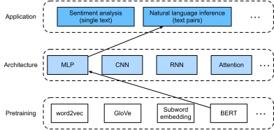

# 自然语言推断：微调 BERT
:label:`sec_natural-language-inference-bert`

在本章的前面几节中，
我们已经为 SNLI 数据集上的自然语言推断任务
设计了一个基于注意力的架构
（见 :numref:`sec_natural-language-inference-attention`，
该任务所用数据集的说明见 :numref:`sec_natural-language-inference-and-dataset`）。
现在，我们通过微调 BERT 来重新审视这项任务。
正如在 :numref:`sec_finetuning-bert` 中讨论的那样，
自然语言推断是一个序列级文本对分类问题，
而微调 BERT 只需要一个额外的基于多层感知机的架构，
如 :numref:`fig_nlp-map-nli-bert` 所示。


:label:`fig_nlp-map-nli-bert`

在本节中，
我们将下载一个小版本的预训练 BERT，
然后在 SNLI 数据集上对其进行微调，
以完成自然语言推断任务。

```{.python .input}
#@tab mxnet
from d2l import mxnet as d2l
import json
import multiprocessing
from mxnet import gluon, np, npx
from mxnet.gluon import nn
import os

npx.set_np()
```

```{.python .input}
#@tab pytorch
from d2l import torch as d2l
import json
import multiprocessing
import torch
from torch import nn
import os
```

## [**加载预训练的 BERT**]

我们已经在 :numref:`sec_bert-dataset` 和 :numref:`sec_bert-pretraining` 中解释了如何在 WikiText-2 数据集上预训练 BERT（请注意，原始的 BERT 模型是在大得多的语料库上预训练的）。
正如 :numref:`sec_bert-pretraining` 中所讨论的，
原始 BERT 模型有数亿个参数。
下面，
我们提供两个版本的预训练 BERT：
“bert.base”与原始 BERT 基础模型差不多大，微调它需要大量的计算资源；
而“bert.small”是一个小版本，以便于演示。

```{.python .input}
#@tab mxnet
d2l.DATA_HUB['bert.base'] = (d2l.DATA_URL + 'bert.base.zip',
                             '7b3820b35da691042e5d34c0971ac3edbd80d3f4')
d2l.DATA_HUB['bert.small'] = (d2l.DATA_URL + 'bert.small.zip',
                              'a4e718a47137ccd1809c9107ab4f5edd317bae2c')
```

```{.python .input}
#@tab pytorch
d2l.DATA_HUB['bert.base'] = (d2l.DATA_URL + 'bert.base.torch.zip',
                             '225d66f04cae318b841a13d32af3acc165f253ac')
d2l.DATA_HUB['bert.small'] = (d2l.DATA_URL + 'bert.small.torch.zip',
                              'c72329e68a732bef0452e4b96a1c341c8910f81f')
```

两个预训练 BERT 模型都包含一个定义词表的“vocab.json”文件
和一个保存预训练参数的“pretrained.params”文件。
我们实现了下面的`load_pretrained_model`函数来[**加载预训练的 BERT 参数**]。

```{.python .input}
#@tab mxnet
def load_pretrained_model(pretrained_model, num_hiddens, ffn_num_hiddens,
                          num_heads, num_blks, dropout, max_len, devices):
    data_dir = d2l.download_extract(pretrained_model)
    # Define an empty vocabulary to load the predefined vocabulary
    vocab = d2l.Vocab()
    vocab.idx_to_token = json.load(open(os.path.join(data_dir, 'vocab.json')))
    vocab.token_to_idx = {token: idx for idx, token in enumerate(
        vocab.idx_to_token)}
    bert = d2l.BERTModel(len(vocab), num_hiddens, ffn_num_hiddens, num_heads, 
                         num_blks, dropout, max_len)
    # Load pretrained BERT parameters
    bert.load_parameters(os.path.join(data_dir, 'pretrained.params'),
                         ctx=devices)
    return bert, vocab
```

```{.python .input}
#@tab pytorch
def load_pretrained_model(pretrained_model, num_hiddens, ffn_num_hiddens,
                          num_heads, num_blks, dropout, max_len, devices):
    data_dir = d2l.download_extract(pretrained_model)
    # Define an empty vocabulary to load the predefined vocabulary
    vocab = d2l.Vocab()
    vocab.idx_to_token = json.load(open(os.path.join(data_dir, 'vocab.json')))
    vocab.token_to_idx = {token: idx for idx, token in enumerate(
        vocab.idx_to_token)}
    bert = d2l.BERTModel(
        len(vocab), num_hiddens, ffn_num_hiddens=ffn_num_hiddens, num_heads=4,
        num_blks=2, dropout=0.2, max_len=max_len)
    # Load pretrained BERT parameters
    bert.load_state_dict(torch.load(os.path.join(data_dir,
                                                 'pretrained.params')))
    return bert, vocab
```

为了便于在大多数机器上演示，
本节我们将加载并微调预训练 BERT 的小版本（“bert.small”）。
在练习中，我们将展示如何微调大得多的“bert.base”，以显著提高测试准确率。

```{.python .input}
#@tab all
devices = d2l.try_all_gpus()
bert, vocab = load_pretrained_model(
    'bert.small', num_hiddens=256, ffn_num_hiddens=512, num_heads=4,
    num_blks=2, dropout=0.1, max_len=512, devices=devices)
```

## [**微调 BERT 的数据集**]

对于 SNLI 数据集上的下游任务自然语言推断，
我们定义了一个自定义数据集类`SNLIBERTDataset`。
在每个样例中，
前提（premise）和假设（hypothesis）构成一对文本序列，
并如 :numref:`fig_bert-two-seqs` 所示被打包成一个 BERT 输入序列。
回想一下 :numref:`subsec_bert_input_rep`：
片段标识用于区分 BERT 输入序列中的前提和假设。
在 BERT 输入序列预定义的最大长度（`max_len`）下，
输入文本对中较长文本的最后一个词元会不断被移除，
直到满足`max_len`。
为了加速生成用于微调 BERT 的 SNLI 数据集，
我们使用 4 个工作进程并行生成训练或测试样例。

```{.python .input}
#@tab mxnet
class SNLIBERTDataset(gluon.data.Dataset):
    def __init__(self, dataset, max_len, vocab=None):
        all_premise_hypothesis_tokens = [[
            p_tokens, h_tokens] for p_tokens, h_tokens in zip(
            *[d2l.tokenize([s.lower() for s in sentences])
              for sentences in dataset[:2]])]
        
        self.labels = np.array(dataset[2])
        self.vocab = vocab
        self.max_len = max_len
        (self.all_token_ids, self.all_segments,
         self.valid_lens) = self._preprocess(all_premise_hypothesis_tokens)
        print('read ' + str(len(self.all_token_ids)) + ' examples')

    def _preprocess(self, all_premise_hypothesis_tokens):
        pool = multiprocessing.Pool(4)  # Use 4 worker processes
        out = pool.map(self._mp_worker, all_premise_hypothesis_tokens)
        all_token_ids = [
            token_ids for token_ids, segments, valid_len in out]
        all_segments = [segments for token_ids, segments, valid_len in out]
        valid_lens = [valid_len for token_ids, segments, valid_len in out]
        return (np.array(all_token_ids, dtype='int32'),
                np.array(all_segments, dtype='int32'), 
                np.array(valid_lens))

    def _mp_worker(self, premise_hypothesis_tokens):
        p_tokens, h_tokens = premise_hypothesis_tokens
        self._truncate_pair_of_tokens(p_tokens, h_tokens)
        tokens, segments = d2l.get_tokens_and_segments(p_tokens, h_tokens)
        token_ids = self.vocab[tokens] + [self.vocab['<pad>']] \
                             * (self.max_len - len(tokens))
        segments = segments + [0] * (self.max_len - len(segments))
        valid_len = len(tokens)
        return token_ids, segments, valid_len

    def _truncate_pair_of_tokens(self, p_tokens, h_tokens):
        # Reserve slots for '<CLS>', '<SEP>', and '<SEP>' tokens for the BERT
        # input
        while len(p_tokens) + len(h_tokens) > self.max_len - 3:
            if len(p_tokens) > len(h_tokens):
                p_tokens.pop()
            else:
                h_tokens.pop()

    def __getitem__(self, idx):
        return (self.all_token_ids[idx], self.all_segments[idx],
                self.valid_lens[idx]), self.labels[idx]

    def __len__(self):
        return len(self.all_token_ids)
```

```{.python .input}
#@tab pytorch
class SNLIBERTDataset(torch.utils.data.Dataset):
    def __init__(self, dataset, max_len, vocab=None):
        all_premise_hypothesis_tokens = [[
            p_tokens, h_tokens] for p_tokens, h_tokens in zip(
            *[d2l.tokenize([s.lower() for s in sentences])
              for sentences in dataset[:2]])]
        
        self.labels = torch.tensor(dataset[2])
        self.vocab = vocab
        self.max_len = max_len
        (self.all_token_ids, self.all_segments,
         self.valid_lens) = self._preprocess(all_premise_hypothesis_tokens)
        print('read ' + str(len(self.all_token_ids)) + ' examples')

    def _preprocess(self, all_premise_hypothesis_tokens):
        pool = multiprocessing.Pool(4)  # Use 4 worker processes
        out = pool.map(self._mp_worker, all_premise_hypothesis_tokens)
        all_token_ids = [
            token_ids for token_ids, segments, valid_len in out]
        all_segments = [segments for token_ids, segments, valid_len in out]
        valid_lens = [valid_len for token_ids, segments, valid_len in out]
        return (torch.tensor(all_token_ids, dtype=torch.long),
                torch.tensor(all_segments, dtype=torch.long), 
                torch.tensor(valid_lens))

    def _mp_worker(self, premise_hypothesis_tokens):
        p_tokens, h_tokens = premise_hypothesis_tokens
        self._truncate_pair_of_tokens(p_tokens, h_tokens)
        tokens, segments = d2l.get_tokens_and_segments(p_tokens, h_tokens)
        token_ids = self.vocab[tokens] + [self.vocab['<pad>']] \
                             * (self.max_len - len(tokens))
        segments = segments + [0] * (self.max_len - len(segments))
        valid_len = len(tokens)
        return token_ids, segments, valid_len

    def _truncate_pair_of_tokens(self, p_tokens, h_tokens):
        # Reserve slots for '<CLS>', '<SEP>', and '<SEP>' tokens for the BERT
        # input
        while len(p_tokens) + len(h_tokens) > self.max_len - 3:
            if len(p_tokens) > len(h_tokens):
                p_tokens.pop()
            else:
                h_tokens.pop()

    def __getitem__(self, idx):
        return (self.all_token_ids[idx], self.all_segments[idx],
                self.valid_lens[idx]), self.labels[idx]

    def __len__(self):
        return len(self.all_token_ids)
```

下载完 SNLI 数据集后，
我们通过实例化`SNLIBERTDataset`类来[**生成训练和测试样例**]。
在自然语言推断的训练和测试过程中，
这些样例将以小批量方式读取。

```{.python .input}
#@tab mxnet
# Reduce `batch_size` if there is an out of memory error. In the original BERT
# model, `max_len` = 512
batch_size, max_len, num_workers = 512, 128, d2l.get_dataloader_workers()
data_dir = d2l.download_extract('SNLI')
train_set = SNLIBERTDataset(d2l.read_snli(data_dir, True), max_len, vocab)
test_set = SNLIBERTDataset(d2l.read_snli(data_dir, False), max_len, vocab)
train_iter = gluon.data.DataLoader(train_set, batch_size, shuffle=True,
                                   num_workers=num_workers)
test_iter = gluon.data.DataLoader(test_set, batch_size,
                                  num_workers=num_workers)
```

```{.python .input}
#@tab pytorch
# Reduce `batch_size` if there is an out of memory error. In the original BERT
# model, `max_len` = 512
batch_size, max_len, num_workers = 512, 128, d2l.get_dataloader_workers()
data_dir = d2l.download_extract('SNLI')
train_set = SNLIBERTDataset(d2l.read_snli(data_dir, True), max_len, vocab)
test_set = SNLIBERTDataset(d2l.read_snli(data_dir, False), max_len, vocab)
train_iter = torch.utils.data.DataLoader(train_set, batch_size, shuffle=True,
                                   num_workers=num_workers)
test_iter = torch.utils.data.DataLoader(test_set, batch_size,
                                  num_workers=num_workers)
```

## 微调 BERT

正如 :numref:`fig_bert-two-seqs` 所示，
为自然语言推断微调 BERT
只需要一个由两个全连接层组成的额外多层感知机
（参见下面`BERTClassifier`类中的`self.hidden`和`self.output`）。
[**该多层感知机将特殊词元“&lt;cls&gt;”的 BERT 表示**]
（该词元同时编码了前提和假设的信息）
(**转换为自然语言推断的三个输出**)：
蕴含（entailment）、矛盾（contradiction）和中性（neutral）。

```{.python .input}
#@tab mxnet
class BERTClassifier(nn.Block):
    def __init__(self, bert):
        super(BERTClassifier, self).__init__()
        self.encoder = bert.encoder
        self.hidden = bert.hidden
        self.output = nn.Dense(3)

    def forward(self, inputs):
        tokens_X, segments_X, valid_lens_x = inputs
        encoded_X = self.encoder(tokens_X, segments_X, valid_lens_x)
        return self.output(self.hidden(encoded_X[:, 0, :]))
```

```{.python .input}
#@tab pytorch
class BERTClassifier(nn.Module):
    def __init__(self, bert):
        super(BERTClassifier, self).__init__()
        self.encoder = bert.encoder
        self.hidden = bert.hidden
        self.output = nn.LazyLinear(3)

    def forward(self, inputs):
        tokens_X, segments_X, valid_lens_x = inputs
        encoded_X = self.encoder(tokens_X, segments_X, valid_lens_x)
        return self.output(self.hidden(encoded_X[:, 0, :]))
```

下面，
预训练的 BERT 模型`bert`被送入用于下游应用的`BERTClassifier`实例`net`。
在常见的 BERT 微调实现中，
只有额外多层感知机（`net.output`）的输出层参数会从头开始学习。
预训练 BERT 编码器（`net.encoder`）和额外多层感知机隐藏层（`net.hidden`）的所有参数都将被微调。

```{.python .input}
#@tab mxnet
net = BERTClassifier(bert)
net.output.initialize(ctx=devices)
```

```{.python .input}
#@tab pytorch
net = BERTClassifier(bert)
```

回想一下，
在 :numref:`sec_bert` 中，
`MaskLM`类和`NextSentencePred`类
在其使用的多层感知机中都有一些参数。
这些参数是预训练 BERT 模型`bert`中参数的一部分，
因而也是`net`中参数的一部分。
然而，这些参数只用于计算
预训练过程中的掩码语言模型损失
和下一句预测损失。
这两个损失函数与微调下游应用无关，
因此当 BERT 被微调时，
`MaskLM`和`NextSentencePred`中所用多层感知机的参数不会更新（处于陈旧状态）。

为了允许存在陈旧梯度的参数，
在`d2l.train_batch_ch13`的`step`函数中设置了标志`ignore_stale_grad=True`。
我们使用该函数，基于 SNLI 的训练集（`train_iter`）和测试集（`test_iter`）训练和评估模型`net`。
由于计算资源有限，
[**训练**]和测试准确率还可以进一步提高：
相关讨论留作练习。

```{.python .input}
#@tab mxnet
lr, num_epochs = 1e-4, 5
trainer = gluon.Trainer(net.collect_params(), 'adam', {'learning_rate': lr})
loss = gluon.loss.SoftmaxCrossEntropyLoss()
d2l.train_ch13(net, train_iter, test_iter, loss, trainer, num_epochs, devices,
               d2l.split_batch_multi_inputs)
```

```{.python .input}
#@tab pytorch
lr, num_epochs = 1e-4, 5
trainer = torch.optim.Adam(net.parameters(), lr=lr)
loss = nn.CrossEntropyLoss(reduction='none')
net(next(iter(train_iter))[0])
d2l.train_ch13(net, train_iter, test_iter, loss, trainer, num_epochs, devices)
```

## 小结

* 我们可以针对下游应用微调预训练的 BERT 模型，例如在 SNLI 数据集上进行自然语言推断。
* 在微调过程中，BERT 模型成为下游应用模型的一部分。只与预训练损失相关的参数在微调期间不会更新。


## 练习

1. 如果计算资源允许，请微调一个大得多的预训练 BERT 模型，其大小与原始 BERT 基础模型相当。将`load_pretrained_model`函数中的参数设置为：用'bert.base'替换'bert.small'，并将`num_hiddens=256`、`ffn_num_hiddens=512`、`num_heads=4`和`num_blks=2`的值分别增加到 768、3072、12 和 12。通过增加微调轮数（并可能调优其他超参数），你能获得高于 0.86 的测试准确率吗？
1. 如何根据一对序列的长度之比来截断它们？比较这种文本对截断方法与`SNLIBERTDataset`类中使用的方法。它们各有什么利弊？

:begin_tab:`mxnet`
[讨论](https://discuss.d2l.ai/t/397)
:end_tab:

:begin_tab:`pytorch`
[讨论](https://discuss.d2l.ai/t/1526)
:end_tab:
