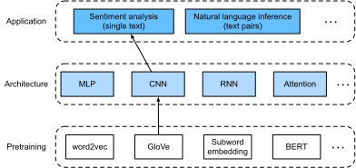
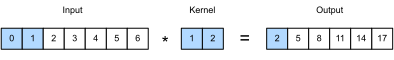
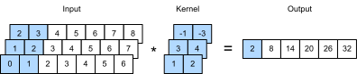
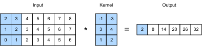
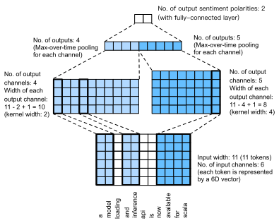

# 情感分析：使用卷积神经网络
:label:`sec_sentiment_cnn` 


在 :numref:`chap_cnn` 中，
我们探讨了
使用二维卷积神经网络处理
二维图像数据
的机制，
并将其应用于
相邻像素等局部特征。
尽管卷积神经网络最初是
为计算机视觉设计的，
但它也被广泛用于自然语言处理。
简单地说，
只需将任何文本序列
想象成一维图像。
这样，
一维卷积神经网络
就可以处理文本中的局部特征，
例如 $n$ 元语法。

本节中，
我们将使用*textCNN*模型
演示
如何设计用于表示单个文本的卷积神经网络架构 :cite:`Kim.2014`。
与
:numref:`fig_nlp-map-sa-rnn` 中
使用带有 GloVe 预训练的循环神经网络架构进行情感分析相比，
:numref:`fig_nlp-map-sa-cnn` 中唯一的区别
在于
架构的选择。



:label:`fig_nlp-map-sa-cnn`

```{.python .input}
#@tab mxnet
from d2l import mxnet as d2l
from mxnet import gluon, init, np, npx
from mxnet.gluon import nn
npx.set_np()

batch_size = 64
train_iter, test_iter, vocab = d2l.load_data_imdb(batch_size)
```

```{.python .input}
#@tab pytorch
from d2l import torch as d2l
import torch
from torch import nn

batch_size = 64
train_iter, test_iter, vocab = d2l.load_data_imdb(batch_size)
```

## 一维卷积

在介绍该模型之前，
让我们先看看一维卷积是如何工作的。
请记住，它只是
基于互相关运算的二维卷积的一个特例。


:label:`fig_conv1d`

如 :numref:`fig_conv1d` 所示，
在一维情形下，
卷积窗口
在输入张量上
从左向右滑动。
在滑动过程中，
某一位置处卷积窗口包含的输入子张量（例如 :numref:`fig_conv1d` 中的 $0$ 和 $1$）
与核张量（例如 :numref:`fig_conv1d` 中的 $1$ 和 $2$）按元素相乘。
这些乘积之和
给出了输出张量相应位置上的
单个标量值（例如 :numref:`fig_conv1d` 中的 $0\times1+1\times2=2$）。

我们在下面的`corr1d`函数中实现一维互相关。
给定输入张量`X`
和核张量`K`，
它返回输出张量`Y`。

```{.python .input}
#@tab all
def corr1d(X, K):
    w = K.shape[0]
    Y = d2l.zeros((X.shape[0] - w + 1))
    for i in range(Y.shape[0]):
        Y[i] = (X[i: i + w] * K).sum()
    return Y
```

我们可以根据 :numref:`fig_conv1d` 构造输入张量`X`和核张量`K`，以验证上述一维互相关实现的输出。

```{.python .input}
#@tab all
X, K = d2l.tensor([0, 1, 2, 3, 4, 5, 6]), d2l.tensor([1, 2])
corr1d(X, K)
```

对于任意
多通道的一维输入，
卷积核
需要具有相同数量的输入通道。
然后对每个通道，
对输入的一维张量和卷积核的一维张量执行互相关运算，
将所有通道上的结果相加，
得到一维输出张量。
:numref:`fig_conv1d_channel` 展示了具有 3 个输入通道的一维互相关运算。


:label:`fig_conv1d_channel`


我们可以实现多输入通道的一维互相关运算，
并在 :numref:`fig_conv1d_channel` 中验证结果。

```{.python .input}
#@tab all
def corr1d_multi_in(X, K):
    # First, iterate through the 0th dimension (channel dimension) of `X` and
    # `K`. Then, add them together
    return sum(corr1d(x, k) for x, k in zip(X, K))

X = d2l.tensor([[0, 1, 2, 3, 4, 5, 6],
              [1, 2, 3, 4, 5, 6, 7],
              [2, 3, 4, 5, 6, 7, 8]])
K = d2l.tensor([[1, 2], [3, 4], [-1, -3]])
corr1d_multi_in(X, K)
```

请注意，
多输入通道的一维互相关运算
等价于
单输入通道的
二维互相关运算。
为了说明这一点，
:numref:`fig_conv1d_channel` 中
多输入通道一维互相关运算的等价形式
就是
:numref:`fig_conv1d_2d` 中
单输入通道的
二维互相关运算，
其中卷积核的高度
必须与输入张量的高度相同。



:label:`fig_conv1d_2d`

:numref:`fig_conv1d` 和 :numref:`fig_conv1d_channel` 中的输出都只有一个通道。
与 :numref:`subsec_multi-output-channels` 中描述的具有多个输出通道的二维卷积相同，
我们也可以为一维卷积
指定多个输出通道。

## 最大时间汇聚

类似地，我们可以使用汇聚
从序列表示中提取最大值，
作为跨时间步的
最重要特征。
textCNN 中使用的*最大时间汇聚*（max-over-time pooling）
的工作原理类似于
一维全局最大汇聚
:cite:`Collobert.Weston.Bottou.ea.2011`。
对于每个通道在不同时间步存储值的多通道输入，
每个通道的输出
是该通道的最大值。
请注意，
最大时间汇聚
允许不同通道具有不同数量的时间步。

## textCNN 模型

利用一维卷积
和最大时间汇聚，
textCNN 模型
将各个预训练的词元表示
作为输入，
然后获得并转换用于下游应用的序列表示。

对于一个包含 $n$ 个词元、
每个词元由 $d$ 维向量表示的
文本序列，
输入张量的宽度、高度和通道数
分别为 $n$、$1$ 和 $d$。
textCNN 模型将输入
转换为输出，步骤如下：

1. 定义多个一维卷积核，并分别对输入执行卷积运算。具有不同宽度的卷积核可以捕获不同数目的相邻词元之间的局部特征。
1. 对所有输出通道执行最大时间汇聚，然后将所有标量汇聚输出连结为一个向量。
1. 使用全连接层将连结后的向量转换为输出类别。可以使用暂退法（dropout）来减少过拟合。


:label:`fig_conv1d_textcnn`

:numref:`fig_conv1d_textcnn`
用一个具体例子
展示了 textCNN 的模型架构。
输入是一个包含 11 个词元的句子，
其中
每个词元由 6 维向量表示。
因此，我们有一个宽度为 11 的 6 通道输入。
定义
两个一维卷积核，
宽度分别为 2 和 4，
输出通道数分别为 4 和 5。
它们分别产生
宽度为 $11-2+1=10$ 的 4 个输出通道
和宽度为 $11-4+1=8$ 的 5 个输出通道。
尽管这 9 个通道的宽度不同，
最大时间汇聚
给出了一个连结的 9 维向量，
最终它被转换为
用于二元情感预测的
2 维输出向量。


### 定义模型

我们在下面的类中实现 textCNN 模型。
与 :numref:`sec_sentiment_rnn` 中的
双向循环神经网络模型相比，
除了
用卷积层替换循环层之外，
我们还使用了两个嵌入层：
一个的权重可训练，另一个的权重
固定。

```{.python .input}
#@tab mxnet
class TextCNN(nn.Block):
    def __init__(self, vocab_size, embed_size, kernel_sizes, num_channels,
                 **kwargs):
        super(TextCNN, self).__init__(**kwargs)
        self.embedding = nn.Embedding(vocab_size, embed_size)
        # The embedding layer not to be trained
        self.constant_embedding = nn.Embedding(vocab_size, embed_size)
        self.dropout = nn.Dropout(0.5)
        self.decoder = nn.Dense(2)
        # The max-over-time pooling layer has no parameters, so this instance
        # can be shared
        self.pool = nn.GlobalMaxPool1D()
        # Create multiple one-dimensional convolutional layers
        self.convs = nn.Sequential()
        for c, k in zip(num_channels, kernel_sizes):
            self.convs.add(nn.Conv1D(c, k, activation='relu'))

    def forward(self, inputs):
        # Concatenate two embedding layer outputs with shape (batch size, no.
        # of tokens, token vector dimension) along vectors
        embeddings = np.concatenate((
            self.embedding(inputs), self.constant_embedding(inputs)), axis=2)
        # Per the input format of one-dimensional convolutional layers,
        # rearrange the tensor so that the second dimension stores channels
        embeddings = embeddings.transpose(0, 2, 1)
        # For each one-dimensional convolutional layer, after max-over-time
        # pooling, a tensor of shape (batch size, no. of channels, 1) is
        # obtained. Remove the last dimension and concatenate along channels
        encoding = np.concatenate([
            np.squeeze(self.pool(conv(embeddings)), axis=-1)
            for conv in self.convs], axis=1)
        outputs = self.decoder(self.dropout(encoding))
        return outputs
```

```{.python .input}
#@tab pytorch
class TextCNN(nn.Module):
    def __init__(self, vocab_size, embed_size, kernel_sizes, num_channels,
                 **kwargs):
        super(TextCNN, self).__init__(**kwargs)
        self.embedding = nn.Embedding(vocab_size, embed_size)
        # The embedding layer not to be trained
        self.constant_embedding = nn.Embedding(vocab_size, embed_size)
        self.dropout = nn.Dropout(0.5)
        self.decoder = nn.Linear(sum(num_channels), 2)
        # The max-over-time pooling layer has no parameters, so this instance
        # can be shared
        self.pool = nn.AdaptiveAvgPool1d(1)
        self.relu = nn.ReLU()
        # Create multiple one-dimensional convolutional layers
        self.convs = nn.ModuleList()
        for c, k in zip(num_channels, kernel_sizes):
            self.convs.append(nn.Conv1d(2 * embed_size, c, k))

    def forward(self, inputs):
        # Concatenate two embedding layer outputs with shape (batch size, no.
        # of tokens, token vector dimension) along vectors
        embeddings = torch.cat((
            self.embedding(inputs), self.constant_embedding(inputs)), dim=2)
        # Per the input format of one-dimensional convolutional layers,
        # rearrange the tensor so that the second dimension stores channels
        embeddings = embeddings.permute(0, 2, 1)
        # For each one-dimensional convolutional layer, after max-over-time
        # pooling, a tensor of shape (batch size, no. of channels, 1) is
        # obtained. Remove the last dimension and concatenate along channels
        encoding = torch.cat([
            torch.squeeze(self.relu(self.pool(conv(embeddings))), dim=-1)
            for conv in self.convs], dim=1)
        outputs = self.decoder(self.dropout(encoding))
        return outputs
```

让我们创建一个 textCNN 实例。
它有 3 个卷积层，卷积核宽度分别为 3、4 和 5，都有 100 个输出通道。

```{.python .input}
#@tab mxnet
embed_size, kernel_sizes, nums_channels = 100, [3, 4, 5], [100, 100, 100]
devices = d2l.try_all_gpus()
net = TextCNN(len(vocab), embed_size, kernel_sizes, nums_channels)
net.initialize(init.Xavier(), ctx=devices)
```

```{.python .input}
#@tab pytorch
embed_size, kernel_sizes, nums_channels = 100, [3, 4, 5], [100, 100, 100]
devices = d2l.try_all_gpus()
net = TextCNN(len(vocab), embed_size, kernel_sizes, nums_channels)

def init_weights(module):
    if type(module) in (nn.Linear, nn.Conv1d):
        nn.init.xavier_uniform_(module.weight)

net.apply(init_weights);
```

### 加载预训练的词向量

与 :numref:`sec_sentiment_rnn` 相同，
我们加载预训练的 100 维 GloVe 嵌入
作为初始化的词元表示。
这些词元表示（嵌入权重）
将在`embedding`中训练，
并在`constant_embedding`中固定。

```{.python .input}
#@tab mxnet
glove_embedding = d2l.TokenEmbedding('glove.6b.100d')
embeds = glove_embedding[vocab.idx_to_token]
net.embedding.weight.set_data(embeds)
net.constant_embedding.weight.set_data(embeds)
net.constant_embedding.collect_params().setattr('grad_req', 'null')
```

```{.python .input}
#@tab pytorch
glove_embedding = d2l.TokenEmbedding('glove.6b.100d')
embeds = glove_embedding[vocab.idx_to_token]
net.embedding.weight.data.copy_(embeds)
net.constant_embedding.weight.data.copy_(embeds)
net.constant_embedding.weight.requires_grad = False
```

### 训练和评估模型

现在我们可以训练 textCNN 模型进行情感分析。

```{.python .input}
#@tab mxnet
lr, num_epochs = 0.001, 5
trainer = gluon.Trainer(net.collect_params(), 'adam', {'learning_rate': lr})
loss = gluon.loss.SoftmaxCrossEntropyLoss()
d2l.train_ch13(net, train_iter, test_iter, loss, trainer, num_epochs, devices)
```

```{.python .input}
#@tab pytorch
lr, num_epochs = 0.001, 5
trainer = torch.optim.Adam(net.parameters(), lr=lr)
loss = nn.CrossEntropyLoss(reduction="none")
d2l.train_ch13(net, train_iter, test_iter, loss, trainer, num_epochs, devices)
```

下面我们使用训练好的模型预测两个简单句子的情感。

```{.python .input}
#@tab all
d2l.predict_sentiment(net, vocab, 'this movie is so great')
```

```{.python .input}
#@tab all
d2l.predict_sentiment(net, vocab, 'this movie is so bad')
```

## 小结

* 一维卷积神经网络可以处理文本中的局部特征，例如 $n$ 元语法。
* 多输入通道的一维互相关运算等价于单输入通道的二维互相关运算。
* 最大时间汇聚允许不同通道具有不同数量的时间步。
* textCNN 模型使用一维卷积层和最大时间汇聚层将各个词元表示转换为下游应用输出。


## 练习

1. 调整超参数，并比较 :numref:`sec_sentiment_rnn` 和本节中用于情感分析的两种架构，例如在分类准确率和计算效率方面。
1. 能否使用 :numref:`sec_sentiment_rnn` 练习中介绍的方法进一步提高模型的分类准确率？
1. 在输入表示中加入位置编码。它能提高分类准确率吗？

:begin_tab:`mxnet`
[讨论](https://discuss.d2l.ai/t/393)
:end_tab:

:begin_tab:`pytorch`
[讨论](https://discuss.d2l.ai/t/1425)
:end_tab:
