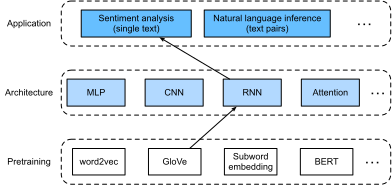

# 情感分析：使用循环神经网络
:label:`sec_sentiment_rnn` 


与词的相似性和类比任务一样，
我们也可以将预训练的词向量
应用于情感分析。
由于 :numref:`sec_sentiment` 中的
IMDb 评论数据集
不是很大，
使用在大规模语料库上
预训练的文本表示
可能减轻模型的过拟合。
如 :numref:`fig_nlp-map-sa-rnn` 所示，
作为一个具体的例子，
我们将使用预训练的 GloVe 模型
表示每个词元，
并将这些词元表示
输入多层双向循环神经网络
以获得文本序列表示，
再将其
转换为
情感分析输出 :cite:`Maas.Daly.Pham.ea.2011`。
对于同一个下游应用，
我们稍后将考虑
另一种架构选择。


:label:`fig_nlp-map-sa-rnn`

```{.python .input}
#@tab mxnet
from d2l import mxnet as d2l
from mxnet import gluon, init, np, npx
from mxnet.gluon import nn, rnn
npx.set_np()

batch_size = 64
train_iter, test_iter, vocab = d2l.load_data_imdb(batch_size)
```

```{.python .input}
#@tab pytorch
from d2l import torch as d2l
import torch
from torch import nn

batch_size = 64
train_iter, test_iter, vocab = d2l.load_data_imdb(batch_size)
```

## 使用循环神经网络表示单个文本

在情感分析这样的文本分类任务中，
变长的文本序列
将被转换为固定长度的类别。
在下面的`BiRNN`类中，
文本序列的每个词元
通过嵌入层
（`self.embedding`）
获得其各自的
预训练 GloVe
表示，
而整个序列
由双向循环神经网络（`self.encoder`）编码。
更具体地说，
双向 LSTM
在初始和最终时间步
（最后一层）的隐藏状态
被连结起来，
作为文本序列的表示。
然后，这个单一的文本表示
由具有两个输出（“积极”和“消极”）的全连接层
（`self.decoder`）
转换为输出类别。

```{.python .input}
#@tab mxnet
class BiRNN(nn.Block):
    def __init__(self, vocab_size, embed_size, num_hiddens,
                 num_layers, **kwargs):
        super(BiRNN, self).__init__(**kwargs)
        self.embedding = nn.Embedding(vocab_size, embed_size)
        # Set `bidirectional` to True to get a bidirectional RNN
        self.encoder = rnn.LSTM(num_hiddens, num_layers=num_layers,
                                bidirectional=True, input_size=embed_size)
        self.decoder = nn.Dense(2)

    def forward(self, inputs):
        # The shape of `inputs` is (batch size, no. of time steps). Because
        # LSTM requires its input's first dimension to be the temporal
        # dimension, the input is transposed before obtaining token
        # representations. The output shape is (no. of time steps, batch size,
        # word vector dimension)
        embeddings = self.embedding(inputs.T)
        # Returns hidden states of the last hidden layer at different time
        # steps. The shape of `outputs` is (no. of time steps, batch size,
        # 2 * no. of hidden units)
        outputs = self.encoder(embeddings)
        # Concatenate the hidden states at the initial and final time steps as
        # the input of the fully connected layer. Its shape is (batch size,
        # 4 * no. of hidden units)
        encoding = np.concatenate((outputs[0], outputs[-1]), axis=1)
        outs = self.decoder(encoding)
        return outs
```

```{.python .input}
#@tab pytorch
class BiRNN(nn.Module):
    def __init__(self, vocab_size, embed_size, num_hiddens,
                 num_layers, **kwargs):
        super(BiRNN, self).__init__(**kwargs)
        self.embedding = nn.Embedding(vocab_size, embed_size)
        # Set `bidirectional` to True to get a bidirectional RNN
        self.encoder = nn.LSTM(embed_size, num_hiddens, num_layers=num_layers,
                                bidirectional=True)
        self.decoder = nn.Linear(4 * num_hiddens, 2)

    def forward(self, inputs):
        # The shape of `inputs` is (batch size, no. of time steps). Because
        # LSTM requires its input's first dimension to be the temporal
        # dimension, the input is transposed before obtaining token
        # representations. The output shape is (no. of time steps, batch size,
        # word vector dimension)
        embeddings = self.embedding(inputs.T)
        self.encoder.flatten_parameters()
        # Returns hidden states of the last hidden layer at different time
        # steps. The shape of `outputs` is (no. of time steps, batch size,
        # 2 * no. of hidden units)
        outputs, _ = self.encoder(embeddings)
        # Concatenate the hidden states at the initial and final time steps as
        # the input of the fully connected layer. Its shape is (batch size,
        # 4 * no. of hidden units)
        encoding = torch.cat((outputs[0], outputs[-1]), dim=1) 
        outs = self.decoder(encoding)
        return outs
```

让我们构造一个具有两个隐藏层的双向循环神经网络，用于表示单个文本以进行情感分析。

```{.python .input}
#@tab all
embed_size, num_hiddens, num_layers, devices = 100, 100, 2, d2l.try_all_gpus()
net = BiRNN(len(vocab), embed_size, num_hiddens, num_layers)
```

```{.python .input}
#@tab mxnet
net.initialize(init.Xavier(), ctx=devices)
```

```{.python .input}
#@tab pytorch
def init_weights(module):
    if type(module) == nn.Linear:
        nn.init.xavier_uniform_(module.weight)
    if type(module) == nn.LSTM:
        for param in module._flat_weights_names:
            if "weight" in param:
                nn.init.xavier_uniform_(module._parameters[param])
net.apply(init_weights);
```

## 加载预训练的词向量

下面，我们为词表中的词元加载预训练的 100 维（需要与`embed_size`一致）GloVe 嵌入。

```{.python .input}
#@tab all
glove_embedding = d2l.TokenEmbedding('glove.6b.100d')
```

打印词表中所有词元
的向量形状。

```{.python .input}
#@tab all
embeds = glove_embedding[vocab.idx_to_token]
embeds.shape
```

我们使用这些预训练的
词向量
表示评论中的词元，
并且在训练期间
不更新这些向量。

```{.python .input}
#@tab mxnet
net.embedding.weight.set_data(embeds)
net.embedding.collect_params().setattr('grad_req', 'null')
```

```{.python .input}
#@tab pytorch
net.embedding.weight.data.copy_(embeds)
net.embedding.weight.requires_grad = False
```

## 训练和评估模型

现在我们可以训练用于情感分析的双向循环神经网络了。

```{.python .input}
#@tab mxnet
lr, num_epochs = 0.01, 5
trainer = gluon.Trainer(net.collect_params(), 'adam', {'learning_rate': lr})
loss = gluon.loss.SoftmaxCrossEntropyLoss()
d2l.train_ch13(net, train_iter, test_iter, loss, trainer, num_epochs, devices)
```

```{.python .input}
#@tab pytorch
lr, num_epochs = 0.01, 5
trainer = torch.optim.Adam(net.parameters(), lr=lr)
loss = nn.CrossEntropyLoss(reduction="none")
d2l.train_ch13(net, train_iter, test_iter, loss, trainer, num_epochs, devices)
```

我们定义以下函数，使用训练好的模型`net`预测文本序列的情感。

```{.python .input}
#@tab mxnet
#@save
def predict_sentiment(net, vocab, sequence):
    """Predict the sentiment of a text sequence."""
    sequence = np.array(vocab[sequence.split()], ctx=d2l.try_gpu())
    label = np.argmax(net(sequence.reshape(1, -1)), axis=1)
    return 'positive' if label == 1 else 'negative'
```

```{.python .input}
#@tab pytorch
#@save
def predict_sentiment(net, vocab, sequence):
    """Predict the sentiment of a text sequence."""
    sequence = torch.tensor(vocab[sequence.split()], device=d2l.try_gpu())
    label = torch.argmax(net(sequence.reshape(1, -1)), dim=1)
    return 'positive' if label == 1 else 'negative'
```

最后，让我们使用训练好的模型预测两个简单句子的情感。

```{.python .input}
#@tab all
predict_sentiment(net, vocab, 'this movie is so great')
```

```{.python .input}
#@tab all
predict_sentiment(net, vocab, 'this movie is so bad')
```

## 小结

* 预训练的词向量可以表示文本序列中的各个词元。
* 双向循环神经网络可以表示文本序列，例如通过连结其在初始和最终时间步的隐藏状态。这种单一的文本表示可以使用全连接层转换为类别。


## 练习

1. 增加训练轮数。能否提高训练和测试准确率？调整其他超参数又会怎样？
1. 使用更大的预训练词向量，例如 300 维的 GloVe 嵌入。分类准确率会提高吗？
1. 能否通过使用 spaCy 词元化来提高分类准确率？你需要安装 spaCy（`pip install spacy`）并安装英文包（`python -m spacy download en`）。在代码中，首先导入 spaCy（`import spacy`）。然后加载 spaCy 英文包（`spacy_en = spacy.load('en')`）。最后定义函数`def tokenizer(text): return [tok.text for tok in spacy_en.tokenizer(text)]`并替换原来的`tokenizer`函数。注意 GloVe 和 spaCy 中短语词元的形式不同。例如，短语词元 "new york" 在 GloVe 中的形式为 "new-york"，而在 spaCy 词元化之后的形式为 "new york"。

:begin_tab:`mxnet`
[讨论](https://discuss.d2l.ai/t/392)
:end_tab:

:begin_tab:`pytorch`
[讨论](https://discuss.d2l.ai/t/1424)
:end_tab:
