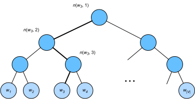

# 近似训练
:label:`sec_approx_train`

回想一下我们在 :numref:`sec_word2vec` 中的讨论。
跳元模型的主要思想是
使用 softmax 运算来计算
给定中心词 $w_c$ 时
生成上下文词 $w_o$ 的条件概率，
如 :eqref:`eq_skip-gram-softmax` 所示，
其对应的对数损失由 :eqref:`eq_skip-gram-log` 的相反数给出。

由于 softmax 运算的性质，
上下文词可能是
词表 $\mathcal{V}$ 中的任何一个词，
因此 :eqref:`eq_skip-gram-log` 的相反数
包含与词表大小一样多的项之和。
因此，
:eqref:`eq_skip-gram-grad` 中跳元模型的梯度计算
以及 :eqref:`eq_cbow-gradient` 中连续词袋模型的梯度计算
都包含这个求和。
不幸的是，
这种对大型词表
（通常包含
数十万或数百万个单词）
求和的梯度的计算成本
是巨大的！

为了降低上述计算复杂度，本节将介绍两种近似训练方法：
*负采样*（negative sampling）和*层序 softmax*（hierarchical softmax）。
由于跳元模型与连续词袋模型
相似，
我们仅以跳元模型为例
来描述这两种近似训练方法。

## 负采样
:label:`subsec_negative-sampling`

负采样修改了原来的目标函数。
给定中心词 $w_c$ 的上下文窗口，
任意（上下文）词 $w_o$
来自该上下文窗口这一事实
被视为一个事件，其概率建模为

$$P(D=1\mid w_c, w_o) = \sigma(\mathbf{u}_o^\top \mathbf{v}_c),$$

其中 $\sigma$ 使用 sigmoid 激活函数的定义：

$$\sigma(x) = \frac{1}{1+\exp(-x)}.$$
:eqlabel:`eq_sigma-f`

我们先通过最大化文本序列中
所有这类事件的联合概率
来训练词嵌入。
具体来说，
给定长度为 $T$ 的文本序列，
用 $w^{(t)}$ 表示时间步 $t$ 处的词，
并令上下文窗口大小为 $m$，
考虑最大化联合概率

$$ \prod_{t=1}^{T} \prod_{-m \leq j \leq m,\ j \neq 0} P(D=1\mid w^{(t)}, w^{(t+j)}).$$
:eqlabel:`eq-negative-sample-pos`

然而，
:eqref:`eq-negative-sample-pos`
只考虑了那些
涉及正例的事件。
因此，
只有当所有词向量都等于无穷大时，
:eqref:`eq-negative-sample-pos` 中的联合概率
才能被最大化到 1。
当然，
这样的结果毫无意义。
为了使目标函数
更有意义，
*负采样*增加了
从预定义分布中采样得到的负例。

用 $S$
表示上下文词 $w_o$
来自中心词 $w_c$ 的上下文窗口
这一事件。
对于这个涉及 $w_o$ 的事件，
从预定义分布 $P(w)$ 中
采样 $K$ 个*噪声词*（noise words），
它们不来自这个上下文窗口。
用 $N_k$
表示噪声词 $w_k$（$k=1, \ldots, K$）
不来自 $w_c$ 的上下文窗口
这一事件。
假设
涉及正例和负例的
这些事件
$S, N_1, \ldots, N_K$ 相互独立。
负采样
将 :eqref:`eq-negative-sample-pos` 中
联合概率（仅涉及正例）
改写为

$$ \prod_{t=1}^{T} \prod_{-m \leq j \leq m,\ j \neq 0} P(w^{(t+j)} \mid w^{(t)}),$$

其中条件概率通过
事件 $S, N_1, \ldots, N_K$ 近似：

$$ P(w^{(t+j)} \mid w^{(t)}) =P(D=1\mid w^{(t)}, w^{(t+j)})\prod_{k=1,\ w_k \sim P(w)}^K P(D=0\mid w^{(t)}, w_k).$$
:eqlabel:`eq-negative-sample-conditional-prob`

分别用
$i_t$ 和 $h_k$
表示文本序列中
时间步 $t$ 处的词 $w^{(t)}$
与噪声词 $w_k$
在词表中的索引。
关于 :eqref:`eq-negative-sample-conditional-prob` 中条件概率的对数损失为

$$
\begin{aligned}
-\log P(w^{(t+j)} \mid w^{(t)})
=& -\log P(D=1\mid w^{(t)}, w^{(t+j)}) - \sum_{k=1,\ w_k \sim P(w)}^K \log P(D=0\mid w^{(t)}, w_k)\\
=&-  \log\, \sigma\left(\mathbf{u}_{i_{t+j}}^\top \mathbf{v}_{i_t}\right) - \sum_{k=1,\ w_k \sim P(w)}^K \log\left(1-\sigma\left(\mathbf{u}_{h_k}^\top \mathbf{v}_{i_t}\right)\right)\\
=&-  \log\, \sigma\left(\mathbf{u}_{i_{t+j}}^\top \mathbf{v}_{i_t}\right) - \sum_{k=1,\ w_k \sim P(w)}^K \log\sigma\left(-\mathbf{u}_{h_k}^\top \mathbf{v}_{i_t}\right).
\end{aligned}
$$

我们可以看到，
现在每个训练步的
梯度计算成本
与词表大小无关，
而是线性依赖于 $K$。
当将超参数 $K$
设置为较小的值时，
负采样每次训练步的
梯度计算成本
较小。

## 层序 softmax

作为另一种近似训练方法，
*层序 softmax*
使用二叉树，
一种在 :numref:`fig_hi_softmax` 中
说明的数据结构，
其中树的每个叶节点
表示词表 $\mathcal{V}$ 中的一个词。

:label:`fig_hi_softmax`

用 $L(w)$
表示二叉树中
从根节点到表示词 $w$ 的叶节点
的路径上（包括两端）
的节点数。
令 $n(w,j)$ 为该路径上的第 $j^\textrm{th}$ 个节点，
其上下文词向量为
$\mathbf{u}_{n(w, j)}$。
例如，
在 :numref:`fig_hi_softmax` 中 $L(w_3) = 4$。
层序 softmax 将 :eqref:`eq_skip-gram-softmax` 中的条件概率近似为

$$P(w_o \mid w_c) = \prod_{j=1}^{L(w_o)-1} \sigma\left( [\![  n(w_o, j+1) = \textrm{leftChild}(n(w_o, j)) ]\!] \cdot \mathbf{u}_{n(w_o, j)}^\top \mathbf{v}_c\right),$$

其中函数 $\sigma$
定义在 :eqref:`eq_sigma-f` 中，
而 $\textrm{leftChild}(n)$ 是节点 $n$ 的左子节点：如果 $x$ 为真，$[\![x]\!] = 1$；否则 $[\![x]\!] = -1$。

为了说明这一点，
让我们计算在 :numref:`fig_hi_softmax` 中
给定词 $w_c$ 时
生成词 $w_3$ 的条件概率。
这需要计算 $w_c$ 的词向量
$\mathbf{v}_c$
与从根到 $w_3$ 的路径
（:numref:`fig_hi_softmax` 中以粗体标出的路径，
遍历顺序为左、右、左）上
非叶节点向量
之间的点积：

$$P(w_3 \mid w_c) = \sigma(\mathbf{u}_{n(w_3, 1)}^\top \mathbf{v}_c) \cdot \sigma(-\mathbf{u}_{n(w_3, 2)}^\top \mathbf{v}_c) \cdot \sigma(\mathbf{u}_{n(w_3, 3)}^\top \mathbf{v}_c).$$

由于 $\sigma(x)+\sigma(-x) = 1$，
因此，
对于任意词 $w_c$，
基于它生成词表 $\mathcal{V}$
中所有词的条件概率
之和为 1：

$$\sum_{w \in \mathcal{V}} P(w \mid w_c) = 1.$$
:eqlabel:`eq_hi-softmax-sum-one`

幸运的是，由于二叉树结构，$L(w_o)-1$ 的量级为 $\mathcal{O}(\textrm{log}_2|\mathcal{V}|)$，
因此当词表 $\mathcal{V}$ 很大时，
与不使用近似训练相比，
使用层序 softmax 时每个训练步的
计算成本
显著降低。

## 小结

* 负采样通过考虑同时涉及正例和负例的相互独立的事件来构造损失函数。训练的计算成本线性依赖于每一步的噪声词数量。
* 层序 softmax 利用二叉树中从根节点到叶节点的路径来构造损失函数。训练的计算成本依赖于每一步词表大小的对数。

## 练习

1. 在负采样中，我们如何采样噪声词？
1. 验证 :eqref:`eq_hi-softmax-sum-one` 成立。
1. 如何分别使用负采样和层序 softmax 来训练连续词袋模型？

[讨论](https://discuss.d2l.ai/t/382)
