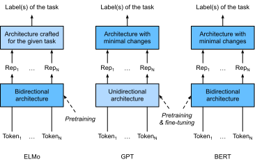

# 来自 Transformer 的双向编码器表示（BERT）
:label:`sec_bert`

我们已经介绍了几种用于自然语言理解的词嵌入模型。
预训练之后，输出可以被看作一个矩阵，
其中每一行是一个向量，表示预定义词表中的一个词。
事实上，这些词嵌入模型都是*上下文无关*的。
让我们先来说明这一性质。


## 从上下文无关到上下文敏感

回想 :numref:`sec_word2vec_pretraining` 和 :numref:`sec_synonyms` 中的实验。
例如，无论词的上下文如何（如果有的话），word2vec 和 GloVe 都为同一个词分配相同的预训练向量。
形式化地说，任意词元 $x$ 的上下文无关表示
是一个仅以 $x$ 作为输入的函数 $f(x)$。
鉴于自然语言中大量的多义现象和复杂的语义，
上下文无关表示具有明显的局限性。
例如，单词“crane”在
“a crane is flying”和“a crane driver came”这两种上下文中具有完全不同的含义；
因此，同一个词可能会根据上下文被分配不同的表示。

这推动了*上下文敏感*词表示的发展，
其中词的表示依赖于它们的上下文。
因此，词元 $x$ 的上下文敏感表示是一个函数 $f(x, c(x))$，
它同时依赖于 $x$ 及其上下文 $c(x)$。
流行的上下文敏感表示
包括 TagLM（语言模型增强的序列标注器）:cite:`Peters.Ammar.Bhagavatula.ea.2017`、
CoVe（上下文向量）:cite:`McCann.Bradbury.Xiong.ea.2017`
和 ELMo（来自语言模型的嵌入）:cite:`Peters.Neumann.Iyyer.ea.2018`。

例如，通过将整个序列作为输入，
ELMo 是一个为输入序列中的每个词分配表示的函数。
具体来说，ELMo 将预训练双向 LSTM 中所有中间层的表示组合为输出表示。
然后，ELMo 表示将作为额外特征加入下游任务已有的监督模型中，
例如将 ELMo 表示与已有模型中词元的原始表示（如 GloVe）连结。
一方面，
在加入 ELMo 表示之后，预训练双向 LSTM 模型中的所有参数都被冻结。
另一方面，
已有的监督模型是针对给定任务专门定制的。
利用当时针对不同任务的不同最佳模型，
加入 ELMo 在六个自然语言处理任务上提高了最优水平：
情感分析、自然语言推断、
语义角色标注、指代消解、
命名实体识别和问答。


## 从任务特定到任务无关

尽管 ELMo 显著改进了对多种自然语言处理任务的解决方案，
但每个解决方案仍然依赖于*任务特定*的架构。
然而，为每个自然语言处理任务专门设计一个架构实际上并非易事。
GPT（生成式预训练）模型代表了
为上下文敏感表示设计通用*任务无关*模型的一种努力 :cite:`Radford.Narasimhan.Salimans.ea.2018`。
GPT 建立在 Transformer 解码器之上，
预训练一个将用于表示文本序列的语言模型。
将 GPT 应用于下游任务时，
语言模型的输出将被送入一个添加的线性输出层，
以预测该任务的标签。
与冻结预训练模型参数的 ELMo 形成鲜明对比的是，
在对下游任务进行监督学习时，GPT 微调预训练 Transformer 解码器中的*所有*参数。
GPT 在自然语言推断、
问答、句子相似性和分类等十二个任务上进行了评估，
并在其中九个任务上以对模型架构最小的改动
提高了最优水平。

然而，由于语言模型的自回归性质，
GPT 只能向前看（从左到右）。
在上下文“i went to the bank to deposit cash”和“i went to the bank to sit down”中，
由于“bank”对其左侧的上下文敏感，
GPT 将为“bank”返回相同的表示，
尽管它具有不同的含义。


## BERT：将两者的优势结合起来

正如我们所看到的，
ELMo 双向编码上下文，但使用任务特定的架构；
而 GPT 任务无关，但从左到右编码上下文。
BERT（来自 Transformer 的双向编码器表示）
将两者的优势结合起来，
双向编码上下文，并且对广泛的自然语言处理任务
只需对架构做最小的改动 :cite:`Devlin.Chang.Lee.ea.2018`。
利用预训练的 Transformer 编码器，
BERT 能够根据双向上下文表示任意词元。
在下游任务的监督学习期间，
BERT 在两个方面与 GPT 相似。
首先，BERT 表示将被送入一个添加的输出层，
并根据任务的性质对模型架构做最小的改动，
例如为每个词元预测还是为整个序列预测。
其次，
预训练 Transformer 编码器的所有参数都被微调，
而额外输出层将从零开始训练。
:numref:`fig_elmo-gpt-bert` 描绘了 ELMo、GPT 和 BERT 之间的差异。


:label:`fig_elmo-gpt-bert`


BERT 进一步提高了十一个自然语言处理任务的最优水平，
这些任务属于以下几大类：（i）单文本分类（例如情感分析），（ii）文本对分类（例如自然语言推断），
（iii）问答，（iv）文本标注（例如命名实体识别）。
从上下文敏感的 ELMo 到任务无关的 GPT 和 BERT，
所有这些都是 2018 年提出的，
概念上简单但经验上强大的自然语言深度表示预训练，彻底改变了各种自然语言处理任务的解决方案。

在本章的剩余部分中，
我们将深入探讨 BERT 的预训练。
当 :numref:`chap_nlp_app` 中解释自然语言处理应用时，
我们将说明如何为下游应用微调 BERT。

```{.python .input}
#@tab mxnet
from d2l import mxnet as d2l
from mxnet import gluon, np, npx
from mxnet.gluon import nn

npx.set_np()
```

```{.python .input}
#@tab pytorch
from d2l import torch as d2l
import torch
from torch import nn
```

## [**输入表示**]
:label:`subsec_bert_input_rep`

在自然语言处理中，
一些任务（例如情感分析）以单个文本作为输入，
而另一些任务（例如自然语言推断）
的输入是一对文本序列。
BERT 输入序列能够明确地表示单个文本和文本对。
在前一种情况下，
BERT 输入序列是
特殊分类词元“&lt;cls&gt;”、
文本序列的词元
和特殊分隔词元“&lt;sep&gt;”的连结。
在后一种情况下，
BERT 输入序列是
“&lt;cls&gt;”、第一个文本序列的词元、
“&lt;sep&gt;”、第二个文本序列的词元和“&lt;sep&gt;”的连结。
我们将始终把“BERT 输入序列”这一术语
与其他类型的“序列”区分开来。
例如，一个*BERT 输入序列*可以包含一个*文本序列*或两个*文本序列*。

为了区分文本对，
学习到的段嵌入 $\mathbf{e}_A$ 和 $\mathbf{e}_B$
分别加到第一个序列和第二个序列的词元嵌入上。
对于单个文本输入，只使用 $\mathbf{e}_A$。

下面的`get_tokens_and_segments`以一个句子或两个句子
作为输入，然后返回 BERT 输入序列的词元
及其对应的段 ID。

```{.python .input}
#@tab all
#@save
def get_tokens_and_segments(tokens_a, tokens_b=None):
    """Get tokens of the BERT input sequence and their segment IDs."""
    tokens = ['<cls>'] + tokens_a + ['<sep>']
    # 0 and 1 are marking segment A and B, respectively
    segments = [0] * (len(tokens_a) + 2)
    if tokens_b is not None:
        tokens += tokens_b + ['<sep>']
        segments += [1] * (len(tokens_b) + 1)
    return tokens, segments
```

BERT 选择 Transformer 编码器作为其双向架构。
与 Transformer 编码器中的常见做法一样，
位置编码被加到 BERT 输入序列的每个位置上。
然而，与原始 Transformer 编码器不同，
BERT 使用*可学习的*位置编码。
总而言之，:numref:`fig_bert-input` 表明
BERT 输入序列的嵌入是
词元嵌入、段嵌入和位置编码之和。


:label:`fig_bert-input`

下面的[**`BERTEncoder`类**]类似于 :numref:`sec_transformer` 中
实现的`TransformerEncoder`类。
与`TransformerEncoder`不同的是，`BERTEncoder`使用
段嵌入和可学习的位置编码。

```{.python .input}
#@tab mxnet
#@save
class BERTEncoder(nn.Block):
    """BERT encoder."""
    def __init__(self, vocab_size, num_hiddens, ffn_num_hiddens, num_heads,
                 num_blks, dropout, max_len=1000, **kwargs):
        super(BERTEncoder, self).__init__(**kwargs)
        self.token_embedding = nn.Embedding(vocab_size, num_hiddens)
        self.segment_embedding = nn.Embedding(2, num_hiddens)
        self.blks = nn.Sequential()
        for _ in range(num_blks):
            self.blks.add(d2l.TransformerEncoderBlock(
                num_hiddens, ffn_num_hiddens, num_heads, dropout, True))
        # In BERT, positional embeddings are learnable, thus we create a
        # parameter of positional embeddings that are long enough
        self.pos_embedding = self.params.get('pos_embedding',
                                             shape=(1, max_len, num_hiddens))

    def forward(self, tokens, segments, valid_lens):
        # Shape of `X` remains unchanged in the following code snippet:
        # (batch size, max sequence length, `num_hiddens`)
        X = self.token_embedding(tokens) + self.segment_embedding(segments)
        X = X + self.pos_embedding.data(ctx=X.ctx)[:, :X.shape[1], :]
        for blk in self.blks:
            X = blk(X, valid_lens)
        return X
```

```{.python .input}
#@tab pytorch
#@save
class BERTEncoder(nn.Module):
    """BERT encoder."""
    def __init__(self, vocab_size, num_hiddens, ffn_num_hiddens, num_heads,
                 num_blks, dropout, max_len=1000, **kwargs):
        super(BERTEncoder, self).__init__(**kwargs)
        self.token_embedding = nn.Embedding(vocab_size, num_hiddens)
        self.segment_embedding = nn.Embedding(2, num_hiddens)
        self.blks = nn.Sequential()
        for i in range(num_blks):
            self.blks.add_module(f"{i}", d2l.TransformerEncoderBlock(
                num_hiddens, ffn_num_hiddens, num_heads, dropout, True))
        # In BERT, positional embeddings are learnable, thus we create a
        # parameter of positional embeddings that are long enough
        self.pos_embedding = nn.Parameter(torch.randn(1, max_len,
                                                      num_hiddens))

    def forward(self, tokens, segments, valid_lens):
        # Shape of `X` remains unchanged in the following code snippet:
        # (batch size, max sequence length, `num_hiddens`)
        X = self.token_embedding(tokens) + self.segment_embedding(segments)
        X = X + self.pos_embedding[:, :X.shape[1], :]
        for blk in self.blks:
            X = blk(X, valid_lens)
        return X
```

假设词表大小为 10000。
为了演示[**`BERTEncoder`的前向推理**]，
让我们创建一个实例并初始化其参数。

```{.python .input}
#@tab mxnet
vocab_size, num_hiddens, ffn_num_hiddens, num_heads = 10000, 768, 1024, 4
num_blks, dropout = 2, 0.2
encoder = BERTEncoder(vocab_size, num_hiddens, ffn_num_hiddens, num_heads,
                      num_blks, dropout)
encoder.initialize()
```

```{.python .input}
#@tab pytorch
vocab_size, num_hiddens, ffn_num_hiddens, num_heads = 10000, 768, 1024, 4
ffn_num_input, num_blks, dropout = 768, 2, 0.2
encoder = BERTEncoder(vocab_size, num_hiddens, ffn_num_hiddens, num_heads,
                      num_blks, dropout)
```

我们定义`tokens`为 2 个长度为 8 的 BERT 输入序列，
其中每个词元是词表中的一个索引。
以`tokens`为输入对`BERTEncoder`进行前向推理，
返回的编码结果中每个词元由一个向量表示，
该向量的长度由超参数`num_hiddens`预先定义。
这个超参数通常称为 Transformer 编码器的*隐藏大小*
（隐藏单元数）。

```{.python .input}
#@tab mxnet
tokens = np.random.randint(0, vocab_size, (2, 8))
segments = np.array([[0, 0, 0, 0, 1, 1, 1, 1], [0, 0, 0, 1, 1, 1, 1, 1]])
encoded_X = encoder(tokens, segments, None)
encoded_X.shape
```

```{.python .input}
#@tab pytorch
tokens = torch.randint(0, vocab_size, (2, 8))
segments = torch.tensor([[0, 0, 0, 0, 1, 1, 1, 1], [0, 0, 0, 1, 1, 1, 1, 1]])
encoded_X = encoder(tokens, segments, None)
encoded_X.shape
```

## 预训练任务
:label:`subsec_bert_pretraining_tasks`

`BERTEncoder`的前向推理给出了输入文本每个词元
以及插入的特殊词元“&lt;cls&gt;”和“&lt;seq&gt;”的
BERT 表示。
接下来，我们将使用这些表示来计算
预训练 BERT 的损失函数。
预训练由以下两个任务组成：
掩码语言模型和下一句预测。

### [**掩码语言模型**]
:label:`subsec_mlm`

如 :numref:`sec_language-model` 所示，
语言模型利用左侧的上下文来预测词元。
为了双向编码上下文以表示每个词元，
BERT 随机掩码一些词元，并以自监督方式
利用双向上下文中的词元
预测被掩码的词元。
该任务称为*掩码语言模型*。

在这个预训练任务中，
将随机选择 15% 的词元作为待预测的掩码词元。
为了在不利用标签作弊的情况下预测掩码词元，
一种直接的方法是在 BERT 输入序列中始终用特殊的“&lt;mask&gt;”词元替换它。
然而，人为的特殊词元“&lt;mask&gt;”
永远不会在微调中出现。
为了避免预训练与微调之间出现这种不一致，
如果一个词元被掩码用于预测（例如，在“this movie is great”中，选择“great”将其掩码并预测），
在输入中它将被替换为：

* 80% 的时间替换为特殊词元“&lt;mask&gt;”（例如，“this movie is great”变为“this movie is &lt;mask&gt;”）；
* 10% 的时间替换为随机词元（例如，“this movie is great”变为“this movie is drink”）；
* 10% 的时间保持标签词元不变（例如，“this movie is great”变为“this movie is great”）。

请注意，有 10% 的时间（占 15% 的一部分）会插入随机词元。
这种偶发的噪声鼓励 BERT 在其双向上下文编码中减少对掩码词元的偏向（尤其是当标签词元保持不变时）。

我们实现下面的`MaskLM`类，以在 BERT 预训练的
掩码语言模型任务中预测掩码词元。
预测使用一个单隐藏层 MLP（`self.mlp`）。
在前向推理中，它接受两个输入：
`BERTEncoder`的编码结果和用于预测的词元位置。
输出是这些位置上的预测结果。

```{.python .input}
#@tab mxnet
#@save
class MaskLM(nn.Block):
    """The masked language model task of BERT."""
    def __init__(self, vocab_size, num_hiddens, **kwargs):
        super(MaskLM, self).__init__(**kwargs)
        self.mlp = nn.Sequential()
        self.mlp.add(
            nn.Dense(num_hiddens, flatten=False, activation='relu'))
        self.mlp.add(nn.LayerNorm())
        self.mlp.add(nn.Dense(vocab_size, flatten=False))

    def forward(self, X, pred_positions):
        num_pred_positions = pred_positions.shape[1]
        pred_positions = pred_positions.reshape(-1)
        batch_size = X.shape[0]
        batch_idx = np.arange(0, batch_size)
        # Suppose that `batch_size` = 2, `num_pred_positions` = 3, then
        # `batch_idx` is `np.array([0, 0, 0, 1, 1, 1])`
        batch_idx = np.repeat(batch_idx, num_pred_positions)
        masked_X = X[batch_idx, pred_positions]
        masked_X = masked_X.reshape((batch_size, num_pred_positions, -1))
        mlm_Y_hat = self.mlp(masked_X)
        return mlm_Y_hat
```

```{.python .input}
#@tab pytorch
#@save
class MaskLM(nn.Module):
    """The masked language model task of BERT."""
    def __init__(self, vocab_size, num_hiddens, **kwargs):
        super(MaskLM, self).__init__(**kwargs)
        self.mlp = nn.Sequential(nn.LazyLinear(num_hiddens),
                                 nn.ReLU(),
                                 nn.LayerNorm(num_hiddens),
                                 nn.LazyLinear(vocab_size))

    def forward(self, X, pred_positions):
        num_pred_positions = pred_positions.shape[1]
        pred_positions = pred_positions.reshape(-1)
        batch_size = X.shape[0]
        batch_idx = torch.arange(0, batch_size)
        # Suppose that `batch_size` = 2, `num_pred_positions` = 3, then
        # `batch_idx` is `torch.tensor([0, 0, 0, 1, 1, 1])`
        batch_idx = torch.repeat_interleave(batch_idx, num_pred_positions)
        masked_X = X[batch_idx, pred_positions]
        masked_X = masked_X.reshape((batch_size, num_pred_positions, -1))
        mlm_Y_hat = self.mlp(masked_X)
        return mlm_Y_hat
```

为了演示[**`MaskLM`的前向推理**]，
我们创建它的实例`mlm`并初始化。
回想一下，`BERTEncoder`前向推理得到的`encoded_X`
表示 2 个 BERT 输入序列。
我们将`mlm_positions`定义为`encoded_X`的任一个 BERT 输入序列中要预测的 3 个索引。
`mlm`的前向推理返回
`encoded_X`所有掩码位置`mlm_positions`上的预测结果`mlm_Y_hat`。
对于每个预测，结果的大小等于词表大小。

```{.python .input}
#@tab mxnet
mlm = MaskLM(vocab_size, num_hiddens)
mlm.initialize()
mlm_positions = np.array([[1, 5, 2], [6, 1, 5]])
mlm_Y_hat = mlm(encoded_X, mlm_positions)
mlm_Y_hat.shape
```

```{.python .input}
#@tab pytorch
mlm = MaskLM(vocab_size, num_hiddens)
mlm_positions = torch.tensor([[1, 5, 2], [6, 1, 5]])
mlm_Y_hat = mlm(encoded_X, mlm_positions)
mlm_Y_hat.shape
```

有了被掩码词元的预测结果`mlm_Y_hat`及其真实标签`mlm_Y`，
我们就可以计算 BERT 预训练中掩码语言模型任务的交叉熵损失。

```{.python .input}
#@tab mxnet
mlm_Y = np.array([[7, 8, 9], [10, 20, 30]])
loss = gluon.loss.SoftmaxCrossEntropyLoss()
mlm_l = loss(mlm_Y_hat.reshape((-1, vocab_size)), mlm_Y.reshape(-1))
mlm_l.shape
```

```{.python .input}
#@tab pytorch
mlm_Y = torch.tensor([[7, 8, 9], [10, 20, 30]])
loss = nn.CrossEntropyLoss(reduction='none')
mlm_l = loss(mlm_Y_hat.reshape((-1, vocab_size)), mlm_Y.reshape(-1))
mlm_l.shape
```

### [**下一句预测**]
:label:`subsec_nsp`

尽管掩码语言模型能够双向编码上下文来表示词，
但它并没有显式地对文本对之间的逻辑关系建模。
为了帮助理解两个文本序列之间的关系，
BERT 在其预训练中考虑一个二元分类任务，即*下一句预测*。
在生成预训练的句子对时，
有一半时间它们确实是相邻的句子，标签为“True”；
而另一半时间第二个句子是从语料库中随机采样的，标签为“False”。

下面的`NextSentencePred`类使用一个单隐藏层 MLP，
来预测 BERT 输入序列中的第二个句子是否是第一个句子的下一句。
由于 Transformer 编码器中的自注意力，
特殊词元“&lt;cls&gt;”的 BERT 表示
编码了输入中的两个句子。
因此，MLP 分类器的输出层（`self.output`）以`X`作为输入，
其中`X`是 MLP 隐藏层的输出，该隐藏层的输入是编码后的“&lt;cls&gt;”词元。

```{.python .input}
#@tab mxnet
#@save
class NextSentencePred(nn.Block):
    """The next sentence prediction task of BERT."""
    def __init__(self, **kwargs):
        super(NextSentencePred, self).__init__(**kwargs)
        self.output = nn.Dense(2)

    def forward(self, X):
        # `X` shape: (batch size, `num_hiddens`)
        return self.output(X)
```

```{.python .input}
#@tab pytorch
#@save
class NextSentencePred(nn.Module):
    """The next sentence prediction task of BERT."""
    def __init__(self, **kwargs):
        super(NextSentencePred, self).__init__(**kwargs)
        self.output = nn.LazyLinear(2)

    def forward(self, X):
        # `X` shape: (batch size, `num_hiddens`)
        return self.output(X)
```

我们可以看到，[**`NextSentencePred`的前向推理**]
为每个 BERT 输入序列返回二元预测。

```{.python .input}
#@tab mxnet
nsp = NextSentencePred()
nsp.initialize()
nsp_Y_hat = nsp(encoded_X)
nsp_Y_hat.shape
```

```{.python .input}
#@tab pytorch
# PyTorch by default will not flatten the tensor as seen in mxnet where, if
# flatten=True, all but the first axis of input data are collapsed together
encoded_X = torch.flatten(encoded_X, start_dim=1)
# input_shape for NSP: (batch size, `num_hiddens`)
nsp = NextSentencePred()
nsp_Y_hat = nsp(encoded_X)
nsp_Y_hat.shape
```

2 个二元分类的交叉熵损失也可以计算。

```{.python .input}
#@tab mxnet
nsp_y = np.array([0, 1])
nsp_l = loss(nsp_Y_hat, nsp_y)
nsp_l.shape
```

```{.python .input}
#@tab pytorch
nsp_y = torch.tensor([0, 1])
nsp_l = loss(nsp_Y_hat, nsp_y)
nsp_l.shape
```

值得注意的是，上述两个预训练任务中的所有标签
都可以轻易地从预训练语料库中获得，无需人工标注。
原始 BERT 是在 BookCorpus :cite:`Zhu.Kiros.Zemel.ea.2015`
和英文维基百科连结而成的语料上预训练的。
这两个文本语料库非常庞大：
它们分别有 8 亿个词和 25 亿个词。


## [**整合代码**]

预训练 BERT 时，最终的损失函数是
掩码语言模型损失函数和下一句预测损失函数的线性组合。
现在我们可以通过实例化`BERTEncoder`、`MaskLM`和`NextSentencePred`
这三个类来定义`BERTModel`类。
前向推理返回编码后的 BERT 表示`encoded_X`、
掩码语言模型的预测`mlm_Y_hat`
以及下一句预测`nsp_Y_hat`。

```{.python .input}
#@tab mxnet
#@save
class BERTModel(nn.Block):
    """The BERT model."""
    def __init__(self, vocab_size, num_hiddens, ffn_num_hiddens, num_heads,
                 num_blks, dropout, max_len=1000):
        super(BERTModel, self).__init__()
        self.encoder = BERTEncoder(vocab_size, num_hiddens, ffn_num_hiddens,
                                   num_heads, num_blks, dropout, max_len)
        self.hidden = nn.Dense(num_hiddens, activation='tanh')
        self.mlm = MaskLM(vocab_size, num_hiddens)
        self.nsp = NextSentencePred()

    def forward(self, tokens, segments, valid_lens=None, pred_positions=None):
        encoded_X = self.encoder(tokens, segments, valid_lens)
        if pred_positions is not None:
            mlm_Y_hat = self.mlm(encoded_X, pred_positions)
        else:
            mlm_Y_hat = None
        # The hidden layer of the MLP classifier for next sentence prediction.
        # 0 is the index of the '<cls>' token
        nsp_Y_hat = self.nsp(self.hidden(encoded_X[:, 0, :]))
        return encoded_X, mlm_Y_hat, nsp_Y_hat
```

```{.python .input}
#@tab pytorch
#@save
class BERTModel(nn.Module):
    """The BERT model."""
    def __init__(self, vocab_size, num_hiddens, ffn_num_hiddens, 
                 num_heads, num_blks, dropout, max_len=1000):
        super(BERTModel, self).__init__()
        self.encoder = BERTEncoder(vocab_size, num_hiddens, ffn_num_hiddens,
                                   num_heads, num_blks, dropout,
                                   max_len=max_len)
        self.hidden = nn.Sequential(nn.LazyLinear(num_hiddens),
                                    nn.Tanh())
        self.mlm = MaskLM(vocab_size, num_hiddens)
        self.nsp = NextSentencePred()

    def forward(self, tokens, segments, valid_lens=None, pred_positions=None):
        encoded_X = self.encoder(tokens, segments, valid_lens)
        if pred_positions is not None:
            mlm_Y_hat = self.mlm(encoded_X, pred_positions)
        else:
            mlm_Y_hat = None
        # The hidden layer of the MLP classifier for next sentence prediction.
        # 0 is the index of the '<cls>' token
        nsp_Y_hat = self.nsp(self.hidden(encoded_X[:, 0, :]))
        return encoded_X, mlm_Y_hat, nsp_Y_hat
```

## 小结

* word2vec 和 GloVe 等词嵌入模型是上下文无关的。无论词的上下文如何（如果有的话），它们都为同一个词分配相同的预训练向量。它们很难很好地处理自然语言中的多义现象或复杂语义。
* 对于 ELMo 和 GPT 等上下文敏感的词表示，词的表示依赖于其上下文。
* ELMo 双向编码上下文，但使用任务特定的架构（然而，为每个自然语言处理任务专门设计架构实际上并非易事）；而 GPT 任务无关，但从左到右编码上下文。
* BERT 将两者的优势结合起来：它双向编码上下文，并且对广泛的自然语言处理任务只需对架构做最小的改动。
* BERT 输入序列的嵌入是词元嵌入、段嵌入和位置编码之和。
* 预训练 BERT 由两个任务组成：掩码语言模型和下一句预测。前者能够为表示词而双向编码上下文，后者则显式地对文本对之间的逻辑关系建模。


## 练习

1. 在其他条件相同的情况下，与从左到右的语言模型相比，掩码语言模型收敛所需的预训练步数是更多还是更少？为什么？
1. 在 BERT 的原始实现中，`BERTEncoder`中的逐位置前馈网络（通过`d2l.TransformerEncoderBlock`）和`MaskLM`中的全连接层都使用高斯误差线性单元（GELU）:cite:`Hendrycks.Gimpel.2016`作为激活函数。研究 GELU 与 ReLU 之间的差异。

:begin_tab:`mxnet`
[讨论](https://discuss.d2l.ai/t/388)
:end_tab:

:begin_tab:`pytorch`
[讨论](https://discuss.d2l.ai/t/1490)
:end_tab:
