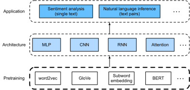

# 自然语言处理：预训练
:label:`chap_nlp_pretrain`


人类需要交流。
出于人类状况的这一基本需要，每天都会产生海量的书面文本。
面对社交媒体、聊天应用、电子邮件、产品评论、新闻文章、研究论文和书籍中的丰富文本，让计算机理解这些文本，从而基于人类语言提供帮助或做出决策，就变得至关重要。

*自然语言处理*（natural language processing）研究计算机与人之间使用自然语言的交互。
在实践中，利用自然语言处理技术来处理和分析文本（人类自然语言）数据非常普遍，例如 :numref:`sec_language-model` 中的语言模型，以及 :numref:`sec_machine_translation` 中的机器翻译模型。

为了理解文本，我们可以从学习文本的表示开始。
*自监督学习*（self-supervised learning）利用大型语料库中已有的文本序列，被广泛用于预训练文本表示，例如利用文本周围的某些部分来预测文本中某些隐藏部分。
通过这种方式，模型可以从*海量*文本数据中接受监督学习，而无需*昂贵*的标注工作！


正如我们将在本章中所看到的，
当把每个单词或子词视为一个独立的词元时，
每个词元的表示都可以利用大型语料库上的 word2vec、GloVe 或子词嵌入模型来预训练。
预训练之后，每个词元的表示可以是一个向量，
然而无论上下文是什么，该向量都保持不变。
例如，"bank"的向量表示在
"go to the bank to deposit some money"
和
"go to the bank to sit down"
两种情况下是相同的。
因此，许多较新的预训练模型会根据不同的上下文来调整同一词元的表示。
其中就包括 BERT，它是一个基于 Transformer 编码器的更深的、自监督模型。
正如 :numref:`fig_nlp-map-pretrain` 所强调的，本章将关注如何为文本预训练这样的表示。


:label:`fig_nlp-map-pretrain`


为了从全局上把握整体图景，:numref:`fig_nlp-map-pretrain` 表明，预训练的文本表示可以馈送到各种深度学习架构中，用于不同的下游自然语言处理应用。
我们将在 :numref:`chap_nlp_app` 中介绍这些内容。

```toc
:maxdepth: 2

word2vec
approx-training
word-embedding-dataset
word2vec-pretraining
glove
subword-embedding
similarity-analogy
bert
bert-dataset
bert-pretraining

```
