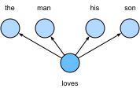
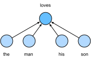

# 词嵌入（word2vec）
:label:`sec_word2vec`

自然语言是一个用于表达意义的复杂系统。
在这个系统中，词是意义的基本单位。
顾名思义，
*词向量*（word vectors）是用来表示词的向量，
也可以看作词的特征向量或表示。
将词映射为实向量的技术
称为*词嵌入*（word embedding）。
近年来，
词嵌入逐渐成为
自然语言处理的基础知识。

## 独热向量是一个糟糕的选择

在 :numref:`sec_rnn-scratch` 中，我们使用独热向量来表示词（字符就是词）。
假设词表中不同词的个数（词表大小）为 $N$，
每个词对应
一个从 $0$ 到 $N-1$ 的不同整数（索引）。
为了得到索引为 $i$ 的任意词的
独热向量表示，
我们创建一个长度为 $N$ 的全零向量，
并将位置 $i$ 处的元素设为 1。
这样，每个词都被表示为一个长度为 $N$ 的向量，
并且可以直接被神经网络使用。

尽管独热词向量易于构造，
但它们通常不是一个好的选择。
一个主要原因是独热词向量无法准确表达不同词之间的相似性，例如我们常用的*余弦相似度*（cosine similarity）。
对于向量 $\mathbf{x}, \mathbf{y} \in \mathbb{R}^d$，它们的余弦相似度是二者之间夹角的余弦：

$$\frac{\mathbf{x}^\top \mathbf{y}}{\|\mathbf{x}\| \|\mathbf{y}\|} \in [-1, 1].$$

由于任意两个不同词的独热向量之间的余弦相似度均为 0，
独热向量无法编码词与词之间的相似性。

## 自监督的 word2vec

[word2vec](https://code.google.com/archive/p/word2vec/) 工具正是为解决上述问题而提出的。
它将每个词映射为一个固定长度的向量，这些向量能更好地表达不同词之间的相似性和类比关系。
word2vec 工具包含两个模型，即*跳元模型*（skip-gram）:cite:`Mikolov.Sutskever.Chen.ea.2013` 和*连续词袋模型*（continuous bag of words，CBOW）:cite:`Mikolov.Chen.Corrado.ea.2013`。
为了获得语义上有意义的表示，
它们的训练依赖于
条件概率，
这些条件概率可以视为在语料库中
用某些周围的词
来预测某一些词。
由于监督来自不带标签的数据，
跳元模型和连续词袋模型
都是自监督模型。

下面，我们将介绍这两个模型及其训练方法。

## 跳元模型
:label:`subsec_skip-gram`

*跳元模型*（skip-gram）假设一个词可以用来生成文本序列中它周围的词。
以文本序列"the"、"man"、"loves"、"his"、"son"为例。
让我们选择"loves"作为*中心词*（center word），并将上下文窗口大小设为 2。
如 :numref:`fig_skip_gram` 所示，
给定中心词"loves"，
跳元模型考虑
生成*上下文词*（context words）"the"、"man"、"his"和"son"的条件概率，
这些词与中心词的距离不超过 2 个词：

$$P(\textrm{"the"},\textrm{"man"},\textrm{"his"},\textrm{"son"}\mid\textrm{"loves"}).$$

假设
给定中心词时，
上下文词是独立生成的（即条件独立）。
在这种情况下，上述条件概率
可以改写为

$$P(\textrm{"the"}\mid\textrm{"loves"})\cdot P(\textrm{"man"}\mid\textrm{"loves"})\cdot P(\textrm{"his"}\mid\textrm{"loves"})\cdot P(\textrm{"son"}\mid\textrm{"loves"}).$$

:label:`fig_skip_gram`

在跳元模型中，每个词
都有两个 $d$ 维的向量表示，
用于计算条件概率。
更具体地说，
对于词表中索引为 $i$ 的任意词，
分别用 $\mathbf{v}_i\in\mathbb{R}^d$
和 $\mathbf{u}_i\in\mathbb{R}^d$
表示其作为*中心*词和*上下文*词时的
两个向量。
给定中心词 $w_c$（在词表中的索引为 $c$）时，
生成任意上下文词 $w_o$（在词表中的索引为 $o$）的条件概率，
可以通过对向量点积的
softmax 运算来建模：

$$P(w_o \mid w_c) = \frac{\exp(\mathbf{u}_o^\top \mathbf{v}_c)}{ \sum_{i \in \mathcal{V}} \exp(\mathbf{u}_i^\top \mathbf{v}_c)},$$
:eqlabel:`eq_skip-gram-softmax`

其中词表索引集 $\mathcal{V} = \{0, 1, \ldots, |\mathcal{V}|-1\}$。
给定长度为 $T$ 的文本序列，其中时间步 $t$ 处的词记为 $w^{(t)}$。
假设
给定任意中心词时，
上下文词是独立生成的。
对于上下文窗口大小 $m$，
跳元模型的似然函数
是给定任意中心词时
生成所有上下文词的概率：

$$ \prod_{t=1}^{T} \prod_{-m \leq j \leq m,\ j \neq 0} P(w^{(t+j)} \mid w^{(t)}),$$

其中任何小于 $1$ 或大于 $T$ 的时间步都可以省略。

### 训练

跳元模型的参数是词表中每个词的中心词向量和上下文词向量。
在训练中，我们通过最大化似然函数（即最大似然估计）来学习模型参数。这等价于最小化以下损失函数：

$$ - \sum_{t=1}^{T} \sum_{-m \leq j \leq m,\ j \neq 0} \textrm{log}\, P(w^{(t+j)} \mid w^{(t)}).$$

当使用随机梯度下降来最小化损失时，
在每次迭代中，
我们可以
随机采样一个较短的子序列，计算该子序列的（随机）梯度，以更新模型参数。
为了计算这个（随机）梯度，
我们需要得到
对数条件概率
关于中心词向量和上下文词向量的梯度。
一般来说，根据 :eqref:`eq_skip-gram-softmax`，
涉及任意一对中心词 $w_c$ 和
上下文词 $w_o$ 的
对数条件概率为

$$\log P(w_o \mid w_c) =\mathbf{u}_o^\top \mathbf{v}_c - \log\left(\sum_{i \in \mathcal{V}} \exp(\mathbf{u}_i^\top \mathbf{v}_c)\right).$$
:eqlabel:`eq_skip-gram-log`

通过求导，我们可以得到它
关于中心词向量 $\mathbf{v}_c$ 的梯度：

$$\begin{aligned}\frac{\partial \textrm{log}\, P(w_o \mid w_c)}{\partial \mathbf{v}_c}&= \mathbf{u}_o - \frac{\sum_{j \in \mathcal{V}} \exp(\mathbf{u}_j^\top \mathbf{v}_c)\mathbf{u}_j}{\sum_{i \in \mathcal{V}} \exp(\mathbf{u}_i^\top \mathbf{v}_c)}\\&= \mathbf{u}_o - \sum_{j \in \mathcal{V}} \left(\frac{\exp(\mathbf{u}_j^\top \mathbf{v}_c)}{ \sum_{i \in \mathcal{V}} \exp(\mathbf{u}_i^\top \mathbf{v}_c)}\right) \mathbf{u}_j\\&= \mathbf{u}_o - \sum_{j \in \mathcal{V}} P(w_j \mid w_c) \mathbf{u}_j.\end{aligned}$$
:eqlabel:`eq_skip-gram-grad`

请注意，:eqref:`eq_skip-gram-grad` 中的计算需要词表中所有以 $w_c$ 为中心词的条件概率。
其他词向量的梯度可以用同样的方法获得。

训练之后，对于词表中索引为 $i$ 的任意词，我们可以得到两个词向量
$\mathbf{v}_i$（作为中心词）和 $\mathbf{u}_i$（作为上下文词）。
在自然语言处理应用中，通常使用跳元模型的中心词向量
作为词表示。

## 连续词袋（CBOW）模型

*连续词袋*（continuous bag of words，CBOW）模型与跳元模型相似。
与跳元模型的主要区别在于，
连续词袋模型
假设中心词是
基于文本序列中其周围的上下文词生成的。
例如，
在相同的文本序列"the"、"man"、"loves"、"his"和"son"中，以"loves"为中心词、上下文窗口大小为 2 时，
连续词袋模型
考虑
基于上下文词"the"、"man"、"his"和"son"生成中心词"loves"的条件概率（如 :numref:`fig_cbow` 所示），即

$$P(\textrm{"loves"}\mid\textrm{"the"},\textrm{"man"},\textrm{"his"},\textrm{"son"}).$$

:label:`fig_cbow`

由于连续词袋模型中有
多个上下文词，
在计算条件概率时
这些上下文词向量会被取平均。
具体来说，
对于词表中索引为 $i$ 的任意词，
分别用 $\mathbf{v}_i\in\mathbb{R}^d$
和 $\mathbf{u}_i\in\mathbb{R}^d$
表示其作为*上下文*词和*中心*词时的
两个向量
（在跳元模型中含义正好相反）。
给定周围上下文词 $w_{o_1}, \ldots, w_{o_{2m}}$（在词表中的索引为 $o_1, \ldots, o_{2m}$）时，
生成任意中心词 $w_c$（在词表中的索引为 $c$）的条件概率可以建模为

$$P(w_c \mid w_{o_1}, \ldots, w_{o_{2m}}) = \frac{\exp\left(\frac{1}{2m}\mathbf{u}_c^\top (\mathbf{v}_{o_1} + \ldots + \mathbf{v}_{o_{2m}}) \right)}{ \sum_{i \in \mathcal{V}} \exp\left(\frac{1}{2m}\mathbf{u}_i^\top (\mathbf{v}_{o_1} + \ldots + \mathbf{v}_{o_{2m}}) \right)}.$$
:eqlabel:`fig_cbow-full`

为简洁起见，令 $\mathcal{W}_o= \{w_{o_1}, \ldots, w_{o_{2m}}\}$，$\bar{\mathbf{v}}_o = \left(\mathbf{v}_{o_1} + \ldots + \mathbf{v}_{o_{2m}} \right)/(2m)$。则 :eqref:`fig_cbow-full` 可以简化为

$$P(w_c \mid \mathcal{W}_o) = \frac{\exp\left(\mathbf{u}_c^\top \bar{\mathbf{v}}_o\right)}{\sum_{i \in \mathcal{V}} \exp\left(\mathbf{u}_i^\top \bar{\mathbf{v}}_o\right)}.$$

给定长度为 $T$ 的文本序列，其中时间步 $t$ 处的词记为 $w^{(t)}$。
对于上下文窗口大小 $m$，
连续词袋模型的似然函数
是给定上下文词时
生成所有中心词的概率：

$$ \prod_{t=1}^{T}  P(w^{(t)} \mid  w^{(t-m)}, \ldots, w^{(t-1)}, w^{(t+1)}, \ldots, w^{(t+m)}).$$

### 训练

训练连续词袋模型
与训练跳元模型
几乎相同。
连续词袋模型的
最大似然估计等价于最小化以下损失函数：

$$  -\sum_{t=1}^T  \textrm{log}\, P(w^{(t)} \mid  w^{(t-m)}, \ldots, w^{(t-1)}, w^{(t+1)}, \ldots, w^{(t+m)}).$$

请注意

$$\log\,P(w_c \mid \mathcal{W}_o) = \mathbf{u}_c^\top \bar{\mathbf{v}}_o - \log\,\left(\sum_{i \in \mathcal{V}} \exp\left(\mathbf{u}_i^\top \bar{\mathbf{v}}_o\right)\right).$$

通过求导，我们可以得到它
关于任意上下文词向量 $\mathbf{v}_{o_i}$（$i = 1, \ldots, 2m$）
的梯度：

$$\frac{\partial \log\, P(w_c \mid \mathcal{W}_o)}{\partial \mathbf{v}_{o_i}} = \frac{1}{2m} \left(\mathbf{u}_c - \sum_{j \in \mathcal{V}} \frac{\exp(\mathbf{u}_j^\top \bar{\mathbf{v}}_o)\mathbf{u}_j}{ \sum_{i \in \mathcal{V}} \exp(\mathbf{u}_i^\top \bar{\mathbf{v}}_o)} \right) = \frac{1}{2m}\left(\mathbf{u}_c - \sum_{j \in \mathcal{V}} P(w_j \mid \mathcal{W}_o) \mathbf{u}_j \right).$$
:eqlabel:`eq_cbow-gradient`

其他词向量的梯度可以用同样的方法获得。
与跳元模型不同，
连续词袋模型
通常
使用上下文词向量作为词表示。

## 小结

* 词向量是用来表示词的向量，也可以看作词的特征向量或表示。将词映射为实向量的技术称为词嵌入。
* word2vec 工具包含跳元模型和连续词袋模型。
* 跳元模型假设一个词可以用来生成文本序列中它周围的词；而连续词袋模型假设中心词是基于其周围的上下文词生成的。

## 练习

1. 计算每个梯度的计算复杂度是多少？如果词表很大，可能会有什么问题？
1. 英语中一些固定短语由多个词组成，例如"new york"。如何训练它们的词向量？提示：参见 word2vec 论文 :cite:`Mikolov.Sutskever.Chen.ea.2013` 的第 4 节。
1. 让我们以跳元模型为例反思 word2vec 的设计。跳元模型中两个词向量的点积与余弦相似度之间是什么关系？对于语义相近的一对词，为什么它们的词向量（由跳元模型训练）的余弦相似度可能很高？

[讨论](https://discuss.d2l.ai/t/381)
