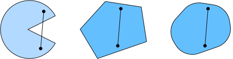
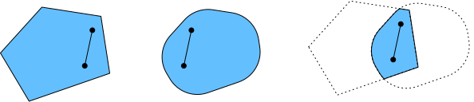
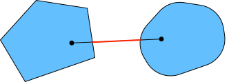
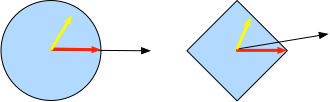

# 凸性
:label:`sec_convexity`

凸性在优化算法的设计中起着至关重要的作用。
这主要是因为在这种情形下分析和测试算法要容易得多。
换句话说，
如果算法即使在凸的设定下表现不佳，
那么通常我们也不应指望在其他情形下看到好的结果。
此外，尽管深度学习中的优化问题一般是非凸的，但它们在局部最小值附近往往表现出凸问题的一些性质。这可以引出令人兴奋的新优化变体，例如 :cite:`Izmailov.Podoprikhin.Garipov.ea.2018`。

```{.python .input}
#@tab mxnet
%matplotlib inline
from d2l import mxnet as d2l
from mpl_toolkits import mplot3d
from mxnet import np, npx
npx.set_np()
```

```{.python .input}
#@tab pytorch
%matplotlib inline
from d2l import torch as d2l
import numpy as np
from mpl_toolkits import mplot3d
import torch
```

```{.python .input}
#@tab tensorflow
%matplotlib inline
from d2l import tensorflow as d2l
import numpy as np
from mpl_toolkits import mplot3d
import tensorflow as tf
```

## 定义

在开始凸分析之前，
我们需要定义*凸集*（convex set）和*凸函数*（convex function）。
它们引出了机器学习中常用的数学工具。


### 凸集

集合是凸性的基础。简单地说，向量空间中的集合$\mathcal{X}$是*凸*的，如果对于任意$a, b \in \mathcal{X}$，连接$a$和$b$的线段也位于$\mathcal{X}$中。用数学术语来说，这意味着对于所有$\lambda \in [0, 1]$，都有

$$\lambda  a + (1-\lambda)  b \in \mathcal{X} \textrm{ whenever } a, b \in \mathcal{X}.$$

这听起来有点抽象。考虑 :numref:`fig_pacman`。第一个集合不是凸的，因为存在不包含在其中的线段。
另外两个集合没有这个问题。


:label:`fig_pacman`

定义本身并不是特别有用，除非你能用它们做些什么。
在这种情况下，我们可以考察交集，如 :numref:`fig_convex_intersect` 所示。
假设$\mathcal{X}$和$\mathcal{Y}$是凸集。那么$\mathcal{X} \cap \mathcal{Y}$也是凸的。要理解这一点，考虑任意$a, b \in \mathcal{X} \cap \mathcal{Y}$。由于$\mathcal{X}$和$\mathcal{Y}$是凸的，连接$a$和$b$的线段同时包含在$\mathcal{X}$和$\mathcal{Y}$中。因此，这条线段也必须包含在$\mathcal{X} \cap \mathcal{Y}$中，从而证明了我们的定理。


:label:`fig_convex_intersect`

我们可以毫不费力地加强这个结果：给定凸集$\mathcal{X}_i$，它们的交集$\cap_{i} \mathcal{X}_i$是凸的。
为了看出逆命题不成立，考虑两个不相交的集合$\mathcal{X} \cap \mathcal{Y} = \emptyset$。现在取$a \in \mathcal{X}$和$b \in \mathcal{Y}$。:numref:`fig_nonconvex` 中连接$a$和$b$的线段必然包含某个既不在$\mathcal{X}$中也不在$\mathcal{Y}$中的部分，因为我们假设了$\mathcal{X} \cap \mathcal{Y} = \emptyset$。因此，这条线段也不在$\mathcal{X} \cup \mathcal{Y}$中，从而证明了一般的凸集并集不必是凸的。


:label:`fig_nonconvex`

通常，深度学习中的问题定义在凸集上。例如，$\mathbb{R}^d$，
即$d$维实数向量的集合，
是凸集（毕竟，$\mathbb{R}^d$中任意两点之间的连线仍位于$\mathbb{R}^d$中）。在某些情况下，我们处理长度有界的变量，例如由$\{\mathbf{x} | \mathbf{x} \in \mathbb{R}^d \textrm{ and } \|\mathbf{x}\| \leq r\}$定义的半径为$r$的球。

### 凸函数

有了凸集，我们就可以引入*凸函数*（convex function）$f$。
给定凸集$\mathcal{X}$，函数$f: \mathcal{X} \to \mathbb{R}$是*凸*的，如果对于所有$x, x' \in \mathcal{X}$以及所有$\lambda \in [0, 1]$，都有

$$\lambda f(x) + (1-\lambda) f(x') \geq f(\lambda x + (1-\lambda) x').$$

为了说明这一点，让我们画出几个函数，并检查哪些函数满足这一要求。
下面我们定义几个函数，既有凸函数也有非凸函数。

```{.python .input}
#@tab all
f = lambda x: 0.5 * x**2  # Convex
g = lambda x: d2l.cos(np.pi * x)  # Nonconvex
h = lambda x: d2l.exp(0.5 * x)  # Convex

x, segment = d2l.arange(-2, 2, 0.01), d2l.tensor([-1.5, 1])
d2l.use_svg_display()
_, axes = d2l.plt.subplots(1, 3, figsize=(9, 3))
for ax, func in zip(axes, [f, g, h]):
    d2l.plot([x, segment], [func(x), func(segment)], axes=ax)
```

正如预期的那样，余弦函数是*非凸*的，而抛物线和指数函数是凸的。注意，要使该条件有意义，$\mathcal{X}$是凸集这一要求是必需的。否则，$f(\lambda x + (1-\lambda) x')$的结果可能没有良好定义。


### 詹森不等式

给定一个凸函数$f$，
最有用的数学工具之一
就是*詹森不等式*（Jensen's inequality）。
它相当于凸性定义的一种推广：

$$\sum_i \alpha_i f(x_i)  \geq f\left(\sum_i \alpha_i x_i\right)    \textrm{ and }    E_X[f(X)]  \geq f\left(E_X[X]\right),$$
:eqlabel:`eq_jensens-inequality`

其中$\alpha_i$是非负实数，满足$\sum_i \alpha_i = 1$，且$X$是随机变量。
换句话说，凸函数的期望不小于期望的凸函数，而后者通常是更简单的表达式。
为了证明第一个不等式，我们每次对求和中的一项反复应用凸性的定义。


詹森不等式的一个常见应用是
用一个更简单的表达式来界定一个更复杂的表达式。
例如，
它可以应用于
部分观测随机变量的对数似然。也就是说，我们使用

$$E_{Y \sim P(Y)}[-\log P(X \mid Y)] \geq -\log P(X),$$

因为$\int P(Y) P(X \mid Y) dY = P(X)$。
这可以用于变分方法。这里$Y$通常是未观测到的随机变量，$P(Y)$是对其可能如何分布的最佳猜测，而$P(X)$是对$Y$积分消去后得到的分布。例如，在聚类中$Y$可能是簇标签，而$P(X \mid Y)$是应用簇标签时的生成模型。


## 性质

凸函数有许多有用的性质。下面我们介绍其中几个常用的性质。


### 局部最小值也是全局最小值

首先，凸函数的局部最小值也是全局最小值。
我们可以用如下反证法证明。

考虑定义在凸集$\mathcal{X}$上的凸函数$f$。
假设$x^{\ast} \in \mathcal{X}$是局部最小值：
存在一个小的正值$p$，使得对于满足$0 < |x - x^{\ast}| \leq p$的$x \in \mathcal{X}$，都有$f(x^{\ast}) < f(x)$。

假设局部最小值$x^{\ast}$
不是$f$的全局最小值：
存在$x' \in \mathcal{X}$使得$f(x') < f(x^{\ast})$。
同时存在
$\lambda \in [0, 1)$，例如$\lambda = 1 - \frac{p}{|x^{\ast} - x'|}$
使得
$0 < |\lambda x^{\ast} + (1-\lambda) x' - x^{\ast}| \leq p$。

然而，
根据凸函数的定义，我们有

$$\begin{aligned}
    f(\lambda x^{\ast} + (1-\lambda) x') &\leq \lambda f(x^{\ast}) + (1-\lambda) f(x') \\
    &< \lambda f(x^{\ast}) + (1-\lambda) f(x^{\ast}) \\
    &= f(x^{\ast}),
\end{aligned}$$

这与我们关于$x^{\ast}$是局部最小值的论断相矛盾。
因此，不存在$x' \in \mathcal{X}$使得$f(x') < f(x^{\ast})$。局部最小值$x^{\ast}$同时也是全局最小值。

例如，凸函数$f(x) = (x-1)^2$在$x=1$处有一个局部最小值，它同时也是全局最小值。

```{.python .input}
#@tab all
f = lambda x: (x - 1) ** 2
d2l.set_figsize()
d2l.plot([x, segment], [f(x), f(segment)], 'x', 'f(x)')
```

凸函数的局部最小值也是全局最小值，这一事实非常方便。
它意味着，如果我们在最小化函数，就不会“卡住”。
不过请注意，这并不意味着全局最小值不可能多于一个，也不意味着它一定存在。例如，函数$f(x) = \mathrm{max}(|x|-1, 0)$在区间$[-1, 1]$上取得其最小值。相反，函数$f(x) = \exp(x)$在$\mathbb{R}$上不取得最小值：当$x \to -\infty$时它渐近于$0$，但不存在$x$使得$f(x) = 0$。

### 凸函数的下水平集是凸的

我们可以通过凸函数的*下水平集*（below set）方便地
定义凸集。
具体地说，
给定定义在凸集$\mathcal{X}$上的凸函数$f$，
任意下水平集

$$\mathcal{S}_b \stackrel{\textrm{def}}{=} \{x | x \in \mathcal{X} \textrm{ and } f(x) \leq b\}$$

都是凸的。

让我们快速证明这一点。回想一下，对于任意$x, x' \in \mathcal{S}_b$，我们需要证明只要$\lambda \in [0, 1]$，就有$\lambda x + (1-\lambda) x' \in \mathcal{S}_b$。
由于$f(x) \leq b$且$f(x') \leq b$，
根据凸性的定义，我们有

$$f(\lambda x + (1-\lambda) x') \leq \lambda f(x) + (1-\lambda) f(x') \leq b.$$

### 凸性与二阶导数

只要函数$f: \mathbb{R}^n \rightarrow \mathbb{R}$的二阶导数存在，就很容易检验$f$是否为凸函数。
我们只需检查$f$的黑塞矩阵是否为半正定：$\nabla^2f \succeq 0$，即，
将黑塞矩阵$\nabla^2f$记为$\mathbf{H}$时，
$\mathbf{x}^\top \mathbf{H} \mathbf{x} \geq 0$
对所有$\mathbf{x} \in \mathbb{R}^n$成立。
例如，函数$f(\mathbf{x}) = \frac{1}{2} \|\mathbf{x}\|^2$是凸的，因为$\nabla^2 f = \mathbf{1}$，即它的黑塞矩阵是单位矩阵。


形式上，一个二阶可微的一维函数$f: \mathbb{R} \rightarrow \mathbb{R}$是凸的，
当且仅当其二阶导数$f'' \geq 0$。对于任意二阶可微的多维函数$f: \mathbb{R}^{n} \rightarrow \mathbb{R}$，
它是凸的当且仅当其黑塞矩阵$\nabla^2f \succeq 0$。

首先，我们需要证明一维情形。
为了看出
$f$的凸性蕴含
$f'' \geq 0$，我们利用以下事实：

$$\frac{1}{2} f(x + \epsilon) + \frac{1}{2} f(x - \epsilon) \geq f\left(\frac{x + \epsilon}{2} + \frac{x - \epsilon}{2}\right) = f(x).$$

由于二阶导数由有限差分的极限给出，因此可以推出

$$f''(x) = \lim_{\epsilon \to 0} \frac{f(x+\epsilon) + f(x - \epsilon) - 2f(x)}{\epsilon^2} \geq 0.$$

为了看出
$f'' \geq 0$蕴含$f$是凸的，
我们利用以下事实：$f'' \geq 0$蕴含$f'$是单调不减函数。设$a < x < b$是$\mathbb{R}$中的三个点，
其中$x = (1-\lambda)a + \lambda b$且$\lambda \in (0, 1)$。
根据中值定理，
存在$\alpha \in [a, x]$和$\beta \in [x, b]$，
使得

$$f'(\alpha) = \frac{f(x) - f(a)}{x-a} \textrm{ and } f'(\beta) = \frac{f(b) - f(x)}{b-x}.$$


由单调性$f'(\beta) \geq f'(\alpha)$，因此

$$\frac{x-a}{b-a}f(b) + \frac{b-x}{b-a}f(a) \geq f(x).$$

由于$x = (1-\lambda)a + \lambda b$，
我们有

$$\lambda f(b) + (1-\lambda)f(a) \geq f((1-\lambda)a + \lambda b),$$

从而证明了凸性。

其次，在证明多维情形之前，
我们需要一个引理：
$f: \mathbb{R}^n \rightarrow \mathbb{R}$
是凸的，当且仅当对所有$\mathbf{x}, \mathbf{y} \in \mathbb{R}^n$

$$g(z) \stackrel{\textrm{def}}{=} f(z \mathbf{x} + (1-z)  \mathbf{y}) \textrm{ where } z \in [0,1]$$

是凸的。

为了证明$f$的凸性蕴含$g$是凸的，
我们可以证明对于所有$a, b, \lambda \in [0, 1]$（因此
$0 \leq \lambda a + (1-\lambda) b \leq 1$）

$$\begin{aligned} &g(\lambda a + (1-\lambda) b)\\
=&f\left(\left(\lambda a + (1-\lambda) b\right)\mathbf{x} + \left(1-\lambda a - (1-\lambda) b\right)\mathbf{y} \right)\\
=&f\left(\lambda \left(a \mathbf{x} + (1-a)  \mathbf{y}\right)  + (1-\lambda) \left(b \mathbf{x} + (1-b)  \mathbf{y}\right) \right)\\
\leq& \lambda f\left(a \mathbf{x} + (1-a)  \mathbf{y}\right)  + (1-\lambda) f\left(b \mathbf{x} + (1-b)  \mathbf{y}\right) \\
=& \lambda g(a) + (1-\lambda) g(b).
\end{aligned}$$

为了证明逆命题，
我们可以证明对于
所有$\lambda \in [0, 1]$

$$\begin{aligned} &f(\lambda \mathbf{x} + (1-\lambda) \mathbf{y})\\
=&g(\lambda \cdot 1 + (1-\lambda) \cdot 0)\\
\leq& \lambda g(1)  + (1-\lambda) g(0) \\
=& \lambda f(\mathbf{x}) + (1-\lambda) f(\mathbf{y}).
\end{aligned}$$


最后，
利用上面的引理和一维情形的结果，
多维情形
可以如下证明。
多维函数$f: \mathbb{R}^n \rightarrow \mathbb{R}$是凸的
当且仅当对所有$\mathbf{x}, \mathbf{y} \in \mathbb{R}^n$，$g(z) \stackrel{\textrm{def}}{=} f(z \mathbf{x} + (1-z)  \mathbf{y})$（其中$z \in [0,1]$）
是凸的。
根据一维情形，
这成立当且仅当
$g'' = (\mathbf{x} - \mathbf{y})^\top \mathbf{H}(\mathbf{x} - \mathbf{y}) \geq 0$（$\mathbf{H} \stackrel{\textrm{def}}{=} \nabla^2f$）
对所有$\mathbf{x}, \mathbf{y} \in \mathbb{R}^n$成立，
而根据半正定矩阵的定义，这等价于$\mathbf{H} \succeq 0$。


## 约束

凸优化的一个良好性质是它可以高效地处理约束。也就是说，它允许我们求解*约束优化*（constrained optimization）问题，其形式为：

$$\begin{aligned} \mathop{\textrm{minimize~}}_{\mathbf{x}} & f(\mathbf{x}) \\
    \textrm{ subject to } & c_i(\mathbf{x}) \leq 0 \textrm{ for all } i \in \{1, \ldots, n\},
\end{aligned}$$

其中$f$是目标，函数$c_i$是约束函数。为了理解它的作用，考虑$c_1(\mathbf{x}) = \|\mathbf{x}\|_2 - 1$的情形。此时参数$\mathbf{x}$被约束在单位球内。如果第二个约束是$c_2(\mathbf{x}) = \mathbf{v}^\top \mathbf{x} + b$，那么这对应于所有位于一个半空间上的$\mathbf{x}$。同时满足两个约束相当于在球中选取一个切片。

### 拉格朗日函数

一般来说，求解约束优化问题很困难。解决该问题的一种方法源于物理学，其直觉相当简单。想象一个盒子里的球。球会滚到最低的位置，重力会被盒子侧壁对球施加的力所平衡。简而言之，目标函数的梯度（即重力）将被约束函数的梯度抵消（球必须留在盒子内，因为墙壁会“推回”）。
注意，有些约束可能不是活跃的：
未被球触及的墙壁
无法对球施加任何力。


跳过*拉格朗日函数*（Lagrangian）$L$的推导，
上述推理
可以通过以下鞍点优化问题来表达：

$$L(\mathbf{x}, \alpha_1, \ldots, \alpha_n) = f(\mathbf{x}) + \sum_{i=1}^n \alpha_i c_i(\mathbf{x}) \textrm{ where } \alpha_i \geq 0.$$

这里变量$\alpha_i$（$i=1,\ldots,n$）就是所谓的*拉格朗日乘子*（Lagrange multiplier），它们确保约束被正确执行。它们的取值恰好大到足以确保对所有$i$都有$c_i(\mathbf{x}) \leq 0$。例如，对于任何自然满足$c_i(\mathbf{x}) < 0$的$\mathbf{x}$，我们最终会选择$\alpha_i = 0$。此外，这是一个鞍点优化问题：我们希望关于所有$\alpha_i$*最大化*$L$，同时关于$\mathbf{x}$对它*最小化*。有大量文献解释如何得到函数$L(\mathbf{x}, \alpha_1, \ldots, \alpha_n)$。就我们的目的而言，只需知道$L$的鞍点就是原始约束优化问题被最优求解的位置。

### 惩罚

至少*近似地*满足约束优化问题的一种方法是改编拉格朗日函数$L$。
我们不是满足$c_i(\mathbf{x}) \leq 0$，而是简单地把$\alpha_i c_i(\mathbf{x})$加到目标函数$f(x)$上。这可以确保约束不会被过度违反。

事实上，我们一直都在使用这个技巧。考虑 :numref:`sec_weight_decay` 中的权重衰减。在其中，我们将$\frac{\lambda}{2} \|\mathbf{w}\|^2$加到目标函数上，以确保$\mathbf{w}$不会变得太大。从约束优化的角度来看，可以看出这将确保对于某个半径$r$有$\|\mathbf{w}\|^2 - r^2 \leq 0$。调整$\lambda$的值可以让我们改变$\mathbf{w}$的大小。

一般来说，添加惩罚是确保近似满足约束的一种好方法。在实践中，这比精确满足要鲁棒得多。此外，对于非凸问题，那些使精确方法在凸情形下如此有吸引力的性质（例如最优性）大多不再成立。

### 投影

满足约束的另一种策略是投影。同样，我们之前已经遇到过它们，例如在处理 :numref:`sec_rnn-scratch` 中的梯度裁剪时。在那里，我们通过以下方式确保梯度的长度以$\theta$为界：

$$\mathbf{g} \leftarrow \mathbf{g} \cdot \mathrm{min}(1, \theta/\|\mathbf{g}\|).$$

事实证明，这是$\mathbf{g}$到半径为$\theta$的球上的一个*投影*。更一般地说，凸集$\mathcal{X}$上的投影定义为

$$\textrm{Proj}_\mathcal{X}(\mathbf{x}) = \mathop{\mathrm{argmin}}_{\mathbf{x}' \in \mathcal{X}} \|\mathbf{x} - \mathbf{x}'\|,$$

它是$\mathcal{X}$中最接近$\mathbf{x}$的点。


:label:`fig_projections`

投影的数学定义可能听起来有点抽象。:numref:`fig_projections` 对此作了较为清楚的解释。其中我们有两个凸集：一个圆和一个菱形。
同时位于两个集合内部的点（黄色）在投影过程中保持不变。
位于两个集合外部的点（黑色）被投影到
集合内部最接近原始点（黑色）的点（红色）上。
虽然对$\ell_2$球来说这会保持方向不变，但一般情况下未必如此，从菱形的情形可以看出这一点。


凸投影的用途之一是计算稀疏权重向量。此时我们将权重向量投影到$\ell_1$球上，
这是 :numref:`fig_projections` 中菱形情形的推广。


## 小结

在深度学习的背景下，凸函数的主要作用是启发优化算法，并帮助我们详细理解这些算法。在接下来的内容中，我们将看到如何据此推导梯度下降和随机梯度下降。


* 凸集的交集是凸的。并集则不是。
* 凸函数的期望不小于期望的凸函数（詹森不等式）。
* 一个二阶可微函数是凸的，当且仅当其黑塞矩阵（二阶导数矩阵）是半正定的。
* 凸约束可以通过拉格朗日函数来添加。在实践中，我们也可以简单地用惩罚项把它们加到目标函数中。
* 投影映射到凸集中最接近原始点的点。

## 练习

1. 假设我们想通过画出集合内各点之间的所有连线，并检查这些连线是否包含在集合内，来验证集合的凸性。
    1. 证明只需检查边界上的点就足够了。
    1. 证明只需检查集合的顶点就足够了。
1. 用$\mathcal{B}_p[r] \stackrel{\textrm{def}}{=} \{\mathbf{x} | \mathbf{x} \in \mathbb{R}^d \textrm{ and } \|\mathbf{x}\|_p \leq r\}$表示使用$p$-范数的半径为$r$的球。证明对所有$p \geq 1$，$\mathcal{B}_p[r]$都是凸的。
1. 给定凸函数$f$和$g$，证明$\mathrm{max}(f, g)$也是凸的。证明$\mathrm{min}(f, g)$不是凸的。
1. 证明 softmax 函数的规范化是凸的。更具体地说，证明
    $f(x) = \log \sum_i \exp(x_i)$的凸性。
1. 证明线性子空间，即$\mathcal{X} = \{\mathbf{x} | \mathbf{W} \mathbf{x} = \mathbf{b}\}$，是凸集。
1. 证明在线性子空间满足$\mathbf{b} = \mathbf{0}$的情形下，投影$\textrm{Proj}_\mathcal{X}$可以写成$\mathbf{M} \mathbf{x}$的形式，其中$\mathbf{M}$是某个矩阵。
1. 证明对于二阶可微的凸函数$f$，可以写成$f(x + \epsilon) = f(x) + \epsilon f'(x) + \frac{1}{2} \epsilon^2 f''(x + \xi)$，其中$\xi \in [0, \epsilon]$。
1. 给定凸集$\mathcal{X}$和两个向量$\mathbf{x}$和$\mathbf{y}$，证明投影永远不会增大距离，即$\|\mathbf{x} - \mathbf{y}\| \geq \|\textrm{Proj}_\mathcal{X}(\mathbf{x}) - \textrm{Proj}_\mathcal{X}(\mathbf{y})\|$。


[讨论](https://discuss.d2l.ai/t/350)
