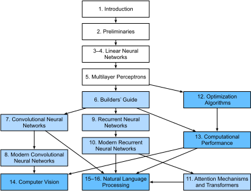

# 前言

就在几年前，大公司和初创企业中还没有成群的深度学习科学家来开发智能产品和服务。当我们进入这一领域时，机器学习还没有成为日报的头条新闻。我们的父母根本不知道机器学习是什么，更不用说我们为什么会更愿意选择机器学习，而不是从事医学或法律职业了。机器学习曾是一门纯理论性的学术学科，其工业意义仅限于语音识别、计算机视觉等少数现实应用。此外，这些应用中的许多都需要大量的领域知识，以至于它们通常被视为完全独立的领域，而机器学习只是其中一个很小的组成部分。当时，神经网络——也就是本书所关注的深度学习方法的前身——通常被认为已经过时。

然而，仅仅几年之间，深度学习就让世界为之惊叹，推动了计算机视觉、自然语言处理、自动语音识别、强化学习和生物医学信息学等多个领域的快速进展。此外，深度学习在如此多具有实际意义的任务中取得成功，甚至促进了理论机器学习和统计学的发展。有了这些进步，我们现在能够制造出比以往任何时候都更自主的自动驾驶汽车（尽管自主程度没有一些公司想让你相信的那么高），能够构建通过提出澄清性问题来调试代码的对话系统，还能让软件智能体在围棋等棋盘游戏中击败世界上最顶尖的人类棋手，而这曾被认为是几十年后才能实现的壮举。这些工具对产业和社会的影响正日益广泛，改变着电影的制作方式和疾病的诊断方式，并在基础科学中扮演着越来越重要的角色——从天体物理学到气候建模，再到天气预报和生物医学。

## 关于本书

本书代表了我们让深度学习变得平易近人的尝试，它将教会你*概念*、*背景*和*代码*。

### 融合代码、数学与HTML的媒介

任何一项计算技术要发挥出全部影响力，都必须被人们充分理解、具有充分的文档记录，并得到成熟且维护良好的工具的支持。关键思想应当被清晰地提炼出来，从而尽可能缩短新从业者跟上进度所需的入门时间。成熟的库应当自动完成常见任务，示例代码则应当让从业者能够轻松地修改、应用和扩展常见应用，以满足自己的需求。

以动态网页应用为例。尽管Amazon等众多公司在20世纪90年代就开发出了成功的数据库驱动网页应用，但这项技术在帮助富有创造力的创业者方面所蕴含的潜力，直到过去十年才在更大程度上得以实现，部分原因是出现了功能强大、文档完善的框架。

探索深度学习的潜力带来了独特的挑战，因为任何一项应用都会涉及多个学科。应用深度学习需要同时理解：（i）以特定方式表述问题的动机；（ii）给定模型的数学形式；（iii）使模型拟合数据的优化算法；（iv）统计原理——它告诉我们何时可以期望模型泛化到未见的数据——以及证明确实发生了泛化的实用方法；还有（v）高效训练模型所需的工程技术，包括规避数值计算中的陷阱、充分利用现有硬件。把表述问题所需的批判性思维、求解问题所需的数学，以及实现这些解所需的软件工具放在同一处讲授，是一项艰巨的挑战。本书的目标是提供一份统一的资源，让有志于此的从业者快速上手。

当我们启动这个图书项目时，还没有哪种资源能够同时做到：（i）保持最新；（ii）以足够的技术深度覆盖现代机器学习实践的广度；（iii）把人们期待教科书具有的高质量讲解，与人们期待实战教程具有的简洁可运行代码交织在一起。我们发现，大量的代码示例散落在各种博客文章和GitHub仓库中，它们展示了如何使用某个深度学习框架（例如如何在TensorFlow中用矩阵做基本的数值计算），或者如何实现特定技术（例如LeNet、AlexNet、ResNet等的代码片段）。然而，这些示例通常关注*如何*实现某种方法，却略去了对*为什么*要做出某些算法决策的讨论。虽然也会零星出现一些专门探讨特定主题的交互式资源，例如发布在[Distill](http://distill.pub)网站上的引人入胜的博客文章，或是个人博客，但它们只覆盖深度学习中的部分主题，而且往往缺少配套代码。另一方面，虽然已经出现了几本深度学习教材——例如 :citet:`Goodfellow.Bengio.Courville.2016`，它对深度学习基础做了全面综述——但这些资源没有把概念的文字描述与代码实现结合起来，有时让读者对如何实现它们茫然无措。此外，还有太多资源被藏在商业课程提供商的付费墙之后。

我们着手创建一份这样的资源：（i）人人都可以免费获取；（ii）提供足够的技术深度，为真正成为一名应用机器学习科学家的道路提供一个起点；（iii）包含可运行的代码，向读者展示在实践中*如何*解决问题；（iv）允许我们以及整个社区进行快速更新；（v）辅以一个[论坛](https://discuss.d2l.ai/c/5)，用于就技术细节进行互动讨论并回答问题。

这些目标往往相互冲突。公式、定理和引用最好用LaTeX来管理和排版；代码最好用Python来描述；而网页的原生语言是HTML和JavaScript。此外，我们希望内容既能作为可执行代码获取，也能作为纸质书、可下载的PDF以及互联网上的网站访问。似乎没有哪种工作流能同时满足这些需求，因此我们决定自行搭建一套（见 :numref:`sec_how_to_contribute`）。我们选择用GitHub共享源代码并方便社区贡献；用Jupyter 笔记本把代码、公式和文本混合在一起；用Sphinx作为渲染引擎；用Discourse作为讨论平台。我们的系统并不完美，但这些选择在相互竞争的各项考量之间达成了折中。我们相信，*Dive into Deep Learning*可能是第一本采用这种集成工作流出版的图书。

### 在实践中学习

许多教材按顺序讲授概念，对每个概念都做详尽无遗的阐述。例如，:citet:`Bishop.2006` 这部优秀的教材把每个主题都讲得极为透彻，以至于要读到线性回归那一章需要花费相当大的功夫。专家们喜爱这本书恰恰是因为其详尽，但对真正的初学者而言，这一特点限制了它作为入门教材的实用性。

在本书中，我们*适时*讲授大多数概念。换句话说，你会在完成某个实际目标恰好需要某个概念的那一刻学习它。虽然我们在开头花了一些时间讲授线性代数和概率等基础预备知识，但我们希望你先体会到训练出第一个模型的满足感，然后再去操心那些更为深奥的概念。

除了少数提供基础数学背景速成课程的预备性笔记本之外，后续每一章都会引入合理数量的新概念，并给出若干使用真实数据集、可独立运行的示例。这带来了组织上的挑战：有些模型从逻辑上讲可以归到同一个笔记本中，而有些想法可能最好通过依次运行多个模型来讲解。相比之下，遵循*一个可运行示例对应一个笔记本*的原则有诸多好处：它让你可以尽可能轻松地借助我们的代码启动自己的研究项目。只需复制一个笔记本，然后开始修改即可。

在全书中，我们根据需要把可运行代码与背景材料交替编排。一般来说，我们宁可先提供工具、再作充分解释（往往稍后再补充背景）。例如，我们可能会先使用*随机梯度下降*，然后再解释它为什么有用，或者为它为何有效提供一些直观解释。这有助于让从业者快速获得解决问题的必要“弹药”，代价则是需要读者信任我们的一些内容组织决策。

本书从零开始讲授深度学习概念。有时，我们会深入探讨现代深度学习框架通常对用户隐藏的模型细节。这在基础教程中尤为常见——我们希望你能理解某一层或某个优化器中发生的一切。在这些情况下，我们通常会给出示例的两个版本：一个版本从零实现所有内容，只依赖类NumPy的功能和自动微分；另一个是更实用的版本，我们使用深度学习框架的高级API写出简洁的代码。在解释清楚某个组件的工作原理之后，后续教程中我们就会依赖高级API。

### 内容与结构

本书大致可分为三个部分，分别涉及预备知识、深度学习技术，以及侧重真实系统与应用的高级主题（见 :numref:`fig_book_org`）。


:label:`fig_book_org`


* **第一部分：基础知识与预备知识**。
:numref:`chap_introduction` 是深度学习的入门介绍。然后，在 :numref:`chap_preliminaries` 中，我们快速带读者掌握动手学习深度学习所需的前提条件，例如如何存储和处理数据，以及如何基于线性代数、微积分和概率的基本概念进行各种数值运算。:numref:`chap_regression` 和 :numref:`chap_perceptrons` 介绍了深度学习中最基本的概念和技术，包括回归与分类、线性模型、多层感知机，以及过拟合与正则化。

* **第二部分：现代深度学习技术**。
:numref:`chap_computation` 描述了深度学习系统的关键计算组件，并为我们随后实现更复杂的模型奠定基础。接下来，:numref:`chap_cnn` 和 :numref:`chap_modern_cnn` 介绍了卷积神经网络（convolutional neural network，CNN），这一强大工具构成了大多数现代计算机视觉系统的骨干。类似地，:numref:`chap_rnn` 和 :numref:`chap_modern_rnn` 介绍了循环神经网络（recurrent neural network，RNN），这类模型利用数据中的序列（例如时间）结构，常用于自然语言处理和时间序列预测。在 :numref:`chap_attention-and-transformers` 中，我们描述了一类相对较新的模型，它们基于所谓的*注意力机制*（attention mechanism），已经取代RNN成为大多数自然语言处理任务的主流架构。这些章节将带你熟悉深度学习从业者广泛使用的最强大、最通用的工具。

* **第三部分：可扩展性、效率与应用**（可[在线](https://d2l.ai)获取）。
第12章中，我们讨论几种常用于训练深度学习模型的优化算法。接着，第13章考察影响深度学习代码计算性能的几个关键因素。然后，第14章展示深度学习在计算机视觉中的主要应用。最后，第15章和第16章演示如何预训练语言表示模型，并将其应用于自然语言处理任务。

### 代码
:label:`sec_code`

本书大多数章节都以可执行代码为特色。我们认为，有些直觉最好通过反复试验来培养——小幅调整代码并观察结果。理想情况下，一个优雅的数学理论或许能精确地告诉我们该如何调整代码以得到期望的结果。然而，如今的深度学习从业者常常必须在没有可靠理论指引的地方摸索前行。尽管我们尽了最大努力，但解释各种技术为何有效仍然缺乏形式化说明，原因多种多样：刻画这些模型所需的数学可能非常困难；解释很可能依赖于目前尚缺乏明确定义的数据性质；而对这些课题的严肃研究直到最近才步入快车道。我们希望，随着深度学习理论的进展，本书未来的每一版都能提供超越现有版本的洞见。

为了避免不必要的重复，我们把最常导入和使用的部分函数与类收录在`d2l`包中。在全书中，我们用`#@save`标记代码块（例如函数、类或一组导入语句），表示稍后可以通过`d2l`包访问它们。我们在 :numref:`sec_d2l` 中详细概述了这些类和函数。`d2l`包很轻量，只依赖以下这些包：

```{.python .input}
#@tab all
#@save
import inspect
import collections
from collections import defaultdict
from IPython import display
import math
from matplotlib import pyplot as plt
from matplotlib_inline import backend_inline
import os
import pandas as pd
import random
import re
import shutil
import sys
import tarfile
import time
import requests
import zipfile
import hashlib
d2l = sys.modules[__name__]
```

:begin_tab:`mxnet`
本书的大部分代码基于Apache MXNet，这是一个开源的深度学习框架，是AWS（Amazon Web Services）以及许多高校和企业的首选。本书中的所有代码都在最新的MXNet版本下通过了测试。然而，由于深度学习发展迅速，*印刷版*中的部分代码在未来版本的MXNet中可能无法正常运行。我们计划持续更新在线版本。如果你遇到任何问题，请查阅 :ref:`chap_installation` 来更新代码和运行环境。下面列出了我们MXNet实现中的依赖。
:end_tab:

:begin_tab:`pytorch`
本书的大部分代码基于PyTorch，这是一个流行的开源框架，受到深度学习研究界的热烈欢迎。本书中的所有代码都在PyTorch最新的稳定版本下通过了测试。然而，由于深度学习发展迅速，*印刷版*中的部分代码在未来版本的PyTorch中可能无法正常运行。我们计划持续更新在线版本。如果你遇到任何问题，请查阅 :ref:`chap_installation` 来更新代码和运行环境。下面列出了我们PyTorch实现中的依赖。
:end_tab:

:begin_tab:`tensorflow`
本书的大部分代码基于TensorFlow，这是一个开源的深度学习框架，在工业界被广泛采用，在研究人员中也颇受欢迎。本书中的所有代码都在最新稳定版本的TensorFlow下通过了测试。然而，由于深度学习发展迅速，*印刷版*中的部分代码在未来版本的TensorFlow中可能无法正常运行。我们计划持续更新在线版本。如果你遇到任何问题，请查阅 :ref:`chap_installation` 来更新代码和运行环境。下面列出了我们TensorFlow实现中的依赖。
:end_tab:

:begin_tab:`jax`
本书的大部分代码基于Jax，这是一个开源框架，支持可组合的函数变换，例如对任意Python和NumPy函数求导，以及即时编译（JIT）、向量化等等！它正在机器学习研究领域流行起来，并提供了易于学习的类NumPy API。实际上，JAX力求与NumPy达到1:1的一致，因此切换代码可能只需改动一条导入语句！然而，由于深度学习发展迅速，*印刷版*中的部分代码在未来版本的Jax中可能无法正常运行。我们计划持续更新在线版本。如果你遇到任何问题，请查阅 :ref:`chap_installation` 来更新代码和运行环境。下面列出了我们JAX实现中的依赖。
:end_tab:

```{.python .input}
#@tab mxnet
#@save
from mxnet import autograd, context, gluon, image, init, np, npx
from mxnet.gluon import nn, rnn
```

```{.python .input}
#@tab pytorch
#@save
import numpy as np
import torch
import torchvision
from torch import nn
from torch.nn import functional as F
from torchvision import transforms
from PIL import Image
from scipy.spatial import distance_matrix
```

```{.python .input}
#@tab tensorflow
#@save
import numpy as np
import tensorflow as tf
```

```{.python .input}
#@tab jax
#@save
from dataclasses import field
from functools import partial
import flax
from flax import linen as nn
from flax.training import train_state
import jax
from jax import numpy as jnp
from jax import grad, vmap
import numpy as np
import optax
import tensorflow as tf
import tensorflow_datasets as tfds
from types import FunctionType
from typing import Any
```

### 目标读者

本书面向希望扎实掌握深度学习实用技术的学生（本科生或研究生）、工程师和研究人员。由于我们从零开始解释每一个概念，因此你不需要具备深度学习或机器学习的任何背景。要完整解释深度学习的方法，需要一些数学和编程知识，但我们只假定你具备一些基础知识，包括适量的线性代数、微积分、概率以及Python编程。以防你忘记了什么，[在线附录](https://d2l.ai/chapter_appendix-mathematics-for-deep-learning/index.html)对本书中出现的绝大部分数学知识提供了复习材料。通常，我们会优先考虑直觉和思想，而不是数学上的严格性。如果你想在理解本书所需的前提之外继续拓展这些基础，我们乐于推荐一些其他优秀资源：由 :citet:`Bollobas.1999` 所著的*Linear Analysis*深入讲解了线性代数与泛函分析；*All of Statistics* :cite:`Wasserman.2013` 对统计学做了精彩的介绍；Joe Blitzstein关于概率和推断的[教材](https://www.amazon.com/Introduction-Probability-Chapman-Statistical-Science/dp/1138369918)和[课程](https://projects.iq.harvard.edu/stat110/home)堪称教学典范。如果你以前没有用过Python，不妨浏览这份[Python教程](http://learnpython.org/)。


### 笔记本、网站、GitHub与论坛

我们所有的笔记本都可以从[D2L.ai网站](https://d2l.ai)和[GitHub](https://github.com/d2l-ai/d2l-en)下载。配合本书，我们在[discuss.d2l.ai](https://discuss.d2l.ai/c/5)上线了一个讨论论坛。无论你对书中哪一节有疑问，都可以在每个笔记本的末尾找到相应讨论页面的链接。

## 致谢

我们感谢英文版和中文版草稿的数百位贡献者。他们帮助改进了内容，并提供了宝贵的反馈。本书最初以MXNet作为主要框架实现。感谢Anirudh Dagar和Yuan Tang分别将早期MXNet代码的大部分改编为PyTorch和TensorFlow实现。自2021年7月起，我们用PyTorch、MXNet和TensorFlow重新设计并重新实现了本书，并选择PyTorch作为主要框架。感谢Anirudh Dagar将较新的PyTorch代码的大部分改编为JAX实现。感谢百度的Gaosheng Wu、Liujun Hu、Ge Zhang和Jiehang Xie将较新的PyTorch代码的大部分改编为中文版中的PaddlePaddle实现。感谢Shuai Zhang将出版社的LaTeX样式集成到PDF构建中。

在GitHub上，我们感谢这份英文草稿的每一位贡献者，是他们让本书对每个人都变得更好。他们的GitHub ID或姓名如下（排名不分先后）：
alxnorden, avinashingit, bowen0701, brettkoonce, Chaitanya Prakash Bapat,
cryptonaut, Davide Fiocco, edgarroman, gkutiel, John Mitro, Liang Pu,
Rahul Agarwal, Mohamed Ali Jamaoui, Michael (Stu) Stewart, Mike Müller,
NRauschmayr, Prakhar Srivastav, sad-, sfermigier, Sheng Zha, sundeepteki,
topecongiro, tpdi, vermicelli, Vishaal Kapoor, Vishwesh Ravi Shrimali, YaYaB, Yuhong Chen,
Evgeniy Smirnov, lgov, Simon Corston-Oliver, Igor Dzreyev, Ha Nguyen, pmuens,
Andrei Lukovenko, senorcinco, vfdev-5, dsweet, Mohammad Mahdi Rahimi, Abhishek Gupta,
uwsd, DomKM, Lisa Oakley, Bowen Li, Aarush Ahuja, Prasanth Buddareddygari, brianhendee,
mani2106, mtn, lkevinzc, caojilin, Lakshya, Fiete Lüer, Surbhi Vijayvargeeya,
Muhyun Kim, dennismalmgren, adursun, Anirudh Dagar, liqingnz, Pedro Larroy,
lgov, ati-ozgur, Jun Wu, Matthias Blume, Lin Yuan, geogunow, Josh Gardner,
Maximilian Böther, Rakib Islam, Leonard Lausen, Abhinav Upadhyay, rongruosong,
Steve Sedlmeyer, Ruslan Baratov, Rafael Schlatter, liusy182, Giannis Pappas,
ati-ozgur, qbaza, dchoi77, Adam Gerson, Phuc Le, Mark Atwood, christabella, vn09,
Haibin Lin, jjangga0214, RichyChen, noelo, hansent, Giel Dops, dvincent1337, WhiteD3vil,
Peter Kulits, codypenta, joseppinilla, ahmaurya, karolszk, heytitle, Peter Goetz, rigtorp,
Tiep Vu, sfilip, mlxd, Kale-ab Tessera, Sanjar Adilov, MatteoFerrara, hsneto,
Katarzyna Biesialska, Gregory Bruss, Duy–Thanh Doan, paulaurel, graytowne, Duc Pham,
sl7423, Jaedong Hwang, Yida Wang, cys4, clhm, Jean Kaddour, austinmw, trebeljahr, tbaums,
Cuong V. Nguyen, pavelkomarov, vzlamal, NotAnotherSystem, J-Arun-Mani, jancio, eldarkurtic,
the-great-shazbot, doctorcolossus, gducharme, cclauss, Daniel-Mietchen, hoonose, biagiom,
abhinavsp0730, jonathanhrandall, ysraell, Nodar Okroshiashvili, UgurKap, Jiyang Kang,
StevenJokes, Tomer Kaftan, liweiwp, netyster, ypandya, NishantTharani, heiligerl, SportsTHU,
Hoa Nguyen, manuel-arno-korfmann-webentwicklung, aterzis-personal, nxby, Xiaoting He, Josiah Yoder,
mathresearch, mzz2017, jroberayalas, iluu, ghejc, BSharmi, vkramdev, simonwardjones, LakshKD,
TalNeoran, djliden, Nikhil95, Oren Barkan, guoweis, haozhu233, pratikhack, Yue Ying, tayfununal,
steinsag, charleybeller, Andrew Lumsdaine, Jiekui Zhang, Deepak Pathak, Florian Donhauser, Tim Gates,
Adriaan Tijsseling, Ron Medina, Gaurav Saha, Murat Semerci, Lei Mao, Levi McClenny, Joshua Broyde,
jake221, jonbally, zyhazwraith, Brian Pulfer, Nick Tomasino, Lefan Zhang, Hongshen Yang, Vinney Cavallo,
yuntai, Yuanxiang Zhu, amarazov, pasricha, Ben Greenawald, Shivam Upadhyay, Quanshangze Du, Biswajit Sahoo,
Parthe Pandit, Ishan Kumar, HomunculusK, Lane Schwartz, varadgunjal, Jason Wiener, Armin Gholampoor,
Shreshtha13, eigen-arnav, Hyeonggyu Kim, EmilyOng, Bálint Mucsányi, Chase DuBois, Juntian Tao,
Wenxiang Xu, Lifu Huang, filevich, quake2005, nils-werner, Yiming Li, Marsel Khisamutdinov,
Francesco "Fuma" Fumagalli, Peilin Sun, Vincent Gurgul, qingfengtommy, Janmey Shukla, Mo Shan,
Kaan Sancak, regob, AlexSauer, Gopalakrishna Ramachandra, Tobias Uelwer, Chao Wang, Tian Cao,
Nicolas Corthorn, akash5474, kxxt, zxydi1992, Jacob Britton, Shuangchi He, zhmou, krahets, Jie-Han Chen,
Atishay Garg, Marcel Flygare, adtygan, Nik Vaessen, bolded, Louis Schlessinger, Balaji Varatharajan,
atgctg, Kaixin Li, Victor Barbaros, Riccardo Musto, Elizabeth Ho, azimjonn, Guilherme Miotto, Alessandro Finamore,
Joji Joseph, Anthony Biel, Zeming Zhao, shjustinbaek, gab-chen, nantekoto, Yutaro Nishiyama, Oren Amsalem,
Tian-MaoMao, Amin Allahyar, Gijs van Tulder, Mikhail Berkov, iamorphen, Matthew Caseres, Andrew Walsh,
pggPL, RohanKarthikeyan, Ryan Choi, and Likun Lei.

我们感谢Amazon Web Services，特别是Wen-Ming Ye、George Karypis、Swami Sivasubramanian、Peter DeSantis、Adam Selipsky和Andrew Jassy，感谢他们对本书写作的慷慨支持。如果没有可支配的时间、资源、与同事的讨论以及持续的鼓励，就不会有这本书。在本书出版准备期间，Cambridge University Press提供了出色的支持。我们感谢组稿编辑David Tranah的帮助与专业精神。


## 小结

深度学习彻底改变了模式识别，它所引入的技术如今支撑着从计算机视觉、自然语言处理到自动语音识别等众多领域的大量技术。要成功应用深度学习，你必须理解如何表述问题、建模所需的基础数学、使模型拟合数据的算法，以及把这一切实现出来的工程技术。本书提供了一份全面的资源，把文字、图表、数学和代码汇于一处。


## 练习

1. 在本书的讨论论坛[discuss.d2l.ai](https://discuss.d2l.ai/)上注册一个账号。
1. 在你的计算机上安装Python。
1. 点击本节末尾指向论坛的链接，在那里你可以寻求帮助、讨论本书，并通过与作者和更广泛的社区交流来找到问题的答案。

:begin_tab:`mxnet`
[讨论](https://discuss.d2l.ai/t/18)
:end_tab:

:begin_tab:`pytorch`
[讨论](https://discuss.d2l.ai/t/20)
:end_tab:

:begin_tab:`tensorflow`
[讨论](https://discuss.d2l.ai/t/186)
:end_tab:

:begin_tab:`jax`
[讨论](https://discuss.d2l.ai/t/17963)
:end_tab:
