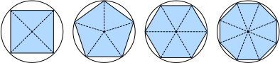

```{.python .input}
%load_ext d2lbook.tab
tab.interact_select(['mxnet', 'pytorch', 'tensorflow', 'jax'])
```

# 微积分
:label:`sec_calculus`

很长一段时间里，如何计算
圆的面积一直是个谜。
后来，在古希腊，数学家阿基米德（Archimedes）
想出了一个巧妙的主意：
在圆内接一系列
顶点数不断增加的多边形
（:numref:`fig_circle_area`）。
对于有$n$个顶点的多边形，
我们得到$n$个三角形。
随着我们把圆划分得越来越细，
每个三角形的高趋近于半径$r$。
同时，它的底趋近于$2 \pi r/n$，
因为当顶点数很大时，
弧长与弦长之比趋近于1。
因此，多边形的面积趋近于
$n \cdot r \cdot \frac{1}{2} (2 \pi r/n) = \pi r^2$。


:label:`fig_circle_area`

这种取极限的过程是
*微分学*（differential calculus）和*积分学*（integral calculus）的共同根源。
前者能告诉我们如何通过
改变函数的自变量来增大
或减小函数值。
这对我们在深度学习中
面对的*优化问题*很有帮助，
在优化中我们反复更新参数，
以减小损失函数。
优化解决的是如何让模型拟合训练数据的问题，
而微积分是它的关键前提。
然而，不要忘记我们的最终目标
是在*以前从未见过*的数据上表现良好。
这个问题称为*泛化*（generalization），
它将是其他章节关注的关键问题。

```{.python .input}
%%tab mxnet
%matplotlib inline
from d2l import mxnet as d2l
from matplotlib_inline import backend_inline
from mxnet import np, npx
npx.set_np()
```

```{.python .input}
%%tab pytorch
%matplotlib inline
from d2l import torch as d2l
from matplotlib_inline import backend_inline
import numpy as np
```

```{.python .input}
%%tab tensorflow
%matplotlib inline
from d2l import tensorflow as d2l
from matplotlib_inline import backend_inline
import numpy as np
```

```{.python .input}
%%tab jax
%matplotlib inline
from d2l import jax as d2l
from matplotlib_inline import backend_inline
import numpy as np
```

## 导数和微分

简而言之，*导数*（derivative）是函数值
相对于其自变量变化的
变化率。
导数可以告诉我们，如果我们把每个参数
*增大*或*减小*一个无穷小的量，
损失函数会以多快的速度增大或减小。
形式上，对于从标量映射到标量的函数$f: \mathbb{R} \rightarrow \mathbb{R}$，
[**$f$在点$x$处的*导数*定义为**]

(**$$f'(x) = \lim_{h \rightarrow 0} \frac{f(x+h) - f(x)}{h}.$$**)
:eqlabel:`eq_derivative`

右侧的这一项称为*极限*（limit），
它告诉我们当某个指定的变量
趋近于某个特定值时，
一个表达式的值会发生什么变化。
这个极限告诉我们，
当我们把扰动的大小缩小到零时，
扰动$h$与函数值变化量
$f(x + h) - f(x)$之比
会收敛到什么值。

当$f'(x)$存在时，称$f$
在$x$处*可微*（differentiable）；
当$f'(x)$对某个集合（例如区间$[a,b]$）
上所有$x$都存在时，
我们说$f$在该集合上可微。
并非所有函数都可微，
包括我们希望优化的许多函数，
例如准确率和
受试者工作特征曲线下面积（AUC，area under the receiving operating characteristic）。
然而，由于计算损失函数的导数
是几乎所有训练深度神经网络算法的
关键步骤，
我们往往改为优化一个可微的*替代函数*（surrogate）。


我们可以把导数
$f'(x)$
解释为$f(x)$关于$x$的*瞬时*
变化率。
让我们通过一个例子来建立一些直觉。
(**定义$u = f(x) = 3x^2-4x$。**)

```{.python .input}
%%tab mxnet
def f(x):
    return 3 * x ** 2 - 4 * x
```

```{.python .input}
%%tab pytorch
def f(x):
    return 3 * x ** 2 - 4 * x
```

```{.python .input}
%%tab tensorflow
def f(x):
    return 3 * x ** 2 - 4 * x
```

```{.python .input}
%%tab jax
def f(x):
    return 3 * x ** 2 - 4 * x
```

[**令$x=1$，可以看到$\frac{f(x+h) - f(x)}{h}$**] (**在$h$趋近于$0$时趋近于$2$。**)
虽然这个实验缺乏
数学证明的严谨性，
但我们可以很快看出确实有$f'(1) = 2$。

```{.python .input}
%%tab all
for h in 10.0**np.arange(-1, -6, -1):
    print(f'h={h:.5f}, numerical limit={(f(1+h)-f(1))/h:.5f}')
```

导数有几种等价的记号约定。
给定$y = f(x)$，下列表达式等价：

$$f'(x) = y' = \frac{dy}{dx} = \frac{df}{dx} = \frac{d}{dx} f(x) = Df(x) = D_x f(x),$$

其中符号$\frac{d}{dx}$和$D$是*微分算子*（differentiation operator）。
下面给出一些常见函数的导数：

$$\begin{aligned} \frac{d}{dx} C & = 0 && \textrm{for any constant $C$} \\ \frac{d}{dx} x^n & = n x^{n-1} && \textrm{for } n \neq 0 \\ \frac{d}{dx} e^x & = e^x \\ \frac{d}{dx} \ln x & = x^{-1}. \end{aligned}$$

由可微函数复合而成的函数
往往本身也可微。
在处理任意可微函数
$f$和$g$以及常数$C$的复合时，
下列法则会派上用场。

$$\begin{aligned} \frac{d}{dx} [C f(x)] & = C \frac{d}{dx} f(x) && \textrm{Constant multiple rule} \\ \frac{d}{dx} [f(x) + g(x)] & = \frac{d}{dx} f(x) + \frac{d}{dx} g(x) && \textrm{Sum rule} \\ \frac{d}{dx} [f(x) g(x)] & = f(x) \frac{d}{dx} g(x) + g(x) \frac{d}{dx} f(x) && \textrm{Product rule} \\ \frac{d}{dx} \frac{f(x)}{g(x)} & = \frac{g(x) \frac{d}{dx} f(x) - f(x) \frac{d}{dx} g(x)}{g^2(x)} && \textrm{Quotient rule} \end{aligned}$$

利用这些法则，我们可以通过下式
求出$3 x^2 - 4x$的导数

$$\frac{d}{dx} [3 x^2 - 4x] = 3 \frac{d}{dx} x^2 - 4 \frac{d}{dx} x = 6x - 4.$$

代入$x = 1$可以看出，在这个位置上
导数确实等于$2$。
请注意，导数告诉我们
函数在某个特定位置的*斜率*（slope）。

## 可视化工具

[**我们可以使用`matplotlib`库把函数的斜率可视化**]。
我们需要定义几个函数。
顾名思义，`use_svg_display`
告诉`matplotlib`以SVG格式
输出图形，以便得到更清晰的图像。
注释`#@save`是一个特殊的修饰符，
它允许我们把任何函数、
类或其他代码块保存到`d2l`包中，
这样以后就可以调用它
而无需重复编写代码，
例如通过`d2l.use_svg_display()`调用。

```{.python .input}
%%tab all
def use_svg_display():  #@save
    """Use the svg format to display a plot in Jupyter."""
    backend_inline.set_matplotlib_formats('svg')
```

很方便的是，我们可以用`set_figsize`设置图形大小。
由于导入语句`from matplotlib import pyplot as plt`
已通过`#@save`标记在`d2l`包中，
因此我们可以调用`d2l.plt`。

```{.python .input}
%%tab all
def set_figsize(figsize=(3.5, 2.5)):  #@save
    """Set the figure size for matplotlib."""
    use_svg_display()
    d2l.plt.rcParams['figure.figsize'] = figsize
```

`set_axes`函数可以把坐标轴
与各种属性关联起来，包括标签、范围
和刻度。

```{.python .input}
%%tab all
#@save
def set_axes(axes, xlabel, ylabel, xlim, ylim, xscale, yscale, legend):
    """Set the axes for matplotlib."""
    axes.set_xlabel(xlabel), axes.set_ylabel(ylabel)
    axes.set_xscale(xscale), axes.set_yscale(yscale)
    axes.set_xlim(xlim),     axes.set_ylim(ylim)
    if legend:
        axes.legend(legend)
    axes.grid()
```

有了这三个函数，我们就可以定义一个`plot`函数
来叠加多条曲线。
这里的很多代码只是确保
输入的大小和形状匹配。

```{.python .input}
%%tab all
#@save
def plot(X, Y=None, xlabel=None, ylabel=None, legend=[], xlim=None,
         ylim=None, xscale='linear', yscale='linear',
         fmts=('-', 'm--', 'g-.', 'r:'), figsize=(3.5, 2.5), axes=None):
    """Plot data points."""

    def has_one_axis(X):  # True if X (tensor or list) has 1 axis
        return (hasattr(X, "ndim") and X.ndim == 1 or isinstance(X, list)
                and not hasattr(X[0], "__len__"))
    
    if has_one_axis(X): X = [X]
    if Y is None:
        X, Y = [[]] * len(X), X
    elif has_one_axis(Y):
        Y = [Y]
    if len(X) != len(Y):
        X = X * len(Y)
        
    set_figsize(figsize)
    if axes is None:
        axes = d2l.plt.gca()
    axes.cla()
    for x, y, fmt in zip(X, Y, fmts):
        axes.plot(x,y,fmt) if len(x) else axes.plot(y,fmt)
    set_axes(axes, xlabel, ylabel, xlim, ylim, xscale, yscale, legend)
```

现在我们可以[**画出函数$u = f(x)$
及其在$x=1$处的切线$y = 2x - 3$**]，
其中系数$2$是切线的斜率。

```{.python .input}
%%tab all
x = np.arange(0, 3, 0.1)
plot(x, [f(x), 2 * x - 3], 'x', 'f(x)', legend=['f(x)', 'Tangent line (x=1)'])
```

## 偏导数与梯度
:label:`subsec_calculus-grad`

到目前为止，我们一直在对
只有一个变量的函数求导。
在深度学习中，我们还需要处理
*多个*变量的函数。
下面简要介绍适用于这类
*多元*函数的导数概念。


设$y = f(x_1, x_2, \ldots, x_n)$是一个具有$n$个变量的函数。
$y$关于其第$i^\textrm{th}$个参数$x_i$的
*偏导数*（partial derivative）是

$$ \frac{\partial y}{\partial x_i} = \lim_{h \rightarrow 0} \frac{f(x_1, \ldots, x_{i-1}, x_i+h, x_{i+1}, \ldots, x_n) - f(x_1, \ldots, x_i, \ldots, x_n)}{h}.$$


为了计算$\frac{\partial y}{\partial x_i}$，
我们可以把$x_1, \ldots, x_{i-1}, x_{i+1}, \ldots, x_n$当作常数，
并计算$y$关于$x_i$的导数。
下列偏导数记号约定
都很常见，而且含义相同：

$$\frac{\partial y}{\partial x_i} = \frac{\partial f}{\partial x_i} = \partial_{x_i} f = \partial_i f = f_{x_i} = f_i = D_i f = D_{x_i} f.$$

我们可以把多元函数
关于其所有变量的偏导数
连结起来，
得到一个向量，这个向量称为
函数的*梯度*（gradient）。
假设函数
$f: \mathbb{R}^n \rightarrow \mathbb{R}$
的输入是一个$n$维向量
$\mathbf{x} = [x_1, x_2, \ldots, x_n]^\top$，
输出是一个标量。
函数$f$
关于$\mathbf{x}$的梯度
是一个由$n$个偏导数组成的向量：

$$\nabla_{\mathbf{x}} f(\mathbf{x}) = \left[\partial_{x_1} f(\mathbf{x}), \partial_{x_2} f(\mathbf{x}), \ldots
\partial_{x_n} f(\mathbf{x})\right]^\top.$$

当不存在歧义时，
$\nabla_{\mathbf{x}} f(\mathbf{x})$
通常被替换为
$\nabla f(\mathbf{x})$。
下列法则在对多元函数求导时
会派上用场：

* 对所有$\mathbf{A} \in \mathbb{R}^{m \times n}$，有$\nabla_{\mathbf{x}} \mathbf{A} \mathbf{x} = \mathbf{A}^\top$以及$\nabla_{\mathbf{x}} \mathbf{x}^\top \mathbf{A}  = \mathbf{A}$。
* 对$\mathbf{A} \in \mathbb{R}^{n \times n}$的方阵，有$\nabla_{\mathbf{x}} \mathbf{x}^\top \mathbf{A} \mathbf{x}  = (\mathbf{A} + \mathbf{A}^\top)\mathbf{x}$，特别地
$\nabla_{\mathbf{x}} \|\mathbf{x} \|^2 = \nabla_{\mathbf{x}} \mathbf{x}^\top \mathbf{x} = 2\mathbf{x}$。

类似地，对任意矩阵$\mathbf{X}$，
有$\nabla_{\mathbf{X}} \|\mathbf{X} \|_\textrm{F}^2 = 2\mathbf{X}$。


## 链式法则

在深度学习中，我们关心的梯度
往往难以计算，
因为我们要处理
深度嵌套的函数
（函数套函数，再套函数……）。
幸运的是，*链式法则*（chain rule）可以解决这个问题。
回到单变量函数，
假设$y = f(g(x))$
并且底层函数
$y=f(u)$和$u=g(x)$
都可微。
链式法则指出


$$\frac{dy}{dx} = \frac{dy}{du} \frac{du}{dx}.$$


再回到多元函数，
假设$y = f(\mathbf{u})$有变量
$u_1, u_2, \ldots, u_m$，
其中每个$u_i = g_i(\mathbf{x})$
有变量$x_1, x_2, \ldots, x_n$，
即$\mathbf{u} = g(\mathbf{x})$。
那么链式法则指出

$$\frac{\partial y}{\partial x_{i}} = \frac{\partial y}{\partial u_{1}} \frac{\partial u_{1}}{\partial x_{i}} + \frac{\partial y}{\partial u_{2}} \frac{\partial u_{2}}{\partial x_{i}} + \ldots + \frac{\partial y}{\partial u_{m}} \frac{\partial u_{m}}{\partial x_{i}} \ \textrm{ and so } \ \nabla_{\mathbf{x}} y =  \mathbf{A} \nabla_{\mathbf{u}} y,$$

其中$\mathbf{A} \in \mathbb{R}^{n \times m}$是一个*矩阵*，
它包含向量$\mathbf{u}$
关于向量$\mathbf{x}$的导数。
因此，求梯度需要
计算一个向量-矩阵积。
这也是线性代数
成为构建深度学习系统
不可或缺的基石之一
的关键原因。


## 讨论

虽然我们只是触及了一个深刻主题的表面，
但已经有一些概念凸显出来：
首先，求导的复合法则
可以常规地应用，使我们能够
*自动*计算梯度。
这项任务不需要创造力，
因此我们可以把认知能力集中在别处。
其次，计算向量值函数的导数
要求我们在追踪
从输出到输入的变量依赖图时
进行矩阵乘法。
特别地，当我们计算一个函数值时，
这个图按*前向*方向遍历；
而当我们计算梯度时，则按*反向*方向遍历。
后续章节将正式介绍反向传播，
这是一种应用链式法则的计算过程。

从优化的角度来看，梯度让我们
能够确定如何移动模型的参数
以降低损失；
本书通篇使用的优化算法的每一步
都需要计算梯度。

## 练习

1. 到目前为止，我们把求导法则当作理所当然的。请利用定义和极限证明以下函数的性质：(i) $f(x) = c$，(ii) $f(x) = x^n$，(iii) $f(x) = e^x$，(iv) $f(x) = \log x$。
1. 同样地，请从第一性原理出发证明乘积法则、求和法则和商法则。
1. 证明常数倍法则可以作为乘积法则的特例推出。
1. 计算$f(x) = x^x$的导数。
1. 对某个$x$有$f'(x) = 0$意味着什么？请给出一个函数$f$和一个可能满足该条件的位置$x$的例子。
1. 画出函数$y = f(x) = x^3 - \frac{1}{x}$的图像，并画出它在$x = 1$处的切线。
1. 求函数$f(\mathbf{x}) = 3x_1^2 + 5e^{x_2}$的梯度。
1. 函数$f(\mathbf{x}) = \|\mathbf{x}\|_2$的梯度是什么？当$\mathbf{x} = \mathbf{0}$时会发生什么？
1. 你能写出$u = f(x, y, z)$且$x = x(a, b)$、$y = y(a, b)$、$z = z(a, b)$情形下的链式法则吗？
1. 给定一个可逆函数$f(x)$，计算其反函数$f^{-1}(x)$的导数。这里$f^{-1}(f(x)) = x$，反过来$f(f^{-1}(y)) = y$。提示：在推导中利用这些性质。

:begin_tab:`mxnet`
[讨论](https://discuss.d2l.ai/t/32)
:end_tab:

:begin_tab:`pytorch`
[讨论](https://discuss.d2l.ai/t/33)
:end_tab:

:begin_tab:`tensorflow`
[讨论](https://discuss.d2l.ai/t/197)
:end_tab:

:begin_tab:`jax`
[讨论](https://discuss.d2l.ai/t/17969)
:end_tab:
