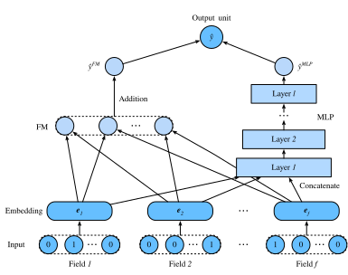

# 深度因子分解机

学习有效的特征组合对于点击率预测任务的成功至关重要。因子分解机以线性的范式（例如双线性交互）对特征交互建模。对于真实世界的数据来说，这往往是不够的，因为其中固有的特征交叉结构通常非常复杂且非线性。更糟糕的是，在实践中，因子分解机一般只使用二阶特征交互。用因子分解机对更高阶的特征组合建模在理论上是可能的，但通常会因数值不稳定和计算复杂度过高而不被采用。

一种有效的解决方案是使用深度神经网络。深度神经网络在特征表示学习方面十分强大，并且有潜力学习复杂的特征交互。因此，将深度神经网络与因子分解机结合起来是很自然的。为因子分解机增加非线性变换层，使其能够同时对低阶特征组合和高阶特征组合建模。此外，深度神经网络还可以捕捉输入中固有的非线性结构。本节将介绍一个代表性模型，名为深度因子分解机（deep factorization machine，DeepFM）:cite:`Guo.Tang.Ye.ea.2017`，它将 FM 和深度神经网络结合起来。


## 模型架构

DeepFM 由一个 FM 组件和一个深度组件组成，二者以并行的结构集成在一起。FM 组件与二阶因子分解机相同，用于对低阶特征交互建模。深度组件是一个 MLP，用于捕捉高阶特征交互和非线性。这两个组件共享相同的输入/嵌入，它们的输出相加作为最终预测。值得指出的是，DeepFM 的精神与 Wide \& Deep 架构相似，后者可以同时捕捉记忆能力和泛化能力。与 Wide \& Deep 模型相比，DeepFM 的优势在于它能够自动识别特征组合，从而减少手工特征工程的工作量。

为简洁起见，我们省略对 FM 组件的描述，并将其输出记为 $\hat{y}^{(FM)}$。读者可参阅上一节了解详情。设 $\mathbf{e}_i \in \mathbb{R}^{k}$ 表示第 $i^\textrm{th}$ 个字段的潜在特征向量。深度组件的输入是对稀疏类别特征输入进行查找得到的所有字段的稠密嵌入的连结，记为：

$$
\mathbf{z}^{(0)}  = [\mathbf{e}_1, \mathbf{e}_2, ..., \mathbf{e}_f],
$$

其中 $f$ 是字段数。然后它被送入下面的神经网络：

$$
\mathbf{z}^{(l)}  = \alpha(\mathbf{W}^{(l)}\mathbf{z}^{(l-1)} + \mathbf{b}^{(l)}),
$$

其中 $\alpha$ 是激活函数。$\mathbf{W}_{l}$ 和 $\mathbf{b}_{l}$ 是第 $l^\textrm{th}$ 层的权重和偏置。设 $y_{DNN}$ 表示预测的输出。DeepFM 的最终预测是 FM 和 DNN 两部分输出之和。因此有：

$$
\hat{y} = \sigma(\hat{y}^{(FM)} + \hat{y}^{(DNN)}),
$$

其中 $\sigma$ 是 sigmoid 函数。DeepFM 的架构如下图所示。


值得注意的是，DeepFM 并不是将深度神经网络与 FM 结合的唯一方式。我们也可以在特征交互之上添加非线性层 :cite:`He.Chua.2017`。

```{.python .input  n=2}
#@tab mxnet
from d2l import mxnet as d2l
from mxnet import init, gluon, np, npx
from mxnet.gluon import nn
import os

npx.set_np()
```

## DeepFM 的实现
DeepFM 的实现与 FM 类似。我们保持 FM 部分不变，并使用一个以 `relu` 为激活函数的 MLP 块。此外还使用暂退法对模型进行正则化。MLP 的神经元数量可以通过超参数 `mlp_dims` 调整。

```{.python .input  n=2}
#@tab mxnet
class DeepFM(nn.Block):
    def __init__(self, field_dims, num_factors, mlp_dims, drop_rate=0.1):
        super(DeepFM, self).__init__()
        num_inputs = int(sum(field_dims))
        self.embedding = nn.Embedding(num_inputs, num_factors)
        self.fc = nn.Embedding(num_inputs, 1)
        self.linear_layer = nn.Dense(1, use_bias=True)
        input_dim = self.embed_output_dim = len(field_dims) * num_factors
        self.mlp = nn.Sequential()
        for dim in mlp_dims:
            self.mlp.add(nn.Dense(dim, 'relu', True, in_units=input_dim))
            self.mlp.add(nn.Dropout(rate=drop_rate))
            input_dim = dim
        self.mlp.add(nn.Dense(in_units=input_dim, units=1))

    def forward(self, x):
        embed_x = self.embedding(x)
        square_of_sum = np.sum(embed_x, axis=1) ** 2
        sum_of_square = np.sum(embed_x ** 2, axis=1)
        inputs = np.reshape(embed_x, (-1, self.embed_output_dim))
        x = self.linear_layer(self.fc(x).sum(1)) \
            + 0.5 * (square_of_sum - sum_of_square).sum(1, keepdims=True) \
            + self.mlp(inputs)
        x = npx.sigmoid(x)
        return x
```

## 训练与评估模型
数据加载过程与 FM 相同。我们将 DeepFM 的 MLP 组件设置为具有金字塔结构（30-20-10）的三层稠密网络。其他所有超参数均与 FM 相同。

```{.python .input  n=4}
#@tab mxnet
batch_size = 2048
data_dir = d2l.download_extract('ctr')
train_data = d2l.CTRDataset(os.path.join(data_dir, 'train.csv'))
test_data = d2l.CTRDataset(os.path.join(data_dir, 'test.csv'),
                           feat_mapper=train_data.feat_mapper,
                           defaults=train_data.defaults)
field_dims = train_data.field_dims
train_iter = gluon.data.DataLoader(
    train_data, shuffle=True, last_batch='rollover', batch_size=batch_size,
    num_workers=d2l.get_dataloader_workers())
test_iter = gluon.data.DataLoader(
    test_data, shuffle=False, last_batch='rollover', batch_size=batch_size,
    num_workers=d2l.get_dataloader_workers())
devices = d2l.try_all_gpus()
net = DeepFM(field_dims, num_factors=10, mlp_dims=[30, 20, 10])
net.initialize(init.Xavier(), ctx=devices)
lr, num_epochs, optimizer = 0.01, 30, 'adam'
trainer = gluon.Trainer(net.collect_params(), optimizer,
                        {'learning_rate': lr})
loss = gluon.loss.SigmoidBinaryCrossEntropyLoss()
d2l.train_ch13(net, train_iter, test_iter, loss, trainer, num_epochs, devices)
```

与 FM 相比，DeepFM 收敛更快，性能也更好。

## 小结

* 将神经网络与 FM 结合，使其能够对复杂的高阶交互建模。
* 在广告数据集上，DeepFM 优于原始的 FM。

## 练习

* 改变 MLP 的结构，考察其对模型性能的影响。
* 将数据集换成 Criteo，并与原始的 FM 模型进行比较。

:begin_tab:`mxnet`
[讨论](https://discuss.d2l.ai/t/407)
:end_tab:
