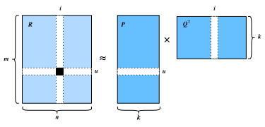

# 矩阵分解

矩阵分解 :cite:`Koren.Bell.Volinsky.2009` 是推荐系统文献中一种成熟的算法。矩阵分解模型的第一个版本由 Simon Funk 在一篇著名的[博客
文章](https://sifter.org/%7Esimon/journal/20061211.html)中提出，他在文中描述了分解交互矩阵的思想。随后，由于 2006 年举办的 Netflix 竞赛，它变得广为人知。当时，流媒体和视频租赁公司 Netflix 宣布举办一场竞赛，以提高其推荐系统的性能。能够比 Netflix 基线（即 Cinematch）提升 10% 的最佳团队将赢得一百万美元的奖金。因此，这场竞赛吸引了
推荐系统研究领域的许多关注。随后，特等奖由 BellKor's Pragmatic Chaos 团队获得，该团队由 BellKor、Pragmatic Theory 和 BigChaos 组成（你现在不必担心这些算法）。虽然最终得分是集成方案（即许多算法的组合）的结果，但矩阵分解算法在最终的融合中发挥了关键作用。Netflix 特等奖方案的技术报告 :cite:`Toscher.Jahrer.Bell.2009` 详细介绍了所采用的模型。在本节中，我们将深入探讨矩阵分解模型的细节及其实现。


## 矩阵分解模型

矩阵分解是一类协同过滤模型。具体而言，该模型把用户-物品交互矩阵（例如评分矩阵）分解为两个低秩矩阵的乘积，从而捕获用户-物品交互的低秩结构。

令 $\mathbf{R} \in \mathbb{R}^{m \times n}$ 表示包含 $m$ 个用户和 $n$ 个物品的交互矩阵，$\mathbf{R}$ 的值表示显式评分。用户-物品交互将被分解为用户潜在矩阵 $\mathbf{P} \in \mathbb{R}^{m \times k}$ 和物品潜在矩阵 $\mathbf{Q} \in \mathbb{R}^{n \times k}$，其中 $k \ll m, n$ 是潜在因子的大小。令 $\mathbf{p}_u$ 表示 $\mathbf{P}$ 的第 $u^\textrm{th}$ 行，$\mathbf{q}_i$ 表示 $\mathbf{Q}$ 的第 $i^\textrm{th}$ 行。对于给定的物品 $i$，$\mathbf{q}_i$ 的元素衡量该物品具有电影类型和语言等特征的程度。对于给定的用户 $u$，$\mathbf{p}_u$ 的元素衡量用户对物品相应特征感兴趣的程度。这些潜在因子可能衡量上述例子中提到的明显维度，也可能是完全无法解释的。预测评分可以估计为

$$\hat{\mathbf{R}} = \mathbf{PQ}^\top$$

其中 $\hat{\mathbf{R}}\in \mathbb{R}^{m \times n}$ 是与 $\mathbf{R}$ 形状相同的预测评分矩阵。这一预测规则的一个主要问题是无法对用户/物品偏置建模。例如，有些用户倾向于给出更高的评分，而有些物品由于质量较差总是得到较低的评分。这些偏置在现实应用中很常见。为了捕获这些偏置，引入了用户特定的和物品特定的偏置项。具体而言，用户 $u$ 给物品 $i$ 的预测评分计算为

$$
\hat{\mathbf{R}}_{ui} = \mathbf{p}_u\mathbf{q}^\top_i + b_u + b_i
$$

然后，我们通过最小化预测评分与真实评分之间的均方误差来训练矩阵分解模型。目标函数定义如下：

$$
\underset{\mathbf{P}, \mathbf{Q}, b}{\mathrm{argmin}} \sum_{(u, i) \in \mathcal{K}} \| \mathbf{R}_{ui} -
\hat{\mathbf{R}}_{ui} \|^2 + \lambda (\| \mathbf{P} \|^2_F + \| \mathbf{Q}
\|^2_F + b_u^2 + b_i^2 )
$$

其中 $\lambda$ 表示正则化率。正则化项 $\lambda (\| \mathbf{P} \|^2_F + \| \mathbf{Q}
\|^2_F + b_u^2 + b_i^2 )$ 用于避免过拟合，具体做法是惩罚参数的大小。对于 $\mathbf{R}_{ui}$ 已知的所有 $(u, i)$ 对，它们存储在集合
$\mathcal{K}=\{(u, i) \mid \mathbf{R}_{ui} \textrm{ is known}\}$ 中。模型参数可以用优化算法学习，例如随机梯度下降和 Adam。

矩阵分解模型的直观图示如下：



在本节的其余部分，我们将解释矩阵分解的实现，并在 MovieLens 数据集上训练该模型。

```{.python .input  n=2}
#@tab mxnet
from d2l import mxnet as d2l
from mxnet import autograd, gluon, np, npx
from mxnet.gluon import nn
import mxnet as mx
npx.set_np()
```

## 模型实现

首先，我们实现上面描述的矩阵分解模型。用户和物品的潜在因子可以用 `nn.Embedding` 创建。`input_dim` 是物品/用户的数量，`output_dim` 是潜在因子的维度 $k$。我们还可以通过把 `output_dim` 设为 1，使用 `nn.Embedding` 创建用户/物品偏置。在 `forward` 函数中，使用用户和物品 id 来查找嵌入。

```{.python .input  n=4}
#@tab mxnet
class MF(nn.Block):
    def __init__(self, num_factors, num_users, num_items, **kwargs):
        super(MF, self).__init__(**kwargs)
        self.P = nn.Embedding(input_dim=num_users, output_dim=num_factors)
        self.Q = nn.Embedding(input_dim=num_items, output_dim=num_factors)
        self.user_bias = nn.Embedding(num_users, 1)
        self.item_bias = nn.Embedding(num_items, 1)

    def forward(self, user_id, item_id):
        P_u = self.P(user_id)
        Q_i = self.Q(item_id)
        b_u = self.user_bias(user_id)
        b_i = self.item_bias(item_id)
        outputs = (P_u * Q_i).sum(axis=1) + np.squeeze(b_u) + np.squeeze(b_i)
        return outputs.flatten()
```

## 评估指标

然后我们实现 RMSE（均方根误差）指标，它常用于衡量模型预测的评分与实际观测评分（真实值）之间的差异 :cite:`Gunawardana.Shani.2015`。RMSE 定义为：

$$
\textrm{RMSE} = \sqrt{\frac{1}{|\mathcal{T}|}\sum_{(u, i) \in \mathcal{T}}(\mathbf{R}_{ui} -\hat{\mathbf{R}}_{ui})^2}
$$

其中 $\mathcal{T}$ 是你想要在其上评估的用户和物品对组成的集合。$|\mathcal{T}|$ 是该集合的大小。我们可以使用 `mx.metric` 提供的 RMSE 函数。

```{.python .input  n=3}
#@tab mxnet
def evaluator(net, test_iter, devices):
    rmse = mx.metric.RMSE()  # Get the RMSE
    rmse_list = []
    for idx, (users, items, ratings) in enumerate(test_iter):
        u = gluon.utils.split_and_load(users, devices, even_split=False)
        i = gluon.utils.split_and_load(items, devices, even_split=False)
        r_ui = gluon.utils.split_and_load(ratings, devices, even_split=False)
        r_hat = [net(u, i) for u, i in zip(u, i)]
        rmse.update(labels=r_ui, preds=r_hat)
        rmse_list.append(rmse.get()[1])
    return float(np.mean(np.array(rmse_list)))
```

## 训练和评估模型


在训练函数中，我们采用带权重衰减的 $\ell_2$ 损失。权重衰减机制与 $\ell_2$ 正则化具有相同的效果。

```{.python .input  n=4}
#@tab mxnet
#@save
def train_recsys_rating(net, train_iter, test_iter, loss, trainer, num_epochs,
                        devices=d2l.try_all_gpus(), evaluator=None,
                        **kwargs):
    timer = d2l.Timer()
    animator = d2l.Animator(xlabel='epoch', xlim=[1, num_epochs], ylim=[0, 2],
                            legend=['train loss', 'test RMSE'])
    for epoch in range(num_epochs):
        metric, l = d2l.Accumulator(3), 0.
        for i, values in enumerate(train_iter):
            timer.start()
            input_data = []
            values = values if isinstance(values, list) else [values]
            for v in values:
                input_data.append(gluon.utils.split_and_load(v, devices))
            train_feat = input_data[:-1] if len(values) > 1 else input_data
            train_label = input_data[-1]
            with autograd.record():
                preds = [net(*t) for t in zip(*train_feat)]
                ls = [loss(p, s) for p, s in zip(preds, train_label)]
            [l.backward() for l in ls]
            l += sum([l.asnumpy() for l in ls]).mean() / len(devices)
            trainer.step(values[0].shape[0])
            metric.add(l, values[0].shape[0], values[0].size)
            timer.stop()
        if len(kwargs) > 0:  # It will be used in section AutoRec
            test_rmse = evaluator(net, test_iter, kwargs['inter_mat'],
                                  devices)
        else:
            test_rmse = evaluator(net, test_iter, devices)
        train_l = l / (i + 1)
        animator.add(epoch + 1, (train_l, test_rmse))
    print(f'train loss {metric[0] / metric[1]:.3f}, '
          f'test RMSE {test_rmse:.3f}')
    print(f'{metric[2] * num_epochs / timer.sum():.1f} examples/sec '
          f'on {str(devices)}')
```

最后，让我们把所有东西放在一起并训练模型。这里，我们把潜在因子维度设为 30。

```{.python .input  n=5}
#@tab mxnet
devices = d2l.try_all_gpus()
num_users, num_items, train_iter, test_iter = d2l.split_and_load_ml100k(
    test_ratio=0.1, batch_size=512)
net = MF(30, num_users, num_items)
net.initialize(ctx=devices, force_reinit=True, init=mx.init.Normal(0.01))
lr, num_epochs, wd, optimizer = 0.002, 20, 1e-5, 'adam'
loss = gluon.loss.L2Loss()
trainer = gluon.Trainer(net.collect_params(), optimizer,
                        {"learning_rate": lr, 'wd': wd})
train_recsys_rating(net, train_iter, test_iter, loss, trainer, num_epochs,
                    devices, evaluator)
```

下面，我们使用训练好的模型来预测用户（ID 20）可能给物品（ID 30）的评分。

```{.python .input  n=6}
#@tab mxnet
scores = net(np.array([20], dtype='int', ctx=devices[0]),
             np.array([30], dtype='int', ctx=devices[0]))
scores
```

## 小结

* 矩阵分解模型广泛用于推荐系统。它可用于预测用户可能给某个物品的评分。
* 我们可以为推荐系统实现并训练矩阵分解。


## 练习

* 改变潜在因子的大小。潜在因子的大小如何影响模型性能？
* 尝试不同的优化器、学习率和权重衰减率。
* 查看其他用户对某部特定电影的预测评分。


:begin_tab:`mxnet`
[讨论](https://discuss.d2l.ai/t/400)
:end_tab:
