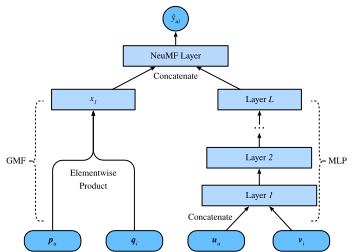

# 面向个性化排序的神经协同过滤

本节从显式反馈转向隐式反馈，介绍基于隐式反馈进行推荐的神经协同过滤（neural collaborative filtering，NCF）框架。隐式反馈在推荐系统中无处不在。点击、购买和观看等行为都是常见的隐式反馈，它们易于收集，并且能够反映用户的偏好。下面要介绍的模型名为 NeuMF :cite:`He.Liao.Zhang.ea.2017`，它是神经矩阵分解（neural matrix factorization）的缩写，旨在解决隐式反馈下的个性化排序任务。该模型利用神经网络的灵活性和非线性来取代矩阵分解中的点积，以增强模型的表达能力。具体而言，该模型由广义矩阵分解（generalized matrix factorization，GMF）和多层感知机（MLP）两个子网络构成，通过两条路径而非简单的点积来建模交互关系。这两个网络的输出会被连结起来，用于计算最终的预测得分。与 AutoRec 中的评分预测任务不同，该模型根据隐式反馈为每个用户生成一个排序后的推荐列表。我们将使用上一节介绍的个性化排序损失来训练该模型。

## NeuMF 模型

如前所述，NeuMF 融合了两个子网络。GMF 是矩阵分解的一种通用神经网络版本，其输入是用户和物品潜在因子的按元素乘积。它由两个神经层组成：

$$
\mathbf{x} = \mathbf{p}_u \odot \mathbf{q}_i \\
\hat{y}_{ui} = \alpha(\mathbf{h}^\top \mathbf{x}),
$$

其中 $\odot$ 表示向量的 Hadamard 乘积。$\mathbf{P} \in \mathbb{R}^{m \times k}$ 和 $\mathbf{Q} \in \mathbb{R}^{n \times k}$ 分别对应用户和物品的潜在矩阵。$\mathbf{p}_u \in \mathbb{R}^{ k}$ 是 $P$ 的第 $u^\textrm{th}$ 行，$\mathbf{q}_i \in \mathbb{R}^{ k}$ 是 $Q$ 的第 $i^\textrm{th}$ 行。$\alpha$ 和 $h$ 分别表示输出层的激活函数和权重。$\hat{y}_{ui}$ 是用户 $u$ 可能给物品 $i$ 的预测得分。

该模型的另一个组件是 MLP。为了增强模型的灵活性，MLP 子网络不与 GMF 共享用户和物品的嵌入。它以用户嵌入和物品嵌入的连结作为输入。凭借复杂的连接和非线性变换，它能够估计用户与物品之间错综复杂的交互关系。更准确地说，MLP 子网络定义如下：

$$
\begin{aligned}
z^{(1)} &= \phi_1(\mathbf{U}_u, \mathbf{V}_i) = \left[ \mathbf{U}_u, \mathbf{V}_i \right] \\
\phi^{(2)}(z^{(1)})  &= \alpha^1(\mathbf{W}^{(2)} z^{(1)} + b^{(2)}) \\
&... \\
\phi^{(L)}(z^{(L-1)}) &= \alpha^L(\mathbf{W}^{(L)} z^{(L-1)} + b^{(L)})) \\
\hat{y}_{ui} &= \alpha(\mathbf{h}^\top\phi^L(z^{(L-1)}))
\end{aligned}
$$

其中 $\mathbf{W}^*, \mathbf{b}^*$ 和 $\alpha^*$ 分别表示权重矩阵、偏置向量和激活函数。$\phi^*$ 表示相应层的函数。$\mathbf{z}^*$ 表示相应层的输出。

为了融合 GMF 和 MLP 的结果，NeuMF 并不采用简单的相加，而是将两个子网络的倒数第二层连结起来，生成一个可以传给后续层的特征向量。随后，输出经矩阵 $\mathbf{h}$ 和 sigmoid 激活函数进行投影。预测层的形式化定义如下：
$$
\hat{y}_{ui} = \sigma(\mathbf{h}^\top[\mathbf{x}, \phi^L(z^{(L-1)})]).
$$

下图展示了 NeuMF 的模型架构。



```{.python .input  n=1}
#@tab mxnet
from d2l import mxnet as d2l
from mxnet import autograd, gluon, np, npx
from mxnet.gluon import nn
import mxnet as mx
import random

npx.set_np()
```

## 模型实现
下面的代码实现了 NeuMF 模型。它由一个广义矩阵分解模型和一个使用不同用户、物品嵌入向量的 MLP 组成。MLP 的结构由参数 `nums_hiddens` 控制。默认使用 ReLU 作为激活函数。

```{.python .input  n=2}
#@tab mxnet
class NeuMF(nn.Block):
    def __init__(self, num_factors, num_users, num_items, nums_hiddens,
                 **kwargs):
        super(NeuMF, self).__init__(**kwargs)
        self.P = nn.Embedding(num_users, num_factors)
        self.Q = nn.Embedding(num_items, num_factors)
        self.U = nn.Embedding(num_users, num_factors)
        self.V = nn.Embedding(num_items, num_factors)
        self.mlp = nn.Sequential()
        for num_hiddens in nums_hiddens:
            self.mlp.add(nn.Dense(num_hiddens, activation='relu',
                                  use_bias=True))
        self.prediction_layer = nn.Dense(1, activation='sigmoid', use_bias=False)

    def forward(self, user_id, item_id):
        p_mf = self.P(user_id)
        q_mf = self.Q(item_id)
        gmf = p_mf * q_mf
        p_mlp = self.U(user_id)
        q_mlp = self.V(item_id)
        mlp = self.mlp(np.concatenate([p_mlp, q_mlp], axis=1))
        con_res = np.concatenate([gmf, mlp], axis=1)
        return self.prediction_layer(con_res)
```

## 带负采样的自定义数据集

对于成对排序损失而言，负采样是一个重要步骤。对每个用户来说，该用户尚未交互过的物品就是候选物品（未观测条目）。下面的函数以用户标识和候选物品为输入，从每个用户的候选集合中为该用户随机采样负样本物品。在训练阶段，模型确保用户喜欢的物品排在用户不喜欢或尚未交互过的物品之前。

```{.python .input  n=3}
#@tab mxnet
class PRDataset(gluon.data.Dataset):
    def __init__(self, users, items, candidates, num_items):
        self.users = users
        self.items = items
        self.cand = candidates
        self.all = set([i for i in range(num_items)])

    def __len__(self):
        return len(self.users)

    def __getitem__(self, idx):
        neg_items = list(self.all - set(self.cand[int(self.users[idx])]))
        indices = random.randint(0, len(neg_items) - 1)
        return self.users[idx], self.items[idx], neg_items[indices]
```

## 评估器
本节采用按时间划分的策略来构造训练集和测试集。我们使用两种评价指标来评估模型的有效性：给定截断位置 $\ell$ 的命中率（$\textrm{Hit}@\ell$）和 ROC 曲线下面积（area under the ROC curve，AUC）。每个用户在给定位置 $\ell$ 处的命中率，表示推荐物品是否包含在排名前 $\ell$ 的列表中。其形式化定义如下：

$$
\textrm{Hit}@\ell = \frac{1}{m} \sum_{u \in \mathcal{U}} \textbf{1}(rank_{u, g_u} <= \ell),
$$

其中 $\textbf{1}$ 表示指示函数：若真实物品排在前 $\ell$ 的列表中，则取值为 1，否则取值为 0。$rank_{u, g_u}$ 表示用户 $u$ 的真实物品 $g_u$ 在推荐列表中的排名（理想排名为 1）。$m$ 是用户数。$\mathcal{U}$ 是用户集合。

AUC 的定义如下：

$$
\textrm{AUC} = \frac{1}{m} \sum_{u \in \mathcal{U}} \frac{1}{|\mathcal{I} \backslash S_u|} \sum_{j \in I \backslash S_u} \textbf{1}(rank_{u, g_u} < rank_{u, j}),
$$

其中 $\mathcal{I}$ 是物品集合。$S_u$ 是用户 $u$ 的候选物品。请注意，也可以使用查准率、查全率和归一化折损累积增益（normalized discounted cumulative gain，NDCG）等许多其他评价方案。

下面的函数为每个用户计算命中次数和 AUC。

```{.python .input  n=4}
#@tab mxnet
#@save
def hit_and_auc(rankedlist, test_matrix, k):
    hits_k = [(idx, val) for idx, val in enumerate(rankedlist[:k])
              if val in set(test_matrix)]
    hits_all = [(idx, val) for idx, val in enumerate(rankedlist)
                if val in set(test_matrix)]
    max = len(rankedlist) - 1
    auc = 1.0 * (max - hits_all[0][0]) / max if len(hits_all) > 0 else 0
    return len(hits_k), auc
```

然后，按下式计算总体的命中率和 AUC。

```{.python .input  n=5}
#@tab mxnet
#@save
def evaluate_ranking(net, test_input, seq, candidates, num_users, num_items,
                     devices):
    ranked_list, ranked_items, hit_rate, auc = {}, {}, [], []
    all_items = set([i for i in range(num_users)])
    for u in range(num_users):
        neg_items = list(all_items - set(candidates[int(u)]))
        user_ids, item_ids, x, scores = [], [], [], []
        [item_ids.append(i) for i in neg_items]
        [user_ids.append(u) for _ in neg_items]
        x.extend([np.array(user_ids)])
        if seq is not None:
            x.append(seq[user_ids, :])
        x.extend([np.array(item_ids)])
        test_data_iter = gluon.data.DataLoader(
            gluon.data.ArrayDataset(*x), shuffle=False, last_batch="keep",
            batch_size=1024)
        for index, values in enumerate(test_data_iter):
            x = [gluon.utils.split_and_load(v, devices, even_split=False)
                 for v in values]
            scores.extend([list(net(*t).asnumpy()) for t in zip(*x)])
        scores = [item for sublist in scores for item in sublist]
        item_scores = list(zip(item_ids, scores))
        ranked_list[u] = sorted(item_scores, key=lambda t: t[1], reverse=True)
        ranked_items[u] = [r[0] for r in ranked_list[u]]
        temp = hit_and_auc(ranked_items[u], test_input[u], 50)
        hit_rate.append(temp[0])
        auc.append(temp[1])
    return np.mean(np.array(hit_rate)), np.mean(np.array(auc))
```

## 训练与评估模型

训练函数定义如下。我们以成对的方式训练该模型。

```{.python .input  n=6}
#@tab mxnet
#@save
def train_ranking(net, train_iter, test_iter, loss, trainer, test_seq_iter,
                  num_users, num_items, num_epochs, devices, evaluator,
                  candidates, eval_step=1):
    timer, hit_rate, auc = d2l.Timer(), 0, 0
    animator = d2l.Animator(xlabel='epoch', xlim=[1, num_epochs], ylim=[0, 1],
                            legend=['test hit rate', 'test AUC'])
    for epoch in range(num_epochs):
        metric, l = d2l.Accumulator(3), 0.
        for i, values in enumerate(train_iter):
            input_data = []
            for v in values:
                input_data.append(gluon.utils.split_and_load(v, devices))
            with autograd.record():
                p_pos = [net(*t) for t in zip(*input_data[:-1])]
                p_neg = [net(*t) for t in zip(*input_data[:-2],
                                              input_data[-1])]
                ls = [loss(p, n) for p, n in zip(p_pos, p_neg)]
            [l.backward(retain_graph=False) for l in ls]
            l += sum([l.asnumpy() for l in ls]).mean()/len(devices)
            trainer.step(values[0].shape[0])
            metric.add(l, values[0].shape[0], values[0].size)
            timer.stop()
        with autograd.predict_mode():
            if (epoch + 1) % eval_step == 0:
                hit_rate, auc = evaluator(net, test_iter, test_seq_iter,
                                          candidates, num_users, num_items,
                                          devices)
                animator.add(epoch + 1, (hit_rate, auc))
    print(f'train loss {metric[0] / metric[1]:.3f}, '
          f'test hit rate {float(hit_rate):.3f}, test AUC {float(auc):.3f}')
    print(f'{metric[2] * num_epochs / timer.sum():.1f} examples/sec '
          f'on {str(devices)}')
```

现在，我们可以加载 MovieLens 100k 数据集并训练该模型。由于 MovieLens 数据集中只有评分，我们以一定的准确率损失为代价，将这些评分二值化为 0 和 1。如果用户对某个物品评过分，我们就认为其隐式反馈为 1，否则为 0。给物品评分这一行为可以看作提供隐式反馈的一种形式。这里，我们以 `seq-aware` 模式划分数据集，即把用户最近交互过的物品留作测试。

```{.python .input  n=11}
#@tab mxnet
batch_size = 1024
df, num_users, num_items = d2l.read_data_ml100k()
train_data, test_data = d2l.split_data_ml100k(df, num_users, num_items,
                                              'seq-aware')
users_train, items_train, ratings_train, candidates = d2l.load_data_ml100k(
    train_data, num_users, num_items, feedback="implicit")
users_test, items_test, ratings_test, test_iter = d2l.load_data_ml100k(
    test_data, num_users, num_items, feedback="implicit")
train_iter = gluon.data.DataLoader(
    PRDataset(users_train, items_train, candidates, num_items ), batch_size,
    True, last_batch="rollover", num_workers=d2l.get_dataloader_workers())
```

接着我们创建并初始化模型。我们使用隐藏层大小恒为 10 的三层 MLP。

```{.python .input  n=8}
#@tab mxnet
devices = d2l.try_all_gpus()
net = NeuMF(10, num_users, num_items, nums_hiddens=[10, 10, 10])
net.initialize(ctx=devices, force_reinit=True, init=mx.init.Normal(0.01))
```

下面的代码训练该模型。

```{.python .input  n=12}
#@tab mxnet
lr, num_epochs, wd, optimizer = 0.01, 10, 1e-5, 'adam'
loss = d2l.BPRLoss()
trainer = gluon.Trainer(net.collect_params(), optimizer,
                        {"learning_rate": lr, 'wd': wd})
train_ranking(net, train_iter, test_iter, loss, trainer, None, num_users,
              num_items, num_epochs, devices, evaluate_ranking, candidates)
```

## 小结

* 在矩阵分解模型中加入非线性，有助于提升模型的能力和效果。
* NeuMF 是矩阵分解与 MLP 的结合。MLP 以用户嵌入和物品嵌入的连结作为输入。

## 练习

* 改变潜在因子的大小。潜在因子的大小如何影响模型性能？
* 改变 MLP 的架构（例如层数、每层的神经元数），考察其对性能的影响。
* 尝试不同的优化器、学习率和权重衰减率。
* 尝试使用上一节定义的合页损失（hinge loss）来优化该模型。

:begin_tab:`mxnet`
[讨论](https://discuss.d2l.ai/t/403)
:end_tab:
