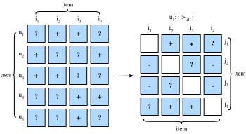

# 推荐系统的个性化排序

在前面的几节中，我们只考虑了显式反馈，并在已观测的评分上训练和测试模型。这类方法有两个缺点：首先，在现实场景中大多数反馈不是显式的，而是隐式的，并且显式反馈的收集成本可能更高。其次，那些可能预示用户兴趣的未观测用户-物品对被完全忽略，这使得这些方法不适合评分并非随机缺失、而是由于用户偏好而缺失的情形。未观测的用户-物品对是真正的负反馈（用户对物品不感兴趣）和缺失值（用户将来可能与该物品交互）的混合。在矩阵分解和 AutoRec 中，我们直接忽略了未观测的对。显然，这些模型无法区分已观测和未观测的对，通常不适合个性化排序任务。

为此，一类旨在根据隐式反馈生成排序推荐列表的推荐模型变得流行起来。一般而言，个性化排序模型可以用逐点、成对或列表式方法进行优化。逐点方法一次考虑单个交互，训练一个分类器或回归器来预测个体偏好。矩阵分解和 AutoRec 就是用逐点目标函数优化的。成对方法为每个用户考虑一对物品，旨在逼近该对物品的最优顺序。通常，成对方法更适合排序任务，因为预测相对顺序与排序的本质相吻合。列表式方法逼近整个物品列表的顺序，例如直接优化归一化折损累积增益（[NDCG](https://en.wikipedia.org/wiki/Discounted_cumulative_gain)）等排序指标。然而，列表式方法比逐点或成对方法更复杂、计算量更大。在本节中，我们将介绍两个成对目标函数/损失，即贝叶斯个性化排序损失和合页损失，以及它们各自的实现。

## 贝叶斯个性化排序损失及其实现

贝叶斯个性化排序（BPR）:cite:`Rendle.Freudenthaler.Gantner.ea.2009` 是一种从最大后验估计量推导出来的成对个性化排序损失。它已被广泛用于许多现有的推荐模型中。BPR 的训练数据由正对和负对（缺失值）组成。它假设用户相对于所有其他未观测物品更偏好正物品。

形式上，训练数据由形如 $(u, i, j)$ 的元组构成，表示用户 $u$ 相对于物品 $j$ 更偏好物品 $i$。旨在最大化后验概率的 BPR 的贝叶斯形式如下所示：

$$
p(\Theta \mid >_u )  \propto  p(>_u \mid \Theta) p(\Theta)
$$

其中 $\Theta$ 表示任意推荐模型的参数，$>_u$ 表示用户 $u$ 对所有物品所期望的个性化总排序。我们可以构造最大后验估计量，以推导出个性化排序任务的通用优化准则。

$$
\begin{aligned}
\textrm{BPR-OPT} : &= \ln p(\Theta \mid >_u) \\
         & \propto \ln p(>_u \mid \Theta) p(\Theta) \\
         &= \ln \prod_{(u, i, j \in D)} \sigma(\hat{y}_{ui} - \hat{y}_{uj}) p(\Theta) \\
         &= \sum_{(u, i, j \in D)} \ln \sigma(\hat{y}_{ui} - \hat{y}_{uj}) + \ln p(\Theta) \\
         &= \sum_{(u, i, j \in D)} \ln \sigma(\hat{y}_{ui} - \hat{y}_{uj}) - \lambda_\Theta \|\Theta \|^2
\end{aligned}
$$


其中 $D \stackrel{\textrm{def}}{=} \{(u, i, j) \mid i \in I^+_u \wedge j \in I \backslash I^+_u \}$ 是训练集，$I^+_u$ 表示用户 $u$ 喜欢的物品，$I$ 表示所有物品，$I \backslash I^+_u$ 表示除用户喜欢的物品之外的所有其他物品。$\hat{y}_{ui}$ 和 $\hat{y}_{uj}$ 分别是用户 $u$ 对物品 $i$ 和 $j$ 的预测得分。先验 $p(\Theta)$ 是均值为零、协方差矩阵为 $\Sigma_\Theta$ 的正态分布。这里，我们令 $\Sigma_\Theta = \lambda_\Theta I$。


我们将实现基类 `mxnet.gluon.loss.Loss` 并重写 `forward` 方法，以构造贝叶斯个性化排序损失。首先，我们导入 Loss 类和 np 模块。

```{.python .input  n=5}
#@tab mxnet
from mxnet import gluon, np, npx
npx.set_np()
```

BPR 损失的实现如下。

```{.python .input  n=2}
#@tab mxnet
#@save
class BPRLoss(gluon.loss.Loss):
    def __init__(self, weight=None, batch_axis=0, **kwargs):
        super(BPRLoss, self).__init__(weight=None, batch_axis=0, **kwargs)

    def forward(self, positive, negative):
        distances = positive - negative
        loss = - np.sum(np.log(npx.sigmoid(distances)), 0, keepdims=True)
        return loss
```

## 合页损失及其实现

用于排序的合页损失与 gluon 库中提供的[合页损失](https://mxnet.incubator.apache.org/api/python/gluon/loss.html#mxnet.gluon.loss.HingeLoss)形式不同，后者常用于 SVM 等分类器。推荐系统中用于排序的损失具有以下形式。

$$
 \sum_{(u, i, j \in D)} \max( m - \hat{y}_{ui} + \hat{y}_{uj}, 0)
$$

其中 $m$ 是安全间隔的大小。它旨在把负物品推离正物品。与 BPR 类似，它旨在优化正样本和负样本之间的相对距离而不是绝对输出，因此非常适合推荐系统。

```{.python .input  n=3}
#@tab mxnet
#@save
class HingeLossbRec(gluon.loss.Loss):
    def __init__(self, weight=None, batch_axis=0, **kwargs):
        super(HingeLossbRec, self).__init__(weight=None, batch_axis=0,
                                            **kwargs)

    def forward(self, positive, negative, margin=1):
        distances = positive - negative
        loss = np.sum(np.maximum(- distances + margin, 0))
        return loss
```

这两种损失在推荐的个性化排序中可以互换使用。

## 小结

- 在推荐系统的个性化排序任务中，可用的排序损失有三类，即逐点、成对和列表式方法。
- 两种成对损失——贝叶斯个性化排序损失和合页损失——可以互换使用。

## 练习

- BPR 和合页损失是否有其他变体？
- 你能找到使用 BPR 或合页损失的推荐模型吗？

:begin_tab:`mxnet`
[讨论](https://discuss.d2l.ai/t/402)
:end_tab:
