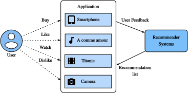

# 推荐系统概述

在过去的十年里，互联网已经发展成为一个大规模在线服务的平台，深刻地改变了我们交流、阅读新闻、购买产品和观看电影的方式。与此同时，网上提供的物品数量之多前所未有（我们用*物品*（item）一词来指代电影、新闻、书籍和产品），这需要一个系统来帮助我们发现自己偏好的物品。因此，推荐系统是强大的信息过滤工具，能够促进个性化服务，并为各个用户提供量身定制的体验。简而言之，推荐系统在利用丰富的数据使选择变得可控方面发挥着关键作用。如今，推荐系统是 Amazon、Netflix 和 YouTube 等众多在线服务提供商的核心。回想一下 :numref:`subsec_recommender_systems` 中 Amazon 推荐深度学习书籍的例子。采用推荐系统的好处有两方面：一方面，它可以大大减少用户寻找物品的工作量，缓解信息过载问题。另一方面，它可以为在线服务提供商增加商业价值，是重要的收入来源。本章将介绍推荐系统领域的基本概念、经典模型以及深度学习的最新进展，并附上实现的例子。

## 协同过滤

我们从推荐系统中的重要概念——协同过滤
（CF）开始这段旅程。该术语最早由 Tapestry 系统 :cite:`Goldberg.Nichols.Oki.ea.1992` 提出，指的是“人们协作帮助彼此执行过滤过程，以处理发布到新闻组的大量电子邮件和消息”。这一术语后来被赋予了更多含义。广义上，它是利用涉及多个用户、智能体和数据源之间协作的技术来过滤信息或模式的过程。协同过滤有多种形式，自其诞生以来已有众多协同过滤方法被提出。

总体而言，协同过滤技术可以分为：基于记忆的协同过滤、基于模型的协同过滤以及二者的混合 :cite:`Su.Khoshgoftaar.2009`。具有代表性的基于记忆的协同过滤技术是基于最近邻的协同过滤，例如基于用户的协同过滤和基于物品的协同过滤 :cite:`Sarwar.Karypis.Konstan.ea.2001`。矩阵分解等潜在因子模型则是基于模型的协同过滤的例子。基于记忆的协同过滤在应对稀疏和大规模数据时存在局限，因为它基于共同物品来计算相似度值。基于模型的方法因在应对稀疏性和可扩展性方面具有更好的能力而越来越流行。许多基于模型的协同过滤方法可以用神经网络来扩展，从而得到更灵活、更具可扩展性的模型，并借助深度学习中的计算加速 :cite:`Zhang.Yao.Sun.ea.2019`。一般而言，协同过滤只使用用户-物品交互数据来做出预测和推荐。除了协同过滤之外，基于内容和基于上下文的推荐系统也有助于纳入物品/用户的内容描述以及时间戳、位置等上下文信号。显然，当可用的输入数据不同时，我们可能需要调整模型的类型/结构。

## 显式反馈和隐式反馈

为了学习用户的偏好，系统应当从用户那里收集反馈。反馈可以是显式的，也可以是隐式的 :cite:`Hu.Koren.Volinsky.2008`。例如，[IMDb](https://www.imdb.com/) 收集电影的一到十星评分。YouTube 提供点赞和点踩按钮供用户表达偏好。显然，收集显式反馈需要用户主动表明自己的兴趣。然而，显式反馈并不总是唾手可得，因为许多用户可能不愿意给产品评分。相对而言，隐式反馈往往唾手可得，因为它主要关心对用户点击等隐式行为进行建模。因此，许多推荐系统以隐式反馈为中心，通过观察用户行为来间接反映用户的意见。隐式反馈有多种形式，包括购买历史、浏览历史、观看记录甚至鼠标移动。例如，购买了同一作者许多本书的用户很可能喜欢该作者。请注意，隐式反馈本质上是含噪的。我们只能*猜测*他们的偏好和真实动机。用户观看了一部电影并不一定表明对该电影持正面看法。

## 推荐任务

过去几十年中，人们研究了许多推荐任务。根据应用领域的不同，有电影推荐、新闻推荐、兴趣点推荐 :cite:`Ye.Yin.Lee.ea.2011` 等等。也可以根据反馈类型和输入数据来区分任务，例如，评分预测任务旨在预测显式评分。Top-$n$ 推荐（物品排序）根据隐式反馈为每个用户分别对所有物品进行排序。如果还包含时间戳信息，我们可以构建序列感知推荐 :cite:`Quadrana.Cremonesi.Jannach.2018`。另一个流行的任务称为点击率预测，它也基于隐式反馈，但可以利用各种类别特征。为新用户推荐以及向现有用户推荐新物品称为冷启动推荐 :cite:`Schein.Popescul.Ungar.ea.2002`。

## 小结

* 推荐系统对个人用户和行业都很重要。协同过滤是推荐中的一个关键概念。
* 反馈有两种类型：隐式反馈和显式反馈。过去十年中，人们探索了许多推荐任务。

## 练习

1. 你能解释推荐系统如何影响你的日常生活吗？
2. 你认为有哪些有趣的推荐任务值得研究？

[讨论](https://discuss.d2l.ai/t/398)
