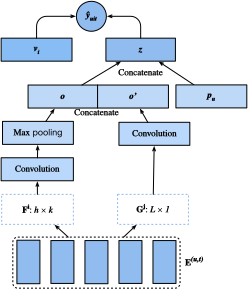
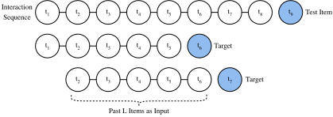

# 序列感知推荐系统

在之前的章节中，我们将推荐任务抽象为矩阵补全问题，而没有考虑用户的短期行为。本节将介绍一种把用户的交互日志按顺序纳入考虑的推荐模型。这是一种序列感知推荐系统（sequence-aware recommender）:cite:`Quadrana.Cremonesi.Jannach.2018`，其输入是按顺序排列、且往往带有时间戳的用户历史动作列表。近期的许多文献已经证明，在建模用户的时间行为模式以及发现其兴趣漂移时，引入这类信息是有用的。

下面要介绍的模型是 Caser :cite:`Tang.Wang.2018`，即卷积序列嵌入推荐模型（convolutional sequence embedding recommendation model）的缩写。该模型采用卷积神经网络来捕捉用户近期活动的动态模式影响。Caser 的主要组件包括一个水平卷积网络和一个垂直卷积网络，分别旨在揭示联合级（union-level）和点级（point-level）的序列模式。点级模式表示历史序列中单个物品对目标物品的影响，而联合级模式则意味着先前的多个动作对后续目标的影响。例如，同时购买牛奶和黄油比只购买其中一样有更高的概率购买面粉。此外，用户的总体兴趣或长期偏好也在最后的全连接层中建模，从而对用户兴趣进行更全面的建模。该模型的细节描述如下。

## 模型架构

在序列感知推荐系统中，每个用户都关联着物品集合中某些物品组成的一个序列。设 $S^u = (S_1^u, ... S_{|S_u|}^u)$ 表示该有序序列。Caser 的目标是在同时考虑用户总体喜好和短期意图的基础上推荐物品。假设我们考虑前面的 $L$ 个物品，则可以构造一个嵌入矩阵来表示时间步 $t$ 之前的交互：

$$
\mathbf{E}^{(u, t)} = [ \mathbf{q}_{S_{t-L}^u} , ..., \mathbf{q}_{S_{t-2}^u}, \mathbf{q}_{S_{t-1}^u} ]^\top,
$$

其中 $\mathbf{Q} \in \mathbb{R}^{n \times k}$ 表示物品嵌入，$\mathbf{q}_i$ 表示其第 $i^\textrm{th}$ 行。$\mathbf{E}^{(u, t)} \in \mathbb{R}^{L \times k}$ 可用于推断用户 $u$ 在时间步 $t$ 的瞬时兴趣。我们可以把输入矩阵 $\mathbf{E}^{(u, t)}$ 视为一张图像，它是后文两个卷积组件的输入。

水平卷积层有 $d$ 个水平滤波器 $\mathbf{F}^j \in \mathbb{R}^{h \times k}, 1 \leq j \leq d, h = \{1, ..., L\}$，垂直卷积层有 $d'$ 个垂直滤波器 $\mathbf{G}^j \in \mathbb{R}^{ L \times 1}, 1 \leq j \leq d'$。经过一系列卷积和汇聚操作后，我们得到两个输出：

$$
\mathbf{o} = \textrm{HConv}(\mathbf{E}^{(u, t)}, \mathbf{F}) \\
\mathbf{o}'= \textrm{VConv}(\mathbf{E}^{(u, t)}, \mathbf{G}) ,
$$

其中 $\mathbf{o} \in \mathbb{R}^d$ 是水平卷积网络的输出，$\mathbf{o}' \in \mathbb{R}^{kd'}$ 是垂直卷积网络的输出。为简单起见，我们省略了卷积和汇聚操作的细节。这两个输出被连结起来，送入一个全连接神经网络层，以获得更高级的表示。

$$
\mathbf{z} = \phi(\mathbf{W}[\mathbf{o}, \mathbf{o}']^\top + \mathbf{b}),
$$

其中 $\mathbf{W} \in \mathbb{R}^{k \times (d + kd')}$ 是权重矩阵，$\mathbf{b} \in \mathbb{R}^k$ 是偏置。学习到的向量 $\mathbf{z} \in \mathbb{R}^k$ 表示用户的短期意图。

最后，预测函数将用户的短期喜好和总体喜好结合起来，其定义如下：

$$
\hat{y}_{uit} = \mathbf{v}_i \cdot [\mathbf{z}, \mathbf{p}_u]^\top + \mathbf{b}'_i,
$$

其中 $\mathbf{V} \in \mathbb{R}^{n \times 2k}$ 是另一个物品嵌入矩阵。$\mathbf{b}' \in \mathbb{R}^n$ 是物品特定的偏置。$\mathbf{P} \in \mathbb{R}^{m \times k}$ 是表示用户总体喜好的用户嵌入矩阵。$\mathbf{p}_u \in \mathbb{R}^{ k}$ 是 $P$ 的第 $u^\textrm{th}$ 行，$\mathbf{v}_i \in \mathbb{R}^{2k}$ 是 $\mathbf{V}$ 的第 $i^\textrm{th}$ 行。

该模型可以使用 BPR 损失或合页损失来学习。Caser 的架构如下图所示：



首先，我们导入所需的库。

```{.python .input  n=3}
#@tab mxnet
from d2l import mxnet as d2l
from mxnet import gluon, np, npx
from mxnet.gluon import nn
import mxnet as mx
import random

npx.set_np()
```

## 模型实现
下面的代码实现了 Caser 模型。它由一个垂直卷积层、一个水平卷积层和一个全连接层组成。

```{.python .input  n=4}
#@tab mxnet
class Caser(nn.Block):
    def __init__(self, num_factors, num_users, num_items, L=5, d=16,
                 d_prime=4, drop_ratio=0.05, **kwargs):
        super(Caser, self).__init__(**kwargs)
        self.P = nn.Embedding(num_users, num_factors)
        self.Q = nn.Embedding(num_items, num_factors)
        self.d_prime, self.d = d_prime, d
        # Vertical convolution layer
        self.conv_v = nn.Conv2D(d_prime, (L, 1), in_channels=1)
        # Horizontal convolution layer
        h = [i + 1 for i in range(L)]
        self.conv_h, self.max_pool = nn.Sequential(), nn.Sequential()
        for i in h:
            self.conv_h.add(nn.Conv2D(d, (i, num_factors), in_channels=1))
            self.max_pool.add(nn.MaxPool1D(L - i + 1))
        # Fully connected layer
        self.fc1_dim_v, self.fc1_dim_h = d_prime * num_factors, d * len(h)
        self.fc = nn.Dense(in_units=d_prime * num_factors + d * L,
                           activation='relu', units=num_factors)
        self.Q_prime = nn.Embedding(num_items, num_factors * 2)
        self.b = nn.Embedding(num_items, 1)
        self.dropout = nn.Dropout(drop_ratio)

    def forward(self, user_id, seq, item_id):
        item_embs = np.expand_dims(self.Q(seq), 1)
        user_emb = self.P(user_id)
        out, out_h, out_v, out_hs = None, None, None, []
        if self.d_prime:
            out_v = self.conv_v(item_embs)
            out_v = out_v.reshape(out_v.shape[0], self.fc1_dim_v)
        if self.d:
            for conv, maxp in zip(self.conv_h, self.max_pool):
                conv_out = np.squeeze(npx.relu(conv(item_embs)), axis=3)
                t = maxp(conv_out)
                pool_out = np.squeeze(t, axis=2)
                out_hs.append(pool_out)
            out_h = np.concatenate(out_hs, axis=1)
        out = np.concatenate([out_v, out_h], axis=1)
        z = self.fc(self.dropout(out))
        x = np.concatenate([z, user_emb], axis=1)
        q_prime_i = np.squeeze(self.Q_prime(item_id))
        b = np.squeeze(self.b(item_id))
        res = (x * q_prime_i).sum(1) + b
        return res
```

## 带负采样的序列数据集
为了处理序列交互数据，我们需要重新实现 `Dataset` 类。下面的代码创建了一个名为 `SeqDataset` 的新数据集类。在每个样本中，它输出用户标识、该用户此前交互过的 $L$ 个物品组成的序列，以及他接下来交互的物品作为目标。下图展示了一个用户的数据加载过程。假设该用户喜欢 9 部电影，我们按时间顺序排列这 9 部电影。最新的电影被留作测试物品。对于其余 8 部电影，我们可以得到三个训练样本，每个样本包含由五部电影（$L=5$）组成的序列及其后续物品作为目标物品。自定义数据集中还包含负样本。



```{.python .input  n=5}
#@tab mxnet
class SeqDataset(gluon.data.Dataset):
    def __init__(self, user_ids, item_ids, L, num_users, num_items,
                 candidates):
        user_ids, item_ids = np.array(user_ids), np.array(item_ids)
        sort_idx = np.array(sorted(range(len(user_ids)),
                                   key=lambda k: user_ids[k]))
        u_ids, i_ids = user_ids[sort_idx], item_ids[sort_idx]
        temp, u_ids, self.cand = {}, u_ids.asnumpy(), candidates
        self.all_items = set([i for i in range(num_items)])
        [temp.setdefault(u_ids[i], []).append(i) for i, _ in enumerate(u_ids)]
        temp = sorted(temp.items(), key=lambda x: x[0])
        u_ids = np.array([i[0] for i in temp])
        idx = np.array([i[1][0] for i in temp])
        self.ns = ns = int(sum([c - L if c >= L + 1 else 1 for c
                                in np.array([len(i[1]) for i in temp])]))
        self.seq_items = np.zeros((ns, L))
        self.seq_users = np.zeros(ns, dtype='int32')
        self.seq_tgt = np.zeros((ns, 1))
        self.test_seq = np.zeros((num_users, L))
        test_users, _uid = np.empty(num_users), None
        for i, (uid, i_seq) in enumerate(self._seq(u_ids, i_ids, idx, L + 1)):
            if uid != _uid:
                self.test_seq[uid][:] = i_seq[-L:]
                test_users[uid], _uid = uid, uid
            self.seq_tgt[i][:] = i_seq[-1:]
            self.seq_items[i][:], self.seq_users[i] = i_seq[:L], uid

    def _win(self, tensor, window_size, step_size=1):
        if len(tensor) - window_size >= 0:
            for i in range(len(tensor), 0, - step_size):
                if i - window_size >= 0:
                    yield tensor[i - window_size:i]
                else:
                    break
        else:
            yield tensor

    def _seq(self, u_ids, i_ids, idx, max_len):
        for i in range(len(idx)):
            stop_idx = None if i >= len(idx) - 1 else int(idx[i + 1])
            for s in self._win(i_ids[int(idx[i]):stop_idx], max_len):
                yield (int(u_ids[i]), s)

    def __len__(self):
        return self.ns

    def __getitem__(self, idx):
        neg = list(self.all_items - set(self.cand[int(self.seq_users[idx])]))
        i = random.randint(0, len(neg) - 1)
        return (self.seq_users[idx], self.seq_items[idx], self.seq_tgt[idx],
                neg[i])
```

## 加载 MovieLens 100K 数据集

随后，我们以序列感知模式读取并划分 MovieLens 100K 数据集，并使用上面实现的序列数据加载器加载训练数据。

```{.python .input  n=6}
#@tab mxnet
TARGET_NUM, L, batch_size = 1, 5, 4096
df, num_users, num_items = d2l.read_data_ml100k()
train_data, test_data = d2l.split_data_ml100k(df, num_users, num_items,
                                              'seq-aware')
users_train, items_train, ratings_train, candidates = d2l.load_data_ml100k(
    train_data, num_users, num_items, feedback="implicit")
users_test, items_test, ratings_test, test_iter = d2l.load_data_ml100k(
    test_data, num_users, num_items, feedback="implicit")
train_seq_data = SeqDataset(users_train, items_train, L, num_users,
                            num_items, candidates)
train_iter = gluon.data.DataLoader(train_seq_data, batch_size, True,
                                   last_batch="rollover",
                                   num_workers=d2l.get_dataloader_workers())
test_seq_iter = train_seq_data.test_seq
train_seq_data[0]
```

训练数据的结构如上所示。第一个元素是用户标识，接下来的列表表示该用户最近喜欢的五个物品，最后一个元素是该用户在五个物品之后喜欢的物品。

## 训练模型
现在，我们来训练模型。我们沿用上一节 NeuMF 的设置（包括学习率、优化器和 $k$），以使结果具有可比性。

```{.python .input  n=7}
#@tab mxnet
devices = d2l.try_all_gpus()
net = Caser(10, num_users, num_items, L)
net.initialize(ctx=devices, force_reinit=True, init=mx.init.Normal(0.01))
lr, num_epochs, wd, optimizer = 0.04, 8, 1e-5, 'adam'
loss = d2l.BPRLoss()
trainer = gluon.Trainer(net.collect_params(), optimizer,
                        {"learning_rate": lr, 'wd': wd})

# Running takes > 1h (pending fix from MXNet)
# d2l.train_ranking(net, train_iter, test_iter, loss, trainer, test_seq_iter, num_users, num_items, num_epochs, devices, d2l.evaluate_ranking, candidates, eval_step=1)
```

## 小结
* 推断用户的短期兴趣和长期兴趣，可以更有效地预测其下一个偏好的物品。
* 可以利用卷积神经网络从序列交互中捕捉用户的短期兴趣。

## 练习

* 通过分别移除水平卷积网络和垂直卷积网络之一来进行消融研究，哪个组件更重要？
* 改变超参数 $L$。更长的历史交互会带来更高的准确率吗？
* 除了上面介绍的序列感知推荐任务之外，还有另一类序列感知推荐任务，称为基于会话的推荐（session-based recommendation）:cite:`Hidasi.Karatzoglou.Baltrunas.ea.2015`。你能解释这两种任务之间的区别吗？


:begin_tab:`mxnet`
[讨论](https://discuss.d2l.ai/t/404)
:end_tab:
