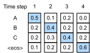
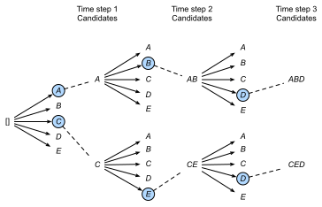

# 束搜索
:label:`sec_beam-search`

在 :numref:`sec_seq2seq` 中，
我们介绍了编码器-解码器架构，
以及端到端训练它们的标准技术。然而，在测试时预测方面，
我们只提到了*贪心*（greedy）策略，
即我们在每个时间步选取
预测为下一个出现的概率最高的词元，
直到在某个时间步，我们发现
已经预测出了特殊的序列结束词元“&lt;eos&gt;”。
本节中，我们将首先
形式化这一*贪心搜索*（greedy search）策略，
并指出从业者往往遇到的一些问题。
随后，我们将把这一策略与
两种替代方案进行比较：
*穷举搜索*（exhaustive search，有说明意义但不实用）
和*束搜索*（beam search，实践中的标准方法）。

我们首先沿用 :numref:`sec_seq2seq` 中的约定，
建立数学记号。
在任意时间步$t'$，解码器输出的
预测表示词表中每个词元
在序列中接下来出现的概率
（即$y_{t'+1}$的可能取值），
条件为之前的词元
$y_1, \ldots, y_{t'}$以及
编码器为表示输入序列而产生的
上下文变量$\mathbf{c}$。
为了量化计算成本，
用$\mathcal{Y}$表示
输出词表
（包括特殊的序列结束词元“&lt;eos&gt;”）。
我们还将输出序列的最大词元数
记为$T'$。
我们的目标是从所有
$\mathcal{O}(\left|\mathcal{Y}\right|^{T'})$
个可能的输出序列中搜索出理想的输出。
请注意，这略微高估了
不同输出的数量，
因为一旦出现“&lt;eos&gt;”词元，
就不会再有后续词元。
不过，就我们的目的而言，
这个数量大致刻画了
搜索空间的大小。

## 贪心搜索

考虑 :numref:`sec_seq2seq` 中简单的*贪心搜索*策略。
在这里，在任意时间步$t'$，
我们只需从$\mathcal{Y}$中
选取条件概率最高的词元，即

$$y_{t'} = \operatorname*{argmax}_{y \in \mathcal{Y}} P(y \mid y_1, \ldots, y_{t'-1}, \mathbf{c}).$$

一旦我们的模型输出“&lt;eos&gt;”
（或者我们达到最大长度$T'$），
输出序列就完成了。

这一策略看起来或许合理，
而且事实上它并不算太差！
考虑到它的计算需求如此之低，
你很难找到性价比更高的方法。
然而，如果我们暂时撇开效率不谈，
搜索*最可能的序列*而非
（贪心选取的）*最可能词元*组成的序列，
似乎更为合理。
事实证明，这两者可能差别很大。
最可能的序列是使表达式
$\prod_{t'=1}^{T'} P(y_{t'} \mid y_1, \ldots, y_{t'-1}, \mathbf{c})$最大化的序列。
在我们的机器翻译例子中，
如果解码器确实还原了
底层生成过程的概率，
那么它就会给出最可能的翻译。
不幸的是，并不能保证
贪心搜索会给出这个序列。

让我们用一个例子来说明。
假设输出词表中有四个词元
“A”“B”“C”和“&lt;eos&gt;”。
在 :numref:`fig_s2s-prob1` 中，
每个时间步下方的四个数字分别表示
在该时间步生成“A”“B”“C”
和“&lt;eos&gt;”的条件概率。

:label:`fig_s2s-prob1`

在每个时间步，贪心搜索都选取
条件概率最高的词元。
因此，将会预测出输出序列“A”“B”“C”和“&lt;eos&gt;”
（:numref:`fig_s2s-prob1`）。
该输出序列的条件概率
为$0.5\times0.4\times0.4\times0.6 = 0.048$。

接下来，让我们看 :numref:`fig_s2s-prob2` 中的另一个例子。
与 :numref:`fig_s2s-prob1` 不同，
在时间步 2，我们选取词元“C”，
它具有*第二*高的条件概率。

:label:`fig_s2s-prob2`

由于时间步 3 所依据的
时间步 1 和 2 的输出子序列，
已从 :numref:`fig_s2s-prob1` 中的“A”和“B”
变为 :numref:`fig_s2s-prob2` 中的“A”和“C”，
所以 :numref:`fig_s2s-prob2` 中时间步 3 的
每个词元条件概率也随之改变。
假设我们在时间步 3 选择词元“B”。
现在时间步 4 以
最初三个时间步的输出子序列
“A”“C”和“B”为条件，
而该子序列已不同于 :numref:`fig_s2s-prob1` 中的“A”“B”和“C”。
因此，:numref:`fig_s2s-prob2` 中时间步 4 生成
每个词元的条件概率
也不同于 :numref:`fig_s2s-prob1` 中的相应概率。
于是，:numref:`fig_s2s-prob2` 中输出序列
“A”“C”“B”和“&lt;eos&gt;”的条件概率
为$0.5\times0.3 \times0.6\times0.6=0.054$，
大于 :numref:`fig_s2s-prob1` 中贪心搜索的条件概率。
在这个例子中，贪心搜索得到的
输出序列“A”“B”“C”和“&lt;eos&gt;”并非最优。

## 穷举搜索

如果目标是得到最可能的序列，
我们可以考虑使用*穷举搜索*（exhaustive search）：
枚举所有可能的输出序列
及其条件概率，
然后输出预测概率
得分最高的那一个。

虽然这确实能给我们想要的结果，
但其计算成本高得令人却步：
$\mathcal{O}(\left|\mathcal{Y}\right|^{T'})$，
它相对于序列长度呈指数增长，
而底数由词表大小给出，极为庞大。
例如，当$|\mathcal{Y}|=10000$且$T'=10$时
（与真实应用中的数值相比，这两个数都很小），
我们需要评估$10000^{10} = 10^{40}$个序列，
这已经超出了任何可预见的计算机的能力。
另一方面，贪心搜索的计算成本是
$\mathcal{O}(\left|\mathcal{Y}\right|T')$：
便宜得不可思议，但远非最优。
例如，当$|\mathcal{Y}|=10000$且$T'=10$时，
我们只需评估$10000\times10=10^5$个序列。

## 束搜索

你可以把序列解码策略看作处于一个谱系上，
其中*束搜索*在贪心搜索的效率
与穷举搜索的最优性之间取得折中。
束搜索最直接的版本
由一个超参数刻画，
即*束宽*（beam size）$k$。
让我们解释一下这一术语。
在时间步 1，我们选取
预测概率最高的$k$个词元。
它们分别将成为
$k$个候选输出序列的第一个词元。
在后续的每个时间步，
基于上一时间步的$k$个候选输出序列，
我们继续挑选$k$个预测概率最高的候选输出序列，
它们取自$k\left|\mathcal{Y}\right|$个可能选择。

:label:`fig_beam-search`

:numref:`fig_beam-search` 用一个例子
演示了束搜索的过程。
假设输出词表
只包含五个元素：
$\mathcal{Y} = \{A, B, C, D, E\}$，
其中一个是“&lt;eos&gt;”。
令束宽为 2，
输出序列的最大长度为 3。
在时间步 1，
假设条件概率
$P(y_1 \mid \mathbf{c})$最高的词元
是$A$和$C$。
在时间步 2，对所有$y_2 \in \mathcal{Y},$
我们计算

$$\begin{aligned}P(A, y_2 \mid \mathbf{c}) = P(A \mid \mathbf{c})P(y_2 \mid A, \mathbf{c}),\\ P(C, y_2 \mid \mathbf{c}) = P(C \mid \mathbf{c})P(y_2 \mid C, \mathbf{c}),\end{aligned}$$

并在这十个值中挑出最大的两个，比如
$P(A, B \mid \mathbf{c})$和$P(C, E \mid \mathbf{c})$。
然后在时间步 3，对所有$y_3 \in \mathcal{Y}$，我们计算

$$\begin{aligned}P(A, B, y_3 \mid \mathbf{c}) = P(A, B \mid \mathbf{c})P(y_3 \mid A, B, \mathbf{c}),\\P(C, E, y_3 \mid \mathbf{c}) = P(C, E \mid \mathbf{c})P(y_3 \mid C, E, \mathbf{c}),\end{aligned}$$

并在这十个值中挑出最大的两个，比如
$P(A, B, D \mid \mathbf{c})$  和  $P(C, E, D \mid  \mathbf{c}).$
于是，我们得到六个候选输出序列：(i) $A$；(ii) $C$；(iii) $A$、$B$；(iv) $C$、$E$；(v) $A$、$B$、$D$；(vi) $C$、$E$、$D$。

最后，我们基于这六个序列（例如，丢弃包含“&lt;eos&gt;”及其之后的部分）
得到最终候选输出序列的集合。
然后我们选择使以下得分最大化的输出序列：

$$ \frac{1}{L^\alpha} \log P(y_1, \ldots, y_{L}\mid \mathbf{c}) = \frac{1}{L^\alpha} \sum_{t'=1}^L \log P(y_{t'} \mid y_1, \ldots, y_{t'-1}, \mathbf{c});$$
:eqlabel:`eq_beam-search-score`

这里$L$是最终候选序列的长度，
$\alpha$通常设为 0.75。
由于较长的序列在 :eqref:`eq_beam-search-score`
的求和中包含更多的对数项，
分母中的$L^\alpha$项
会对长序列加以惩罚。

束搜索的计算成本是$\mathcal{O}(k\left|\mathcal{Y}\right|T')$。
这一结果介于贪心搜索和穷举搜索的计算成本之间。
贪心搜索可以视为束宽设为
1 时束搜索的一个特例。

## 小结

序列搜索策略包括
贪心搜索、穷举搜索和束搜索。
束搜索通过灵活选择束宽，
在准确率与
计算成本之间提供了一种折中。

## 练习

1. 我们能否把穷举搜索看作束搜索的一种特殊类型？为什么能或为什么不能？
1. 在 :numref:`sec_seq2seq` 的机器翻译问题中应用束搜索。束宽如何影响翻译结果和预测速度？
1. 在 :numref:`sec_rnn-scratch` 中，我们使用语言模型根据用户提供的前缀生成文本。它使用的是哪种搜索策略？你能改进它吗？

[讨论](https://discuss.d2l.ai/t/338)
