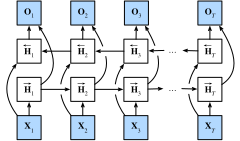

# 双向循环神经网络
:label:`sec_bi_rnn`

到目前为止，我们一直使用的序列学习任务示例是语言建模，
即在给定序列中所有先前词元的条件下预测下一个词元。
在这种情况下，我们只希望以左侧上下文为条件，
因此标准 RNN 的单向链式结构似乎是合适的。
然而，在许多其他序列学习任务中，
每个时间步的预测完全可以同时以左侧和右侧上下文为条件。
例如，考虑词性检测。
在判断给定单词的词性时，
我们为什么不应该把两个方向的上下文都考虑进来呢？

另一项常见的任务——它常常作为预训练练习，
在针对实际感兴趣的任务微调模型之前很有用——是
在文本文档中随机掩盖一些词元，
然后训练一个序列模型来预测缺失词元的值。
请注意，根据空白处之后的内容不同，
缺失词元的可能值会发生巨大变化：

* 我 `___`。
* 我 `___` 饿了。
* 我 `___` 饿了，而且我能吃下半头猪。

在第一句中，“happy”似乎是一个可能的候选。
在第二句中，“not”和“very”这两个词似乎都说得通，
但“not”似乎与第三句不相容。

幸运的是，有一种简单的技术可以把任何单向 RNN
转换为双向 RNN :cite:`Schuster.Paliwal.1997`。
我们只需要实现两个单向 RNN 层，
让它们朝相反方向链接在一起并作用于同一输入（:numref:`fig_birnn`）。
对于第一个 RNN 层，
第一个输入是 $\mathbf{x}_1$，
最后一个输入是 $\mathbf{x}_T$；
而对于第二个 RNN 层，
第一个输入是 $\mathbf{x}_T$，
最后一个输入是 $\mathbf{x}_1$。
要得到这个双向 RNN 层的输出，
我们只需把两个底层单向 RNN 层的对应输出连结在一起。


:label:`fig_birnn`

形式化地说，对于任意时间步 $t$，
我们考虑一个小批量输入 $\mathbf{X}_t \in \mathbb{R}^{n \times d}$
（样例数 $=n$；每个样例的输入数 $=d$），
并设隐藏层激活函数为 $\phi$。
在双向架构中，该时间步的前向和反向隐藏状态
分别为 $\overrightarrow{\mathbf{H}}_t  \in \mathbb{R}^{n \times h}$ 和 $\overleftarrow{\mathbf{H}}_t  \in \mathbb{R}^{n \times h}$，
其中 $h$ 是隐藏单元数。
前向和反向隐藏状态的更新如下：

$$
\begin{aligned}
\overrightarrow{\mathbf{H}}_t &= \phi(\mathbf{X}_t \mathbf{W}_{\textrm{xh}}^{(f)} + \overrightarrow{\mathbf{H}}_{t-1} \mathbf{W}_{\textrm{hh}}^{(f)}  + \mathbf{b}_\textrm{h}^{(f)}),\\
\overleftarrow{\mathbf{H}}_t &= \phi(\mathbf{X}_t \mathbf{W}_{\textrm{xh}}^{(b)} + \overleftarrow{\mathbf{H}}_{t+1} \mathbf{W}_{\textrm{hh}}^{(b)}  + \mathbf{b}_\textrm{h}^{(b)}),
\end{aligned}
$$

其中权重 $\mathbf{W}_{\textrm{xh}}^{(f)} \in \mathbb{R}^{d \times h}, \mathbf{W}_{\textrm{hh}}^{(f)} \in \mathbb{R}^{h \times h}, \mathbf{W}_{\textrm{xh}}^{(b)} \in \mathbb{R}^{d \times h}, \textrm{ and } \mathbf{W}_{\textrm{hh}}^{(b)} \in \mathbb{R}^{h \times h}$，
以及偏置 $\mathbf{b}_\textrm{h}^{(f)} \in \mathbb{R}^{1 \times h}$ 和 $\mathbf{b}_\textrm{h}^{(b)} \in \mathbb{R}^{1 \times h}$ 都是模型参数。

接下来，我们把前向和反向隐藏状态
$\overrightarrow{\mathbf{H}}_t$ 和 $\overleftarrow{\mathbf{H}}_t$ 连结起来，
得到隐藏状态 $\mathbf{H}_t \in \mathbb{R}^{n \times 2h}$，用于输入到输出层。
在具有多个隐藏层的深度双向 RNN 中，
这种信息会作为*输入*传递给下一个双向层。
最后，输出层计算输出
$\mathbf{O}_t \in \mathbb{R}^{n \times q}$（输出数 $=q$）：

$$\mathbf{O}_t = \mathbf{H}_t \mathbf{W}_{\textrm{hq}} + \mathbf{b}_\textrm{q}.$$

这里，权重矩阵 $\mathbf{W}_{\textrm{hq}} \in \mathbb{R}^{2h \times q}$ 和偏置 $\mathbf{b}_\textrm{q} \in \mathbb{R}^{1 \times q}$ 是输出层的模型参数。
尽管从技术上来说，两个方向可以有不同数量的隐藏单元，
但在实践中很少这样设计。
现在我们来演示双向 RNN 的一个简单实现。

```{.python .input}
%load_ext d2lbook.tab
tab.interact_select('mxnet', 'pytorch', 'tensorflow', 'jax')
```

```{.python .input}
%%tab mxnet
from d2l import mxnet as d2l
from mxnet import npx, np
from mxnet.gluon import rnn
npx.set_np()
```

```{.python .input}
%%tab pytorch
from d2l import torch as d2l
import torch
from torch import nn
```

```{.python .input}
%%tab tensorflow
from d2l import tensorflow as d2l
import tensorflow as tf
```

```{.python .input}
%%tab jax
from d2l import jax as d2l
from jax import numpy as jnp
```

## 从零开始实现

如果我们想从零实现一个双向 RNN，
可以包含两个各自拥有可学习参数的单向 `RNNScratch` 实例。

```{.python .input}
%%tab pytorch, mxnet, tensorflow
class BiRNNScratch(d2l.Module):
    def __init__(self, num_inputs, num_hiddens, sigma=0.01):
        super().__init__()
        self.save_hyperparameters()
        self.f_rnn = d2l.RNNScratch(num_inputs, num_hiddens, sigma)
        self.b_rnn = d2l.RNNScratch(num_inputs, num_hiddens, sigma)
        self.num_hiddens *= 2  # The output dimension will be doubled
```

```{.python .input}
%%tab jax
class BiRNNScratch(d2l.Module):
    num_inputs: int
    num_hiddens: int
    sigma: float = 0.01

    def setup(self):
        self.f_rnn = d2l.RNNScratch(num_inputs, num_hiddens, sigma)
        self.b_rnn = d2l.RNNScratch(num_inputs, num_hiddens, sigma)
        self.num_hiddens *= 2  # The output dimension will be doubled
```

前向 RNN 和反向 RNN 的状态分别更新，
而这两个 RNN 的输出则连结在一起。

```{.python .input}
%%tab all
@d2l.add_to_class(BiRNNScratch)
def forward(self, inputs, Hs=None):
    f_H, b_H = Hs if Hs is not None else (None, None)
    f_outputs, f_H = self.f_rnn(inputs, f_H)
    b_outputs, b_H = self.b_rnn(reversed(inputs), b_H)
    outputs = [d2l.concat((f, b), -1) for f, b in zip(
        f_outputs, reversed(b_outputs))]
    return outputs, (f_H, b_H)
```

## 简洁实现

:begin_tab:`pytorch, mxnet, tensorflow`
使用高级 API，我们可以更简洁地实现双向 RNN。
这里我们以 GRU 模型为例。
:end_tab:

:begin_tab:`jax`
Flax API 不提供 RNN 层，因此没有 `bidirectional` 参数的概念。
如果需要双向层，就需要像从零实现中那样手动反转输入。
:end_tab:

```{.python .input}
%%tab mxnet, pytorch
class BiGRU(d2l.RNN):
    def __init__(self, num_inputs, num_hiddens):
        d2l.Module.__init__(self)
        self.save_hyperparameters()
        if tab.selected('mxnet'):
            self.rnn = rnn.GRU(num_hiddens, bidirectional=True)
        if tab.selected('pytorch'):
            self.rnn = nn.GRU(num_inputs, num_hiddens, bidirectional=True)
        self.num_hiddens *= 2
```

## 小结

在双向 RNN 中，每个时间步的隐藏状态同时由当前时间步之前和之后的数据决定。
双向 RNN 主要用于序列编码以及在双向上下文下估计观测值。
由于梯度链很长，双向 RNN 的训练代价非常高。

## 练习

1. 如果不同方向使用不同数量的隐藏单元，$\mathbf{H}_t$ 的形状会如何变化？
1. 设计一个具有多个隐藏层的双向 RNN。
1. 多义词在自然语言中很常见。例如，“bank”这个词在“i went to the bank to deposit cash”和“i went to the bank to sit down”两种语境中含义不同。我们如何设计一个神经网络模型，使得给定一个上下文序列和一个单词时，返回该单词在正确语境中的向量表示？处理多义词时更偏好哪类神经网络架构？

:begin_tab:`mxnet`
[讨论](https://discuss.d2l.ai/t/339)
:end_tab:

:begin_tab:`pytorch`
[讨论](https://discuss.d2l.ai/t/1059)
:end_tab:

:begin_tab:`jax`
[讨论](https://discuss.d2l.ai/t/18019)
:end_tab:
