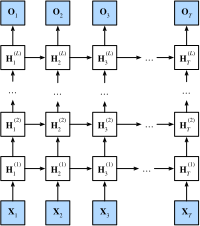

# 深度循环神经网络

:label:`sec_deep_rnn`

到目前为止，我们关注的是由序列输入、
单个隐藏 RNN 层和一个输出层组成的网络。
尽管任意时间步的输入与对应的输出之间只有一个隐藏层，
但从某种意义上说，这些网络是“深”的。
第一个时间步的输入可以影响最后时间步 $T$ 的输出
（通常是在数百甚至数千步之后）。
这些输入要经过循环层的 $T$ 次应用，
才到达最终输出。
然而，我们通常还希望保留表达能力，
以刻画给定时间步的输入
与该同一时间步的输出之间的复杂关系。
因此，我们常常构建不仅在时间方向上深、
而且在输入到输出方向上也深的 RNN。
这正是我们在介绍多层感知机和深度 CNN 时
已经遇到过的“深度”概念。

构建这类深度 RNN 的标准方法非常简单：
把 RNN 一层层堆叠起来。
给定长度为 $T$ 的序列，
第一个 RNN 产生输出序列，其长度也是 $T$。
这些输出依次构成下一个 RNN 层的输入。
在这一短节中，我们说明这种设计模式，
并给出一个如何编写这种堆叠 RNN 的简单示例。
下面，:numref:`fig_deep_rnn` 展示了一个具有 $L$ 个隐藏层的深度 RNN。
每个隐藏状态都对一个序列输入进行操作，
并产生一个序列输出。
此外，每个时间步的任意 RNN 单元（:numref:`fig_deep_rnn` 中的白色方框）
都同时依赖于同一层在上一时间步的值
和上一层在同一时间步的值。


:label:`fig_deep_rnn`

形式化地说，假设在时间步 $t$，
我们有一个小批量输入
$\mathbf{X}_t \in \mathbb{R}^{n \times d}$
（样例数 $=n$；每个样例的输入数 $=d$）。
在同一时间步，设第 $l^\textrm{th}$ 个隐藏层
（$l=1,\ldots,L$）的隐藏状态为 $\mathbf{H}_t^{(l)} \in \mathbb{R}^{n \times h}$
（隐藏单元数 $=h$），
输出层变量为
$\mathbf{O}_t \in \mathbb{R}^{n \times q}$
（输出数：$q$）。
令 $\mathbf{H}_t^{(0)} = \mathbf{X}_t$，
则使用激活函数 $\phi_l$ 的第 $l^\textrm{th}$ 个隐藏层
的隐藏状态计算如下：

$$\mathbf{H}_t^{(l)} = \phi_l(\mathbf{H}_t^{(l-1)} \mathbf{W}_{\textrm{xh}}^{(l)} + \mathbf{H}_{t-1}^{(l)} \mathbf{W}_{\textrm{hh}}^{(l)}  + \mathbf{b}_\textrm{h}^{(l)}),$$
:eqlabel:`eq_deep_rnn_H`

其中权重 $\mathbf{W}_{\textrm{xh}}^{(l)} \in \mathbb{R}^{h \times h}$ 和 $\mathbf{W}_{\textrm{hh}}^{(l)} \in \mathbb{R}^{h \times h}$，
连同偏置 $\mathbf{b}_\textrm{h}^{(l)} \in \mathbb{R}^{1 \times h}$，
是第 $l^\textrm{th}$ 个隐藏层的模型参数。

最后，输出层的计算只基于第 $L^\textrm{th}$ 个（即最后一个）隐藏层的隐藏状态：

$$\mathbf{O}_t = \mathbf{H}_t^{(L)} \mathbf{W}_{\textrm{hq}} + \mathbf{b}_\textrm{q},$$

其中权重 $\mathbf{W}_{\textrm{hq}} \in \mathbb{R}^{h \times q}$ 和偏置 $\mathbf{b}_\textrm{q} \in \mathbb{R}^{1 \times q}$ 是输出层的模型参数。

与多层感知机一样，隐藏层数 $L$
和隐藏单元数 $h$ 是我们可以调的超参数。
常见的 RNN 层宽度（$h$）在 $(64, 2056)$ 范围内，
常见的深度（$L$）在 $(1, 8)$ 范围内。
此外，只要把 :eqref:`eq_deep_rnn_H` 中的隐藏状态计算
替换为 LSTM 或 GRU 中的相应计算，
我们就能轻松得到深度门控 RNN。

```{.python .input}
%load_ext d2lbook.tab
tab.interact_select('mxnet', 'pytorch', 'tensorflow', 'jax')
```

```{.python .input}
%%tab mxnet
from d2l import mxnet as d2l
from mxnet import np, npx
from mxnet.gluon import rnn
npx.set_np()
```

```{.python .input}
%%tab pytorch
from d2l import torch as d2l
import torch
from torch import nn
```

```{.python .input}
%%tab tensorflow
from d2l import tensorflow as d2l
import tensorflow as tf
```

```{.python .input}
%%tab jax
from d2l import jax as d2l
from flax import linen as nn
import jax
from jax import numpy as jnp
```

## 从零开始实现

为了从零实现多层 RNN，
我们可以把每一层都看作一个 `RNNScratch` 实例，各自拥有可学习的参数。

```{.python .input}
%%tab mxnet, tensorflow
class StackedRNNScratch(d2l.Module):
    def __init__(self, num_inputs, num_hiddens, num_layers, sigma=0.01):
        super().__init__()
        self.save_hyperparameters()
        self.rnns = [d2l.RNNScratch(num_inputs if i==0 else num_hiddens,
                                    num_hiddens, sigma)
                     for i in range(num_layers)]
```

```{.python .input}
%%tab pytorch
class StackedRNNScratch(d2l.Module):
    def __init__(self, num_inputs, num_hiddens, num_layers, sigma=0.01):
        super().__init__()
        self.save_hyperparameters()
        self.rnns = nn.Sequential(*[d2l.RNNScratch(
            num_inputs if i==0 else num_hiddens, num_hiddens, sigma)
                                    for i in range(num_layers)])
```

```{.python .input}
%%tab jax
class StackedRNNScratch(d2l.Module):
    num_inputs: int
    num_hiddens: int
    num_layers: int
    sigma: float = 0.01

    def setup(self):
        self.rnns = [d2l.RNNScratch(self.num_inputs if i==0 else self.num_hiddens,
                                    self.num_hiddens, self.sigma)
                     for i in range(self.num_layers)]
```

多层前向计算就是逐层进行前向计算。

```{.python .input}
%%tab all
@d2l.add_to_class(StackedRNNScratch)
def forward(self, inputs, Hs=None):
    outputs = inputs
    if Hs is None: Hs = [None] * self.num_layers
    for i in range(self.num_layers):
        outputs, Hs[i] = self.rnns[i](outputs, Hs[i])
        outputs = d2l.stack(outputs, 0)
    return outputs, Hs
```

例如，我们在*The Time Machine*数据集上训练一个深度 GRU 模型
（与 :numref:`sec_rnn-scratch` 中相同）。
为简单起见，我们把层数设为 2。

```{.python .input}
%%tab all
data = d2l.TimeMachine(batch_size=1024, num_steps=32)
if tab.selected('mxnet', 'pytorch', 'jax'):
    rnn_block = StackedRNNScratch(num_inputs=len(data.vocab),
                                  num_hiddens=32, num_layers=2)
    model = d2l.RNNLMScratch(rnn_block, vocab_size=len(data.vocab), lr=2)
    trainer = d2l.Trainer(max_epochs=100, gradient_clip_val=1, num_gpus=1)
if tab.selected('tensorflow'):
    with d2l.try_gpu():
        rnn_block = StackedRNNScratch(num_inputs=len(data.vocab),
                                  num_hiddens=32, num_layers=2)
        model = d2l.RNNLMScratch(rnn_block, vocab_size=len(data.vocab), lr=2)
    trainer = d2l.Trainer(max_epochs=100, gradient_clip_val=1)
trainer.fit(model, data)
```

## 简洁实现

:begin_tab:`pytorch, mxnet, tensorflow`
幸运的是，实现多层 RNN 所需的许多细节
在高级 API 中都可以直接获得。
我们的简洁实现将使用这些内置功能。
代码推广了我们在 :numref:`sec_gru` 中使用的实现，
让我们能够显式指定层数，
而不是采用默认的仅一层。
:end_tab:

:begin_tab:`jax`
Flax 在实现 RNN 时采取极简方式。
在 RNN 中定义层数或将层数与暂退法结合，
这些功能并非开箱即用。
我们的简洁实现将使用所有内置功能，
并在其上增加 `num_layers` 和 `dropout` 功能。
代码推广了我们在 :numref:`sec_gru` 中使用的实现，
允许显式指定层数，
而不是采用默认的仅一层。
:end_tab:

```{.python .input}
%%tab mxnet
class GRU(d2l.RNN):  #@save
    """The multilayer GRU model."""
    def __init__(self, num_hiddens, num_layers, dropout=0):
        d2l.Module.__init__(self)
        self.save_hyperparameters()
        self.rnn = rnn.GRU(num_hiddens, num_layers, dropout=dropout)
```

```{.python .input}
%%tab pytorch
class GRU(d2l.RNN):  #@save
    """The multilayer GRU model."""
    def __init__(self, num_inputs, num_hiddens, num_layers, dropout=0):
        d2l.Module.__init__(self)
        self.save_hyperparameters()
        self.rnn = nn.GRU(num_inputs, num_hiddens, num_layers,
                          dropout=dropout)
```

```{.python .input}
%%tab tensorflow
class GRU(d2l.RNN):  #@save
    """The multilayer GRU model."""
    def __init__(self, num_hiddens, num_layers, dropout=0):
        d2l.Module.__init__(self)
        self.save_hyperparameters()
        gru_cells = [tf.keras.layers.GRUCell(num_hiddens, dropout=dropout)
                     for _ in range(num_layers)]
        self.rnn = tf.keras.layers.RNN(gru_cells, return_sequences=True,
                                       return_state=True, time_major=True)

    def forward(self, X, state=None):
        outputs, *state = self.rnn(X, state)
        return outputs, state
```

```{.python .input}
%%tab jax
class GRU(d2l.RNN):  #@save
    """The multilayer GRU model."""
    num_hiddens: int
    num_layers: int
    dropout: float = 0

    @nn.compact
    def __call__(self, X, state=None, training=False):
        outputs = X
        new_state = []
        if state is None:
            batch_size = X.shape[1]
            state = [nn.GRUCell.initialize_carry(jax.random.PRNGKey(0),
                    (batch_size,), self.num_hiddens)] * self.num_layers

        GRU = nn.scan(nn.GRUCell, variable_broadcast="params",
                      in_axes=0, out_axes=0, split_rngs={"params": False})

        # Introduce a dropout layer after every GRU layer except last
        for i in range(self.num_layers - 1):
            layer_i_state, X = GRU()(state[i], outputs)
            new_state.append(layer_i_state)
            X = nn.Dropout(self.dropout, deterministic=not training)(X)

        # Final GRU layer without dropout
        out_state, X = GRU()(state[-1], X)
        new_state.append(out_state)
        return X, jnp.array(new_state)
```

诸如选择超参数之类的架构决策与 :numref:`sec_gru` 中非常相似。
我们令输入数和输出数都等于不同词元的个数，即 `vocab_size`。
隐藏单元数仍然是 32。
唯一的区别是，我们现在
(**通过指定 `num_layers` 的值来选择非平凡的隐藏层数。**)

```{.python .input}
%%tab mxnet
gru = GRU(num_hiddens=32, num_layers=2)
model = d2l.RNNLM(gru, vocab_size=len(data.vocab), lr=2)

# Running takes > 1h (pending fix from MXNet)
# trainer.fit(model, data)
# model.predict('it has', 20, data.vocab, d2l.try_gpu())
```

```{.python .input}
%%tab pytorch, tensorflow, jax
if tab.selected('tensorflow', 'jax'):
    gru = GRU(num_hiddens=32, num_layers=2)
if tab.selected('pytorch'):
    gru = GRU(num_inputs=len(data.vocab), num_hiddens=32, num_layers=2)
if tab.selected('pytorch', 'jax'):
    model = d2l.RNNLM(gru, vocab_size=len(data.vocab), lr=2)
if tab.selected('tensorflow'):
    with d2l.try_gpu():
        model = d2l.RNNLM(gru, vocab_size=len(data.vocab), lr=2)
trainer.fit(model, data)
```

```{.python .input}
%%tab pytorch
model.predict('it has', 20, data.vocab, d2l.try_gpu())
```

```{.python .input}
%%tab tensorflow
model.predict('it has', 20, data.vocab)
```

```{.python .input}
%%tab jax
model.predict('it has', 20, data.vocab, trainer.state.params)
```

## 小结

在深度 RNN 中，隐藏状态信息会传递给当前层的下一时间步
以及下一层的当前时间步。
深度 RNN 有许多不同的变体，
例如 LSTM、GRU 或普通 RNN。
方便的是，这些模型都可以作为
深度学习框架高级 API 的一部分直接使用。
模型的初始化需要谨慎处理。
总的来说，深度 RNN 需要相当多的工作
（例如学习率和裁剪），才能确保正确收敛。

## 练习

1. 把 GRU 替换为 LSTM，并比较准确率和训练速度。
1. 增加训练数据，使其包含多本书。你能把困惑度降到多低？
1. 建模文本时，你会希望合并不同作者的数据来源吗？为什么这是一个好主意？可能会出什么问题？

:begin_tab:`mxnet`
[讨论](https://discuss.d2l.ai/t/340)
:end_tab:

:begin_tab:`pytorch`
[讨论](https://discuss.d2l.ai/t/1058)
:end_tab:

:begin_tab:`tensorflow`
[讨论](https://discuss.d2l.ai/t/3862)
:end_tab:

:begin_tab:`jax`
[讨论](https://discuss.d2l.ai/t/18018)
:end_tab:
