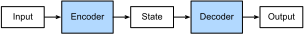

```{.python .input  n=1}
%load_ext d2lbook.tab
tab.interact_select('mxnet', 'pytorch', 'tensorflow', 'jax')
```

# 编码器-解码器架构
:label:`sec_encoder-decoder`

在机器翻译（:numref:`sec_machine_translation`）这类一般的序列到序列问题中，
输入和输出的长度各不相同，而且彼此未对齐。
处理这类数据的标准方法是设计一种*编码器-解码器*（encoder-decoder）架构
（:numref:`fig_encoder_decoder`），
它由两个主要组件组成：
一个*编码器*（encoder），它接收可变长度序列作为输入；
以及一个*解码器*（decoder），它充当条件语言模型，
接收编码后的输入和目标序列的左侧上下文，
并预测目标序列中的后续词元。


:label:`fig_encoder_decoder`

让我们以从英语到法语的机器翻译为例。
给定一个英文输入序列：
“They”、“are”、“watching”、“.”，
这个编码器-解码器架构首先把可变长度的输入编码为一个状态，
然后对该状态进行解码，
逐个词元地生成翻译后的序列作为输出：
“Ils”、“regardent”、“.”。
由于编码器-解码器架构是后续各节中不同序列到序列模型的基础，
本节将把这个架构转换为一个接口，稍后再加以实现。

```{.python .input}
%%tab mxnet
from d2l import mxnet as d2l
from mxnet.gluon import nn
```

```{.python .input}
%%tab pytorch
from d2l import torch as d2l
from torch import nn
```

```{.python .input}
%%tab tensorflow
from d2l import tensorflow as d2l
import tensorflow as tf
```

```{.python .input}
%%tab jax
from d2l import jax as d2l
from flax import linen as nn
```

## (**编码器**)

在编码器接口中，
我们只规定编码器接收可变长度序列作为输入 `X`。
任何继承这个基类 `Encoder` 的模型都将提供具体实现。

```{.python .input}
%%tab mxnet
class Encoder(nn.Block):  #@save
    """The base encoder interface for the encoder--decoder architecture."""
    def __init__(self):
        super().__init__()

    # Later there can be additional arguments (e.g., length excluding padding)
    def forward(self, X, *args):
        raise NotImplementedError
```

```{.python .input}
%%tab pytorch
class Encoder(nn.Module):  #@save
    """The base encoder interface for the encoder--decoder architecture."""
    def __init__(self):
        super().__init__()

    # Later there can be additional arguments (e.g., length excluding padding)
    def forward(self, X, *args):
        raise NotImplementedError
```

```{.python .input}
%%tab tensorflow
class Encoder(tf.keras.layers.Layer):  #@save
    """The base encoder interface for the encoder--decoder architecture."""
    def __init__(self):
        super().__init__()

    # Later there can be additional arguments (e.g., length excluding padding)
    def call(self, X, *args):
        raise NotImplementedError
```

```{.python .input}
%%tab jax
class Encoder(nn.Module):  #@save
    """The base encoder interface for the encoder--decoder architecture."""
    def setup(self):
        raise NotImplementedError

    # Later there can be additional arguments (e.g., length excluding padding)
    def __call__(self, X, *args):
        raise NotImplementedError
```

## [**解码器**]

在下面的解码器接口中，
我们添加一个额外的 `init_state` 方法，
用于把编码器的输出（`enc_all_outputs`）转换为编码后的状态。
请注意，这一步可能需要额外的输入，
例如输入的有效长度，
这已在 :numref:`sec_machine_translation` 中解释过。
为了逐个词元地生成可变长度序列，
解码器每次可以把一个输入
（例如上一时间步生成的词元）和编码后的状态
映射为当前时间步的输出词元。

```{.python .input}
%%tab mxnet
class Decoder(nn.Block):  #@save
    """The base decoder interface for the encoder--decoder architecture."""
    def __init__(self):
        super().__init__()

    # Later there can be additional arguments (e.g., length excluding padding)
    def init_state(self, enc_all_outputs, *args):
        raise NotImplementedError

    def forward(self, X, state):
        raise NotImplementedError
```

```{.python .input}
%%tab pytorch
class Decoder(nn.Module):  #@save
    """The base decoder interface for the encoder--decoder architecture."""
    def __init__(self):
        super().__init__()

    # Later there can be additional arguments (e.g., length excluding padding)
    def init_state(self, enc_all_outputs, *args):
        raise NotImplementedError

    def forward(self, X, state):
        raise NotImplementedError
```

```{.python .input}
%%tab tensorflow
class Decoder(tf.keras.layers.Layer):  #@save
    """The base decoder interface for the encoder--decoder architecture."""
    def __init__(self):
        super().__init__()

    # Later there can be additional arguments (e.g., length excluding padding)
    def init_state(self, enc_all_outputs, *args):
        raise NotImplementedError

    def call(self, X, state):
        raise NotImplementedError
```

```{.python .input}
%%tab jax
class Decoder(nn.Module):  #@save
    """The base decoder interface for the encoder--decoder architecture."""
    def setup(self):
        raise NotImplementedError

    # Later there can be additional arguments (e.g., length excluding padding)
    def init_state(self, enc_all_outputs, *args):
        raise NotImplementedError

    def __call__(self, X, state):
        raise NotImplementedError
```

## [**把编码器和解码器放在一起**]

在前向传播中，
编码器的输出用于产生编码后的状态，
这个状态将进一步被解码器用作其输入之一。

```{.python .input}
%%tab mxnet, pytorch
class EncoderDecoder(d2l.Classifier):  #@save
    """The base class for the encoder--decoder architecture."""
    def __init__(self, encoder, decoder):
        super().__init__()
        self.encoder = encoder
        self.decoder = decoder

    def forward(self, enc_X, dec_X, *args):
        enc_all_outputs = self.encoder(enc_X, *args)
        dec_state = self.decoder.init_state(enc_all_outputs, *args)
        # Return decoder output only
        return self.decoder(dec_X, dec_state)[0]
```

```{.python .input}
%%tab tensorflow
class EncoderDecoder(d2l.Classifier):  #@save
    """The base class for the encoder--decoder architecture."""
    def __init__(self, encoder, decoder):
        super().__init__()
        self.encoder = encoder
        self.decoder = decoder

    def call(self, enc_X, dec_X, *args):
        enc_all_outputs = self.encoder(enc_X, *args, training=True)
        dec_state = self.decoder.init_state(enc_all_outputs, *args)
        # Return decoder output only
        return self.decoder(dec_X, dec_state, training=True)[0]
```

```{.python .input}
%%tab jax
class EncoderDecoder(d2l.Classifier):  #@save
    """The base class for the encoder--decoder architecture."""
    encoder: nn.Module
    decoder: nn.Module
    training: bool

    def __call__(self, enc_X, dec_X, *args):
        enc_all_outputs = self.encoder(enc_X, *args, training=self.training)
        dec_state = self.decoder.init_state(enc_all_outputs, *args)
        # Return decoder output only
        return self.decoder(dec_X, dec_state, training=self.training)[0]
```

在下一节中，我们将看到如何应用 RNN，
基于这个编码器-解码器架构来设计序列到序列模型。

## 小结

编码器-解码器架构可以处理由可变长度序列组成的输入和输出，
因此适用于机器翻译等序列到序列问题。
编码器接收可变长度序列作为输入，
并将其变换为具有固定形状的状态。
解码器把固定形状的编码状态映射为可变长度序列。

## 练习

1. 假设我们用神经网络来实现编码器-解码器架构。编码器和解码器必须是同一类型的神经网络吗？
1. 除了机器翻译，你还能想到编码器-解码器架构的其他应用吗？

:begin_tab:`mxnet`
[讨论](https://discuss.d2l.ai/t/341)
:end_tab:

:begin_tab:`pytorch`
[讨论](https://discuss.d2l.ai/t/1061)
:end_tab:

:begin_tab:`tensorflow`
[讨论](https://discuss.d2l.ai/t/3864)
:end_tab:

:begin_tab:`jax`
[讨论](https://discuss.d2l.ai/t/18021)
:end_tab:
