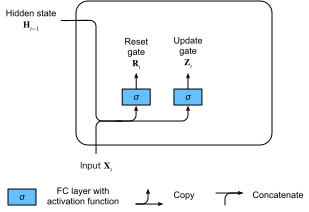
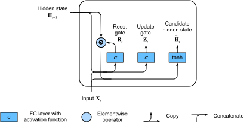
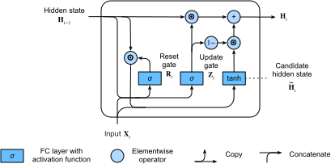

# 门控循环单元（GRU）
:label:`sec_gru`

随着 RNN 尤其是 LSTM 架构（:numref:`sec_lstm`）
在 2010 年代迅速流行起来，
许多研究者开始尝试简化的架构，
希望保留“引入内部状态和乘法门控机制”这一关键思想，
同时加快计算速度。
门控循环单元（GRU）:cite:`Cho.Van-Merrienboer.Bahdanau.ea.2014`
提供了 LSTM 记忆单元的一个精简版本，
它通常能达到相当的性能，
但具有计算更快的优势 :cite:`Chung.Gulcehre.Cho.ea.2014`。

```{.python .input  n=5}
%load_ext d2lbook.tab
tab.interact_select(['mxnet', 'pytorch', 'tensorflow', 'jax'])
```

```{.python .input  n=6}
%%tab mxnet
from d2l import mxnet as d2l
from mxnet import np, npx
from mxnet.gluon import rnn
npx.set_np()
```

```{.python .input  n=7}
%%tab pytorch
from d2l import torch as d2l
import torch
from torch import nn
```

```{.python .input  n=8}
%%tab tensorflow
from d2l import tensorflow as d2l
import tensorflow as tf
```

```{.python .input}
%%tab jax
from d2l import jax as d2l
from flax import linen as nn
import jax
from jax import numpy as jnp
```

## 重置门和更新门

在这里，LSTM 的三个门被替换为两个门：
*重置门*（reset gate）和*更新门*（update gate）。
与 LSTM 一样，这些门带有 sigmoid 激活，
迫使其取值落在 $(0, 1)$ 区间内。
直观地说，重置门控制我们可能还想记住多少前一状态。
同样，更新门让我们能够控制新状态中有多少只是旧状态的副本。
:numref:`fig_gru_1` 展示了 GRU 中重置门和更新门的输入，
这些输入是当前时间步的输入和上一时间步的隐藏状态。
门的输出由两个带 sigmoid 激活函数的全连接层给出。


:label:`fig_gru_1`

在数学上，对于给定的时间步 $t$，
假设输入是一个小批量
$\mathbf{X}_t \in \mathbb{R}^{n \times d}$
（样例数 $=n$；输入数 $=d$），
上一时间步的隐藏状态为
$\mathbf{H}_{t-1} \in \mathbb{R}^{n \times h}$
（隐藏单元数 $=h$）。
那么重置门 $\mathbf{R}_t \in \mathbb{R}^{n \times h}$
和更新门 $\mathbf{Z}_t \in \mathbb{R}^{n \times h}$ 的计算方式如下：

$$
\begin{aligned}
\mathbf{R}_t = \sigma(\mathbf{X}_t \mathbf{W}_{\textrm{xr}} + \mathbf{H}_{t-1} \mathbf{W}_{\textrm{hr}} + \mathbf{b}_\textrm{r}),\\
\mathbf{Z}_t = \sigma(\mathbf{X}_t \mathbf{W}_{\textrm{xz}} + \mathbf{H}_{t-1} \mathbf{W}_{\textrm{hz}} + \mathbf{b}_\textrm{z}),
\end{aligned}
$$

其中 $\mathbf{W}_{\textrm{xr}}, \mathbf{W}_{\textrm{xz}} \in \mathbb{R}^{d \times h}$ 和 $\mathbf{W}_{\textrm{hr}}, \mathbf{W}_{\textrm{hz}} \in \mathbb{R}^{h \times h}$ 是权重参数，
$\mathbf{b}_\textrm{r}, \mathbf{b}_\textrm{z} \in \mathbb{R}^{1 \times h}$ 是偏置参数。

## 候选隐藏状态

接下来，我们把重置门 $\mathbf{R}_t$
与 :eqref:`rnn_h_with_state` 中的常规更新机制结合起来，
得到时间步 $t$ 的如下*候选隐藏状态*（candidate hidden state）
$\tilde{\mathbf{H}}_t \in \mathbb{R}^{n \times h}$：

$$\tilde{\mathbf{H}}_t = \tanh(\mathbf{X}_t \mathbf{W}_{\textrm{xh}} + \left(\mathbf{R}_t \odot \mathbf{H}_{t-1}\right) \mathbf{W}_{\textrm{hh}} + \mathbf{b}_\textrm{h}),$$
:eqlabel:`gru_tilde_H`

其中 $\mathbf{W}_{\textrm{xh}} \in \mathbb{R}^{d \times h}$ 和 $\mathbf{W}_{\textrm{hh}} \in \mathbb{R}^{h \times h}$
是权重参数，
$\mathbf{b}_\textrm{h} \in \mathbb{R}^{1 \times h}$
是偏置，
符号 $\odot$ 是哈达玛（按元素）乘积运算符。
这里我们使用 tanh 激活函数。

结果是一个*候选*状态，因为我们还需要引入更新门的作用。
与 :eqref:`rnn_h_with_state` 相比，
前一状态的影响现在可以通过 :eqref:`gru_tilde_H` 中
$\mathbf{R}_t$ 与 $\mathbf{H}_{t-1}$ 的按元素乘法来削弱。
每当重置门 $\mathbf{R}_t$ 中的元素接近 1 时，
我们就恢复出 :eqref:`rnn_h_with_state` 那样的普通 RNN。
对于重置门 $\mathbf{R}_t$ 中接近 0 的所有元素，
候选隐藏状态就是以 $\mathbf{X}_t$ 为输入的多层感知机的结果。
因此，任何已有的隐藏状态都被*重置*为默认值。

:numref:`fig_gru_2` 展示了应用重置门之后的计算流程。


:label:`fig_gru_2`

## 隐藏状态

最后，我们需要引入更新门 $\mathbf{Z}_t$ 的作用。
它决定了新的隐藏状态 $\mathbf{H}_t \in \mathbb{R}^{n \times h}$
在多大程度上与旧状态 $\mathbf{H}_{t-1}$ 一致，
以及它在多大程度上类似于新的候选状态 $\tilde{\mathbf{H}}_t$。
更新门 $\mathbf{Z}_t$ 可以用来实现这一点，
只需对 $\mathbf{H}_{t-1}$ 和 $\tilde{\mathbf{H}}_t$ 取按元素的凸组合。
这就得到了 GRU 的最终更新公式：

$$\mathbf{H}_t = \mathbf{Z}_t \odot \mathbf{H}_{t-1}  + (1 - \mathbf{Z}_t) \odot \tilde{\mathbf{H}}_t.$$

每当更新门 $\mathbf{Z}_t$ 接近 1 时，
我们就直接保留旧状态。
在这种情况下，来自 $\mathbf{X}_t$ 的信息被忽略，
相当于在依赖链中跳过时间步 $t$。
相反，每当 $\mathbf{Z}_t$ 接近 0 时，
新的潜在状态 $\mathbf{H}_t$ 就趋近于候选潜在状态 $\tilde{\mathbf{H}}_t$。
:numref:`fig_gru_3` 展示了更新门起作用之后的计算流程。


:label:`fig_gru_3`

总而言之，GRU 有以下两个显著特征：

* 重置门有助于捕捉序列中的短期依赖关系。
* 更新门有助于捕捉序列中的长期依赖关系。

## 从零开始实现

为了更好地理解 GRU 模型，让我们从零开始实现它。

### (**初始化模型参数**)

第一步是初始化模型参数。
我们从标准差为 `sigma` 的高斯分布中抽取权重，
并把偏置设为 0。
超参数 `num_hiddens` 定义隐藏单元的数量。
我们实例化与更新门、重置门和候选隐藏状态相关的所有权重和偏置。

```{.python .input}
%%tab pytorch, mxnet, tensorflow
class GRUScratch(d2l.Module):
    def __init__(self, num_inputs, num_hiddens, sigma=0.01):
        super().__init__()
        self.save_hyperparameters()
        
        if tab.selected('mxnet'):
            init_weight = lambda *shape: d2l.randn(*shape) * sigma
            triple = lambda: (init_weight(num_inputs, num_hiddens),
                              init_weight(num_hiddens, num_hiddens),
                              d2l.zeros(num_hiddens))            
        if tab.selected('pytorch'):
            init_weight = lambda *shape: nn.Parameter(d2l.randn(*shape) * sigma)
            triple = lambda: (init_weight(num_inputs, num_hiddens),
                              init_weight(num_hiddens, num_hiddens),
                              nn.Parameter(d2l.zeros(num_hiddens)))
        if tab.selected('tensorflow'):
            init_weight = lambda *shape: tf.Variable(d2l.normal(shape) * sigma)
            triple = lambda: (init_weight(num_inputs, num_hiddens),
                              init_weight(num_hiddens, num_hiddens),
                              tf.Variable(d2l.zeros(num_hiddens)))            
            
        self.W_xz, self.W_hz, self.b_z = triple()  # Update gate
        self.W_xr, self.W_hr, self.b_r = triple()  # Reset gate
        self.W_xh, self.W_hh, self.b_h = triple()  # Candidate hidden state        
```

```{.python .input}
%%tab jax
class GRUScratch(d2l.Module):
    num_inputs: int
    num_hiddens: int
    sigma: float = 0.01

    def setup(self):
        init_weight = lambda name, shape: self.param(name,
                                                     nn.initializers.normal(self.sigma),
                                                     shape)
        triple = lambda name : (
            init_weight(f'W_x{name}', (self.num_inputs, self.num_hiddens)),
            init_weight(f'W_h{name}', (self.num_hiddens, self.num_hiddens)),
            self.param(f'b_{name}', nn.initializers.zeros, (self.num_hiddens)))

        self.W_xz, self.W_hz, self.b_z = triple('z')  # Update gate
        self.W_xr, self.W_hr, self.b_r = triple('r')  # Reset gate
        self.W_xh, self.W_hh, self.b_h = triple('h')  # Candidate hidden state
```

### 定义模型

现在我们准备好[**定义 GRU 的前向计算**]。
它的结构与基本 RNN 单元相同，
只是更新公式更复杂。

```{.python .input}
%%tab pytorch, mxnet, tensorflow
@d2l.add_to_class(GRUScratch)
def forward(self, inputs, H=None):
    if H is None:
        # Initial state with shape: (batch_size, num_hiddens)
        if tab.selected('mxnet'):
            H = d2l.zeros((inputs.shape[1], self.num_hiddens),
                          ctx=inputs.ctx)
        if tab.selected('pytorch'):
            H = d2l.zeros((inputs.shape[1], self.num_hiddens),
                          device=inputs.device)
        if tab.selected('tensorflow'):
            H = d2l.zeros((inputs.shape[1], self.num_hiddens))
    outputs = []
    for X in inputs:
        Z = d2l.sigmoid(d2l.matmul(X, self.W_xz) +
                        d2l.matmul(H, self.W_hz) + self.b_z)
        R = d2l.sigmoid(d2l.matmul(X, self.W_xr) + 
                        d2l.matmul(H, self.W_hr) + self.b_r)
        H_tilde = d2l.tanh(d2l.matmul(X, self.W_xh) + 
                           d2l.matmul(R * H, self.W_hh) + self.b_h)
        H = Z * H + (1 - Z) * H_tilde
        outputs.append(H)
    return outputs, H
```

```{.python .input}
%%tab jax
@d2l.add_to_class(GRUScratch)
def forward(self, inputs, H=None):
    # Use lax.scan primitive instead of looping over the
    # inputs, since scan saves time in jit compilation
    def scan_fn(H, X):
        Z = d2l.sigmoid(d2l.matmul(X, self.W_xz) + d2l.matmul(H, self.W_hz) +
                        self.b_z)
        R = d2l.sigmoid(d2l.matmul(X, self.W_xr) +
                        d2l.matmul(H, self.W_hr) + self.b_r)
        H_tilde = d2l.tanh(d2l.matmul(X, self.W_xh) +
                           d2l.matmul(R * H, self.W_hh) + self.b_h)
        H = Z * H + (1 - Z) * H_tilde
        return H, H  # return carry, y

    if H is None:
        batch_size = inputs.shape[1]
        carry = jnp.zeros((batch_size, self.num_hiddens))
    else:
        carry = H

    # scan takes the scan_fn, initial carry state, xs with leading axis to be scanned
    carry, outputs = jax.lax.scan(scan_fn, carry, inputs)
    return outputs, carry
```

### 训练

在*The Time Machine*数据集上[**训练**]语言模型的方式，
与 :numref:`sec_rnn-scratch` 中完全相同。

```{.python .input}
%%tab all
data = d2l.TimeMachine(batch_size=1024, num_steps=32)
if tab.selected('mxnet', 'pytorch', 'jax'):
    gru = GRUScratch(num_inputs=len(data.vocab), num_hiddens=32)
    model = d2l.RNNLMScratch(gru, vocab_size=len(data.vocab), lr=4)
    trainer = d2l.Trainer(max_epochs=50, gradient_clip_val=1, num_gpus=1)
if tab.selected('tensorflow'):
    with d2l.try_gpu():
        gru = GRUScratch(num_inputs=len(data.vocab), num_hiddens=32)
        model = d2l.RNNLMScratch(gru, vocab_size=len(data.vocab), lr=4)
    trainer = d2l.Trainer(max_epochs=50, gradient_clip_val=1)
trainer.fit(model, data)
```

## [**简洁实现**]

在高级 API 中，我们可以直接实例化一个 GRU 模型。
这样就把我们上面显式给出的所有配置细节都封装了起来。

```{.python .input}
%%tab pytorch, mxnet, tensorflow
class GRU(d2l.RNN):
    def __init__(self, num_inputs, num_hiddens):
        d2l.Module.__init__(self)
        self.save_hyperparameters()
        if tab.selected('mxnet'):
            self.rnn = rnn.GRU(num_hiddens)
        if tab.selected('pytorch'):
            self.rnn = nn.GRU(num_inputs, num_hiddens)
        if tab.selected('tensorflow'):
            self.rnn = tf.keras.layers.GRU(num_hiddens, return_sequences=True, 
                                           return_state=True)
```

```{.python .input}
%%tab jax
class GRU(d2l.RNN):
    num_hiddens: int

    @nn.compact
    def __call__(self, inputs, H=None, training=False):
        if H is None:
            batch_size = inputs.shape[1]
            H = nn.GRUCell.initialize_carry(jax.random.PRNGKey(0),
                                            (batch_size,), self.num_hiddens)

        GRU = nn.scan(nn.GRUCell, variable_broadcast="params",
                      in_axes=0, out_axes=0, split_rngs={"params": False})

        H, outputs = GRU()(H, inputs)
        return outputs, H
```

这段代码的训练速度显著更快，
因为它使用的是编译后的运算符而不是 Python。

```{.python .input}
%%tab all
if tab.selected('mxnet', 'pytorch', 'tensorflow'):
    gru = GRU(num_inputs=len(data.vocab), num_hiddens=32)
if tab.selected('jax'):
    gru = GRU(num_hiddens=32)
if tab.selected('mxnet', 'pytorch', 'jax'):
    model = d2l.RNNLM(gru, vocab_size=len(data.vocab), lr=4)
if tab.selected('tensorflow'):
    with d2l.try_gpu():
        model = d2l.RNNLM(gru, vocab_size=len(data.vocab), lr=4)
trainer.fit(model, data)
```

训练之后，我们打印出训练集上的困惑度，
以及按照所提供前缀预测出的序列。

```{.python .input}
%%tab mxnet, pytorch
model.predict('it has', 20, data.vocab, d2l.try_gpu())
```

```{.python .input}
%%tab tensorflow
model.predict('it has', 20, data.vocab)
```

```{.python .input}
%%tab jax
model.predict('it has', 20, data.vocab, trainer.state.params)
```

## 小结

与 LSTM 相比，GRU 达到相似的性能，但计算上往往更轻量。
一般来说，与简单 RNN 相比，
像 LSTM 和 GRU 这样的门控 RNN
能更好地捕捉时间步距离较大的序列中的依赖关系。
当重置门开启时，GRU 把基本 RNN 作为其极端情形包含在内。
它们还可以通过开启更新门来跳过子序列。

## 练习

1. 假设我们只想用时间步 $t'$ 的输入来预测时间步 $t > t'$ 的输出。对每个时间步而言，重置门和更新门的最佳取值是什么？
1. 调整超参数，并分析它们对运行时间、困惑度和输出序列的影响。
1. 比较 `rnn.RNN` 和 `rnn.GRU` 实现的运行时间、困惑度和输出字符串。
1. 如果你只实现 GRU 的一部分（例如只有重置门或只有更新门），会发生什么？

:begin_tab:`mxnet`
[讨论](https://discuss.d2l.ai/t/342)
:end_tab:

:begin_tab:`pytorch`
[讨论](https://discuss.d2l.ai/t/1056)
:end_tab:

:begin_tab:`tensorflow`
[讨论](https://discuss.d2l.ai/t/3860)
:end_tab:

:begin_tab:`jax`
[讨论](https://discuss.d2l.ai/t/18017)
:end_tab:
