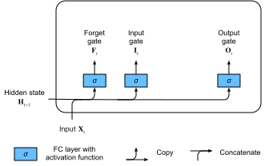
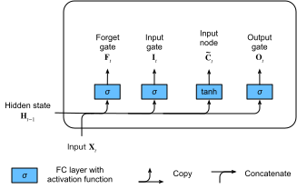
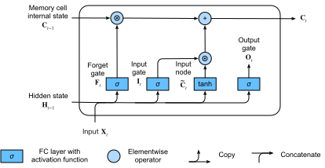
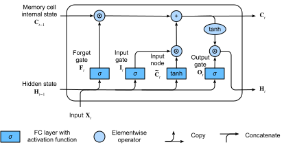

# 长短期记忆网络（LSTM）
:label:`sec_lstm`

在第一批 Elman 风格的 RNN 使用反向传播训练之后不久
:cite:`elman1990finding`，
学习长期依赖的问题（由梯度消失和梯度爆炸引起）就变得突出起来，
Bengio 和 Hochreiter 讨论了这一问题
:cite:`bengio1994learning,Hochreiter.Bengio.Frasconi.ea.2001`。
Hochreiter 早在 1991 年的硕士论文中就已经阐明了这个问题，
但由于论文是用德语写的，这些结果并没有广为人知。
虽然梯度裁剪有助于处理梯度爆炸，
但处理梯度消失似乎需要更精细的解决方案。
最早且最成功的解决梯度消失问题的技术之一，
是由 :citet:`Hochreiter.Schmidhuber.1997` 提出的
长短期记忆网络（LSTM）模型。
LSTM 类似标准的循环神经网络，
但在这里每个普通的循环节点都被替换为一个*记忆单元*（memory cell）。
每个记忆单元包含一个*内部状态*（internal state），
即一个具有固定权重为 1 的自连接循环边的节点，
这确保了梯度可以跨过许多时间步而不会消失或爆炸。

“长短期记忆”这个术语来自以下直觉。
简单的循环神经网络以权重的形式拥有*长期记忆*。
权重在训练过程中变化缓慢，编码了关于数据的一般知识。
它们也以短暂的激活值形式拥有*短期记忆*，
这些激活值从每个节点传递到后续节点。
LSTM 模型通过记忆单元引入了一种中间类型的存储。
记忆单元是一个复合单元，
由更简单的节点按特定的连接模式构建而成，
并创新性地加入了乘法节点。

```{.python .input}
%load_ext d2lbook.tab
tab.interact_select(['mxnet', 'pytorch', 'tensorflow', 'jax'])
```

```{.python .input}
%%tab mxnet
from d2l import mxnet as d2l
from mxnet import np, npx
from mxnet.gluon import rnn
npx.set_np()
```

```{.python .input}
%%tab pytorch
from d2l import torch as d2l
import torch
from torch import nn
```

```{.python .input}
%%tab tensorflow
from d2l import tensorflow as d2l
import tensorflow as tf
```

```{.python .input}
%%tab jax
from d2l import jax as d2l
from flax import linen as nn
import jax
from jax import numpy as jnp
```

## 门控记忆单元

每个记忆单元都配备一个*内部状态*和若干个乘法门，
这些门决定：(i) 给定的输入是否应影响内部状态（*输入门*（input gate））；
(ii) 内部状态是否应被清空为 $0$（*遗忘门*（forget gate））；
以及 (iii) 是否允许给定神经元的内部状态影响单元的输出（*输出门*（output gate））。

### 隐藏状态的门控

普通 RNN 与 LSTM 的关键区别在于，
后者支持对隐藏状态进行门控。
这意味着我们有专门的机制来决定隐藏状态何时应该被*更新*，
以及何时应该被*重置*。
这些机制是可学习的，它们解决了上面列出的问题。
例如，如果第一个词元非常重要，
我们就会学到在第一次观测之后不再更新隐藏状态。
同样，我们会学到跳过无关的临时观测。
最后，我们会学到在需要时重置潜在状态。
下面我们详细讨论这一点。

### 输入门、遗忘门和输出门

输入到 LSTM 门的数据是当前时间步的输入
和上一时间步的隐藏状态，如 :numref:`fig_lstm_0` 所示。
三个带 sigmoid 激活函数的全连接层
分别计算输入门、遗忘门和输出门的值。
由于使用了 sigmoid 激活，
三个门的所有值都落在 $(0, 1)$ 区间内。
此外，我们还需要一个*输入节点*（input node），
它通常用 *tanh* 激活函数计算。
直观地说，*输入门*决定输入节点的值有多少
应被加到当前记忆单元的内部状态中。
*遗忘门*决定是保留记忆的当前值还是将其清空。
而*输出门*决定记忆单元是否应在当前时间步影响输出。


:label:`fig_lstm_0`

在数学上，假设有 $h$ 个隐藏单元，
批量大小为 $n$，输入数为 $d$。
于是，输入为 $\mathbf{X}_t \in \mathbb{R}^{n \times d}$，
上一时间步的隐藏状态为 $\mathbf{H}_{t-1} \in \mathbb{R}^{n \times h}$。
相应地，时间步 $t$ 的门定义如下：
输入门为 $\mathbf{I}_t \in \mathbb{R}^{n \times h}$，
遗忘门为 $\mathbf{F}_t \in \mathbb{R}^{n \times h}$，
输出门为 $\mathbf{O}_t \in \mathbb{R}^{n \times h}$。
它们的计算方式如下：

$$
\begin{aligned}
\mathbf{I}_t &= \sigma(\mathbf{X}_t \mathbf{W}_{\textrm{xi}} + \mathbf{H}_{t-1} \mathbf{W}_{\textrm{hi}} + \mathbf{b}_\textrm{i}),\\
\mathbf{F}_t &= \sigma(\mathbf{X}_t \mathbf{W}_{\textrm{xf}} + \mathbf{H}_{t-1} \mathbf{W}_{\textrm{hf}} + \mathbf{b}_\textrm{f}),\\
\mathbf{O}_t &= \sigma(\mathbf{X}_t \mathbf{W}_{\textrm{xo}} + \mathbf{H}_{t-1} \mathbf{W}_{\textrm{ho}} + \mathbf{b}_\textrm{o}),
\end{aligned}
$$

其中 $\mathbf{W}_{\textrm{xi}}, \mathbf{W}_{\textrm{xf}}, \mathbf{W}_{\textrm{xo}} \in \mathbb{R}^{d \times h}$ 和 $\mathbf{W}_{\textrm{hi}}, \mathbf{W}_{\textrm{hf}}, \mathbf{W}_{\textrm{ho}} \in \mathbb{R}^{h \times h}$ 是权重参数，
$\mathbf{b}_\textrm{i}, \mathbf{b}_\textrm{f}, \mathbf{b}_\textrm{o} \in \mathbb{R}^{1 \times h}$ 是偏置参数。
请注意，在求和过程中会触发广播
（参见 :numref:`subsec_broadcasting`）。
我们使用 sigmoid 函数（如 :numref:`sec_mlp` 中所介绍）
把输入值映射到区间 $(0, 1)$。

### 输入节点

接下来我们设计记忆单元。
由于我们还没有指定各个门的作用，
我们首先引入*输入节点*（input node）
$\tilde{\mathbf{C}}_t \in \mathbb{R}^{n \times h}$。
它的计算与上面描述的三个门类似，
但使用值域为 $(-1, 1)$ 的 $\tanh$ 函数作为激活函数。
这就得到了时间步 $t$ 的以下公式：

$$\tilde{\mathbf{C}}_t = \textrm{tanh}(\mathbf{X}_t \mathbf{W}_{\textrm{xc}} + \mathbf{H}_{t-1} \mathbf{W}_{\textrm{hc}} + \mathbf{b}_\textrm{c}),$$

其中 $\mathbf{W}_{\textrm{xc}} \in \mathbb{R}^{d \times h}$ 和 $\mathbf{W}_{\textrm{hc}} \in \mathbb{R}^{h \times h}$ 是权重参数，
$\mathbf{b}_\textrm{c} \in \mathbb{R}^{1 \times h}$ 是偏置参数。

输入节点的简要图示见 :numref:`fig_lstm_1`。


:label:`fig_lstm_1`

### 记忆单元的内部状态

在 LSTM 中，输入门 $\mathbf{I}_t$ 通过 $\tilde{\mathbf{C}}_t$
控制我们考虑多少新数据，
而遗忘门 $\mathbf{F}_t$ 则决定我们保留多少
旧的单元内部状态 $\mathbf{C}_{t-1} \in \mathbb{R}^{n \times h}$。
利用哈达玛（按元素）乘积运算符 $\odot$，
我们得到以下更新公式：

$$\mathbf{C}_t = \mathbf{F}_t \odot \mathbf{C}_{t-1} + \mathbf{I}_t \odot \tilde{\mathbf{C}}_t.$$

如果遗忘门始终为 1、输入门始终为 0，
那么记忆单元的内部状态 $\mathbf{C}_{t-1}$ 将永远保持不变，
原封不动地传递到每个后续时间步。
然而，输入门和遗忘门使模型能够灵活地学习：
何时保持该值不变，何时响应后续输入而扰动它。
在实践中，这种设计缓解了梯度消失问题，
使得模型更容易训练，
尤其是在面对序列长度较长的数据集时。

于是我们得到 :numref:`fig_lstm_2` 中的流程图。



:label:`fig_lstm_2`

### 隐藏状态

最后，我们需要定义如何计算记忆单元的输出，
即其他层所看到的隐藏状态 $\mathbf{H}_t \in \mathbb{R}^{n \times h}$。
这正是输出门发挥作用的地方。
在 LSTM 中，我们先对记忆单元的内部状态应用 $\tanh$，
然后再进行一次按元素乘法，这次是与输出门相乘。
这确保了 $\mathbf{H}_t$ 的值始终位于 $(-1, 1)$ 区间内：

$$\mathbf{H}_t = \mathbf{O}_t \odot \tanh(\mathbf{C}_t).$$

当输出门接近 1 时，
我们允许记忆单元的内部状态不受阻碍地影响后续层；
而当输出门值接近 0 时，
我们阻止当前记忆在当前时间步影响网络的其他层。
请注意，记忆单元可以在不影响网络其余部分的情况下
（只要输出门取值接近 0）跨许多时间步累积信息，
然后在后续时间步，一旦输出门从接近 0 的值变为接近 1 的值，
就突然影响网络。
:numref:`fig_lstm_3` 给出了数据流的图形化说明。


:label:`fig_lstm_3`

## 从零开始实现

现在让我们从零开始实现一个 LSTM。
与 :numref:`sec_rnn-scratch` 中的实验一样，
我们首先加载*The Time Machine*数据集。

### [**初始化模型参数**]

接下来，我们需要定义并初始化模型参数。
与之前一样，超参数 `num_hiddens` 决定隐藏单元的数量。
我们按照标准差为 0.01 的高斯分布初始化权重，
并将偏置设为 0。

```{.python .input}
%%tab pytorch, mxnet, tensorflow
class LSTMScratch(d2l.Module):
    def __init__(self, num_inputs, num_hiddens, sigma=0.01):
        super().__init__()
        self.save_hyperparameters()

        if tab.selected('mxnet'):
            init_weight = lambda *shape: d2l.randn(*shape) * sigma
            triple = lambda: (init_weight(num_inputs, num_hiddens),
                              init_weight(num_hiddens, num_hiddens),
                              d2l.zeros(num_hiddens))
        if tab.selected('pytorch'):
            init_weight = lambda *shape: nn.Parameter(d2l.randn(*shape) * sigma)
            triple = lambda: (init_weight(num_inputs, num_hiddens),
                              init_weight(num_hiddens, num_hiddens),
                              nn.Parameter(d2l.zeros(num_hiddens)))
        if tab.selected('tensorflow'):
            init_weight = lambda *shape: tf.Variable(d2l.normal(shape) * sigma)
            triple = lambda: (init_weight(num_inputs, num_hiddens),
                              init_weight(num_hiddens, num_hiddens),
                              tf.Variable(d2l.zeros(num_hiddens)))

        self.W_xi, self.W_hi, self.b_i = triple()  # Input gate
        self.W_xf, self.W_hf, self.b_f = triple()  # Forget gate
        self.W_xo, self.W_ho, self.b_o = triple()  # Output gate
        self.W_xc, self.W_hc, self.b_c = triple()  # Input node
```

```{.python .input}
%%tab jax
class LSTMScratch(d2l.Module):
    num_inputs: int
    num_hiddens: int
    sigma: float = 0.01

    def setup(self):
        init_weight = lambda name, shape: self.param(name,
                                                     nn.initializers.normal(self.sigma),
                                                     shape)
        triple = lambda name : (
            init_weight(f'W_x{name}', (self.num_inputs, self.num_hiddens)),
            init_weight(f'W_h{name}', (self.num_hiddens, self.num_hiddens)),
            self.param(f'b_{name}', nn.initializers.zeros, (self.num_hiddens)))

        self.W_xi, self.W_hi, self.b_i = triple('i')  # Input gate
        self.W_xf, self.W_hf, self.b_f = triple('f')  # Forget gate
        self.W_xo, self.W_ho, self.b_o = triple('o')  # Output gate
        self.W_xc, self.W_hc, self.b_c = triple('c')  # Input node
```

:begin_tab:`pytorch, mxnet, tensorflow`
[**实际的模型**]正是按上面描述定义的，
由三个门和一个输入节点组成。
请注意，只有隐藏状态会被传递到输出层。
:end_tab:

:begin_tab:`jax`
[**实际的模型**]正是按上面描述定义的，
由三个门和一个输入节点组成。
请注意，只有隐藏状态会被传递到输出层。
在 `forward` 方法中使用很长的 for 循环，
会导致首次运行时 JIT 编译时间极长。
作为解决方案，JAX 提供了 `jax.lax.scan` 工具变换，
来替代用 for 循环在每个时间步更新状态的做法，从而实现相同的行为。
它接收一个称为 `carry` 的初始状态
和一个 `inputs` 数组，并沿后者的首轴进行扫描。
`scan` 变换最终会按预期返回最终状态和堆叠的输出。
:end_tab:

```{.python .input}
%%tab pytorch, mxnet, tensorflow
@d2l.add_to_class(LSTMScratch)
def forward(self, inputs, H_C=None):
    if H_C is None:
        # Initial state with shape: (batch_size, num_hiddens)
        if tab.selected('mxnet'):
            H = d2l.zeros((inputs.shape[1], self.num_hiddens),
                          ctx=inputs.ctx)
            C = d2l.zeros((inputs.shape[1], self.num_hiddens),
                          ctx=inputs.ctx)
        if tab.selected('pytorch'):
            H = d2l.zeros((inputs.shape[1], self.num_hiddens),
                          device=inputs.device)
            C = d2l.zeros((inputs.shape[1], self.num_hiddens),
                          device=inputs.device)
        if tab.selected('tensorflow'):
            H = d2l.zeros((inputs.shape[1], self.num_hiddens))
            C = d2l.zeros((inputs.shape[1], self.num_hiddens))
    else:
        H, C = H_C
    outputs = []
    for X in inputs:
        I = d2l.sigmoid(d2l.matmul(X, self.W_xi) +
                        d2l.matmul(H, self.W_hi) + self.b_i)
        F = d2l.sigmoid(d2l.matmul(X, self.W_xf) +
                        d2l.matmul(H, self.W_hf) + self.b_f)
        O = d2l.sigmoid(d2l.matmul(X, self.W_xo) +
                        d2l.matmul(H, self.W_ho) + self.b_o)
        C_tilde = d2l.tanh(d2l.matmul(X, self.W_xc) +
                           d2l.matmul(H, self.W_hc) + self.b_c)
        C = F * C + I * C_tilde
        H = O * d2l.tanh(C)
        outputs.append(H)
    return outputs, (H, C)
```

```{.python .input}
%%tab jax
@d2l.add_to_class(LSTMScratch)
def forward(self, inputs, H_C=None):
    # Use lax.scan primitive instead of looping over the
    # inputs, since scan saves time in jit compilation.
    def scan_fn(carry, X):
        H, C = carry
        I = d2l.sigmoid(d2l.matmul(X, self.W_xi) + (
            d2l.matmul(H, self.W_hi)) + self.b_i)
        F = d2l.sigmoid(d2l.matmul(X, self.W_xf) +
                        d2l.matmul(H, self.W_hf) + self.b_f)
        O = d2l.sigmoid(d2l.matmul(X, self.W_xo) +
                        d2l.matmul(H, self.W_ho) + self.b_o)
        C_tilde = d2l.tanh(d2l.matmul(X, self.W_xc) +
                           d2l.matmul(H, self.W_hc) + self.b_c)
        C = F * C + I * C_tilde
        H = O * d2l.tanh(C)
        return (H, C), H  # return carry, y

    if H_C is None:
        batch_size = inputs.shape[1]
        carry = jnp.zeros((batch_size, self.num_hiddens)), \
                jnp.zeros((batch_size, self.num_hiddens))
    else:
        carry = H_C

    # scan takes the scan_fn, initial carry state, xs with leading axis to be scanned
    carry, outputs = jax.lax.scan(scan_fn, carry, inputs)
    return outputs, carry
```

### [**训练**]与预测

让我们通过实例化 :numref:`sec_rnn-scratch` 中的 `RNNLMScratch` 类
来训练一个 LSTM 模型。

```{.python .input}
%%tab all
data = d2l.TimeMachine(batch_size=1024, num_steps=32)
if tab.selected('mxnet', 'pytorch', 'jax'):
    lstm = LSTMScratch(num_inputs=len(data.vocab), num_hiddens=32)
    model = d2l.RNNLMScratch(lstm, vocab_size=len(data.vocab), lr=4)
    trainer = d2l.Trainer(max_epochs=50, gradient_clip_val=1, num_gpus=1)
if tab.selected('tensorflow'):
    with d2l.try_gpu():
        lstm = LSTMScratch(num_inputs=len(data.vocab), num_hiddens=32)
        model = d2l.RNNLMScratch(lstm, vocab_size=len(data.vocab), lr=4)
    trainer = d2l.Trainer(max_epochs=50, gradient_clip_val=1)
trainer.fit(model, data)
```

## [**简洁实现**]

使用高级 API，我们可以直接实例化一个 LSTM 模型。
这样就把我们上面显式给出的所有配置细节都封装了起来。
代码运行速度显著更快，因为对于此前我们详细写出的许多细节，
它使用的是编译后的运算符，而不是 Python。

```{.python .input}
%%tab mxnet
class LSTM(d2l.RNN):
    def __init__(self, num_hiddens):
        d2l.Module.__init__(self)
        self.save_hyperparameters()
        self.rnn = rnn.LSTM(num_hiddens)

    def forward(self, inputs, H_C=None):
        if H_C is None: H_C = self.rnn.begin_state(
            inputs.shape[1], ctx=inputs.ctx)
        return self.rnn(inputs, H_C)
```

```{.python .input}
%%tab pytorch
class LSTM(d2l.RNN):
    def __init__(self, num_inputs, num_hiddens):
        d2l.Module.__init__(self)
        self.save_hyperparameters()
        self.rnn = nn.LSTM(num_inputs, num_hiddens)

    def forward(self, inputs, H_C=None):
        return self.rnn(inputs, H_C)
```

```{.python .input}
%%tab tensorflow
class LSTM(d2l.RNN):
    def __init__(self, num_hiddens):
        d2l.Module.__init__(self)
        self.save_hyperparameters()
        self.rnn = tf.keras.layers.LSTM(
                num_hiddens, return_sequences=True,
                return_state=True, time_major=True)

    def forward(self, inputs, H_C=None):
        outputs, *H_C = self.rnn(inputs, H_C)
        return outputs, H_C
```

```{.python .input}
%%tab jax
class LSTM(d2l.RNN):
    num_hiddens: int

    @nn.compact
    def __call__(self, inputs, H_C=None, training=False):
        if H_C is None:
            batch_size = inputs.shape[1]
            H_C = nn.OptimizedLSTMCell.initialize_carry(jax.random.PRNGKey(0),
                                                        (batch_size,),
                                                        self.num_hiddens)

        LSTM = nn.scan(nn.OptimizedLSTMCell, variable_broadcast="params",
                       in_axes=0, out_axes=0, split_rngs={"params": False})

        H_C, outputs = LSTM()(H_C, inputs)
        return outputs, H_C
```

```{.python .input}
%%tab all
if tab.selected('pytorch'):
    lstm = LSTM(num_inputs=len(data.vocab), num_hiddens=32)
if tab.selected('mxnet', 'tensorflow', 'jax'):
    lstm = LSTM(num_hiddens=32)
if tab.selected('mxnet', 'pytorch', 'jax'):
    model = d2l.RNNLM(lstm, vocab_size=len(data.vocab), lr=4)
if tab.selected('tensorflow'):
    with d2l.try_gpu():
        model = d2l.RNNLM(lstm, vocab_size=len(data.vocab), lr=4)
trainer.fit(model, data)
```

```{.python .input}
%%tab mxnet, pytorch
model.predict('it has', 20, data.vocab, d2l.try_gpu())
```

```{.python .input}
%%tab tensorflow
model.predict('it has', 20, data.vocab)
```

```{.python .input}
%%tab jax
model.predict('it has', 20, data.vocab, trainer.state.params)
```

LSTM 是具有非平凡状态控制的典型潜在变量自回归模型。
多年来人们提出了许多其变体，
例如多层、残差连接、不同类型的正则化。
然而，由于序列的长程依赖，
训练 LSTM 和其他序列模型（例如 GRU）的代价相当高。
后面我们将遇到 Transformer 等在某些情况下可以使用的替代模型。

## 小结

虽然 LSTM 发表于 1997 年，
但它在 2000 年代中期凭借在一些预测竞赛中的胜利而声名鹊起，
并从 2011 年起成为序列学习的主导模型，
直到 2017 年开始 Transformer 模型崛起。
甚至连 Transformer 的一些关键思想也要归功于
LSTM 所引入的架构设计创新。

LSTM 有三类门：输入门、遗忘门和输出门，它们控制信息的流动。
LSTM 的隐藏层输出包括隐藏状态和记忆单元的内部状态。
只有隐藏状态会被传入输出层，
而记忆单元的内部状态则完全保持内部。
LSTM 可以缓解梯度消失和梯度爆炸。

## 练习

1. 调整超参数，并分析它们对运行时间、困惑度和输出序列的影响。
1. 要生成恰当的单词而不仅仅是字符序列，你需要如何修改模型？
1. 对于给定的隐藏维度，比较 GRU、LSTM 和普通 RNN 的计算成本。请特别关注训练和推理成本。
1. 由于候选记忆单元通过使用 $\tanh$ 函数确保取值范围在 $-1$ 和 $1$ 之间，为什么隐藏状态还需要再次使用 $\tanh$ 函数，以确保输出值范围在 $-1$ 和 $1$ 之间？
1. 实现一个用于时间序列预测而不是字符序列预测的 LSTM 模型。

:begin_tab:`mxnet`
[讨论](https://discuss.d2l.ai/t/343)
:end_tab:

:begin_tab:`pytorch`
[讨论](https://discuss.d2l.ai/t/1057)
:end_tab:

:begin_tab:`tensorflow`
[讨论](https://discuss.d2l.ai/t/3861)
:end_tab:

:begin_tab:`jax`
[讨论](https://discuss.d2l.ai/t/18016)
:end_tab:
