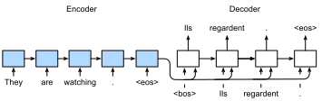
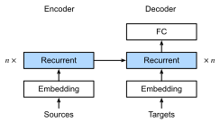
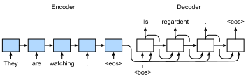

```{.python .input}
%load_ext d2lbook.tab
tab.interact_select('mxnet', 'pytorch', 'tensorflow', 'jax')
```

#  机器翻译的序列到序列学习
:label:`sec_seq2seq`

在所谓的序列到序列问题（如机器翻译，
见 :numref:`sec_machine_translation`）中，
输入和输出都由长度可变、未对齐的序列组成，
此时我们通常依赖编码器-解码器架构
（:numref:`sec_encoder-decoder`）。
本节中，
我们将展示编码器-解码器架构
在机器翻译任务中的应用
:cite:`Sutskever.Vinyals.Le.2014,Cho.Van-Merrienboer.Gulcehre.ea.2014`，
其中编码器和解码器
都实现为 RNN。

这里，编码器 RNN 将变长序列作为输入，
并将其变换为形状固定的隐藏状态。
稍后在 :numref:`chap_attention-and-transformers` 中，
我们将介绍注意力机制，
它让我们无需把整个输入
压缩成单个固定长度的表示
就能访问编码后的输入。

然后，为了一次一个词元地
生成输出序列，
由单独 RNN 组成的解码器模型
将根据输入序列
和输出中前面的词元，
预测每个相继的目标词元。
训练时，解码器通常
以官方“真实标签”（ground truth）中
前面的词元为条件。
然而在测试时，我们希望
解码器的每个输出都以已经预测出的词元为条件。
请注意，如果忽略编码器，
序列到序列架构中的解码器
与普通的语言模型行为完全一样。
:numref:`fig_seq2seq` 展示了
如何用两个 RNN
进行机器翻译中的序列到序列学习。



:label:`fig_seq2seq`

在 :numref:`fig_seq2seq` 中，
特殊的“&lt;eos&gt;”词元
标记序列的结束。
一旦生成该词元，
我们的模型就可以停止预测。
在 RNN 解码器的初始时间步，
有两个需要特别注意的特殊设计决定：
第一，我们在每个输入的开头
放置一个特殊的序列开始“&lt;bos&gt;”词元。
第二，我们可以把
编码器的最终隐藏状态
在每个解码时间步都送入解码器
:cite:`Cho.Van-Merrienboer.Gulcehre.ea.2014`。
在其他一些设计中，
例如 :citet:`Sutskever.Vinyals.Le.2014` 的设计，
RNN 编码器的最终隐藏状态
只用于在第一个解码步
初始化解码器的隐藏状态。

```{.python .input}
%%tab mxnet
import collections
from d2l import mxnet as d2l
import math
from mxnet import np, npx, init, gluon, autograd
from mxnet.gluon import nn, rnn
npx.set_np()
```

```{.python .input}
%%tab pytorch
import collections
from d2l import torch as d2l
import math
import torch
from torch import nn
from torch.nn import functional as F
```

```{.python .input}
%%tab tensorflow
import collections
from d2l import tensorflow as d2l
import math
import tensorflow as tf
```

```{.python .input}
%%tab jax
import collections
from d2l import jax as d2l
from flax import linen as nn
from functools import partial
import jax
from jax import numpy as jnp
import math
import optax
```

## 教师强制

在输入序列上运行编码器
相对直接，
而处理解码器的输入和输出
则需要更加小心。
最常见的做法有时称为*教师强制*（teacher forcing）。
这里，原始的目标序列（词元标签）
被作为输入送入解码器。
更具体地说，
特殊的序列开始词元
和原始目标序列（除去最后一个词元）
连结成解码器的输入，
而解码器输出（用于训练的标签）则是
原始目标序列平移一个词元后的结果：“&lt;bos&gt;”、“Ils”、“regardent”、“.”$\rightarrow$“Ils”、“regardent”、“.”、“&lt;eos&gt;”（:numref:`fig_seq2seq`）。

我们在
:numref:`subsec_loading-seq-fixed-len`
中的实现已经为教师强制准备好了训练数据，
其中为自监督学习而平移词元的做法，
与 :numref:`sec_language-model` 中
语言模型的训练相似。
另一种替代做法是
把上一时间步*预测*出的词元
作为解码器当前的输入。


下面，我们将更详细地解释
:numref:`fig_seq2seq` 所描绘的设计。
我们将使用 :numref:`sec_machine_translation` 中介绍的
英法数据集来训练该模型进行机器翻译。

## 编码器

回想一下，编码器将长度可变的输入序列
变换为形状固定的*上下文变量*（context variable）$\mathbf{c}$（见 :numref:`fig_seq2seq`）。


考虑单个序列样例（批量大小为 1）。
假设输入序列为$x_1, \ldots, x_T$，
其中$x_t$是第$t^{\textrm{th}}$个词元。
在时间步$t$，RNN 把
输入特征向量$\mathbf{x}_t$（对应$x_t$）
和来自上一时间步的隐藏状态$\mathbf{h} _{t-1}$
变换为当前隐藏状态$\mathbf{h}_t$。
我们可以用函数$f$来表示
RNN 循环层的变换：

$$\mathbf{h}_t = f(\mathbf{x}_t, \mathbf{h}_{t-1}). $$

一般而言，编码器通过一个自定义函数$q$
把所有时间步的隐藏状态
变换为上下文变量：

$$\mathbf{c} =  q(\mathbf{h}_1, \ldots, \mathbf{h}_T).$$

例如，在 :numref:`fig_seq2seq` 中，
上下文变量就是隐藏状态$\mathbf{h}_T$，
它对应编码器 RNN 在处理完输入序列的
最后一个词元之后的表示。

在这个例子中，我们使用了单向 RNN
来设计编码器，
其中隐藏状态只依赖于
该隐藏状态所在时间步及之前的输入子序列。
我们也可以使用双向 RNN 来构造编码器。
在这种情况下，一个隐藏状态依赖于
该时间步之前和之后的子序列
（包括当前时间步的输入），
从而编码了整个序列的信息。


现在让我们[**实现 RNN 编码器**]。
请注意，我们使用*嵌入层*
来获得输入序列中每个词元的特征向量。
嵌入层的权重是一个矩阵，
其行数对应于
输入词表的大小（`vocab_size`），
列数对应于
特征向量的维数（`embed_size`）。
对于任意输入词元索引$i$，
嵌入层取权重矩阵的第$i^{\textrm{th}}$行
（从 0 开始计数）
来返回其特征向量。
这里我们用多层 GRU 实现编码器。

```{.python .input}
%%tab mxnet
class Seq2SeqEncoder(d2l.Encoder):  #@save
    """The RNN encoder for sequence-to-sequence learning."""
    def __init__(self, vocab_size, embed_size, num_hiddens, num_layers,
                 dropout=0):
        super().__init__()
        self.embedding = nn.Embedding(vocab_size, embed_size)
        self.rnn = d2l.GRU(num_hiddens, num_layers, dropout)
        self.initialize(init.Xavier())
            
    def forward(self, X, *args):
        # X shape: (batch_size, num_steps)
        embs = self.embedding(d2l.transpose(X))
        # embs shape: (num_steps, batch_size, embed_size)    
        outputs, state = self.rnn(embs)
        # outputs shape: (num_steps, batch_size, num_hiddens)
        # state shape: (num_layers, batch_size, num_hiddens)
        return outputs, state
```

```{.python .input}
%%tab pytorch
def init_seq2seq(module):  #@save
    """Initialize weights for sequence-to-sequence learning."""
    if type(module) == nn.Linear:
         nn.init.xavier_uniform_(module.weight)
    if type(module) == nn.GRU:
        for param in module._flat_weights_names:
            if "weight" in param:
                nn.init.xavier_uniform_(module._parameters[param])
```

```{.python .input}
%%tab pytorch
class Seq2SeqEncoder(d2l.Encoder):  #@save
    """The RNN encoder for sequence-to-sequence learning."""
    def __init__(self, vocab_size, embed_size, num_hiddens, num_layers,
                 dropout=0):
        super().__init__()
        self.embedding = nn.Embedding(vocab_size, embed_size)
        self.rnn = d2l.GRU(embed_size, num_hiddens, num_layers, dropout)
        self.apply(init_seq2seq)
            
    def forward(self, X, *args):
        # X shape: (batch_size, num_steps)
        embs = self.embedding(d2l.astype(d2l.transpose(X), d2l.int64))
        # embs shape: (num_steps, batch_size, embed_size)
        outputs, state = self.rnn(embs)
        # outputs shape: (num_steps, batch_size, num_hiddens)
        # state shape: (num_layers, batch_size, num_hiddens)
        return outputs, state
```

```{.python .input}
%%tab tensorflow
class Seq2SeqEncoder(d2l.Encoder):  #@save
    """The RNN encoder for sequence-to-sequence learning."""
    def __init__(self, vocab_size, embed_size, num_hiddens, num_layers,
                 dropout=0):
        super().__init__()
        self.embedding = tf.keras.layers.Embedding(vocab_size, embed_size)
        self.rnn = d2l.GRU(num_hiddens, num_layers, dropout)
            
    def call(self, X, *args):
        # X shape: (batch_size, num_steps)
        embs = self.embedding(d2l.transpose(X))
        # embs shape: (num_steps, batch_size, embed_size)    
        outputs, state = self.rnn(embs)
        # outputs shape: (num_steps, batch_size, num_hiddens)
        # state shape: (num_layers, batch_size, num_hiddens)
        return outputs, state
```

```{.python .input}
%%tab jax
class Seq2SeqEncoder(d2l.Encoder):  #@save
    """The RNN encoder for sequence-to-sequence learning."""
    vocab_size: int
    embed_size: int
    num_hiddens: int
    num_layers: int
    dropout: float = 0

    def setup(self):
        self.embedding = nn.Embed(self.vocab_size, self.embed_size)
        self.rnn = d2l.GRU(self.num_hiddens, self.num_layers, self.dropout)

    def __call__(self, X, *args, training=False):
        # X shape: (batch_size, num_steps)
        embs = self.embedding(d2l.astype(d2l.transpose(X), d2l.int32))
        # embs shape: (num_steps, batch_size, embed_size)
        outputs, state = self.rnn(embs, training=training)
        # outputs shape: (num_steps, batch_size, num_hiddens)
        # state shape: (num_layers, batch_size, num_hiddens)
        return outputs, state
```

让我们用一个具体例子
来[**演示上述编码器实现**]。
下面，我们实例化一个隐藏单元数为 16 的两层 GRU 编码器。
给定一个小批量序列输入`X`
（批量大小$=4$；时间步数$=9$），
最后一层在所有时间步上的隐藏状态
（即编码器循环层返回的`enc_outputs`）
是一个形状为
（时间步数、批量大小、隐藏单元数）的张量。

```{.python .input}
%%tab all
vocab_size, embed_size, num_hiddens, num_layers = 10, 8, 16, 2
batch_size, num_steps = 4, 9
encoder = Seq2SeqEncoder(vocab_size, embed_size, num_hiddens, num_layers)
X = d2l.zeros((batch_size, num_steps))
if tab.selected('pytorch', 'mxnet', 'tensorflow'):
    enc_outputs, enc_state = encoder(X)
if tab.selected('jax'):
    (enc_outputs, enc_state), _ = encoder.init_with_output(d2l.get_key(), X)

d2l.check_shape(enc_outputs, (num_steps, batch_size, num_hiddens))
```

由于我们这里使用的是 GRU，
最终时间步的多层隐藏状态的形状为
（隐藏层数、批量大小、隐藏单元数）。

```{.python .input}
%%tab all
if tab.selected('mxnet', 'pytorch', 'jax'):
    d2l.check_shape(enc_state, (num_layers, batch_size, num_hiddens))
if tab.selected('tensorflow'):
    d2l.check_len(enc_state, num_layers)
    d2l.check_shape(enc_state[0], (batch_size, num_hiddens))
```

## [**解码器**]
:label:`sec_seq2seq_decoder`

给定目标输出序列$y_1, y_2, \ldots, y_{T'}$，
对每个时间步$t'$
（我们用$t^\prime$来区别于输入序列的时间步），
解码器为第$y_{t'+1}$步可能出现的每个词元
赋予一个预测概率，
其条件为目标序列中前面的词元
$y_1, \ldots, y_{t'}$
以及上下文变量
$\mathbf{c}$，即$P(y_{t'+1} \mid y_1, \ldots, y_{t'}, \mathbf{c})$。

为了预测目标序列中后续的词元$t^\prime+1$，
RNN 解码器把上一步的目标词元$y_{t^\prime}$、
来自上一时间步的 RNN 隐藏状态$\mathbf{s}_{t^\prime-1}$
以及上下文变量$\mathbf{c}$作为输入，
并把它们变换为当前时间步的
隐藏状态$\mathbf{s}_{t^\prime}$。
我们可以用函数$g$来表示
解码器隐藏层的变换：

$$\mathbf{s}_{t^\prime} = g(y_{t^\prime-1}, \mathbf{c}, \mathbf{s}_{t^\prime-1}).$$
:eqlabel:`eq_seq2seq_s_t`

在得到解码器的隐藏状态之后，
我们可以使用输出层和 softmax 运算，
计算出关于后续输出词元${t^\prime+1}$的预测分布
$p(y_{t^{\prime}+1} \mid y_1, \ldots, y_{t^\prime}, \mathbf{c})$。

遵循 :numref:`fig_seq2seq`，
在如下实现解码器时，
我们直接使用编码器
最终时间步的隐藏状态
来初始化解码器的隐藏状态。
这要求 RNN 编码器和 RNN 解码器
具有相同的层数和隐藏单元数。
为了进一步纳入编码后的输入序列信息，
上下文变量在所有时间步
都与解码器输入连结。
为了预测输出词元的概率分布，
我们使用一个全连接层
来变换 RNN 解码器
最后一层的隐藏状态。

```{.python .input}
%%tab mxnet
class Seq2SeqDecoder(d2l.Decoder):
    """The RNN decoder for sequence to sequence learning."""
    def __init__(self, vocab_size, embed_size, num_hiddens, num_layers,
                 dropout=0):
        super().__init__()
        self.embedding = nn.Embedding(vocab_size, embed_size)
        self.rnn = d2l.GRU(num_hiddens, num_layers, dropout)
        self.dense = nn.Dense(vocab_size, flatten=False)
        self.initialize(init.Xavier())
            
    def init_state(self, enc_all_outputs, *args):
        return enc_all_outputs 

    def forward(self, X, state):
        # X shape: (batch_size, num_steps)
        # embs shape: (num_steps, batch_size, embed_size)
        embs = self.embedding(d2l.transpose(X))
        enc_output, hidden_state = state
        # context shape: (batch_size, num_hiddens)
        context = enc_output[-1]
        # Broadcast context to (num_steps, batch_size, num_hiddens)
        context = np.tile(context, (embs.shape[0], 1, 1))
        # Concat at the feature dimension
        embs_and_context = d2l.concat((embs, context), -1)
        outputs, hidden_state = self.rnn(embs_and_context, hidden_state)
        outputs = d2l.swapaxes(self.dense(outputs), 0, 1)
        # outputs shape: (batch_size, num_steps, vocab_size)
        # hidden_state shape: (num_layers, batch_size, num_hiddens)
        return outputs, [enc_output, hidden_state]
```

```{.python .input}
%%tab pytorch
class Seq2SeqDecoder(d2l.Decoder):
    """The RNN decoder for sequence to sequence learning."""
    def __init__(self, vocab_size, embed_size, num_hiddens, num_layers,
                 dropout=0):
        super().__init__()
        self.embedding = nn.Embedding(vocab_size, embed_size)
        self.rnn = d2l.GRU(embed_size+num_hiddens, num_hiddens,
                           num_layers, dropout)
        self.dense = nn.LazyLinear(vocab_size)
        self.apply(init_seq2seq)
            
    def init_state(self, enc_all_outputs, *args):
        return enc_all_outputs

    def forward(self, X, state):
        # X shape: (batch_size, num_steps)
        # embs shape: (num_steps, batch_size, embed_size)
        embs = self.embedding(d2l.astype(d2l.transpose(X), d2l.int32))
        enc_output, hidden_state = state
        # context shape: (batch_size, num_hiddens)
        context = enc_output[-1]
        # Broadcast context to (num_steps, batch_size, num_hiddens)
        context = context.repeat(embs.shape[0], 1, 1)
        # Concat at the feature dimension
        embs_and_context = d2l.concat((embs, context), -1)
        outputs, hidden_state = self.rnn(embs_and_context, hidden_state)
        outputs = d2l.swapaxes(self.dense(outputs), 0, 1)
        # outputs shape: (batch_size, num_steps, vocab_size)
        # hidden_state shape: (num_layers, batch_size, num_hiddens)
        return outputs, [enc_output, hidden_state]
```

```{.python .input}
%%tab tensorflow
class Seq2SeqDecoder(d2l.Decoder):
    """The RNN decoder for sequence to sequence learning."""
    def __init__(self, vocab_size, embed_size, num_hiddens, num_layers,
                 dropout=0):
        super().__init__()
        self.embedding = tf.keras.layers.Embedding(vocab_size, embed_size)
        self.rnn = d2l.GRU(num_hiddens, num_layers, dropout)
        self.dense = tf.keras.layers.Dense(vocab_size)
            
    def init_state(self, enc_all_outputs, *args):
        return enc_all_outputs

    def call(self, X, state):
        # X shape: (batch_size, num_steps)
        # embs shape: (num_steps, batch_size, embed_size)
        embs = self.embedding(d2l.transpose(X))
        enc_output, hidden_state = state
        # context shape: (batch_size, num_hiddens)
        context = enc_output[-1]
        # Broadcast context to (num_steps, batch_size, num_hiddens)
        context = tf.tile(tf.expand_dims(context, 0), (embs.shape[0], 1, 1))
        # Concat at the feature dimension
        embs_and_context = d2l.concat((embs, context), -1)
        outputs, hidden_state = self.rnn(embs_and_context, hidden_state)
        outputs = d2l.transpose(self.dense(outputs), (1, 0, 2))
        # outputs shape: (batch_size, num_steps, vocab_size)
        # hidden_state shape: (num_layers, batch_size, num_hiddens)
        return outputs, [enc_output, hidden_state]
```

```{.python .input}
%%tab jax
class Seq2SeqDecoder(d2l.Decoder):
    """The RNN decoder for sequence to sequence learning."""
    vocab_size: int
    embed_size: int
    num_hiddens: int
    num_layers: int
    dropout: float = 0

    def setup(self):
        self.embedding = nn.Embed(self.vocab_size, self.embed_size)
        self.rnn = d2l.GRU(self.num_hiddens, self.num_layers, self.dropout)
        self.dense = nn.Dense(self.vocab_size)

    def init_state(self, enc_all_outputs, *args):
        return enc_all_outputs

    def __call__(self, X, state, training=False):
        # X shape: (batch_size, num_steps)
        # embs shape: (num_steps, batch_size, embed_size)
        embs = self.embedding(d2l.astype(d2l.transpose(X), d2l.int32))
        enc_output, hidden_state = state
        # context shape: (batch_size, num_hiddens)
        context = enc_output[-1]
        # Broadcast context to (num_steps, batch_size, num_hiddens)
        context = jnp.tile(context, (embs.shape[0], 1, 1))
        # Concat at the feature dimension
        embs_and_context = d2l.concat((embs, context), -1)
        outputs, hidden_state = self.rnn(embs_and_context, hidden_state,
                                         training=training)
        outputs = d2l.swapaxes(self.dense(outputs), 0, 1)
        # outputs shape: (batch_size, num_steps, vocab_size)
        # hidden_state shape: (num_layers, batch_size, num_hiddens)
        return outputs, [enc_output, hidden_state]
```

为了[**演示所实现的解码器**]，
下面我们用上述编码器相同的超参数来实例化它。
如我们所见，解码器的输出形状变为
（批量大小、时间步数、词表大小），
其中张量的最后一维存储预测的词元分布。

```{.python .input}
%%tab all
decoder = Seq2SeqDecoder(vocab_size, embed_size, num_hiddens, num_layers)
if tab.selected('mxnet', 'pytorch', 'tensorflow'):
    state = decoder.init_state(encoder(X))
    dec_outputs, state = decoder(X, state)
if tab.selected('jax'):
    state = decoder.init_state(encoder.init_with_output(d2l.get_key(), X)[0])
    (dec_outputs, state), _ = decoder.init_with_output(d2l.get_key(), X,
                                                       state)


d2l.check_shape(dec_outputs, (batch_size, num_steps, vocab_size))
if tab.selected('mxnet', 'pytorch', 'jax'):
    d2l.check_shape(state[1], (num_layers, batch_size, num_hiddens))
if tab.selected('tensorflow'):
    d2l.check_len(state[1], num_layers)
    d2l.check_shape(state[1][0], (batch_size, num_hiddens))
```

上述 RNN 编码器-解码器模型中的各层
总结于 :numref:`fig_seq2seq_details`。


:label:`fig_seq2seq_details`

## 序列到序列学习的编码器-解码器


把它们整合到代码中，就得到以下内容：

```{.python .input}
%%tab pytorch, tensorflow, mxnet
class Seq2Seq(d2l.EncoderDecoder):  #@save
    """The RNN encoder--decoder for sequence to sequence learning."""
    def __init__(self, encoder, decoder, tgt_pad, lr):
        super().__init__(encoder, decoder)
        self.save_hyperparameters()
        
    def validation_step(self, batch):
        Y_hat = self(*batch[:-1])
        self.plot('loss', self.loss(Y_hat, batch[-1]), train=False)
        
    def configure_optimizers(self):
        # Adam optimizer is used here
        if tab.selected('mxnet'):
            return gluon.Trainer(self.parameters(), 'adam',
                                 {'learning_rate': self.lr})
        if tab.selected('pytorch'):
            return torch.optim.Adam(self.parameters(), lr=self.lr)
        if tab.selected('tensorflow'):
            return tf.keras.optimizers.Adam(learning_rate=self.lr)
```

```{.python .input}
%%tab jax
class Seq2Seq(d2l.EncoderDecoder):  #@save
    """The RNN encoder--decoder for sequence to sequence learning."""
    encoder: nn.Module
    decoder: nn.Module
    tgt_pad: int
    lr: float

    def validation_step(self, params, batch, state):
        l, _ = self.loss(params, batch[:-1], batch[-1], state)
        self.plot('loss', l, train=False)

    def configure_optimizers(self):
        # Adam optimizer is used here
        return optax.adam(learning_rate=self.lr)
```

## 带掩码的损失函数

在每个时间步，解码器
预测输出词元的概率分布。
与语言建模一样，
我们可以应用 softmax
得到该分布，
并计算交叉熵损失用于优化。
回想 :numref:`sec_machine_translation` 中的内容：
特殊的填充词元
被追加到序列末尾，
因此长度不一的序列
可以高效地加载到
形状相同的小批量中。
然而，填充词元的预测
应当从损失计算中排除。
为此，我们可以
[**用零值掩码无关项**]，
这样任何无关预测
与零相乘都等于零。

```{.python .input}
%%tab pytorch, mxnet, tensorflow
@d2l.add_to_class(Seq2Seq)
def loss(self, Y_hat, Y):
    l = super(Seq2Seq, self).loss(Y_hat, Y, averaged=False)
    mask = d2l.astype(d2l.reshape(Y, -1) != self.tgt_pad, d2l.float32)
    return d2l.reduce_sum(l * mask) / d2l.reduce_sum(mask)
```

```{.python .input}
%%tab jax
@d2l.add_to_class(Seq2Seq)
@partial(jax.jit, static_argnums=(0, 5))
def loss(self, params, X, Y, state, averaged=False):
    Y_hat = state.apply_fn({'params': params}, *X,
                           rngs={'dropout': state.dropout_rng})
    Y_hat = d2l.reshape(Y_hat, (-1, Y_hat.shape[-1]))
    Y = d2l.reshape(Y, (-1,))
    fn = optax.softmax_cross_entropy_with_integer_labels
    l = fn(Y_hat, Y)
    mask = d2l.astype(d2l.reshape(Y, -1) != self.tgt_pad, d2l.float32)
    return d2l.reduce_sum(l * mask) / d2l.reduce_sum(mask), {}
```

## [**训练**]
:label:`sec_seq2seq_training`

现在我们可以在机器翻译数据集上
[**创建并训练一个 RNN 编码器-解码器模型**]
用于序列到序列学习。

```{.python .input}
%%tab all
data = d2l.MTFraEng(batch_size=128) 
embed_size, num_hiddens, num_layers, dropout = 256, 256, 2, 0.2
if tab.selected('mxnet', 'pytorch', 'jax'):
    encoder = Seq2SeqEncoder(
        len(data.src_vocab), embed_size, num_hiddens, num_layers, dropout)
    decoder = Seq2SeqDecoder(
        len(data.tgt_vocab), embed_size, num_hiddens, num_layers, dropout)
if tab.selected('mxnet', 'pytorch'):
    model = Seq2Seq(encoder, decoder, tgt_pad=data.tgt_vocab['<pad>'],
                    lr=0.005)
if tab.selected('jax'):
    model = Seq2Seq(encoder, decoder, tgt_pad=data.tgt_vocab['<pad>'],
                    lr=0.005, training=True)
if tab.selected('mxnet', 'pytorch', 'jax'):
    trainer = d2l.Trainer(max_epochs=30, gradient_clip_val=1, num_gpus=1)
if tab.selected('tensorflow'):
    with d2l.try_gpu():
        encoder = Seq2SeqEncoder(
            len(data.src_vocab), embed_size, num_hiddens, num_layers, dropout)
        decoder = Seq2SeqDecoder(
            len(data.tgt_vocab), embed_size, num_hiddens, num_layers, dropout)
        model = Seq2Seq(encoder, decoder, tgt_pad=data.tgt_vocab['<pad>'],
                        lr=0.005)
    trainer = d2l.Trainer(max_epochs=30, gradient_clip_val=1)
trainer.fit(model, data)
```

## [**预测**]

为了逐步预测输出序列，
上一时间步预测出的词元
会作为输入送入解码器。
一种简单的策略是：
在每一步预测时，选取解码器
赋予概率最高的那个词元。
与训练时一样，在初始时间步，
序列开始（“&lt;bos&gt;”）词元
被送入解码器。
这一预测过程
如 :numref:`fig_seq2seq_predict` 所示。
当预测出序列结束（“&lt;eos&gt;”）词元时，
输出序列的预测就完成了。



:label:`fig_seq2seq_predict`

下一节中，我们将介绍
基于束搜索的
更为精细的策略
（:numref:`sec_beam-search`）。

```{.python .input}
%%tab pytorch, mxnet, tensorflow
@d2l.add_to_class(d2l.EncoderDecoder)  #@save
def predict_step(self, batch, device, num_steps,
                 save_attention_weights=False):
    if tab.selected('mxnet', 'pytorch'):
        batch = [d2l.to(a, device) for a in batch]
    src, tgt, src_valid_len, _ = batch
    if tab.selected('mxnet', 'pytorch'):
        enc_all_outputs = self.encoder(src, src_valid_len)
    if tab.selected('tensorflow'):
        enc_all_outputs = self.encoder(src, src_valid_len, training=False)
    dec_state = self.decoder.init_state(enc_all_outputs, src_valid_len)
    outputs, attention_weights = [d2l.expand_dims(tgt[:, 0], 1), ], []
    for _ in range(num_steps):
        if tab.selected('mxnet', 'pytorch'):
            Y, dec_state = self.decoder(outputs[-1], dec_state)
        if tab.selected('tensorflow'):
            Y, dec_state = self.decoder(outputs[-1], dec_state, training=False)
        outputs.append(d2l.argmax(Y, 2))
        # Save attention weights (to be covered later)
        if save_attention_weights:
            attention_weights.append(self.decoder.attention_weights)
    return d2l.concat(outputs[1:], 1), attention_weights
```

```{.python .input}
%%tab jax
@d2l.add_to_class(d2l.EncoderDecoder)  #@save
def predict_step(self, params, batch, num_steps,
                 save_attention_weights=False):
    src, tgt, src_valid_len, _ = batch
    enc_all_outputs, inter_enc_vars = self.encoder.apply(
        {'params': params['encoder']}, src, src_valid_len, training=False,
        mutable='intermediates')
    # Save encoder attention weights if inter_enc_vars containing encoder
    # attention weights is not empty. (to be covered later)
    enc_attention_weights = []
    if bool(inter_enc_vars) and save_attention_weights:
        # Encoder Attention Weights saved in the intermediates collection
        enc_attention_weights = inter_enc_vars[
            'intermediates']['enc_attention_weights'][0]

    dec_state = self.decoder.init_state(enc_all_outputs, src_valid_len)
    outputs, attention_weights = [d2l.expand_dims(tgt[:,0], 1), ], []
    for _ in range(num_steps):
        (Y, dec_state), inter_dec_vars = self.decoder.apply(
            {'params': params['decoder']}, outputs[-1], dec_state,
            training=False, mutable='intermediates')
        outputs.append(d2l.argmax(Y, 2))
        # Save attention weights (to be covered later)
        if save_attention_weights:
            # Decoder Attention Weights saved in the intermediates collection
            dec_attention_weights = inter_dec_vars[
                'intermediates']['dec_attention_weights'][0]
            attention_weights.append(dec_attention_weights)
    return d2l.concat(outputs[1:], 1), (attention_weights,
                                        enc_attention_weights)
```

## 预测序列的评估

我们可以通过将预测序列与
目标序列（真实标签）进行比较
来评估它。
但是，衡量两个序列之间相似性的
合适指标究竟是什么呢？


双语评估替补（Bilingual Evaluation Understudy，BLEU）
最初是为评估机器翻译结果而提出的 :cite:`Papineni.Roukos.Ward.ea.2002`，
但已被广泛用于衡量
不同应用中输出序列的质量。
原则上，对于预测序列中的任意$n$元语法（:numref:`subsec_markov-models-and-n-grams`），
BLEU 评估该$n$元语法是否
出现在目标序列中。

用$p_n$表示$n$元语法的查准率，
其定义为预测序列与目标序列中
匹配的$n$元语法数量，
与预测序列中$n$元语法数量之比。
举例来说，给定目标序列$A$、$B$、$C$、$D$、$E$、$F$，
以及预测序列$A$、$B$、$B$、$C$、$D$，
我们有$p_1 = 4/5$、$p_2 = 3/4$、$p_3 = 1/3$和$p_4 = 0$。
现在令$\textrm{len}_{\textrm{label}}$和$\textrm{len}_{\textrm{pred}}$
分别表示目标序列
和预测序列中的词元数。
那么，BLEU 定义为

$$ \exp\left(\min\left(0, 1 - \frac{\textrm{len}_{\textrm{label}}}{\textrm{len}_{\textrm{pred}}}\right)\right) \prod_{n=1}^k p_n^{1/2^n},$$
:eqlabel:`eq_bleu`

其中$k$是用于匹配的最长$n$元语法。

根据 :eqref:`eq_bleu` 中 BLEU 的定义，
只要预测序列与目标序列相同，BLEU 就为 1。
此外，
由于匹配较长的$n$元语法更困难，
当较长的$n$元语法具有高查准率时，
BLEU 会赋予更大的权重。
具体来说，当$p_n$固定时，
$p_n^{1/2^n}$随着$n$的增大而增大（原论文使用的是$p_n^{1/n}$）。
此外，
由于
预测较短的序列
往往会得到较高的$p_n$值，
:eqref:`eq_bleu` 中乘积项之前的系数
会惩罚较短的预测序列。
例如，当$k=2$时，
给定目标序列$A$、$B$、$C$、$D$、$E$、$F$以及预测序列$A$、$B$，
尽管$p_1 = p_2 = 1$，惩罚因子$\exp(1-6/2) \approx 0.14$仍会降低 BLEU。

我们如下[**实现 BLEU 指标**]。

```{.python .input}
%%tab all
def bleu(pred_seq, label_seq, k):  #@save
    """Compute the BLEU."""
    pred_tokens, label_tokens = pred_seq.split(' '), label_seq.split(' ')
    len_pred, len_label = len(pred_tokens), len(label_tokens)
    score = math.exp(min(0, 1 - len_label / len_pred))
    for n in range(1, min(k, len_pred) + 1):
        num_matches, label_subs = 0, collections.defaultdict(int)
        for i in range(len_label - n + 1):
            label_subs[' '.join(label_tokens[i: i + n])] += 1
        for i in range(len_pred - n + 1):
            if label_subs[' '.join(pred_tokens[i: i + n])] > 0:
                num_matches += 1
                label_subs[' '.join(pred_tokens[i: i + n])] -= 1
        score *= math.pow(num_matches / (len_pred - n + 1), math.pow(0.5, n))
    return score
```

最后，
我们使用训练好的 RNN 编码器-解码器
[**把几个英文句子翻译成法语**]，
并计算结果序列的 BLEU。

```{.python .input}
%%tab all
engs = ['go .', 'i lost .', 'he\'s calm .', 'i\'m home .']
fras = ['va !', 'j\'ai perdu .', 'il est calme .', 'je suis chez moi .']
if tab.selected('pytorch', 'mxnet', 'tensorflow'):
    preds, _ = model.predict_step(
        data.build(engs, fras), d2l.try_gpu(), data.num_steps)
if tab.selected('jax'):
    preds, _ = model.predict_step(trainer.state.params, data.build(engs, fras),
                                  data.num_steps)
for en, fr, p in zip(engs, fras, preds):
    translation = []
    for token in data.tgt_vocab.to_tokens(p):
        if token == '<eos>':
            break
        translation.append(token)        
    print(f'{en} => {translation}, bleu,'
          f'{bleu(" ".join(translation), fr, k=2):.3f}')
```

## 小结

遵循编码器-解码器架构的设计，我们可以使用两个 RNN 来设计序列到序列学习的模型。
在编码器-解码器的训练中，教师强制方法把原始输出序列（而非预测结果）送入解码器。
在实现编码器和解码器时，我们可以使用多层 RNN。
我们可以使用掩码过滤掉无关计算，例如在计算损失时。
对于输出序列的评估，BLEU 是一种流行的指标，它在预测序列与目标序列之间匹配$n$元语法。


## 练习

1. 你能调整超参数来改善翻译结果吗？
1. 在损失计算中不使用掩码，重新运行实验。你观察到什么结果？为什么？
1. 如果编码器和解码器在层数或隐藏单元数上不同，我们如何初始化解码器的隐藏状态？
1. 在训练中，把教师强制替换为将上一时间步的预测送入解码器。这如何影响性能？
1. 用 LSTM 替换 GRU，重新运行实验。
1. 还有其他设计解码器输出层的方法吗？

:begin_tab:`mxnet`
[讨论](https://discuss.d2l.ai/t/345)
:end_tab:

:begin_tab:`pytorch`
[讨论](https://discuss.d2l.ai/t/1062)
:end_tab:

:begin_tab:`tensorflow`
[讨论](https://discuss.d2l.ai/t/3865)
:end_tab:

:begin_tab:`jax`
[讨论](https://discuss.d2l.ai/t/18022)
:end_tab:
