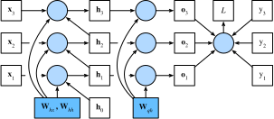

# 通过时间反向传播
:label:`sec_bptt`

如果你完成了 :numref:`sec_rnn-scratch` 中的练习，
就会看到梯度裁剪对于防止偶发的大梯度破坏训练稳定性是多么关键。
我们曾提示，梯度爆炸源于在长序列上的反向传播。
在介绍一系列现代 RNN 架构之前，
让我们先从数学细节上仔细看看*反向传播*在序列模型中是如何进行的。
希望这些讨论能让*梯度消失*和*梯度爆炸*的概念更精确一些。
如果你还记得我们在 :numref:`sec_backprop` 中介绍多层感知机时
关于计算图中前向传播和反向传播的讨论，
那么 RNN 中的前向传播应该就比较容易理解了。
在 RNN 中应用反向传播称为*通过时间反向传播*（backpropagation through time）:cite:`Werbos.1990`。
这一过程要求我们一次一个时间步地展开（或铺开）RNN 的计算图。
展开后的 RNN 本质上是一个前馈神经网络，
其特殊之处在于相同的参数在整个展开网络中重复出现，
即在每个时间步都出现。
然后，就像在任何前馈神经网络中一样，
我们可以应用链式法则，在展开后的网络上反向传播梯度。
关于每个参数的梯度，必须在该参数于展开网络中出现过的所有位置求和。
处理这种权重共享应该并不陌生，
我们在卷积神经网络章节中已经见过。

复杂之处在于序列可能相当长。
处理包含一千多个词元的文本序列并不罕见。
请注意，这会同时带来计算（内存过多）
和优化（数值不稳定）两方面的问题。
第一个时间步的输入在到达输出之前要经过一千多次矩阵乘积，
而计算梯度又需要另外一千次矩阵乘积。
下面我们分析可能出现什么问题，以及实践中如何应对。

## RNN 中的梯度分析
:label:`subsec_bptt_analysis`

我们从一个简化的 RNN 工作模型开始。
该模型忽略了隐藏状态的具体细节以及它如何更新。
这里的数学记号不显式区分标量、向量和矩阵。
我们只是想建立一些直觉。
在这个简化模型中，我们用 $h_t$ 表示隐藏状态，
用 $x_t$ 表示输入，用 $o_t$ 表示
时间步 $t$ 的输出。
回想我们在
:numref:`subsec_rnn_w_hidden_states`
中的讨论：输入和隐藏状态可以先连结起来，
再乘以隐藏层中的一个权重变量。
因此，我们用 $w_\textrm{h}$ 和 $w_\textrm{o}$ 分别表示
隐藏层和输出层的权重。
于是，每个时间步的隐藏状态和输出为

$$\begin{aligned}h_t &= f(x_t, h_{t-1}, w_\textrm{h}),\\o_t &= g(h_t, w_\textrm{o}),\end{aligned}$$
:eqlabel:`eq_bptt_ht_ot`

其中 $f$ 和 $g$ 分别是
隐藏层和输出层的变换。
因此，我们有一串值
$\{\ldots, (x_{t-1}, h_{t-1}, o_{t-1}), (x_{t}, h_{t}, o_t), \ldots\}$，
它们通过循环计算相互依赖。
前向传播相当直接。
我们只需要一次一个时间步地遍历 $(x_t, h_t, o_t)$ 三元组。
然后，用目标函数在全部 $T$ 个时间步上
评价输出 $o_t$ 与期望目标 $y_t$ 之间的差异，即

$$L(x_1, \ldots, x_T, y_1, \ldots, y_T, w_\textrm{h}, w_\textrm{o}) = \frac{1}{T}\sum_{t=1}^T l(y_t, o_t).$$

对于反向传播，情况就有点棘手了，
尤其是当我们计算目标函数 $L$ 关于参数 $w_\textrm{h}$ 的梯度时。
具体来说，由链式法则可得

$$\begin{aligned}\frac{\partial L}{\partial w_\textrm{h}}  & = \frac{1}{T}\sum_{t=1}^T \frac{\partial l(y_t, o_t)}{\partial w_\textrm{h}}  \\& = \frac{1}{T}\sum_{t=1}^T \frac{\partial l(y_t, o_t)}{\partial o_t} \frac{\partial g(h_t, w_\textrm{o})}{\partial h_t}  \frac{\partial h_t}{\partial w_\textrm{h}}.\end{aligned}$$
:eqlabel:`eq_bptt_partial_L_wh`

:eqref:`eq_bptt_partial_L_wh` 中乘积的
第一个和第二个因子很容易计算。
第三个因子 $\partial h_t/\partial w_\textrm{h}$ 才是棘手之处，
因为我们需要循环地计算参数 $w_\textrm{h}$ 对 $h_t$ 的影响。
根据 :eqref:`eq_bptt_ht_ot` 中的循环计算，
$h_t$ 同时依赖于 $h_{t-1}$ 和 $w_\textrm{h}$，
而 $h_{t-1}$ 的计算也依赖于 $w_\textrm{h}$。
因此，用链式法则求 $h_t$ 关于 $w_\textrm{h}$ 的总导数，得到

$$\frac{\partial h_t}{\partial w_\textrm{h}}= \frac{\partial f(x_{t},h_{t-1},w_\textrm{h})}{\partial w_\textrm{h}} +\frac{\partial f(x_{t},h_{t-1},w_\textrm{h})}{\partial h_{t-1}} \frac{\partial h_{t-1}}{\partial w_\textrm{h}}.$$
:eqlabel:`eq_bptt_partial_ht_wh_recur`

为了推导上面的梯度，假设我们有
三个序列 $\{a_{t}\},\{b_{t}\},\{c_{t}\}$，
满足 $a_{0}=0$，且对 $t=1, 2,\ldots$ 有 $a_{t}=b_{t}+c_{t}a_{t-1}$。
那么对 $t\geq 1$，容易证明

$$a_{t}=b_{t}+\sum_{i=1}^{t-1}\left(\prod_{j=i+1}^{t}c_{j}\right)b_{i}.$$
:eqlabel:`eq_bptt_at`

按照下式代入 $a_t$、$b_t$ 和 $c_t$：

$$\begin{aligned}a_t &= \frac{\partial h_t}{\partial w_\textrm{h}},\\
b_t &= \frac{\partial f(x_{t},h_{t-1},w_\textrm{h})}{\partial w_\textrm{h}}, \\
c_t &= \frac{\partial f(x_{t},h_{t-1},w_\textrm{h})}{\partial h_{t-1}},\end{aligned}$$

则 :eqref:`eq_bptt_partial_ht_wh_recur` 中的梯度计算满足
$a_{t}=b_{t}+c_{t}a_{t-1}$。
因此，根据 :eqref:`eq_bptt_at`，
我们可以用下式去掉 :eqref:`eq_bptt_partial_ht_wh_recur`
中的循环计算：

$$\frac{\partial h_t}{\partial w_\textrm{h}}=\frac{\partial f(x_{t},h_{t-1},w_\textrm{h})}{\partial w_\textrm{h}}+\sum_{i=1}^{t-1}\left(\prod_{j=i+1}^{t} \frac{\partial f(x_{j},h_{j-1},w_\textrm{h})}{\partial h_{j-1}} \right) \frac{\partial f(x_{i},h_{i-1},w_\textrm{h})}{\partial w_\textrm{h}}.$$
:eqlabel:`eq_bptt_partial_ht_wh_gen`

虽然我们可以用链式法则递归地计算 $\partial h_t/\partial w_\textrm{h}$，
但当 $t$ 很大时，这条链会变得非常长。
让我们讨论几种应对这个问题的策略。

### 完全计算 ###

一种想法是计算 :eqref:`eq_bptt_partial_ht_wh_gen` 中的完整和。
然而，这样做非常慢，而且梯度可能爆炸，
因为初始条件的细微变化可能对结果产生很大影响。
也就是说，我们可能会看到类似蝴蝶效应的现象：
初始条件的极小变化会导致结果产生不成比例的变化。
这通常是不希望出现的。
毕竟，我们寻找的是能很好泛化的鲁棒估计量。
因此，这种策略在实践中几乎从不使用。

### 截断时间步###

或者，我们可以在 $\tau$ 步之后
截断 :eqref:`eq_bptt_partial_ht_wh_gen` 中的和。
这就是我们到目前为止一直在讨论的做法。
它通过将求和终止在 $\partial h_{t-\tau}/\partial w_\textrm{h}$ 处，
从而给出真实梯度的一个*近似*。
在实践中，这种做法的效果相当好。
它通常被称为截断的通过时间反向传播（truncated backpropgation through time）:cite:`Jaeger.2002`。
这样做的一个结果是，
模型主要关注短期影响，而不是长期后果。
这实际上是*可取的*，
因为它使估计偏向更简单、更稳定的模型。

### 随机截断 ###

最后，我们可以把 $\partial h_t/\partial w_\textrm{h}$
替换成一个在期望意义下正确、但会截断序列的随机变量。
为此，我们使用一个 $\xi_t$ 序列，
并预先给定 $0 \leq \pi_t \leq 1$，
使得 $P(\xi_t = 0) = 1-\pi_t$ 且
$P(\xi_t = \pi_t^{-1}) = \pi_t$，从而 $E[\xi_t] = 1$。
我们用这个来替换 :eqref:`eq_bptt_partial_ht_wh_recur` 中的梯度
$\partial h_t/\partial w_\textrm{h}$，得到

$$z_t= \frac{\partial f(x_{t},h_{t-1},w_\textrm{h})}{\partial w_\textrm{h}} +\xi_t \frac{\partial f(x_{t},h_{t-1},w_\textrm{h})}{\partial h_{t-1}} \frac{\partial h_{t-1}}{\partial w_\textrm{h}}.$$

根据 $\xi_t$ 的定义可知，
$E[z_t] = \partial h_t/\partial w_\textrm{h}$。
每当 $\xi_t = 0$ 时，循环计算
就在该时间步 $t$ 终止。
这导致不同长度序列的加权和，
其中长序列很少出现，但会被适当地加大权重。
这个想法由 :citet:`Tallec.Ollivier.2017` 提出。

### 比较策略

:label:`fig_truncated_bptt`

:numref:`fig_truncated_bptt` 展示了在分析*The Time Machine*的前几个字符时，
用 RNN 的通过时间反向传播计算梯度的三种策略：

* 第一行是随机截断，它把文本划分成长度不同的片段。
* 第二行是常规截断，它把文本切成长度相同的子序列。这就是我们在 RNN 实验中一直采用的做法。
* 第三行是完全的通过时间反向传播，它会导致计算上不可行的表达式。

遗憾的是，随机截断虽然在理论上很吸引人，
但效果并不比常规截断好多少，
这很可能是由若干因素造成的。
首先，在实践中，观测在向过去反向传播若干步之后产生的效应，
已经足以捕捉依赖关系。
其次，方差增大抵消了步数更多时梯度更精确这一好处。
第三，我们实际上*希望*模型的交互范围较短。
因此，按常规截断的通过时间反向传播具有轻微的正则化效果，这可能是理想的。

## 通过时间反向传播的细节

讨论了一般原理之后，让我们详细讨论通过时间反向传播。
与 :numref:`subsec_bptt_analysis` 中的分析不同，
下面我们将展示如何计算目标函数关于所有分解后的模型参数的梯度。
为简单起见，我们考虑一个不带偏置参数的 RNN，
其隐藏层的激活函数使用恒等映射（$\phi(x)=x$）。
对于时间步 $t$，设单个样例的输入和目标分别为
$\mathbf{x}_t \in \mathbb{R}^d$ 和 $y_t$。
隐藏状态 $\mathbf{h}_t \in \mathbb{R}^h$ 和输出 $\mathbf{o}_t \in \mathbb{R}^q$ 的计算方式为

$$\begin{aligned}\mathbf{h}_t &= \mathbf{W}_\textrm{hx} \mathbf{x}_t + \mathbf{W}_\textrm{hh} \mathbf{h}_{t-1},\\
\mathbf{o}_t &= \mathbf{W}_\textrm{qh} \mathbf{h}_{t},\end{aligned}$$

其中 $\mathbf{W}_\textrm{hx} \in \mathbb{R}^{h \times d}$、$\mathbf{W}_\textrm{hh} \in \mathbb{R}^{h \times h}$ 和
$\mathbf{W}_\textrm{qh} \in \mathbb{R}^{q \times h}$
是权重参数。
用 $l(\mathbf{o}_t, y_t)$ 表示时间步 $t$ 的损失。
于是我们的目标函数，即从序列开头起 $T$ 个时间步上的损失为

$$L = \frac{1}{T} \sum_{t=1}^T l(\mathbf{o}_t, y_t).$$

为了可视化 RNN 计算过程中
模型变量与参数之间的依赖关系，
我们可以为模型画出计算图，如 :numref:`fig_rnn_bptt` 所示。
例如，时间步 3 的隐藏状态
$\mathbf{h}_3$ 的计算依赖于模型参数
$\mathbf{W}_\textrm{hx}$ 和 $\mathbf{W}_\textrm{hh}$、
上一时间步的隐藏状态 $\mathbf{h}_2$
以及当前时间步的输入 $\mathbf{x}_3$。

:label:`fig_rnn_bptt`

正如刚才提到的，:numref:`fig_rnn_bptt` 中的模型参数是
$\mathbf{W}_\textrm{hx}$、$\mathbf{W}_\textrm{hh}$ 和 $\mathbf{W}_\textrm{qh}$。
一般来说，训练这个模型需要计算关于这些参数的梯度
$\partial L/\partial \mathbf{W}_\textrm{hx}$、$\partial L/\partial \mathbf{W}_\textrm{hh}$ 和 $\partial L/\partial \mathbf{W}_\textrm{qh}$。
根据 :numref:`fig_rnn_bptt` 中的依赖关系，
我们可以沿箭头的反方向遍历，依次计算并存储梯度。
为了在链式法则中灵活地表示不同形状的矩阵、向量和标量的乘法，
我们继续使用 :numref:`sec_backprop` 中描述的 $\textrm{prod}$ 运算符。

首先，目标函数关于任意时间步 $t$ 的模型输出求导相当直接：

$$\frac{\partial L}{\partial \mathbf{o}_t} =  \frac{\partial l (\mathbf{o}_t, y_t)}{T \cdot \partial \mathbf{o}_t} \in \mathbb{R}^q.$$
:eqlabel:`eq_bptt_partial_L_ot`

现在可以计算目标关于输出层中参数 $\mathbf{W}_\textrm{qh}$ 的梯度：
$\partial L/\partial \mathbf{W}_\textrm{qh} \in \mathbb{R}^{q \times h}$。
根据 :numref:`fig_rnn_bptt`，
目标 $L$ 通过 $\mathbf{o}_1, \ldots, \mathbf{o}_T$ 依赖于 $\mathbf{W}_\textrm{qh}$。
利用链式法则得到

$$
\frac{\partial L}{\partial \mathbf{W}_\textrm{qh}}
= \sum_{t=1}^T \textrm{prod}\left(\frac{\partial L}{\partial \mathbf{o}_t}, \frac{\partial \mathbf{o}_t}{\partial \mathbf{W}_\textrm{qh}}\right)
= \sum_{t=1}^T \frac{\partial L}{\partial \mathbf{o}_t} \mathbf{h}_t^\top,
$$

其中 $\partial L/\partial \mathbf{o}_t$ 由 :eqref:`eq_bptt_partial_L_ot` 给出。

接下来，如 :numref:`fig_rnn_bptt` 所示，
在最后的时间步 $T$，目标函数 $L$
仅通过 $\mathbf{o}_T$ 依赖于隐藏状态 $\mathbf{h}_T$。
因此，利用链式法则很容易求得梯度
$\partial L/\partial \mathbf{h}_T \in \mathbb{R}^h$：

$$\frac{\partial L}{\partial \mathbf{h}_T} = \textrm{prod}\left(\frac{\partial L}{\partial \mathbf{o}_T}, \frac{\partial \mathbf{o}_T}{\partial \mathbf{h}_T} \right) = \mathbf{W}_\textrm{qh}^\top \frac{\partial L}{\partial \mathbf{o}_T}.$$
:eqlabel:`eq_bptt_partial_L_hT_final_step`

对于任意时间步 $t < T$，情况会变得棘手一些：
目标函数 $L$ 通过 $\mathbf{h}_{t+1}$ 和 $\mathbf{o}_t$
依赖于 $\mathbf{h}_t$。
根据链式法则，
任意时间步 $t < T$ 处隐藏状态的梯度
$\partial L/\partial \mathbf{h}_t \in \mathbb{R}^h$ 可以循环地计算为：

$$\frac{\partial L}{\partial \mathbf{h}_t} = \textrm{prod}\left(\frac{\partial L}{\partial \mathbf{h}_{t+1}}, \frac{\partial \mathbf{h}_{t+1}}{\partial \mathbf{h}_t} \right) + \textrm{prod}\left(\frac{\partial L}{\partial \mathbf{o}_t}, \frac{\partial \mathbf{o}_t}{\partial \mathbf{h}_t} \right) = \mathbf{W}_\textrm{hh}^\top \frac{\partial L}{\partial \mathbf{h}_{t+1}} + \mathbf{W}_\textrm{qh}^\top \frac{\partial L}{\partial \mathbf{o}_t}.$$
:eqlabel:`eq_bptt_partial_L_ht_recur`

为便于分析，对任意时间步 $1 \leq t \leq T$ 展开循环计算，得到

$$\frac{\partial L}{\partial \mathbf{h}_t}= \sum_{i=t}^T {\left(\mathbf{W}_\textrm{hh}^\top\right)}^{T-i} \mathbf{W}_\textrm{qh}^\top \frac{\partial L}{\partial \mathbf{o}_{T+t-i}}.$$
:eqlabel:`eq_bptt_partial_L_ht`

从 :eqref:`eq_bptt_partial_L_ht` 可以看出，
这个简单的线性例子已经暴露出长序列模型的一些关键问题：
它涉及 $\mathbf{W}_\textrm{hh}^\top$ 可能非常大的幂次。
其中，小于 1 的特征值会消失，大于 1 的特征值会发散。
这在数值上是不稳定的，
并表现为梯度消失和梯度爆炸的形式。
解决这个问题的一种方法是，
如 :numref:`subsec_bptt_analysis` 中所讨论的，
在计算上方便的尺寸处截断时间步。
在实践中，这种截断也可以通过在一定数量的时间步之后分离梯度来实现。
后面我们将看到，像长短期记忆网络这样更精细的序列模型
如何进一步缓解这个问题。

最后，:numref:`fig_rnn_bptt` 表明，
目标函数 $L$ 通过隐藏状态
$\mathbf{h}_1, \ldots, \mathbf{h}_T$ 依赖于隐藏层中的模型参数
$\mathbf{W}_\textrm{hx}$ 和 $\mathbf{W}_\textrm{hh}$。
为了计算关于这些参数的梯度
$\partial L / \partial \mathbf{W}_\textrm{hx} \in \mathbb{R}^{h \times d}$ 和 $\partial L / \partial \mathbf{W}_\textrm{hh} \in \mathbb{R}^{h \times h}$，
我们应用链式法则，得到

$$
\begin{aligned}
\frac{\partial L}{\partial \mathbf{W}_\textrm{hx}}
&= \sum_{t=1}^T \textrm{prod}\left(\frac{\partial L}{\partial \mathbf{h}_t}, \frac{\partial \mathbf{h}_t}{\partial \mathbf{W}_\textrm{hx}}\right)
= \sum_{t=1}^T \frac{\partial L}{\partial \mathbf{h}_t} \mathbf{x}_t^\top,\\
\frac{\partial L}{\partial \mathbf{W}_\textrm{hh}}
&= \sum_{t=1}^T \textrm{prod}\left(\frac{\partial L}{\partial \mathbf{h}_t}, \frac{\partial \mathbf{h}_t}{\partial \mathbf{W}_\textrm{hh}}\right)
= \sum_{t=1}^T \frac{\partial L}{\partial \mathbf{h}_t} \mathbf{h}_{t-1}^\top,
\end{aligned}
$$

其中 $\partial L/\partial \mathbf{h}_t$ 由 :eqref:`eq_bptt_partial_L_hT_final_step`
和 :eqref:`eq_bptt_partial_L_ht_recur` 循环计算得到，
是影响数值稳定性的关键量。

由于通过时间反向传播就是反向传播在 RNN 中的应用，
正如我们在 :numref:`sec_backprop` 中所解释的，
训练 RNN 会在前向传播和通过时间反向传播之间交替进行。
此外，通过时间反向传播会依次计算并存储上述梯度。
具体来说，存储的中间值会被重复利用，以避免重复计算，
例如存储 $\partial L/\partial \mathbf{h}_t$ 以便同时用于计算
$\partial L / \partial \mathbf{W}_\textrm{hx}$ 和 $\partial L / \partial \mathbf{W}_\textrm{hh}$。

## 小结

通过时间反向传播只是把反向传播应用于带隐藏状态的序列模型。
为了计算方便和数值稳定，需要进行截断（例如常规截断或随机截断）。
矩阵的高次幂可能导致特征值发散或消失，
并以梯度爆炸或梯度消失的形式表现出来。
为了高效计算，在通过时间反向传播过程中会缓存中间值。

## 练习

1. 假设我们有一个对称矩阵 $\mathbf{M} \in \mathbb{R}^{n \times n}$，其特征值为 $\lambda_i$，对应的特征向量为 $\mathbf{v}_i$（$i = 1, \ldots, n$）。不失一般性，假设它们按 $|\lambda_i| \geq |\lambda_{i+1}|$ 的顺序排列。
   1. 证明 $\mathbf{M}^k$ 的特征值为 $\lambda_i^k$。
   1. 证明：对随机向量 $\mathbf{x} \in \mathbb{R}^n$，$\mathbf{M}^k \mathbf{x}$ 以高概率会与 $\mathbf{M}$ 的特征向量 $\mathbf{v}_1$ 非常对齐。请将这一陈述形式化。
   1. 上述结果对 RNN 中的梯度意味着什么？
1. 除梯度裁剪之外，你还能想到其他应对循环神经网络中梯度爆炸的方法吗？

[讨论](https://discuss.d2l.ai/t/334)
