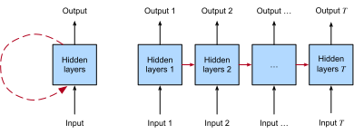

# 循环神经网络
:label:`chap_rnn`

到目前为止，我们主要关注的是固定长度的数据。
在 :numref:`chap_regression` 和 :numref:`chap_classification` 中介绍线性回归和逻辑回归，
以及在 :numref:`chap_perceptrons` 中介绍多层感知机时，
我们都乐于假设每个特征向量$\mathbf{x}_i$
由固定数量的分量$x_1, \dots, x_d$组成，
其中每个数值特征$x_j$
对应一个特定的属性。
这类数据集有时称为*表格型*（tabular）数据，
因为它们可以排成表格，
其中每个样例$i$占一行，
每个属性占一列。
关键在于，对于表格型数据，我们很少
对列假设任何特定的结构。

随后，在 :numref:`chap_cnn` 中，
我们转向图像数据，其中的输入由
图像中每个坐标处的原始像素值组成。
图像数据几乎不符合
典型表格型数据集的特征。
在那里，我们需要借助卷积神经网络（CNN）
来处理层次结构和不变性。
然而，我们的数据仍然是固定长度的。
每张Fashion-MNIST图像都表示为
$28 \times 28$的像素值网格。
此外，我们的目标是开发一个模型，
它只看一张图像，然后
输出单个预测。
但是，当面对
一连串图像（如视频中那样）时，或者当任务要求生成
按序列结构组织的预测（如图像描述）时，我们该怎么办呢？

许多学习任务都需要处理序列数据。
图像描述、语音合成和音乐生成
都要求模型产生的输出由序列组成。
在其他领域，例如时间序列预测、
视频分析和音乐信息检索中，
模型必须从序列形式的输入中学习。
这些需求往往同时出现：
诸如把一段文本从一种自然语言翻译成另一种自然语言、
进行对话或控制机器人等任务，
都要求模型既接收又输出
按序列结构组织的数据。


循环神经网络（RNN）是一类深度学习模型，
它通过*循环*连接来捕捉序列的动态特性，
这些连接可以看作
节点网络中的环路。
这乍看起来可能违反直觉。
毕竟，正是神经网络的前馈性质
使得计算顺序明确无歧义。
然而，循环边的定义方式很精确，
能够确保不会产生这种歧义。
循环神经网络沿时间步（或序列步）*展开*，
每一步都应用*相同*的底层参数。
标准连接是*同步*应用的，
用于把每一层的激活值
传递到*同一时间步*的后续层，
而循环连接是*动态的*，
在相邻时间步之间传递信息。
正如 :numref:`fig_unfolded-rnn` 中的展开视图所揭示的，
RNN可以看作前馈神经网络，
其中每层的参数（常规参数和循环参数）
在各时间步共享。



:label:`fig_unfolded-rnn`


与更广义的神经网络一样，
RNN有着漫长而跨越学科的历史：
它最初是认知科学家推广的脑模型，
后来被机器学习社区采纳
为实用的建模工具。
正如我们对更广义的深度学习所做的那样，
在本书中我们采取机器学习的视角，
把RNN看作实用工具，它之所以
在2010年代流行起来，是由于
在手写识别 :cite:`graves2008novel`、
机器翻译 :cite:`Sutskever.Vinyals.Le.2014`
和医学诊断识别 :cite:`Lipton.Kale.2016` 等各种不同任务上取得的突破性成果。
对于希望了解更多背景材料的读者，
我们推荐一篇公开可得的综述 :cite:`Lipton.Berkowitz.Elkan.2015`。
我们还要指出，序列性并非RNN独有。
例如，我们已经介绍的CNN
可以被改造成处理长度可变的数据，
例如分辨率不同的图像。
此外，RNN近来把相当大的
市场份额让给了Transformer模型，
后者将在 :numref:`chap_attention-and-transformers` 中介绍。
然而，RNN是作为处理深度学习中复杂序列结构的默认模型
而崛起的，
时至今日仍然是序列建模的常用模型。
RNN的故事与序列建模的故事
密不可分，因此本章
既讲述RNN，也同样讲述序列建模问题的入门基础。


一个关键洞见为序列建模的革命铺平了道路。
尽管机器学习中许多基本任务的输入和目标
不容易表示为固定长度的向量，
但它们往往仍然可以表示为
由定长向量组成的变长序列。
例如，文档可以表示为单词序列；
医疗记录通常可以表示为事件序列
（就诊、用药、手术、化验、诊断）；
视频可以表示为长度可变的静止图像序列。


尽管序列模型已在众多应用领域中出现，
但该领域的基础研究主要由
自然语言处理核心任务的进展所推动。
因此，本章通篇将把
论述和示例集中在文本数据上。
如果你掌握了这些示例，
那么把模型应用于其他数据模态
应当相对直接。
在接下来的几节中，我们介绍序列的
基本记号，以及一些评价指标，
用于评估按序列结构组织的模型输出的质量。
之后，我们讨论语言模型的基本概念，
并用这一讨论来引出我们的第一批RNN模型。
最后，我们描述通过RNN
进行反向传播时计算梯度的方法，并探讨
训练这类网络时经常遇到的一些挑战，
从而引出 :numref:`chap_modern_rnn` 中
将要介绍的现代RNN架构。

```toc
:maxdepth: 2

sequence
text-sequence
language-model
rnn
rnn-scratch
rnn-concise
bptt
```
