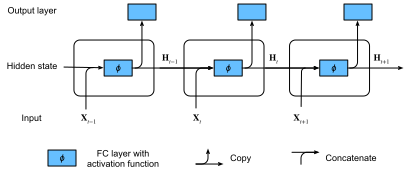
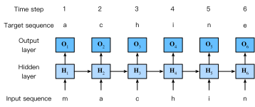

# 循环神经网络
:label:`sec_rnn`


在 :numref:`sec_language-model` 中，我们描述了用于语言建模的马尔可夫模型和$n$元语法，其中时间步$t$的词元$x_t$的条件概率只依赖于之前的$n-1$个词元。
如果我们想要纳入早于时间步$t-(n-1)$的词元对$x_t$可能产生的影响，
就需要增大$n$。
然而，模型参数的数量也会随之呈指数增长，因为对词表集合$\mathcal{V}$，我们需要存储$|\mathcal{V}|^n$个数。
因此，与其对$P(x_t \mid x_{t-1}, \ldots, x_{t-n+1})$建模，不如使用潜在变量模型，

$$P(x_t \mid x_{t-1}, \ldots, x_1) \approx P(x_t \mid h_{t-1}),$$

其中$h_{t-1}$是*隐藏状态*（hidden state），它存储了截至时间步$t-1$的序列信息。
一般而言，
任一时间步$t$的隐藏状态都可以基于当前输入$x_{t}$和前一个隐藏状态$h_{t-1}$计算出来：

$$h_t = f(x_{t}, h_{t-1}).$$
:eqlabel:`eq_ht_xt`

对于 :eqref:`eq_ht_xt` 中足够强大的函数$f$，潜在变量模型并非近似。毕竟，$h_t$完全可以简单地存储迄今为止观测到的所有数据。
然而，这可能使计算和存储都变得昂贵。

回想一下，我们在 :numref:`chap_perceptrons` 中讨论了带有隐藏单元的隐藏层。
值得注意的是，
隐藏层和隐藏状态指的是两个非常不同的概念。
如前所述，隐藏层是在从输入到输出的路径上对视图隐藏的层。
从技术上讲，隐藏状态是我们在给定步骤所做任何事情的*输入*，
并且只能通过查看先前时间步的数据来计算。

*循环神经网络*（recurrent neural network，RNN）是带有隐藏状态的神经网络。在介绍RNN模型之前，我们先回顾一下 :numref:`sec_mlp` 中介绍的多层感知机模型。

```{.python .input}
%load_ext d2lbook.tab
tab.interact_select('mxnet', 'pytorch', 'tensorflow', 'jax')
```

```{.python .input}
%%tab mxnet
from d2l import mxnet as d2l
from mxnet import np, npx
npx.set_np()
```

```{.python .input}
%%tab pytorch
from d2l import torch as d2l
import torch
```

```{.python .input}
%%tab tensorflow
from d2l import tensorflow as d2l
import tensorflow as tf
```

```{.python .input}
%%tab jax
from d2l import jax as d2l
import jax
from jax import numpy as jnp
```

## 没有隐藏状态的神经网络

让我们来看看一个只有单个隐藏层的多层感知机。
设隐藏层的激活函数为$\phi$。
给定一个小批量样例$\mathbf{X} \in \mathbb{R}^{n \times d}$，其批量大小为$n$、输入数为$d$，则隐藏层输出$\mathbf{H} \in \mathbb{R}^{n \times h}$的计算如下：

$$\mathbf{H} = \phi(\mathbf{X} \mathbf{W}_{\textrm{xh}} + \mathbf{b}_\textrm{h}).$$
:eqlabel:`rnn_h_without_state`

在 :eqref:`rnn_h_without_state` 中，隐藏层的权重参数为$\mathbf{W}_{\textrm{xh}} \in \mathbb{R}^{d \times h}$，偏置参数为$\mathbf{b}_\textrm{h} \in \mathbb{R}^{1 \times h}$，隐藏单元数为$h$。
有了这些，我们在求和时应用广播机制（见 :numref:`subsec_broadcasting` ）。
接下来，隐藏层输出$\mathbf{H}$被用作输出层的输入，输出层由下式给出：

$$\mathbf{O} = \mathbf{H} \mathbf{W}_{\textrm{hq}} + \mathbf{b}_\textrm{q},$$

其中$\mathbf{O} \in \mathbb{R}^{n \times q}$是输出变量，$\mathbf{W}_{\textrm{hq}} \in \mathbb{R}^{h \times q}$是权重参数，$\mathbf{b}_\textrm{q} \in \mathbb{R}^{1 \times q}$是输出层的偏置参数。如果是分类问题，我们可以用$\mathrm{softmax}(\mathbf{O})$来计算输出类别的概率分布。

这与我们之前在 :numref:`sec_sequence` 中解决的回归问题完全类似，因此我们省略细节。
只需说明：我们可以随机选取特征-标签对，并通过自动微分和随机梯度下降来学习网络的参数。

## 带有隐藏状态的循环神经网络
:label:`subsec_rnn_w_hidden_states`

当我们有隐藏状态时，情况就完全不同了。让我们更详细地看一下其结构。

假设我们在时间步$t$
有一个小批量输入
$\mathbf{X}_t \in \mathbb{R}^{n \times d}$。
换句话说，
对于由$n$个序列样例组成的小批量，
$\mathbf{X}_t$的每一行对应于序列中时间步$t$的一个样例。
接下来，
用$\mathbf{H}_t  \in \mathbb{R}^{n \times h}$表示时间步$t$的隐藏层输出。
与多层感知机不同，这里我们保存上一时间步的隐藏层输出$\mathbf{H}_{t-1}$，并引入一个新的权重参数$\mathbf{W}_{\textrm{hh}} \in \mathbb{R}^{h \times h}$，用于描述如何在当前时间步使用上一时间步的隐藏层输出。具体来说，当前时间步隐藏层输出的计算由当前时间步的输入与上一时间步的隐藏层输出共同决定：

$$\mathbf{H}_t = \phi(\mathbf{X}_t \mathbf{W}_{\textrm{xh}} + \mathbf{H}_{t-1} \mathbf{W}_{\textrm{hh}}  + \mathbf{b}_\textrm{h}).$$
:eqlabel:`rnn_h_with_state`

与 :eqref:`rnn_h_without_state` 相比，:eqref:`rnn_h_with_state` 多了一项$\mathbf{H}_{t-1} \mathbf{W}_{\textrm{hh}}$，从而
实例化了 :eqref:`eq_ht_xt`。
从相邻时间步的隐藏层输出$\mathbf{H}_t$和$\mathbf{H}_{t-1}$之间的关系可知，
这些变量捕捉并保留了序列截至其当前时间步的历史信息，就像神经网络当前时间步的状态或记忆一样。因此，这样的隐藏层输出称为*隐藏状态*。
由于隐藏状态在当前时间步使用与上一时间步相同的定义，:eqref:`rnn_h_with_state` 的计算是*循环的*。因此，正如我们所说，基于循环计算、带有隐藏状态的神经网络
被命名为
*循环神经网络*。
在RNN中
执行 :eqref:`rnn_h_with_state`
计算的层
称为*循环层*。


构造RNN有许多不同的方式。
其中由 :eqref:`rnn_h_with_state` 定义隐藏状态的方式非常常见。
对于时间步$t$，
输出层的输出与多层感知机中的计算类似：

$$\mathbf{O}_t = \mathbf{H}_t \mathbf{W}_{\textrm{hq}} + \mathbf{b}_\textrm{q}.$$

RNN的参数
包括隐藏层的权重$\mathbf{W}_{\textrm{xh}} \in \mathbb{R}^{d \times h}, \mathbf{W}_{\textrm{hh}} \in \mathbb{R}^{h \times h}$、
偏置$\mathbf{b}_\textrm{h} \in \mathbb{R}^{1 \times h}$，
以及输出层的权重$\mathbf{W}_{\textrm{hq}} \in \mathbb{R}^{h \times q}$
和偏置$\mathbf{b}_\textrm{q} \in \mathbb{R}^{1 \times q}$。
值得一提的是，
即使在不同时间步，
RNN也总是使用这些模型参数。
因此，RNN的参数化成本
并不会随时间步数的增加而增长。

:numref:`fig_rnn` 说明了RNN在三个相邻时间步上的计算逻辑。
在任一时间步$t$，
隐藏状态的计算可以看作：
(i) 连结当前时间步$t$的输入$\mathbf{X}_t$和上一时间步$t-1$的隐藏状态$\mathbf{H}_{t-1}$；
(ii) 把连结结果送入激活函数为$\phi$的全连接层。
这样的全连接层的输出就是当前时间步$t$的隐藏状态$\mathbf{H}_t$。
在这种情况下，
模型参数是$\mathbf{W}_{\textrm{xh}}$和$\mathbf{W}_{\textrm{hh}}$的连结，再加上偏置$\mathbf{b}_\textrm{h}$，它们都来自 :eqref:`rnn_h_with_state`。
当前时间步$t$的隐藏状态$\mathbf{H}_t$将参与计算下一时间步$t+1$的隐藏状态$\mathbf{H}_{t+1}$。
此外，$\mathbf{H}_t$还会
被送入全连接输出层，
以计算
当前时间步$t$的输出$\mathbf{O}_t$。


:label:`fig_rnn`

我们刚才提到，隐藏状态的计算$\mathbf{X}_t \mathbf{W}_{\textrm{xh}} + \mathbf{H}_{t-1} \mathbf{W}_{\textrm{hh}}$等价于
对$\mathbf{X}_t$与$\mathbf{H}_{t-1}$的连结
和
$\mathbf{W}_{\textrm{xh}}$与$\mathbf{W}_{\textrm{hh}}$的连结
做矩阵乘法。
虽然这在数学上可以证明，
但下面我们只用一个简单的代码片段作为演示。
首先，
我们定义形状分别为 (3, 1)、(1, 4)、(3, 4) 和 (4, 4) 的矩阵`X`、`W_xh`、`H`和`W_hh`。
把`X`乘以`W_xh`，把`H`乘以`W_hh`，再把这两个乘积相加，
我们得到一个形状为 (3, 4) 的矩阵。

```{.python .input}
%%tab mxnet, pytorch
X, W_xh = d2l.randn(3, 1), d2l.randn(1, 4)
H, W_hh = d2l.randn(3, 4), d2l.randn(4, 4)
d2l.matmul(X, W_xh) + d2l.matmul(H, W_hh)
```

```{.python .input}
%%tab tensorflow
X, W_xh = d2l.normal((3, 1)), d2l.normal((1, 4))
H, W_hh = d2l.normal((3, 4)), d2l.normal((4, 4))
d2l.matmul(X, W_xh) + d2l.matmul(H, W_hh)
```

```{.python .input}
%%tab jax
X, W_xh = jax.random.normal(d2l.get_key(), (3, 1)), jax.random.normal(
                                                        d2l.get_key(), (1, 4))
H, W_hh = jax.random.normal(d2l.get_key(), (3, 4)), jax.random.normal(
                                                        d2l.get_key(), (4, 4))
d2l.matmul(X, W_xh) + d2l.matmul(H, W_hh)
```

现在我们把矩阵`X`和`H`
沿列（轴1）连结，
并把矩阵
`W_xh`和`W_hh`沿行（轴0）连结。
这两个连结
分别得到
形状为 (3, 5) 的矩阵
和形状为 (5, 4) 的矩阵。
把这两个连结后的矩阵相乘，
我们得到与上面相同的形状为 (3, 4) 的输出矩阵。

```{.python .input}
%%tab all
d2l.matmul(d2l.concat((X, H), 1), d2l.concat((W_xh, W_hh), 0))
```

## 基于RNN的字符级语言模型

回想一下，对于 :numref:`sec_language-model` 中的语言建模，
我们的目标是基于
当前和过去的词元预测下一个词元；
因此我们把原始序列平移一个词元
作为目标（标签）。
:citet:`Bengio.Ducharme.Vincent.ea.2003` 首次提出
使用神经网络进行语言建模。
下面我们说明如何使用RNN来构建语言模型。
设小批量大小为1，文本序列为“machine”。
为简化后续各节中的训练，
我们把文本词元化为字符而不是单词，
并考虑*字符级语言模型*。
:numref:`fig_rnn_train` 演示了在字符级语言建模中，如何通过RNN基于当前和先前的字符预测下一个字符。


:label:`fig_rnn_train`

在训练过程中，
我们对每个时间步输出层的输出执行softmax运算，然后使用交叉熵损失来计算模型输出与目标之间的误差。
由于隐藏层中隐藏状态的循环计算，:numref:`fig_rnn_train` 中时间步3的输出$\mathbf{O}_3$由文本序列“m”、“a”和“c”决定。由于训练数据中该序列的下一个字符是“h”，时间步3的损失将取决于基于特征序列“m”、“a”、“c”生成下一个字符的概率分布以及该时间步的目标“h”。

在实践中，每个词元由一个$d$维向量表示，并且我们使用的批量大小为$n>1$。因此，时间步$t$的输入$\mathbf X_t$将是一个$n\times d$矩阵，这与我们在 :numref:`subsec_rnn_w_hidden_states` 中讨论的相同。

在接下来的几节中，我们将为字符级语言模型实现RNN。


## 小结

对隐藏状态使用循环计算的神经网络称为循环神经网络（RNN）。
RNN的隐藏状态可以捕捉序列截至当前时间步的历史信息。通过循环计算，RNN模型参数的数量不会随时间步数的增加而增长。在应用方面，RNN可用于创建字符级语言模型。


## 练习

1. 如果我们使用RNN预测文本序列中的下一个字符，任何输出所需的维度是多少？
1. 为什么RNN能够基于文本序列中所有先前的词元来表达某个时间步词元的条件概率？
1. 如果通过长序列进行反向传播，梯度会发生什么变化？
1. 与本节描述的语言模型相关的问题有哪些？


:begin_tab:`mxnet`
[讨论](https://discuss.d2l.ai/t/337)
:end_tab:

:begin_tab:`pytorch`
[讨论](https://discuss.d2l.ai/t/1050)
:end_tab:

:begin_tab:`tensorflow`
[讨论](https://discuss.d2l.ai/t/1051)
:end_tab:

:begin_tab:`jax`
[讨论](https://discuss.d2l.ai/t/180013)
:end_tab:
