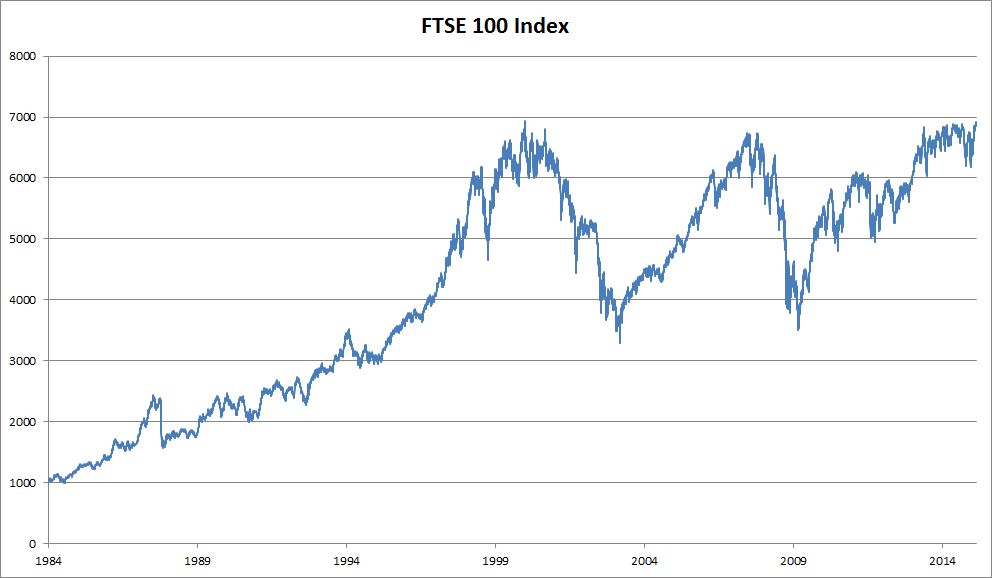
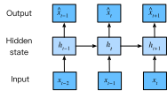

# 处理序列
:label:`sec_sequence`

到目前为止，我们关注的模型其输入
由单个特征向量$\mathbf{x} \in \mathbb{R}^d$组成。
开发能够处理序列的模型时，
视角上的主要变化在于：我们现在
关注由特征向量$\mathbf{x}_1, \dots, \mathbf{x}_T$组成的
有序列表作为输入，
其中每个特征向量$\mathbf{x}_t$
由时间步$t \in \mathbb{Z}^+$索引，
且处于$\mathbb{R}^d$中。

有些数据集由单个巨大的序列组成。
例如，考虑气候科学家可能获得的
极长的传感器读数流。
在这种情况下，我们可以通过随机采样
某个预定长度的子序列来创建训练数据集。
更常见的是，我们的数据以序列集合的形式出现。
考虑以下例子：
(i) 一个文档集合，
每个文档表示为它自己的单词序列，
且每个文档有自己的长度$T_i$；
(ii) 病人在医院住院的序列表示，
其中每次住院由若干事件组成，
序列长度大致取决于
住院时间的长短。


以前，在处理单个输入时，
我们假设它们是从同一个底层分布$P(X)$中
独立采样得到的。
虽然我们仍然假设整个序列
（例如整个文档或病人轨迹）
是独立采样的，
但我们不能假设每个时间步到达的
数据彼此独立。
例如，文档后面可能出现的单词
在很大程度上取决于文档中较早出现的单词。
病人在住院第10天
可能接受的药物，
在很大程度上取决于前9天
发生的事情。

这并不奇怪。
如果我们不相信序列中的元素是相关的，
一开始就不会费心把它们建模为序列。
想想搜索工具和现代电子邮件客户端上
流行的自动补全功能多么有用。
它们之所以有用，恰恰是因为
在给定某个初始前缀的情况下，通常可以
（不完美地，但比随机猜测更好地）
预测序列可能的延续。
对于大多数序列模型，
我们并不要求序列具有独立性，
甚至不要求平稳性。
相反，我们只要求
序列本身是从某个固定的、
作用于整个序列的底层分布中采样得到的。

这种灵活的方法允许以下现象存在：
(i) 文档的开头与结尾看起来显著不同；
或者 (ii) 病人在住院过程中状态向康复或
向死亡演变；
或者 (iii) 随着与推荐系统的持续交互，
顾客偏好在可预测的方向上演变。


有时我们希望根据按序列结构组织的输入
预测一个固定的目标$y$
（例如基于电影评论的情感分类）。
另一些时候，我们希望根据固定的输入
预测按序列结构组织的目标
（$y_1, \ldots, y_T$）
（例如图像描述）。
还有些时候，我们的目标是
根据按序列结构组织的输入预测按序列结构组织的目标
（例如机器翻译或视频描述）。
这类序列到序列任务有两种形式：
(i) *对齐的*：每个时间步的输入
与相应的目标对齐（例如词性标注）；
(ii) *非对齐的*：输入与目标
不一定存在逐步骤的对应关系
（例如机器翻译）。

在操心如何处理任何类型的目标之前，
我们可以先解决最直接的问题：
无监督密度建模（也称为*序列建模*）。
这里，给定一个序列集合，
我们的目标是估计概率质量函数，
它告诉我们看到任意给定序列的可能性有多大，
即$p(\mathbf{x}_1, \ldots, \mathbf{x}_T)$。

```{.python .input  n=6}
%load_ext d2lbook.tab
tab.interact_select('mxnet', 'pytorch', 'tensorflow', 'jax')
```

```{.python .input  n=7}
%%tab mxnet
%matplotlib inline
from d2l import mxnet as d2l
from mxnet import autograd, np, npx, gluon, init
from mxnet.gluon import nn
npx.set_np()
```

```{.python .input  n=8}
%%tab pytorch
%matplotlib inline
from d2l import torch as d2l
import torch
from torch import nn
```

```{.python .input  n=9}
%%tab tensorflow
%matplotlib inline
from d2l import tensorflow as d2l
import tensorflow as tf
```

```{.python .input  n=9}
%%tab jax
%matplotlib inline
from d2l import jax as d2l
import jax
from jax import numpy as jnp
import numpy as np
```

## 自回归模型


在介绍专门设计用于处理按序列结构组织的数据的
神经网络之前，
让我们先看一些实际的序列数据，
建立一些基本的直觉和统计工具。
特别地，我们将关注
富时100指数（FTSE 100）的股价数据（ :numref:`fig_ftse100` ）。
在每个*时间步*$t \in \mathbb{Z}^+$，我们观测
该时刻指数的价格$x_t$。



:width:`400px`
:label:`fig_ftse100`


现在假设一位交易者想要进行短期交易，
根据他们认为指数在随后时间步
会上涨还是下跌，
有策略地买入或卖出该指数。
在没有任何其他特征
（新闻、财务报告数据等）的情况下，
预测后续数值唯一可用的信号
就是迄今为止的价格历史。
因此，交易者想知道一个概率分布

$$P(x_t \mid x_{t-1}, \ldots, x_1)$$

该分布刻画指数在随后时间步
可能取的价格。
虽然估计一个连续取值随机变量上的
整个分布可能很困难，但交易者会乐于
只关注分布的少数关键统计量，
特别是期望值和方差。
估计条件期望

$$\mathbb{E}[(x_t \mid x_{t-1}, \ldots, x_1)],$$

的一种简单策略是应用线性回归模型
（回想 :numref:`sec_linear_regression` ）。
这种把一个信号的值
对其自身先前值进行回归的模型，
自然称为*自回归模型*（autoregressive model）。
这里只有一个主要问题：输入的数量
$x_{t-1}, \ldots, x_1$随$t$变化。
换句话说，输入的数量随着
我们遇到的数据量而增加。
因此，如果我们想把历史数据
当作训练集，就会面临
每个样例的特征数不同的问题。
本章接下来的大部分内容
将围绕一些技术展开，
用于在从事这类*自回归*建模问题时
克服这些挑战，
其中我们感兴趣的对象是
$P(x_t \mid x_{t-1}, \ldots, x_1)$
或该分布的某个（些）统计量。

有几种策略反复出现。
首先，
我们可能认为，虽然长的序列
$x_{t-1}, \ldots, x_1$是可得的，
但在预测近期未来时
可能不必回溯那么远的历史。
在这种情况下，我们可能满足于
以某个长度为$\tau$的窗口为条件，
只使用$x_{t-1}, \ldots, x_{t-\tau}$这些观测。
直接的好处是，现在的输入参数个数
总是相同的，至少对$t > \tau$如此。
这使我们能够训练任何要求固定长度向量
作为输入的线性模型或深度网络。
其次，我们可以开发一些模型，维护
过去观测的某种摘要$h_t$
（见 :numref:`fig_sequence-model` ），
并在预测$\hat{x}_t$之外
同时更新$h_t$。
这引出的模型不仅用
$\hat{x}_t = P(x_t \mid h_{t})$
来估计$x_t$，
还包含
$h_t = g(h_{t-1}, x_{t-1})$形式的更新。
由于$h_t$从未被观测到，
这些模型也称为
*潜在自回归模型*（latent autoregressive model）。


:label:`fig_sequence-model`

为了从历史数据构造训练数据，
人们通常通过随机采样窗口来创建样例。
一般而言，我们并不期望时间静止不动。
然而，我们常常假设：
虽然$x_t$的具体取值可能变化，
但根据先前观测生成每个后续
观测的动态规律不变。
统计学家把不变化的动态性质称为*平稳的*。


## 序列模型

有时，尤其是在处理语言时，
我们希望估计整个序列的
联合概率。
当处理的序列由离散的*词元*
（例如单词）组成时，这是一项常见的任务。
一般来说，这些被估计的函数称为*序列模型*（sequence model），
而对于自然语言数据，它们称为*语言模型*。
序列建模领域一直深受自然语言处理的推动，
以至于即使在处理非语言数据时，
我们也常把序列模型称为“语言模型”。
语言模型之所以有用，有多种原因。
有时我们想评估句子的似然。
例如，我们可能希望比较
机器翻译系统
或语音识别系统生成的两个候选输出的
自然程度。
但语言建模给予我们的
不仅是*评估*似然的能力，
还有*采样*序列的能力，
甚至还有针对最可能序列进行优化的能力。

虽然语言建模乍看起来可能不像
一个自回归问题，
但我们可以通过应用概率的链式法则，
把序列的联合密度$p(x_1, \ldots, x_T)$
从左到右分解为条件密度的乘积，
从而把语言建模归结为自回归预测：

$$P(x_1, \ldots, x_T) = P(x_1) \prod_{t=2}^T P(x_t \mid x_{t-1}, \ldots, x_1).$$

请注意，如果我们处理的是单词这样的离散信号，
那么自回归模型必须是一个概率分类器，
在给定左侧上下文的情况下，
为接下来将出现的单词
输出词表上的完整概率分布。


### 马尔可夫模型
:label:`subsec_markov-models`


现在假设我们希望采用上面提到的策略，
即只以之前$\tau$个时间步为条件，
也就是$x_{t-1}, \ldots, x_{t-\tau}$，而不是
以整个序列历史$x_{t-1}, \ldots, x_1$为条件。
每当我们能够丢弃超过前$\tau$步的历史
而不损失任何预测能力时，
我们就说该序列满足*马尔可夫条件*，
即*在给定近期历史的情况下，
未来与过去条件独立*。
当$\tau = 1$时，我们说数据由
*一阶马尔可夫模型*刻画；
当$\tau = k$时，我们说数据由
$k^{\textrm{th}}$阶马尔可夫模型刻画。
当一阶马尔可夫条件成立（$\tau = 1$）时，
联合概率的分解就变成每个单词
在给定前一个*单词*下的概率之积：

$$P(x_1, \ldots, x_T) = P(x_1) \prod_{t=2}^T P(x_t \mid x_{t-1}).$$

我们常常发现，使用那些
表现得仿佛马尔可夫条件成立的模型很有用，
即使我们知道这只是*近似*成立。
对于真实的文本文档，随着我们纳入
越来越多的左侧上下文，我们会继续获得信息。
但这些收益迅速递减。
因此，有时我们会做出妥协，
通过训练有效性依赖于
$k^{\textrm{th}}$阶马尔可夫条件的模型，
来避免计算上和统计上的困难。
即使是当今庞大的基于RNN和Transformer的语言模型，
也很少纳入超过数千个单词的上下文。


对于离散数据，真正的马尔可夫模型
只是统计每个单词
在每个上下文中出现的次数，从而得到
$P(x_t \mid x_{t-1})$的相对频率估计。
当数据只取离散值
（如语言中）时，
最可能的单词序列可以使用动态规划
高效地计算出来。

### 解码的顺序

你可能会奇怪，为什么我们把文本序列
$P(x_1, \ldots, x_T)$的分解表示成
从左到右的条件概率链。
为什么不从右到左，或者按其他看似随意的顺序呢？
原则上，按相反顺序展开
$P(x_1, \ldots, x_T)$没有任何问题。
其结果是一个有效的分解：

$$P(x_1, \ldots, x_T) = P(x_T) \prod_{t=T-1}^1 P(x_t \mid x_{t+1}, \ldots, x_T).$$


然而，在语言建模任务中，
按照我们阅读文本的方向
（对大多数语言是从左到右，
但对阿拉伯语和希伯来语是从右到左）
来分解文本之所以更受青睐，有许多原因。
首先，这对我们来说只是一个更自然的思考方向。
毕竟我们每天都阅读文本，
而这个过程是由我们预见接下来
可能出现哪些单词和短语的能力所引导的。
想一想你曾多少次补全了别人的句子。
因此，即使我们没有其他理由
偏好这种按顺序的解码，
仅仅因为在这种顺序下预测时
我们对什么应当更可能具有更好的直觉，
它们也是有用的。

其次，通过按顺序分解，
我们可以使用同一个语言模型
为任意长的序列赋予概率。
要把覆盖步骤$1$到$t$的概率
转换为延伸到单词$t+1$的概率，我们只需
乘以在给定前面词元的情况下
额外词元出现的条件概率：
$P(x_{t+1}, \ldots, x_1) = P(x_{t}, \ldots, x_1) \cdot P(x_{t+1} \mid x_{t}, \ldots, x_1)$。

第三，对于相邻单词的预测，
我们拥有比预测任意其他位置的单词
更强的预测模型。
虽然所有分解顺序都是有效的，
但它们并不一定都代表
同样容易的预测建模问题。
这不仅对语言成立，
对其他类型的数据也成立，
例如当数据具有因果结构时。
例如，我们认为未来事件不能影响过去。
因此，如果我们改变$x_t$，我们可能能够影响
今后$x_{t+1}$会发生什么，但反过来不行。
也就是说，如果我们改变$x_t$，过去事件上的分布不会改变。
在某些情形下，这使得预测$P(x_{t+1} \mid x_t)$
比预测$P(x_t \mid x_{t+1})$更容易。
例如，在某些情况下，我们可以找到$x_{t+1} = f(x_t) + \epsilon$，
其中$\epsilon$是某种加性噪声，
而反过来则不成立 :cite:`Hoyer.Janzing.Mooij.ea.2009`。
这是一个好消息，因为我们通常感兴趣估计的
正是前向方向。
:citet:`Peters.Janzing.Scholkopf.2017` 的著作对此有更多论述。
我们只是触及了它的表面。


## 训练

在把注意力集中在文本数据上之前，
让我们先用一些
连续取值的合成数据来试一试。

(**这里，我们的1000个合成数据将遵循
三角函数`sin`，
自变量为时间步的0.01倍。
为了让问题稍微更有趣一些，
我们给每个样本加上加性噪声。**)
从这个序列中，我们提取训练样例，
每个样例由特征和一个标签组成。

```{.python .input  n=10}
%%tab all
class Data(d2l.DataModule):
    def __init__(self, batch_size=16, T=1000, num_train=600, tau=4):
        self.save_hyperparameters()
        self.time = d2l.arange(1, T + 1, dtype=d2l.float32)
        if tab.selected('mxnet', 'pytorch'):
            self.x = d2l.sin(0.01 * self.time) + d2l.randn(T) * 0.2
        if tab.selected('tensorflow'):
            self.x = d2l.sin(0.01 * self.time) + d2l.normal([T]) * 0.2
        if tab.selected('jax'):
            key = d2l.get_key()
            self.x = d2l.sin(0.01 * self.time) + jax.random.normal(key,
                                                                   [T]) * 0.2
```

```{.python .input}
%%tab all
data = Data()
d2l.plot(data.time, data.x, 'time', 'x', xlim=[1, 1000], figsize=(6, 3))
```

首先，我们尝试一个模型，它表现得
好像数据满足$\tau^{\textrm{th}}$阶马尔可夫条件，
因此只用过去$\tau$个观测来预测$x_t$。
[**于是，对每个时间步，我们有一个
标签为$y  = x_t$、特征为
$\mathbf{x}_t = [x_{t-\tau}, \ldots, x_{t-1}]$的样例。**]
敏锐的读者可能已经注意到，
这会产生$1000-\tau$个样例，
因为我们缺少$y_1, \ldots, y_\tau$的足够历史。
虽然我们可以用零填充前$\tau$个序列，
但为保持简单，我们暂时丢弃它们。
所得数据集包含$T - \tau$个样例，
其中模型的每个输入序列长度都是$\tau$。
我们(**在前600个样例上创建一个数据迭代器**)，
覆盖sin函数的一段范围。

```{.python .input}
%%tab all
@d2l.add_to_class(Data)
def get_dataloader(self, train):
    features = [self.x[i : self.T-self.tau+i] for i in range(self.tau)]
    self.features = d2l.stack(features, 1)
    self.labels = d2l.reshape(self.x[self.tau:], (-1, 1))
    i = slice(0, self.num_train) if train else slice(self.num_train, None)
    return self.get_tensorloader([self.features, self.labels], train, i)
```

在这个例子中，我们的模型将是一个标准的线性回归。

```{.python .input}
%%tab all
model = d2l.LinearRegression(lr=0.01)
trainer = d2l.Trainer(max_epochs=5)
trainer.fit(model, data)
```

## 预测

[**为了评估我们的模型，我们首先检查
它在一步提前预测上的表现**]。

```{.python .input}
%%tab pytorch, mxnet, tensorflow
onestep_preds = d2l.numpy(model(data.features))
d2l.plot(data.time[data.tau:], [data.labels, onestep_preds], 'time', 'x',
         legend=['labels', '1-step preds'], figsize=(6, 3))
```

```{.python .input}
%%tab jax
onestep_preds = model.apply({'params': trainer.state.params}, data.features)
d2l.plot(data.time[data.tau:], [data.labels, onestep_preds], 'time', 'x',
         legend=['labels', '1-step preds'], figsize=(6, 3))
```

这些预测看起来不错，
即使在接近末尾的$t=1000$处也是如此。

但是，如果我们只观测到
时间步604（`n_train + tau`）为止的序列数据，
并希望预测未来若干步，
那该怎么办呢？
不幸的是，我们无法直接计算
时间步609的一步提前预测，
因为我们不知道相应的输入，
只看到了$x_{604}$为止的数据。
我们可以通过把我们早先的预测
作为模型的输入来进行后续预测，
一步一步地向前推进，
直到达到所需的时间步，
从而解决这个问题：

$$\begin{aligned}
\hat{x}_{605} &= f(x_{601}, x_{602}, x_{603}, x_{604}), \\
\hat{x}_{606} &= f(x_{602}, x_{603}, x_{604}, \hat{x}_{605}), \\
\hat{x}_{607} &= f(x_{603}, x_{604}, \hat{x}_{605}, \hat{x}_{606}),\\
\hat{x}_{608} &= f(x_{604}, \hat{x}_{605}, \hat{x}_{606}, \hat{x}_{607}),\\
\hat{x}_{609} &= f(\hat{x}_{605}, \hat{x}_{606}, \hat{x}_{607}, \hat{x}_{608}),\\
&\vdots\end{aligned}$$

一般而言，对于观测序列$x_1, \ldots, x_t$，
它在时间步$t+k$的预测输出$\hat{x}_{t+k}$
称为$k$*步提前预测*。
由于我们观测到$x_{604}$为止，
它的$k$步提前预测是$\hat{x}_{604+k}$。
换句话说，我们将不得不
持续使用自己的预测
来进行多步提前预测。
让我们看看这效果如何。

```{.python .input}
%%tab mxnet, pytorch
multistep_preds = d2l.zeros(data.T)
multistep_preds[:] = data.x
for i in range(data.num_train + data.tau, data.T):
    multistep_preds[i] = model(
        d2l.reshape(multistep_preds[i-data.tau : i], (1, -1)))
multistep_preds = d2l.numpy(multistep_preds)
```

```{.python .input}
%%tab tensorflow
multistep_preds = tf.Variable(d2l.zeros(data.T))
multistep_preds[:].assign(data.x)
for i in range(data.num_train + data.tau, data.T):
    multistep_preds[i].assign(d2l.reshape(model(
        d2l.reshape(multistep_preds[i-data.tau : i], (1, -1))), ()))
```

```{.python .input}
%%tab jax
multistep_preds = d2l.zeros(data.T)
multistep_preds = multistep_preds.at[:].set(data.x)
for i in range(data.num_train + data.tau, data.T):
    pred = model.apply({'params': trainer.state.params},
                       d2l.reshape(multistep_preds[i-data.tau : i], (1, -1)))
    multistep_preds = multistep_preds.at[i].set(pred.item())
```

```{.python .input}
%%tab all
d2l.plot([data.time[data.tau:], data.time[data.num_train+data.tau:]],
         [onestep_preds, multistep_preds[data.num_train+data.tau:]], 'time',
         'x', legend=['1-step preds', 'multistep preds'], figsize=(6, 3))
```

不幸的是，在这个例子中我们败得很惨。
预测在几步之后就相当快地
衰减为一个常数。
为什么算法在预测更远的未来时
表现差得多？
归根结底，这是因为
误差会累积。
假设在第1步之后我们有一些误差$\epsilon_1 = \bar\epsilon$。
现在第2步的*输入*受到了$\epsilon_1$的扰动，
因此我们会遭受量级为
$\epsilon_2 = \bar\epsilon + c \epsilon_1$
的某种误差，其中$c$是某个常数，依此类推。
预测可能迅速
偏离真实的观测。
你可能已经熟悉
这一常见现象。
例如，未来24小时的天气预报
往往相当准确，但超过这个时间后，
准确率就迅速下降。
我们将在本章及后续内容中
讨论改善这一问题的方法。

让我们[**通过在整个序列上计算$k = 1, 4, 16, 64$时的预测，
仔细考察$k$步提前预测中的困难**]。

```{.python .input}
%%tab pytorch, mxnet, tensorflow
def k_step_pred(k):
    features = []
    for i in range(data.tau):
        features.append(data.x[i : i+data.T-data.tau-k+1])
    # The (i+tau)-th element stores the (i+1)-step-ahead predictions
    for i in range(k):
        preds = model(d2l.stack(features[i : i+data.tau], 1))
        features.append(d2l.reshape(preds, -1))
    return features[data.tau:]
```

```{.python .input}
%%tab jax
def k_step_pred(k):
    features = []
    for i in range(data.tau):
        features.append(data.x[i : i+data.T-data.tau-k+1])
    # The (i+tau)-th element stores the (i+1)-step-ahead predictions
    for i in range(k):
        preds = model.apply({'params': trainer.state.params},
                            d2l.stack(features[i : i+data.tau], 1))
        features.append(d2l.reshape(preds, -1))
    return features[data.tau:]
```

```{.python .input}
%%tab all
steps = (1, 4, 16, 64)
preds = k_step_pred(steps[-1])
d2l.plot(data.time[data.tau+steps[-1]-1:],
         [d2l.numpy(preds[k-1]) for k in steps], 'time', 'x',
         legend=[f'{k}-step preds' for k in steps], figsize=(6, 3))
```

这清楚地展示了当我们尝试预测
更远的未来时，预测质量如何变化。
虽然4步提前预测看起来仍然不错，
但再往后的预测几乎毫无用处。

## 小结

插值与外推在难度上有相当大的差别。
因此，如果你有一个序列，训练时务必尊重
数据的时间顺序，
即绝不要在未来的数据上训练。
对于这类数据，
序列模型需要专门的统计工具来进行估计。
两种流行的选择是自回归模型
和潜在变量自回归模型。
对于因果模型（例如向前流逝的时间），
估计前向方向通常
比反向方向容易得多。
对于截至时间步$t$的观测序列，
其在时间步$t+k$的预测输出
就是$k$*步提前预测*。
当我们通过增大$k$预测更远的时间时，
误差会累积，预测质量会下降，
而且往往下降得很剧烈。

## 练习

1. 改进本节实验中的模型。
    1. 纳入四个以上的历史观测？你真正需要多少个？
    1. 如果没有噪声，你需要多少个过去的观测？提示：你可以把$\sin$和$\cos$写成一个微分方程。
    1. 你能在保持特征总数不变的情况下纳入更早的观测吗？这会提高准确率吗？为什么？
    1. 改变神经网络架构并评估性能。你可以用更多轮次训练新模型。你观察到了什么？
1. 一位投资者想找到一种好的证券来买入。
   他们查看过去的收益率来决定哪一种可能表现良好。
   这种策略可能出什么问题？
1. 因果性也适用于文本吗？在何种程度上适用？
1. 举一个例子，说明何时可能需要潜在自回归模型
   来捕捉数据的动态。

:begin_tab:`mxnet`
[讨论](https://discuss.d2l.ai/t/113)
:end_tab:

:begin_tab:`pytorch`
[讨论](https://discuss.d2l.ai/t/114)
:end_tab:

:begin_tab:`tensorflow`
[讨论](https://discuss.d2l.ai/t/1048)
:end_tab:

:begin_tab:`jax`
[讨论](https://discuss.d2l.ai/t/18010)
:end_tab:
