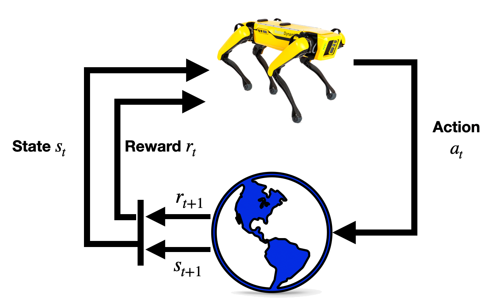

# 强化学习
:label:`chap_reinforcement_learning`


**Pratik Chaudhari**（*宾夕法尼亚大学与亚马逊*）、**Rasool Fakoor**（*亚马逊*）和 **Kavosh Asadi**（*亚马逊*）

强化学习（reinforcement learning，RL）是一套技术，使我们能够构建按顺序做决策的机器学习系统。例如，你从某家在线零售商购买的一包新衣服要经过一连串决策才能送到你家门口：零售商在你家附近的仓库里找到衣服，把衣服装进箱子，通过陆运或空运的方式运输箱子，并在当日送达你在城中的住处。沿途有许多变量会影响包裹的递送，例如衣服在仓库中是否有货、运输箱子花了多长时间、箱子是否在每日配送卡车出发之前到达你所在的城市，等等。关键思想在于，在每一阶段，这些我们往往无法控制的变量都会影响未来的整个事件序列——例如，如果仓库在装箱时出现了延误，零售商可能就需要改用空运而非陆运，以保证及时送达。强化学习方法让我们能够在一个顺序决策问题的每个阶段采取适当的动作，从而最终最大化某种效用，例如此时及时地将包裹送到你手中。

这类顺序决策问题在许多其他地方也能见到，例如，下[围棋](https://en.wikipedia.org/wiki/Go_(game))时，你当前的落子决定了接下来的走法，而对手的走法是你无法控制的变量……一连串走法最终决定你能否获胜；Netflix 现在推荐给你的电影决定了你会看什么，你是否喜欢这部电影对 Netflix 来说是未知的，一连串电影推荐最终决定你对 Netflix 的满意程度。如今，强化学习正被用于为这些问题开发有效的解决方案 :cite:`mnih2013playing,Silver.Huang.Maddison.ea.2016`。强化学习与标准深度学习的关键区别在于：在标准深度学习中，训练好的模型在一个测试数据上的预测不会影响它在未来测试数据上的预测；而在强化学习中，未来时刻的决策（在强化学习中，决策也称为动作）会受到过去所做决策的影响。

在本章中，我们将介绍强化学习的基础知识，并通过实现一些流行的强化学习方法来获得实践经验。我们首先会提出一个称为马尔可夫决策过程（Markov decision process，MDP）的概念，它使我们能够思考这类顺序决策问题。一个称为值迭代（value iteration）的算法将是我们第一个洞见，用于在假设我们知道 MDP 中不可控变量（在强化学习中，这些可控变量称为环境）通常如何表现的前提下求解强化学习问题。使用值迭代的更一般版本——一个称为 Q 学习（Q-learning）的算法——即使我们不一定完全了解环境，也能够采取适当的动作。然后，我们将研究如何通过模仿专家的动作，将深度网络用于强化学习问题。最后，我们将开发一种使用深度网络在未知环境中采取动作的强化学习方法。这些技术构成了当今各种实际应用中使用的更高级强化算法的基础，我们将在本章中指出其中一些应用。


:width:`400px`
:label:`fig_rl_big`

```toc
:maxdepth: 2

mdp
value-iter
qlearning
```
