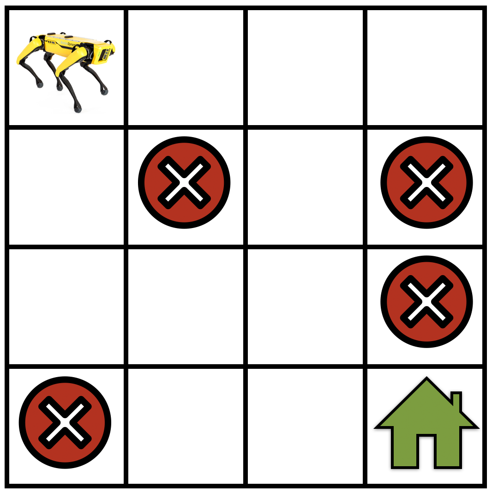

# 马尔可夫决策过程（MDP）
:label:`sec_mdp`
本节将讨论如何用马尔可夫决策过程（Markov decision process，MDP）来形式化强化学习问题，并详细描述 MDP 的各个组成部分。

## MDP 的定义

马尔可夫决策过程（MDP） :cite:`BellmanMDP` 是一个描述系统状态如何随施加不同动作而演化的模型。若干不同的量共同构成一个 MDP。

:width:`250px`
:label:`fig_mdp`

* 令 $\mathcal{S}$ 为 MDP 中的状态集合。具体例子见 :numref:`fig_mdp`：一个在网格世界中导航的机器人。此时，$\mathcal{S}$ 对应于机器人在任意给定时间步可能所处的位置集合。
* 令 $\mathcal{A}$ 为机器人在每个状态可执行的动作集合，例如“前进”“右转”“左转”“停在原地”等。动作可以将机器人当前的状态改变为集合 $\mathcal{S}$ 中的其他状态。
* 有时我们并不*确切*知道机器人如何移动，只能近似地了解。在强化学习中，我们这样对这种情况建模：如果机器人执行“前进”动作，它可能以一个小概率停在当前状态，又以另一个小概率“左转”，等等。在数学上，这相当于定义一个“转移函数” $T: \mathcal{S} \times \mathcal{A} \times \mathcal{S} \to [0,1]$，它给出 $T(s, a, s') = P(s' \mid s, a)$，也就是在机器人处于状态 $s$ 并执行动作 $a$ 的条件下到达状态 $s'$ 的条件概率。转移函数是一个概率分布，因此对所有 $s \in \mathcal{S}$ 和 $a \in \mathcal{A}$ 都有 $\sum_{s' \in \mathcal{S}} T(s, a, s') = 1$，也就是说，机器人一旦执行某个动作，就必须转移到某个状态。
* 现在，我们利用“奖励” $r: \mathcal{S} \times \mathcal{A} \to \mathbb{R}$ 的概念来建立一种判断哪些动作有用、哪些动作无用的观念。我们说，如果机器人在状态 $s$ 执行动作 $a$，它就获得奖励 $r(s,a)$。如果奖励 $r(s, a)$ 很大，这表明在状态 $s$ 执行动作 $a$ 对实现机器人的目标（即前往绿色房子）更有用。如果奖励 $r(s, a)$ 很小，那么动作 $a$ 对实现该目标的作用就较小。需要注意的是，奖励是由用户（即编写强化学习算法的人）带着目标来设计的。

## 回报与折扣因子

上述不同组成部分共同构成一个马尔可夫决策过程（MDP）
$$\textrm{MDP}: (\mathcal{S}, \mathcal{A}, T, r).$$

现在考虑这样的情形：机器人从某个特定状态 $s_0 \in \mathcal{S}$ 出发，不断执行动作，从而形成一条轨迹
$$\tau = (s_0, a_0, r_0, s_1, a_1, r_1, s_2, a_2, r_2, \ldots).$$

在每个时间步 $t$，机器人处于状态 $s_t$ 并执行动作 $a_t$，从而获得奖励 $r_t = r(s_t, a_t)$。一条轨迹的*回报*（return）是机器人沿该轨迹获得的总奖励
$$R(\tau) = r_0 + r_1 + r_2 + \cdots.$$

强化学习的目标是找到一条*回报*最大的轨迹。

设想机器人在网格世界中不断移动，却始终没有到达目标位置。此时轨迹中的状态和动作序列可以无限长，而任何这样的无限长轨迹的*回报*都将是无穷大。为了使强化学习的形式化描述即使对这类轨迹也保持有意义，我们引入折扣因子 $\gamma < 1$ 的概念。我们将折扣*回报*写为
$$R(\tau) = r_0 + \gamma r_1 + \gamma^2 r_2 + \cdots = \sum_{t=0}^\infty \gamma^t r_t.$$

请注意，如果 $\gamma$ 很小，机器人在遥远未来（例如 $t = 1000$）获得的奖励会被因子 $\gamma^{1000}$ 大幅折扣。这会鼓励机器人选择能实现其目标的短轨迹，即网格世界示例中前往绿色房子的轨迹（见 :numref:`fig_mdp`）。若折扣因子很大，例如 $\gamma = 0.99$，则会鼓励机器人先*探索*，然后找到前往目标位置的最佳轨迹。

## 马尔可夫假设的讨论

让我们考虑一个新的机器人：其状态 $s_t$ 仍表示位置，但动作 $a_t$ 是机器人施加在车轮上的加速度，而不是“前进”这类抽象指令。如果该机器人在状态 $s_t$ 具有非零速度，那么下一个位置 $s_{t+1}$ 是过去位置 $s_t$、加速度 $a_t$ 以及机器人在时刻 $t$ 的速度的函数，而该速度正比于 $s_t - s_{t-1}$。这表明我们应该有

$$s_{t+1} = \textrm{some function}(s_t, a_t, s_{t-1});$$

在这个例子中，“某个函数”将是牛顿运动定律。这与我们仅依赖于 $s_t$ 和 $a_t$ 的转移函数有相当大的不同。

马尔可夫系统是指这样的系统：其下一个状态 $s_{t+1}$ 只是当前状态 $s_t$ 与在当前状态所执行动作 $a_t$ 的函数。在马尔可夫系统中，下一个状态不依赖于过去执行过哪些动作，也不依赖于机器人过去处于哪些状态。例如，上面那个以加速度为动作的新机器人不是马尔可夫的，因为下一个位置 $s_{t+1}$ 通过速度依赖于前一状态 $s_{t-1}$。系统的马尔可夫性质看似是一个限制性很强的假设，但事实并非如此。马尔可夫决策过程仍然能够对很大一类真实系统建模。例如，对于我们的新机器人，如果把状态 $s_t$ 取为元组 $(\textrm{location}, \textrm{velocity})$，那么该系统就是马尔可夫的，因为其下一个状态 $(\textrm{location}_{t+1}, \textrm{velocity}_{t+1})$ 只依赖于当前状态 $(\textrm{location}_t, \textrm{velocity}_t)$ 和在当前状态执行的动作 $a_t$。

## 小结
强化学习问题通常用马尔可夫决策过程来建模。马尔可夫决策过程（MDP）由四个实体组成的元组 $(\mathcal{S}, \mathcal{A}, T, r)$ 定义，其中 $\mathcal{S}$ 是状态空间，$\mathcal{A}$ 是动作空间，$T$ 是编码 MDP 转移概率的转移函数，$r$ 是在特定状态执行动作所获得的即时奖励。

## 练习

1. 假设我们要设计一个 MDP 来建模 [MountainCar](https://www.gymlibrary.dev/environments/classic_control/mountain_car/) 问题。
    1. 状态集合会是什么？
    2. 动作集合会是什么？
    3. 可能的奖励函数有哪些？
2. 你会如何为 [Pong 游戏](https://www.gymlibrary.dev/environments/atari/pong/)这类 Atari 游戏设计 MDP？

:begin_tab:`pytorch`
[讨论](https://discuss.d2l.ai/t/12084)
:end_tab:
